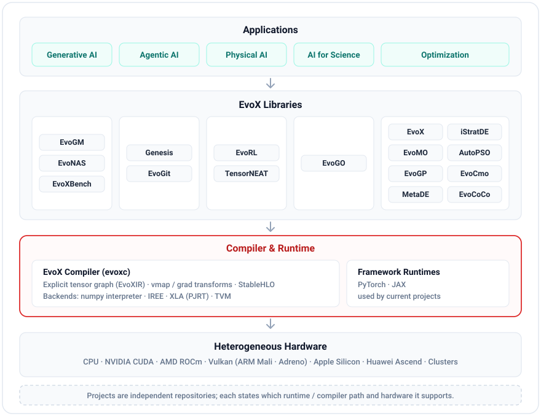

<h1 align="center">
  <picture>
    <source media="(prefers-color-scheme: dark)" srcset="docs/source/_static/evox_brand_light.svg">
    <source media="(prefers-color-scheme: light)" srcset="docs/source/_static/evox_brand_dark.svg">
    
  </picture>
</h1>

<h3 align="center">The Infrastructure for Evolutionary AI Systems</h3>
<p align="center">
  <em>Enabling intelligence to adapt, create, and evolve across digital and physical worlds.</em>
</p>

<div align="center">
  <a href="https://evox.group"></a>
  <a href="https://evox.group/libs"></a>
  <a href="https://evox.readthedocs.io/en/latest/index.html"></a>
  <a href="https://discord.gg/Vbtgcpy7G4"></a>
  <a href="https://qm.qq.com/q/vTPvoMUGAw"></a>
</div>

<p align="center">
  <a href="#02--ecosystem"><strong>Ecosystem</strong></a> ·
  <a href="#03--architecture"><strong>Architecture</strong></a> ·
  <a href="https://evox.group"><strong>Website</strong></a> ·
  <a href="https://evox.readthedocs.io/en/latest/index.html"><strong>Documentation</strong></a>
</p>

<p align="center">
  <a href="./README.md"></a>
  <a href="./README_ZH.md"></a>
</p>

---

## 01 · Introduction

**EvoX** is open-source infrastructure for evolutionary AI systems. It brings together libraries, a compiler, and end-to-end systems that apply one loop — *generate candidates, evaluate them for real, keep what works, and build on it* — to models, agents, robots, scientific design, and optimization.

- **One loop, five application areas** — Generative AI, Agentic AI, Physical AI, AI for Science, and Optimization.
- **15+ open-source projects** with **140+ evolutionary algorithms** and **240+ benchmark problems / environments** across the ecosystem.
- **A shared compilation path** — the EvoX Compiler lowers explicit tensor graphs through IREE, XLA, and TVM to CPUs, NVIDIA and AMD GPUs, and Vulkan GPUs, including mobile and edge GPUs such as ARM Mali and Qualcomm Adreno.
- **Heterogeneous by design** — from a laptop CPU to GPU servers, mobile GPUs, and clusters.

---

## 02 · Ecosystem

| Area | What the ecosystem covers | Projects |
| :--- | :--- | :--- |
| **Generative AI** | Evolving the models themselves — model merging, generative optimization, and architecture search. | [EvoGM](https://github.com/EMI-Group/evogm) · [EvoNAS](https://github.com/EMI-Group/evonas) · [EvoXBench](https://github.com/EMI-Group/evoxbench) |
| **Agentic AI** | Long-horizon, autonomous software evolution driven by collaborating agents. | [EvoX Genesis](https://genesis.evox.group) · [EvoGit](https://github.com/BillHuang2001/evogit) |
| **Physical AI** | Evolving control policies and neural topologies through massively parallel simulation. | [EvoRL](https://github.com/EMI-Group/evorl) · [TensorNEAT](https://github.com/EMI-Group/tensorneat) |
| **AI for Science** | Data-driven black-box optimization for scientific and engineering design. | [EvoGO](https://github.com/EMI-Group/evogo) |
| **Optimization** | GPU-accelerated evolutionary algorithms, multi-objective optimization, genetic programming, and automated algorithm design. | [EvoX](https://github.com/EMI-Group/evox) · [EvoMO](https://github.com/EMI-Group/evomo) · [EvoGP](https://github.com/EMI-Group/evogp) · [MetaDE](https://github.com/EMI-Group/metade) · [iStratDE](https://github.com/EMI-Group/istratde) · [AutoPSO](https://github.com/EMI-Group/autopso) · [EvoCmo](https://github.com/785509490/EvoCmo) · [EvoCoCo](https://github.com/EMI-Group/evococo) |
| **Compiler & Infrastructure** | Compiling explicit tensor graphs to heterogeneous hardware through external ML compilers. | [EvoX Compiler (evoxc)](https://github.com/EMI-Group/evoxc) |

Every project is an independent repository with its own documentation. Browse them all at [**evox.group/libs**](https://evox.group/libs).

---

## 03 · Architecture

<p align="center">
  
</p>

| Layer | Role |
| :--- | :--- |
| **Applications** | The problems EvoX targets: Generative AI, Agentic AI, Physical AI, AI for Science, and Optimization. |
| **EvoX Libraries** | A group of independent projects, each focused on one class of problems. |
| **Compiler & Runtime** | The **EvoX Compiler** owns an explicit, inspectable tensor graph and its transforms, and hands StableHLO to IREE, XLA, or TVM for optimization and code generation. Projects also run on the **PyTorch** and **JAX** runtimes. |
| **Heterogeneous Hardware** | CPUs, NVIDIA and AMD GPUs, Vulkan GPUs (including ARM Mali and Qualcomm Adreno), Apple Silicon, Huawei Ascend, and clusters. |

> The diagram shows how the pieces relate, not a single mandatory stack — each project states which runtime or compiler path it uses.

---

## 04 · Hardware Support & Validation Scope

| Hardware | Status | How |
| :--- | :--- | :--- |
| **CPU** | Supported | PyTorch / JAX · EvoX Compiler (numpy interpreter, IREE, TVM) |
| **NVIDIA GPU** | Supported | CUDA via PyTorch / JAX · EvoX Compiler via IREE or XLA |
| **AMD GPU** | Supported | ROCm via PyTorch · EvoX Compiler via IREE or XLA |
| **Vulkan GPUs** (incl. ARM Mali, Qualcomm Adreno) | Supported via EvoX Compiler | IREE Vulkan-SPIRV, from desktop to mobile and edge devices |
| **Apple Silicon** | Supported via MPS | PyTorch MPS in eager mode; `torch.compile` has upstream limitations |
| **Huawei Ascend** | Project-level validation | Validated on selected operators and project workflows — not ecosystem-wide |
| **Multi-device / clusters** | Experimental | `torch.distributed`; compiler collectives are explicit graph ops, not yet compiled by any backend |

Exact coverage varies by project; each repository is the source of truth for its own validated hardware.

---

## 05 · Resources

- **Website**: [evox.group](https://evox.group) · [Ecosystem](https://evox.group/libs) · [News](https://evox.group/news)
- **Documentation**: [EvoX Docs](https://evox.readthedocs.io/en/latest/index.html) · [中文文档](https://evox.readthedocs.io/zh_CN/latest/index.html)
- **Community**: [GitHub Discussions](https://github.com/EMI-Group/evox/discussions) · [Discord](https://discord.gg/Vbtgcpy7G4) · [QQ Group](https://qm.qq.com/q/vTPvoMUGAw) (`297969717`)

### Citation

If EvoX contributes to your work, please cite:

```bibtex
@article{evox,
  title   = {{EvoX}: {A} {Distributed} {GPU}-accelerated {Framework} for {Scalable} {Evolutionary} {Computation}},
  author  = {Huang, Beichen and Cheng, Ran and Li, Zhuozhao and Jin, Yaochu and Tan, Kay Chen},
  journal = {IEEE Transactions on Evolutionary Computation},
  year    = {2024},
  doi     = {10.1109/TEVC.2024.3388550}
}
```

Individual projects list their own papers in their repositories.

### License

Each project is licensed in its own repository. See [LICENSE](./LICENSE) for this repository.
