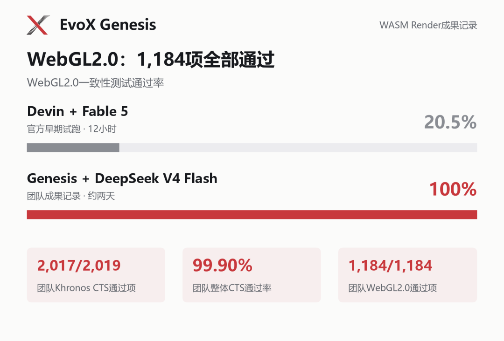

能否持续推进长周期任务、最终交付完整工程，正成为衡量AI能力的重要指标。Terminal-Bench是AI Agent领域的代表性评测基准之一，侧重终端环境中的程序与命令行任务。Terminal-Bench Challenges则将评测推进到从零构建完整软件项目，官方估计每项挑战的成本超过1,000美元。

EvoX团队推出的递归演化式AI系统EvoX Genesis，此次使用DeepSeek V4 Flash模型，耗时约**两天**、花费仅**36美元**模型费用完成WASM Render挑战，成为**全球首个提交该挑战成果的AI系统**。团队测试记录显示，Khronos CTS套件通过2,017/2,019项测试（99.90%），其中WebGL2.0一致性测试1,184/1,184项全部通过。

## 从局部代码到完整系统，难关在哪里？

WASM Render是Terminal-Bench Challenges中的一项图形系统挑战：让WebGL程序在没有浏览器、GPU和外部运行库的条件下运行。

这相当于用软件实现一套图形管线：读懂着色程序、算出图形，再让大量接口与状态变化保持一致。单个局部功能可用，距离整套系统配合起来工作，还有很长的路。该任务要求AI在多轮开发中持续对齐目标、处理模块依赖，依据测试反馈修正错误，最终完成系统集成与回归验证。

据Terminal-Bench团队公布的12小时早期试跑结果，Cognition的AI软件开发产品Devin搭配Fable 5，在更难的WebGL2.0一致性测试上通过率为20.5%。Genesis则在约两天开发后，将所运行的WebGL2.0一致性测试通过率推进到100%。

*WebGL2.0一致性测试结果与Genesis的Khronos CTS测试记录。*

Genesis公开的成果仓库包含约**13万行代码**，覆盖GLSL着色语言编译器、WebGL接口与状态管理、软件光栅化、图像呈现等模块。这些TypeScript实现经构建形成JavaScript渲染器，将语言处理、图形计算和接口行为串联起来。

本次开发最终通过2,017项Khronos CTS测试，模型token费用约为36美元，其中缓存命中率约98%。在较低模型成本下持续推进并集成如此大规模的软件工程，这也体现出Genesis利用经济型开源模型开展长周期开发的能力。

## 让项目持续演化，让Agent按需登场

Genesis是一套递归演化式AI系统。用户描述软件开发目标，系统围绕目标展开任务，让局部Agent在需要的位置承担工作，并将接受的代码与验证结果留在软件项目中。

面对大项目，一种直观的思路是为Agent加码：更长的上下文、更持久的会话、更复杂的预设协作。Genesis则把开发的连续性放在软件项目上——顶层目标与约束贯穿开发，任务随仓库结构递归展开。Agent处理局部工作、完成后退出，后续Agent从已经形成的项目继续。

此前，Genesis已从空仓库出发，构建出约25万行代码的C编译器，并开展了跨模型接续开发。本次WASM Render挑战的测试结果，进一步验证了Genesis在复杂图形系统开发中的自主构建与集成能力。

## 开源与社区

EvoX团队将持续深耕递归演化式AI系统，推动代码、验证结果与开发经验在开源社区中积累，让更多开发者参与可持续的软件演化，共同建设开放的软件开发生态。

🔗 Genesis仓库：[https://github.com/EMI-Group/genesis](https://github.com/EMI-Group/genesis)

📄 Genesis论文：[https://arxiv.org/abs/2608.10450](https://arxiv.org/abs/2608.10450)

✅ 挑战成果仓库：[https://github.com/BillHuang2001/tbench-wasm](https://github.com/BillHuang2001/tbench-wasm)

🔼 上游项目（EvoX）：[https://github.com/EMI-Group/evox](https://github.com/EMI-Group/evox)

🌐 QQ交流群：297969717
