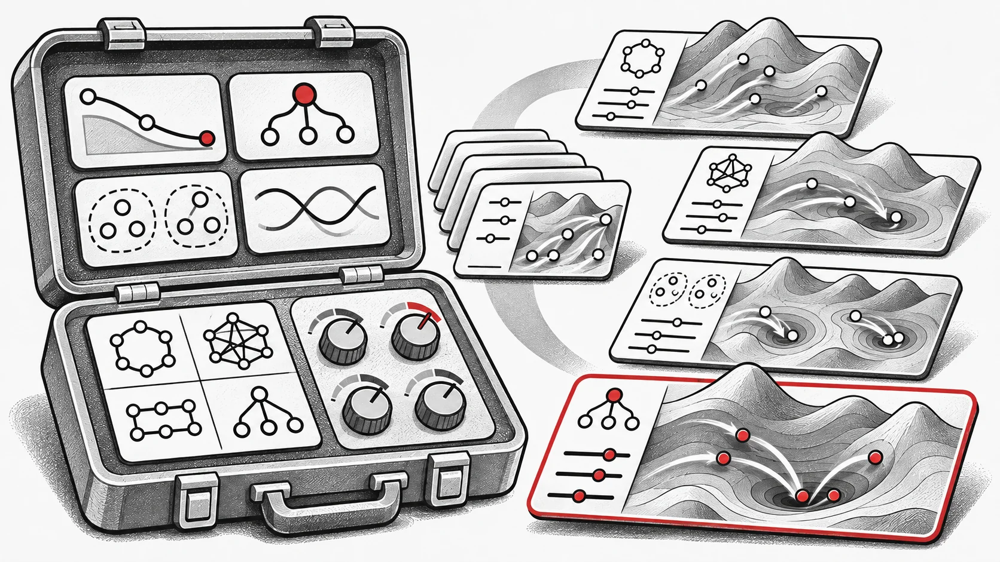

Un sistema di IA evolutiva deve decidere cosa cercare e come cercarlo. AutoPSO porta la seconda domanda nel ciclo di ottimizzazione: parametri, regole di apprendimento e organizzazione dello sciame diventano progetti candidati da valutare e migliorare per un compito.

Il framework **AutoPSO**, proposto dal team EvoX, codifica in modo uniforme la configurazione dei parametri, i meccanismi di apprendimento e la struttura dello sciame del PSO in uno spazio evolutivo ricercabile, e tramite **meta-evoluzione** cerca automaticamente una variante di PSO adatta per un dato problema target. Questo framework non solo ottimizza la soluzione del problema, ma, a un livello superiore, ottimizza automaticamente "quale PSO utilizzare per risolverlo".

La ricerca su larga scala della meta-evoluzione si affida a valutazioni massivamente parallele, e il calcolo tensorizzato, l'elaborazione a batch e il parallelismo GPU di EvoX risolvono proprio questo collo di bottiglia — migliaia di varianti candidate possono evolvere simultaneamente, rendendo concretamente praticabili ricerche a livello meta prima infeasibili sulle CPU.

**Potenza di calcolo GPU × meta-evoluzione spinge il PSO dalla "progettazione manuale" verso la "generazione automatica".**

## Al PSO non mancano metodi; manca la capacità di combinarli automaticamente

Negli ultimi decenni, la ricerca sul PSO ha accumulato un ricco insieme di opzioni meccistiche: come i parametri cambiano nel corso delle iterazioni, da quali individui le particelle apprendono, se lo sciame viene suddiviso in sottogruppi e quali strategie di aggiornamento adottano i diversi sottogruppi.

Il problema non è la carenza di meccanismi, ma il fatto che la maggior parte di essi esiste come algoritmi autonomi specifici per un dato problema. Davanti a un nuovo compito, i ricercatori devono ancora selezionare, combinare e verificare manualmente da un vasto insieme di meccanismi, per poi ri-calibrarli.

La filosofia di AutoPSO non è scartare questa conoscenza accumulata, ma riorganizzarla in uno spazio di componenti riutilizzabili. Il metodo decompone gli aspetti progettuali chiave del PSO in diversi moduli:

- come evolvono i parametri;

- da quali esempi le particelle apprendono;

- come lo sciame viene partizionato in sottogruppi;

- quali strategie di aggiornamento impiegano i diversi sottogruppi.

Negli approcci tradizionali, queste scelte sono fatte principalmente dall'uomo; in AutoPSO, diventano oggetti ricercabili dall'algoritmo. In altre parole, AutoPSO non consiste nel "reinventare manualmente un PSO", ma nel costruire un meta-framework che, prima di risolvere il problema corrente, possa configurare automaticamente una variante di PSO adatta a esso.

*Figura 1: AutoPSO organizza gli elementi progettuali chiave del PSO in moduli componibili e ricercabili.*

## Delegare all'algoritmo stesso l'ottimizzazione di livello esterno, tradizionalmente svolta dai ricercatori

La ricerca sull'ottimizzazione convenzionale ha sempre posseduto una struttura a due livelli. Al livello interno, il PSO viene usato per risolvere il problema target — sia esso ottimizzazione di funzioni, progettazione ingegneristica o politiche di controllo. Al livello esterno esiste un'ottimizzazione meno esplicita: i ricercatori stanno ottimizzando l'algoritmo stesso.

Quali regole di aggiornamento scegliere, come impostare i parametri, quali esempi di apprendimento adottare, se introdurre meccanismi di sottogruppo, quali meccanismi possano essere combinati e quali combinazioni risultino instabili — queste decisioni sono state tipicamente prese dai ricercatori sulla base dell'esperienza e poi affinate attraverso tentativi ed errori.

Il cambiamento chiave apportato da AutoPSO è delegare all'algoritmo questo processo di livello esterno, in precedenza svolto manualmente dai ricercatori. Una particella di livello esterno non rappresenta più una soluzione candidata al problema target, bensì un progetto candidato di PSO, che codifica parametri, esempi di apprendimento, partizionamento in sottogruppi e strategie di aggiornamento. Il PSO di livello interno, dotato di queste configurazioni, risolve il problema target e restituisce le proprie prestazioni come feedback al livello esterno, che prosegue di conseguenza la ricerca di configurazioni algoritmiche migliori.

**AutoPSO non solo ottimizza la soluzione del problema, ma ottimizza anche "quale PSO utilizzare per risolverlo".**

Trasforma il processo di progettazione algoritmica, un tempo affidato all'esperienza dei ricercatori, in un processo evolutivo interno al sistema, che può essere ricercato, valutato e iterato automaticamente.

*Figura 2: Il livello esterno cerca configurazioni dell'algoritmo, mentre il livello interno utilizza la configurazione scelta per risolvere il problema target.*

## EvoX e GPU: rendere davvero fattibile la progettazione automatica di algoritmi

Proporre un framework di ricerca automatica per strutture algoritmiche non è particolarmente difficile; la vera sfida sta nel costo computazionale. Valutare un progetto candidato di PSO richiede di eseguirlo su un processo completo di soluzione del problema target. Più progetti candidati ci sono, maggiore è il carico computazionale del livello interno.

Negli ambienti seriali tradizionali basati su CPU, tali costi sono proibitivi. Questo tipo di calcolo è però intrinsecamente parallelizzabile: gli algoritmi candidati possono essere valutati contemporaneamente e, all'interno di ciascun algoritmo candidato, anche gli aggiornamenti delle particelle possono essere elaborati in batch. AutoPSO sfrutta EvoX per mappare la struttura delle popolazioni del calcolo evolutivo sulla capacità di elaborazione a batch delle GPU, consentendo alla ricerca di configurazioni del livello esterno e alla soluzione del problema del livello interno di procedere simultaneamente.

L'elaborazione in batch sulla GPU permette di confrontare più progetti PSO entro un budget temporale. La qualità dipende anche dai componenti disponibili, dall'affidabilità delle valutazioni e dall'allocazione del budget. AutoPSO cerca un progetto adatto al compito in questo spazio; più candidati non garantiscono un algoritmo globalmente ottimale.

Il valore di EvoX sta proprio nel fornire questa capacità: esso organizza gli aggiornamenti delle particelle e le valutazioni di fitness del livello interno, nonché il confronto degli algoritmi candidati del livello esterno, in operazioni tensoriali su GPU, permettendo a migliaia di progetti candidati di avanzare in sincronia a ogni iterazione. In altre parole, EvoX trasforma la meta-evoluzione da un processo di "lento tentativo ed errore" a una "sperimentazione parallela su larga scala" — ed è proprio su questa base computazionale che AutoPSO si fonda.

## Non solo più veloce, ma anche più abile nell'"usare la ricerca"

Ciò che AutoPSO intende dimostrare non è semplicemente che gira veloce sulle GPU, ma che, una volta automatizzato il processo di progettazione del PSO, l'algoritmo può effettivamente scoprire una strategia di ricerca più adatta al problema specifico.

Sul benchmark di ottimizzazione numerica CEC2022, il team EvoX ha confrontato AutoPSO con il PSO originale, CSO, CLPSO, FIPS e diverse varianti di PSO ad apprendimento sociale. A parità di budget di tempo di esecuzione, molte varianti di PSO a struttura fissa hanno mostrato un rapido declino iniziale dei valori obiettivo ma una tendenza a ristagnare prematuramente. Al contrario, AutoPSO è riuscito ad adeguare continuamente la configurazione del PSO di livello interno durante l'esecuzione, mantenendo una tendenza di miglioramento più stabile su più funzioni.

Il team ha inoltre effettuato confronti a parità di numero di valutazioni di funzione, e AutoPSO ha comunque ottenuto prestazioni superiori. Ciò indica che il suo vantaggio deriva da un'organizzazione più efficace del processo di ricerca, e non dal semplice consumo di maggiori risorse computazionali.

*Figura 3: Risultati sperimentali sul benchmark di ottimizzazione numerica CEC2022.*

Il team di ricerca ha inoltre applicato AutoPSO a compiti di controllo robotico basati su neuroevoluzione. Rispetto all'ottimizzazione di funzioni numeriche, tali compiti sono molto più vicini alle applicazioni reali: coinvolgono parametri di policy ad alta dimensione, rumore significativo nel feedback, paesaggi obiettivo irregolari e informazioni di gradiente non sempre disponibili.

Su più ambienti di controllo robotico Brax, AutoPSO ha ottenuto un miglioramento più rapido dei reward e migliori prestazioni finali. Ciò suggerisce che AutoPSO non sia semplicemente un insieme di euristiche tarate su una specifica classe di funzioni, bensì un approccio pratico e trasferibile alla costruzione automatica di algoritmi.

*Figura 4: Risultati sperimentali sui problemi di controllo robotico Brax.*

Il valore di EvoX si dimostra nel modo più diretto negli esperimenti di scalabilità. La struttura a due livelli di AutoPSO comporta naturalmente una dimensione maggiore della popolazione: il livello esterno ospita molti algoritmi candidati e ciascun algoritmo candidato al livello interno ha il proprio sciame di particelle. Con l'esecuzione seriale tradizionale, il tempo di calcolo necessario diverrebbe rapidamente proibitivo.

Sulle GPU, invece, aumentando la dimensione totale della popolazione di un fattore 100, il tempo di esecuzione cresce solo di un fattore di circa 3. Nei test a 8192 dimensioni, AutoPSO mantiene un sovraccarico temporale accettabile e ottiene un'accelerazione di un ordine di grandezza rispetto all'esecuzione su CPU.

*Figura 5: Impatto della scalatura della dimensione della popolazione sul tempo di esecuzione.*

## AutoPSO non spreca né potenza di calcolo né conoscenze storiche

Invece di sostituire la ricerca algoritmica con la pura potenza di calcolo, AutoPSO trasforma i risultati di ricerca a lungo accumulati in asset di progettazione operativi. I meccanismi efficaci un tempo dispersi tra diverse varianti di PSO vengono astratti in componenti riutilizzabili, mentre le decisioni combinatorie che prima si affidavano all'esperienza umana vengono delegate alla meta-evoluzione per la validazione su compiti specifici.

Tre elementi sono indispensabili: la conoscenza storica fornisce lo spazio di ricerca; l'ottimizzazione automatica gestisce la ricerca combinatoria; EvoX, insieme al parallelismo GPU, fornisce la capacità di valutazione su larga scala. Senza conoscenza storica, alla ricerca mancano candidati promettenti; senza ottimizzazione automatica, la conoscenza difficilmente può essere riorganizzata per il compito concreto; senza calcolo parallelo, la scala della ricerca non può essere sostenuta.

AutoPSO libera i ricercatori dalla ripetitiva calibrazione dei parametri e dai tentativi ed errori, indirizzando i loro sforzi verso attività di maggior valore: definire componenti, progettare spazi di ricerca e costruire pipeline di valutazione più affidabili.

## Dal modificare algoritmi al costruire sistemi che generano algoritmi

AutoPSO mostra il ruolo di EvoX nella progettazione sperimentale degli algoritmi. I ricercatori definiscono componenti utili e valutazioni affidabili; la ricerca per popolazioni esplora le combinazioni. Il calcolo parallelo sostiene così la costruzione di algoritmi adatti al compito, fondata sulle prestazioni misurate.

## Risorse

- [Articolo scientifico](https://arxiv.org/abs/2608.07539)
- [GitHub](https://github.com/EMI-Group/autopso)
- [EvoX](https://github.com/EMI-Group/evox)
