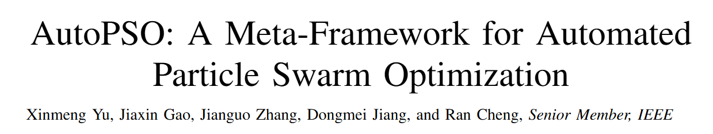

*2026年11月7日更新。過去の結果は元の記録日時に基づきます。*

進化型 AI システムは、何を探すかと、どう探すかを決める必要があります。AutoPSO は後者を最適化ループに取り込みます。パラメータ、学習規則、群の構成を候補設計として評価し、対象課題に合わせて改善します。

EvoXチームが提案する**AutoPSO**は、PSOのパラメータ設定、学習メカニズム、群構造を検索可能な進化空間へと統一的にエンコードし、**メタ進化**（meta-evolution）によって特定の目的問題に合わせた適切なPSO変種を自動的に探索します。このフレームワークは問題の解を最適化するだけでなく、より高い次元で「どのPSOを使って解くか」を自動的に最適化します。

メタ進化における大規模探索は大量の並列評価に依存しますが、EvoXのテンソル化計算、バッチ処理、GPU並列性がまさにこのボトルネックを解決します——数千の候補変種が同時に進化でき、CPUでは実行不可能だったメタレベルの探索が現実のものになります。

**GPUコンピューティングパワー×メタ進化は、PSOを「手作業による設計」から「自動生成」へと導きます。**

## PSOに不足しているのは手法ではなく、それらを自動的に組み合わせる能力

過去数十年間、PSO研究は豊富な機構の選択肢を蓄積してきました。パラメータを反復に応じてどう変化させるか、粒子は誰から学ぶか、群をサブ群に分割するか、各サブ群がどの更新戦略を採用するか、といった具合です。

問題は機構が足りないことではなく、それらの多くが特定の問題向けの独立したアルゴリズムとして存在していることです。新しいタスクに直面すると、研究者は依然として大量の機構の中から手動で選択・組み合わせ・検証し、再調整する必要があります。

AutoPSOの思想は、これらの蓄積を捨てることではなく、再利用可能なコンポーネント空間として再構成することです。PSOの鍵となる設計をいくつかのモジュールに分解します：

- パラメータをどう進化させるか；

- 粒子はどの範例から学ぶか；

- 群をどうサブ群に分割するか；

- 各サブ群がどの更新戦略を採用するか。

従来のアプローチでは、これらの選択は主に人間が行ってきました。AutoPSOでは、それらがアルゴリズムによる検索対象になります。言い換えれば、AutoPSOは「手作業でPSOを作り直す」ことではなく、現在の問題を解く前に、それに適したPSO変種を自動的に構成できるメタフレームワーク（meta-framework）を構築することです。

*図1：AutoPSOはPSOの鍵となる設計要素を、組合せ可能で検索可能なモジュールとして組織化します。*

## 研究者が行ってきた「外側の最適化」も、アルゴリズム自身に委ねる

従来の最適化研究は、常に二層構造を持ってきました。内層ではPSOを使って目的問題を解きます——関数最適化、工学設計、制御ポリシーなどです。外層には、それほど明示的ではないもう一つの最適化が存在します。研究者がアルゴリズム自体を最適化しているのです。

どの更新規則を選ぶか、パラメータをどう設定するか、どの学習範例を採用するか、サブ群機構を導入するか、どの機構を組み合わせられるか、どの組み合わせが不安定か——これらの意思決定は、これまで主に研究者の経験に基づいて行われ、試行錯誤を通じて洗練されてきました。

AutoPSOがもたらす重要な転換は、この従来研究者が手作業で行ってきた外層のプロセスを、アルゴリズムに委ねることです。外層の粒子は、もはや目的問題の候補解ではなく、パラメータ、学習範例、サブ群分割、更新戦略をエンコードした候補PSO設計を表します。これらの構成を与えられた内層のPSOが目的問題を解き、その性能を外層へフィードバックし、外層はそれに基づいてより優れたアルゴリズム構成の探索を続けます。

**AutoPSOは問題の解を最適化するだけでなく、「この問題を解くのにどのPSOを使うか」をも最適化します。**

かつて研究者の経験に依存していたアルゴリズム設計プロセスを、自動的に検索・評価・反復できるシステム内部の進化プロセスへと変換するのです。

*図2：外層はアルゴリズム構成を探索し、内層はその構成を用いて目的問題を解きます。*

## EvoXとGPUが、自動アルゴリズム設計を現実のものにする

アルゴリズム構造の自動探索フレームワークを提案すること自体はそれほど難しくありません。本当の難しさは計算コストにあります。候補PSO設計を評価するには、目的問題の求解プロセスを完了まで実行する必要があり、候補設計が増えるほど内層の計算負荷は増大します。

従来のCPUベースの逐次実行環境では、このコストは法外なものになります。しかし、この種の計算は本質的に並列化に適しています。候補アルゴリズムは並行して評価でき、各候補アルゴリズム内部の粒子更新もバッチ処理できます。AutoPSOはEvoXを活用し、進化計算の種群構造をGPUのバッチ処理能力へとマッピングすることで、外層の構成探索と内層の問題求解を同時に進行させます。

GPU バッチ処理により、時間予算内に比較できる PSO 設計の数が増えます。ただし探索品質は部品集合、評価の信頼性、予算配分にも依存します。AutoPSO は定義された探索空間で課題に適した設計を探すもので、候補数の増加は大域的に最適なアルゴリズムを保証しません。

EvoXの価値はまさにこの能力の提供にあります。内層の粒子更新と適応度評価、そして外層の候補アルゴリズム比較を、すべてGPU上のテンソル演算として組織し、数千の候補設計が各イテレーションで同期して前進できるようにします。言い換えれば、EvoXはメタ進化を「ゆっくりした試行錯誤」から「大規模並行実験」へと変換します——これこそがAutoPSOが成立する計算基盤です。

## より速いだけでなく、「探索の使い方」も上手く

AutoPSOが示したいのは、GPU上で高速に動作することだけではありません。PSOの設計プロセスが自動化されると、アルゴリズムが現在の問題により適した探索戦略を本当に発見できるのか、ということです。

CEC2022数値最適化ベンチマークにおいて、EvoXチームはAutoPSOをオリジナルのPSO、CSO、CLPSO、FIPS、および社会学習PSOのいくつかの変種と比較しました。同じ実行時間予算の下では、固定構造のPSO変種の多くは目的値が初期に急速に下降した後、早い段階で停滞する傾向がありました。対照的に、AutoPSOは実行中に内層PSOの構成を継続的に調整し、複数の関数においてより安定した改善傾向を維持しました。

研究チームはさらに、同じ関数評価回数の下での比較も行い、AutoPSOは依然として優れた性能を達成しました。これは、その利点がより多くの計算資源の消費ではなく、探索プロセスのより効果的な組織化に由来することを示しています。

*図3：CEC2022数値最適化問題における実験結果。*

研究チームはさらに、AutoPSOをニューロエボリューションによるロボット制御タスクに適用しました。数値関数最適化と比べ、この種のタスクは実際の応用にずっと近いものです。高次元のポリシーパラメータ、大きなフィードバックノイズ、不規則な目的地形、そして常に利用できるとは限らない勾配情報が含まれます。

複数のBraxロボット制御環境において、AutoPSOはより速い報酬の向上と、より優れた最終性能を実現しました。これは、AutoPSOが特定の関数クラスに合わせたヒューリスティクスの集合ではなく、実用的で移植可能な自動アルゴリズム構築アプローチであることを示唆しています。

*図4：Braxロボット制御問題における実験結果。*

EvoXの価値が最も直接的に示されるのは、スケーラビリティ実験です。AutoPSOの二層構造は本質的に、より大きな種群サイズを伴います。外層には多くの候補アルゴリズムがあり、内層の各候補アルゴリズムにはそれぞれ独自の粒子群があります。従来の逐次実行では、必要な計算時間はすぐに耐え難いものになるでしょう。

しかしGPU上では、総種群サイズを100倍に拡大しても、実行時間は約3倍しか増加しません。8192次元のテストでも、AutoPSOは許容範囲内の時間オーバーヘッドを維持し、CPUベースの実行に対して桁違いの高速化を達成しています。

*図5：種群サイズのスケーリングが実行時間に与える影響。*

## 計算資源を無駄にせず、歴史的知見も無駄にしない

AutoPSOは、生の計算能力によってアルゴリズム研究を置き換えるのではなく、長年蓄積された研究成果を運用可能な設計資産へと変換します。かつて様々なPSO変種に散在していた有効な機構は再利用可能なコンポーネントとして抽象化され、かつて人間の経験に依存していた組み合わせの意思決定は、メタ進化によって具体的なタスク上で検証されます。

歴史的研究が探索空間を提供し、自動最適化が組み合わせ探索を担い、EvoXとGPU並列性が大規模な評価能力を供給します。三つの要素はどれも欠かせません。歴史的知見がなければ探索には有望な候補が不足し、自動最適化がなければ知見をタスクに合わせて再組織化することは困難で、並列計算がなければ探索規模を維持できません。

AutoPSOは研究者を反復的なパラメータ調整と試行錯誤から解放し、より価値のある作業——コンポーネントの定義、探索空間の設計、より信頼性の高い評価パイプラインの構築——へと向かわせます。

## アルゴリズムを改変することから、アルゴリズムを生み出すシステムの構築へ

AutoPSO は、アルゴリズム設計を実験的に探索するための EvoX の役割を示します。研究者が有用な部品と信頼できる評価を定義し、集団探索がその組み合わせを調べます。並列計算によって、測定した性能に基づく課題別のアルゴリズム構築を支えます。

## 関連資料

- [論文](https://arxiv.org/abs/2608.07539)
- [GitHub](https://github.com/EMI-Group/autopso)
- [EvoX](https://github.com/EMI-Group/evox)
