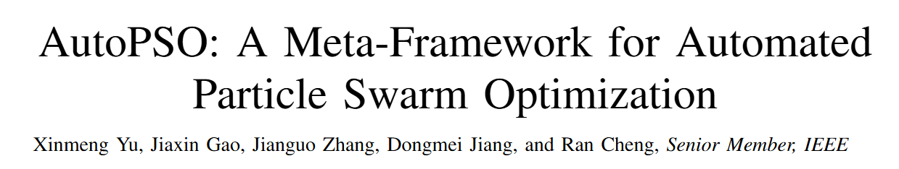
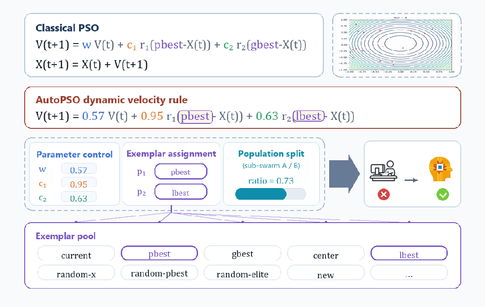
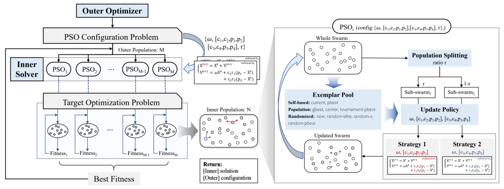
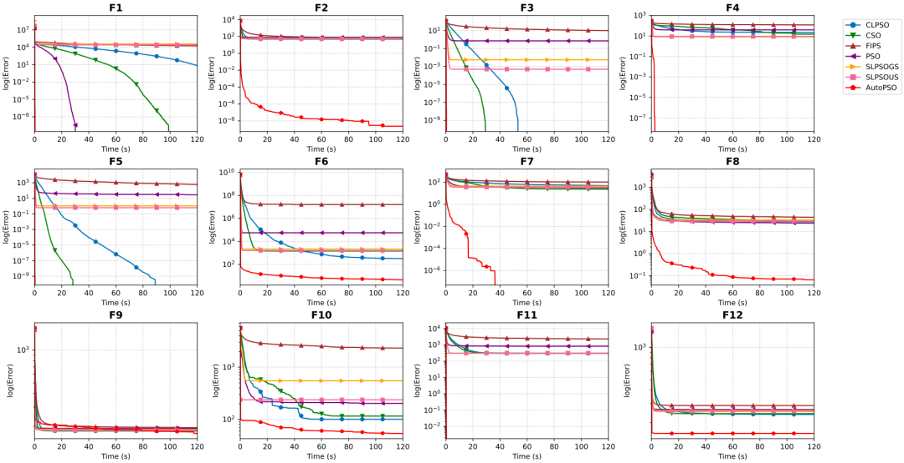
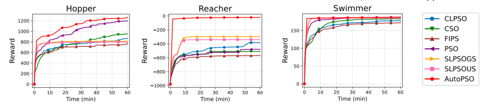
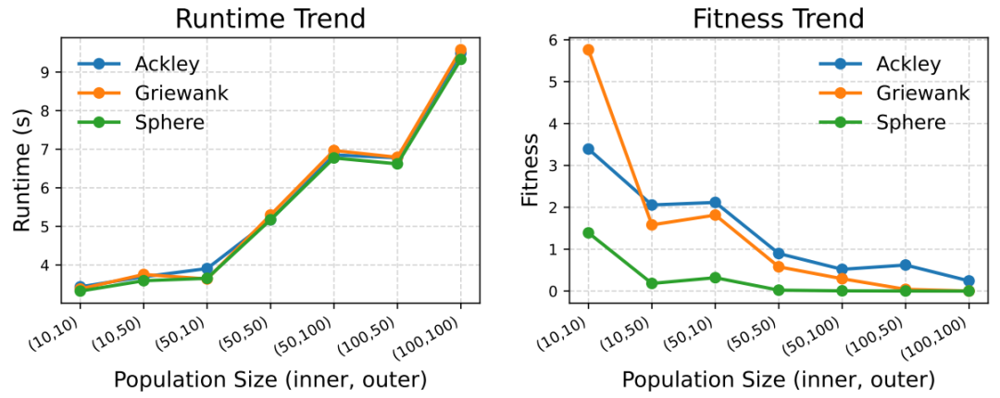

*更新于 2026 年 11 月 7 日。历史结果保留其原始记录日期。*

演化式 AI 系统既需要决定搜索什么，也需要决定如何搜索。AutoPSO 将后一个问题纳入优化循环：参数、学习规则与种群组织方式，都可以成为面向具体任务接受评价和改进的候选设计。

EvoX团队提出的**AutoPSO**，将PSO的参数配置、学习机制与群体结构统一编码为一个可搜索的演化空间，并通过**元演化**（meta-evolution）自动寻找适配特定目标问题的合适的PSO变体。这一框架不仅优化了问题的解，还在更高一层自动优化了"用什么样的PSO求解"。

元演化的大规模搜索依赖大量并行评估，而EvoX的张量化计算、批量处理与GPU并行能力恰好解决了这一瓶颈——数千候选变体可同时演化，使CPU上原本不可行的元层搜索成为现实。

**GPU算力×元演化，让PSO从"人工设计"走向"自动生成"。**

## PSO不缺方法，缺的是自动组合方法的能力

过去几十年，PSO研究已积累了丰富的机制选项：参数如何随迭代变化、粒子向谁学习、群体是否划分子群、不同子群采用何种更新策略。

问题不在于机制不够，而在于这些机制大多以面向特定问题的独立算法形式存在。面对新的任务，研究者仍要从大量机制中手动选择、组合、验证，再重新调整。

AutoPSO的思路不是丢掉这些积累，而是把它们重新整理成一个可复用的组件空间。它将PSO的关键设计拆解为多个模块：

- 参数如何演化；

- 粒子向谁学习；

- 群体如何划分子群；

- 不同子群采用何种更新策略。

传统方法中，这些选择主要由人来完成；在AutoPSO中，它们变成了算法可以搜索的对象。换句话说，AutoPSO并非"手工再造一个PSO"，而是构建一个在求解当前问题之前，能够自动为其配置合适PSO变体的元框架（meta-framework）。

*图1：AutoPSO将PSO的关键设计组织为可组合、可搜索的模块。*

## 把研究者做的"外层优化"，也交给算法

传统优化研究一直带有一种双层结构。内层是在用PSO求解目标问题——函数优化、工程设计或控制策略；外层还存在着不那么显性的优化：研究者在优化算法本身。

选择什么更新规则、怎样设置参数、采用哪种学习对象、要不要引入子群机制、哪些机制可以组合、哪些组合不稳定——这些过去通常由研究者根据经验判断，再通过实验不断试错。

AutoPSO的关键转变，就是把这个原本由研究者手工完成的外层过程，也交给算法来做。一个外层粒子不再表示目标问题的一个候选解，而是表示一种候选PSO设计，编码了参数、学习对象、子群划分和更新策略。内层PSO拿着这些配置求解目标问题，并将表现反馈给外层，外层据此继续搜索更好的算法配置。

**AutoPSO不仅优化问题的解，更在优化"用什么样的PSO去求解这个问题"。**

它将过去依赖研究者经验的算法设计过程，转化成了一个可自动搜索、自动评估、自动迭代的系统内部演化过程。

*图2：外层搜索算法配置，内层使用该配置求解目标问题。*

## EvoX和GPU，让自动算法设计真正可行

提出自动搜索算法结构并不难，真正的难点在于计算成本。比较一套候选PSO设计，意味着先让它完整跑完一次目标问题求解；候选方案越多，内层运算量越大。

在传统CPU串行环境下，这样的代价很高。但这类计算天然适合并行：候选算法并行评估，候选算法内部的粒子也可以批量更新。AutoPSO借助EvoX，将演化计算的种群结构映射到GPU的批处理能力上，使外层配置搜索与内层任务求解能够同时推进。

GPU 批处理使同一时间预算内能够比较更多候选 PSO 设计。搜索质量还取决于组件池、评价可靠性和预算分配。AutoPSO 寻找的是给定搜索空间内适合目标任务的设计，评价更多候选并不保证得到全局最优算法。

EvoX的价值正在于提供这种能力：它把内层的粒子更新、适应度评估，以及外层的候选算法比较，全部组织成GPU上的张量运算，使数千个候选设计可以在同一轮迭代中同步推进。换句话说，EvoX让元演化从"慢慢试"变成"大规模并行试"——这正是AutoPSO得以成立的计算基础。

## 不仅更快，也更会"用搜索"

AutoPSO想证明的并不是"GPU上跑得快"这么简单，而是当PSO的设计过程被自动化之后，算法能不能真正找到更适合当前问题的搜索方式。

在CEC2022数值优化基准上，EvoX团队将AutoPSO与原始PSO、CSO、CLPSO、FIPS以及社会学习PSO的不同版本进行比较。在相同运行时间预算下，很多固定结构的PSO变体前期下降较快、随后容易停滞；AutoPSO则能在运行过程中持续调整内层PSO的配置，在多个函数上保持更稳定的改进趋势。

研究团队还在相同函数评估次数下比较，AutoPSO仍表现更优，说明其优势来自更有效地组织搜索，而不只是消耗更多计算。

*图3：CEC2022数值优化问题上的实验结果。*

研究团队进一步将AutoPSO应用于神经演化机器人控制任务中。相比数值函数，这类任务更接近真实应用：策略参数维度高、反馈噪声大、目标函数不规则，梯度信息也并非总是可得。

在多个Brax机器人控制环境中，AutoPSO取得了更快的奖励提升和更好的最终表现。这说明它不只是为某一类函数定制的技巧，而是一种具有实际迁移潜力的自动算法构造方法。

*图4：Brax机器人控制问题上的实验结果。*

EvoX的价值在可扩展性实验中体现得尤为直接。AutoPSO的双层结构天然会带来更大的种群规模：外层有许多候选算法，内层每个候选算法又有自己的粒子群。若按传统串行方式，所需的计算时间将迅速变得不可承受。

但在GPU上，总种群规模扩大100倍时，运行时间只增加约3倍；在8192维测试中，AutoPSO仍能保持可接受的时间开销，并相比CPU获得数量级加速。

*图5：种群规模扩展对运行时间的影响。*

## 不浪费算力，也不浪费历史知识

AutoPSO并非以算力取代算法研究，而是把长期积累的研究成果转化为可操作的设计资产。过去散落在不同PSO变体中的有效机制，被抽象为可复用的组件；过去依赖经验完成的组合判断，被交给元演化在具体任务中验证。

历史研究提供搜索空间，自动优化负责寻找组合，EvoX与GPU提供并行评估能力。三者缺一不可：没有历史知识，搜索缺少有价值的候选；没有自动优化，知识难以针对任务重组；没有并行计算，搜索规模又难以支撑。

AutoPSO让研究者从重复的参数试错中抽身，转而投入到更有价值的工作：定义组件、设计搜索空间，以及建立更可靠的评估流程。

## 从改算法，到构建会产生算法的系统

AutoPSO 展示了 EvoX 在算法设计中的作用：让“如何构造优化器”成为可以开展实验的搜索问题。研究者定义有价值的组件和可靠的评价方式，种群搜索探索它们的组合。并行计算支撑这一过程，使算法构造能够围绕任务反馈持续改进。

## 相关资源

- [研究论文](https://arxiv.org/abs/2608.07539)
- [GitHub](https://github.com/EMI-Group/autopso)
- [EvoX](https://github.com/EMI-Group/evox)
