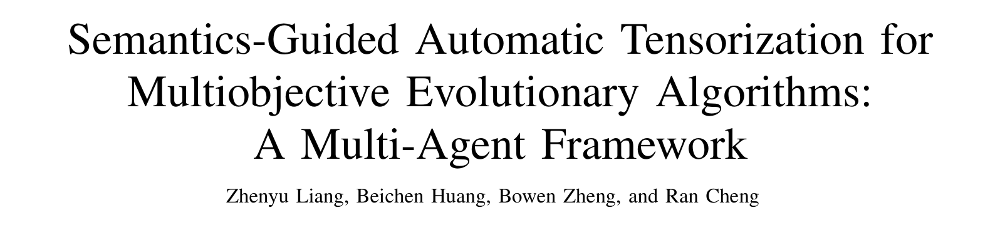
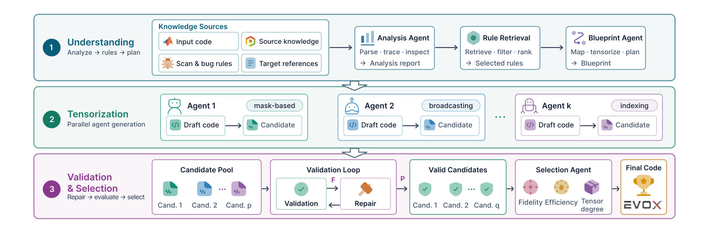
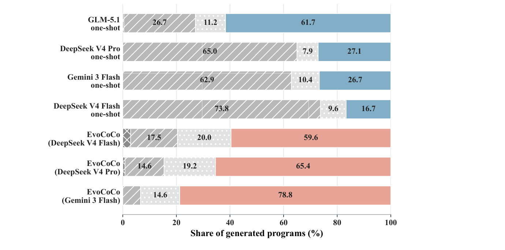
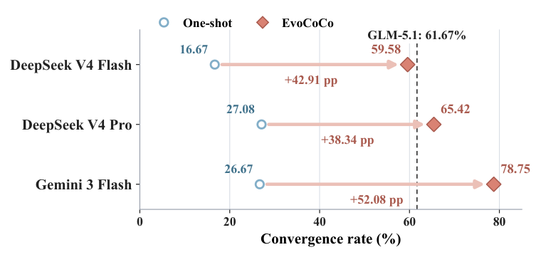
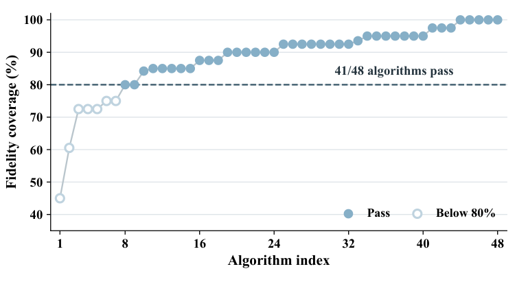
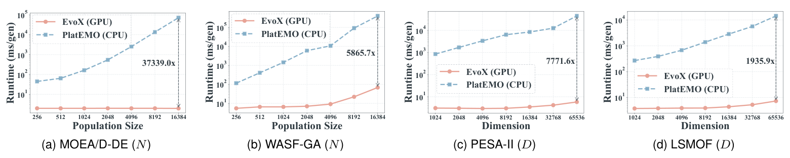

Un algorithme évolutionnaire multiobjectif (MOEA) implémenté en MATLAB peut-il être confié tel quel à un grand modèle de langage et réécrit automatiquement en un programme accéléré par GPU ? En apparence, il suffirait de remplacer MATLAB par PyTorch, les tableaux par des tenseurs et les boucles par des opérations par lots. La véritable difficulté réside pourtant dans la sémantique de l'algorithme : quels calculs peuvent s'exécuter en parallèle, lesquels dépendent d'un ordre qui doit être préservé, quelles variables sont temporaires et lesquelles portent un état d'une génération à l'autre. Si ces distinctions sont erronées, le code converti peut s'exécuter tout en implémentant un algorithme différent.

L'équipe EvoX propose EvoCoCo (Evolutionary Code Conversion), un cadre multi-agents de tensorisation automatique guidée par la sémantique. Il comprend d'abord l'algorithme source, puis explore différentes implémentations tensorisées, et utilise enfin le retour d'exécution pour valider, réparer et sélectionner les candidats. EvoCoCo a été évalué sur 48 MOEA selon trois dimensions : la fiabilité de la migration, la fidélité d'optimisation et l'extensibilité calculatoire. La couverture globale de fidélité d'optimisation atteint 88.2%. Les accélérations médianes sont de 22.6× lors de l'agrandissement de la taille de population et de 80.2× lors de l'agrandissement de la dimension des variables de décision. À plus grande échelle, l'algorithme représentatif MOEA/D-DE atteint une accélération de 37,339×.

## Ce qui est vraiment difficile à porter sur GPU, ce n'est pas la syntaxe

Les MOEA offrent un parallélisme important au niveau de la population. L'évaluation des objectifs, la mutation, le tri, la sélection environnementale et les opérations d'archivage traitent souvent des lots de solutions candidates ou des relations au sein d'une population, ce qui les rend bien adaptés à une exécution parallèle par calcul tensoriel sur GPU.

Le parallélisme d'un algorithme ne signifie pas que son implémentation existante est prête pour une exécution sur GPU. Dans PlatEMO, par exemple, le code MATLAB combine opérations vectorisées, boucles au niveau des individus, conteneurs dynamiques, branchements conditionnels, extraction itérative des fronts non dominés, découpage d'objets et diverses fonctions auxiliaires. Déplacer ce code vers un GPU exige de réorganiser les représentations de données, le flux de contrôle et les mises à jour d'état. Cela va bien au-delà d'un simple remplacement de syntaxe.

Le défi consiste à identifier quelles structures définissent l'algorithme d'origine :

- Quelles variables représentent un état d'algorithme persistant d'une génération à l'autre ?
- Quels calculs peuvent être réécrits à l'aide de diffusion (broadcasting), de masques ou d'indexation par lots ?
- Quelles boucles contiennent de véritables dépendances séquentielles et doivent être préservées ?
- Quelles modifications de l'état et des relations de mise à jour altéreraient le mécanisme d'optimisation ?

EvoCoCo répond précisément à ces questions. La conversion peut modifier les dispositions de données, le flux de contrôle et les stratégies d'exécution, tout en préservant les opérateurs fondamentaux, l'état persistant, les dépendances et la logique de mise à jour de l'algorithme. Cela établit la frontière entre ce que la tensorisation automatique peut restructurer et ce qu'elle doit préserver.

## La tensorisation automatique exige plus qu'une génération de code en une fois

EvoCoCo découpe la conversion du code en trois étapes : compréhension, tensorisation, puis validation et sélection. Aucun agent unique n'assure la conversion de bout en bout. L'algorithme source est analysé une seule fois pour produire une représentation sémantique partagée. Les candidats tensorisés sont ensuite générés à partir de cette même représentation et du même plan. Cela sépare la compréhension de l'algorithme de la génération des implémentations.

*Figure 1. Architecture multi-agents d'EvoCoCo. Le Source Analysis Agent reconstruit la sémantique de l'algorithme, le Rule Retriever récupère les règles de migration et le Blueprint Agent établit un plan de tensorisation. Plusieurs Tensorization Agents génèrent des candidats en parallèle sous des contraintes partagées. Le retour d'exécution pilote la réparation, et le Selection Agent opère la sélection finale.*

Étape 1 : compréhension. Le Source Analysis Agent reconstruit la sémantique de l'algorithme source, en identifiant ses opérateurs fondamentaux, son état persistant, ses dépendances et sa logique de mise à jour. Le Rule Retriever récupère les règles de migration pertinentes selon la structure de l'algorithme. Le Blueprint Agent établit ensuite un plan de tensorisation partagé qui précise comment l'état est mis en correspondance, comment le calcul est restructuré et quelles contraintes le cadre cible doit satisfaire.

Étape 2 : tensorisation. Sous le même plan, k Tensorization Agents génèrent des candidats en parallèle, avec des emphases différentes sur la diffusion, l'optimisation par einsum, les opérations masquées, les mises à jour sur place, les opérateurs tensoriels avancés et la tensorisation de la sélection itérative. Ils explorent différentes implémentations computationnelles du même algorithme, en s'appuyant sur la compréhension partagée du code source, et non en réinterprétant chacun le code source indépendamment.

Étape 3 : validation et sélection. Les programmes candidats subissent des vérifications statiques et une validation à l'exécution. Les problèmes d'interface, de forme de tenseurs, de dispositif, de numérique ou de flux de contrôle exposés pendant l'exécution sont renvoyés au Repair Agent pour une réparation supplémentaire. Parmi les candidats validés, le Selection Agent choisit l'implémentation finale en tenant compte des résultats d'optimisation, du temps d'exécution et du degré de tensorisation.

L'idée clé est de partager la compréhension de l'algorithme source tout en autorisant des implémentations GPU diverses.

## Le retour d'exécution fait converger le processus de conversion

La traduction en une fois comprime la compréhension sémantique, l'adaptation au cadre et la conception de la tensorisation en une unique étape de génération. Une erreur dans l'un de ces domaines peut n'apparaître que lorsque le programme s'exécute réellement, sans mécanisme de diagnostic et de réparation ultérieur.

EvoCoCo intègre l'exécution dans le processus de conversion. Les programmes candidats s'exécutent dans l'environnement cible ; les problèmes d'interface, de forme de tenseurs, de comportement numérique et de mise à jour d'état deviennent des retours concrets pour réparer les candidats. Les multiples branches de tensorisation offrent également des chemins d'implémentation alternatifs. La génération de code devient une boucle fermée de génération, d'exécution, de réparation et de sélection.

*Figure 2. Résultats par étape sur 240 tentatives de conversion indépendantes par condition. Sur trois comparaisons à backend apparié, les échecs d'exécution représentaient 62.9% à 73.8% des tentatives de traduction en une fois, contre 6.7% à 17.5% pour EvoCoCo. Davantage de candidats ont pu accéder à l'évaluation d'optimisation.*

Ce déplacement de l'endroit où surviennent les échecs montre que la boucle de retour ne se contente pas de corriger des bogues : elle permet à l'environnement cible de contribuer à déterminer quelles implémentations tensorisées sont réellement utilisables. Nombre de traductions en une fois s'arrêtent à l'étape d'exécution. EvoCoCo obtient des informations de diagnostic par l'exécution réelle, puis répare et filtre les candidats afin que davantage d'implémentations puissent accéder à l'évaluation de leur comportement d'optimisation.

## Une exécution réussie n'est que la première étape de la migration

Les expériences d'EvoCoCo répondent à trois questions : la conversion automatique peut-elle être menée à bien de manière fiable, les algorithmes convertis conservent-ils des performances d'optimisation acceptables, et la tensorisation libère-t-elle le parallélisme des GPU. L'évaluation couvre la fiabilité de la migration, la fidélité d'optimisation et l'extensibilité calculatoire.

### 1. Fiabilité de la migration

Dans les comparaisons à backend apparié, chaque condition comprenait 240 tentatives de conversion indépendantes. EvoCoCo avec Gemini 3 Flash a atteint un taux de réussite d'exécution de 93.33% et un taux de réussite de convergence de 78.75%. Pour chacun des 48 algorithmes de référence, EvoCoCo a produit au moins une implémentation validée en convergence. Le taux de réussite de convergence dépassait de 52.08 points de pourcentage celui de la traduction en une fois avec le même backend. Il dépassait également de 17.08 points de pourcentage GLM-5.1, la meilleure condition parmi toutes les traductions en une fois.

*Figure 3. EvoCoCo a amélioré le taux de réussite de convergence par rapport à la traduction en une fois dans les trois comparaisons à backend apparié. La ligne pointillée représente GLM-5.1, la référence la plus performante en traduction en une fois.*

### 2. Fidélité d'optimisation

Les algorithmes évolutionnaires sont stochastiques : la comparaison élément par élément des sorties d'une seule exécution ne peut pas établir que la conversion préserve le comportement d'optimisation. L'évaluation a utilisé des exécutions répétées indépendantes pour comparer les valeurs finales de distance générational inverse (IGD) des implémentations PlatEMO et EvoX dans des réglages de problèmes identiques. Les suites DTLZ, WFG, LSMOP et MaF ont fourni 1,904 comparaisons valides, dont 1,680 satisfaisaient le critère de fidélité prédéfini, soit une couverture globale de 88.2%. La couverture dépassait 80% sur les quatre suites, atteignant 96.5% sur WFG. Sur les 48 algorithmes, 41 ont atteint une couverture d'au moins 80% au niveau de l'algorithme.

*Figure 4. Couverture de fidélité d'optimisation pour 48 algorithmes tensorisés. Au total, 41 algorithmes ont atteint le seuil de 80%.*

### 3. Extensibilité calculatoire

Sur l'ensemble des comparaisons CPU–GPU valides, l'accélération médiane était de 22.6× pour l'agrandissement de la taille de population et de 80.2× pour l'agrandissement de la dimension des variables de décision. À mesure que la taille des problèmes augmentait encore, les implémentations GPU gagnaient généralement un avantage d'exécution plus important.

| Axe d'agrandissement | Comparaisons valides | Accélération médiane | Accélération moyenne géométrique | Écart interquartile |
| --- | --- | --- | --- | --- |
| Taille de population | 289 | 22.6× | 29.9× | 4.5–163.5× |
| Dimension des variables de décision | 276 | 80.2× | 71.5× | 8.4–404.9× |

Les accélérations varient fortement selon les algorithmes, mais la tendance globale est claire : à mesure que la taille de population ou la dimension des variables de décision augmente, la tensorisation guidée par la sémantique libère progressivement le parallélisme au niveau de la population qui restait caché dans les structures de programmes CPU. Les courbes d'exécution d'algorithmes représentatifs illustrent davantage cet avantage d'extensibilité.

*Figure 5. Les panneaux (a) et (b) montrent l'extensibilité par taille de population ; les panneaux (c) et (d) par dimension des variables de décision. Les annotations indiquent les accélérations aux plus grandes échelles testées. MOEA/D-DE a atteint 37,339× à N = 16,384.*

Au-delà des trois évaluations principales, des ablations de composants et la conversion de sources externes ont éprouvé les mécanismes clés d'EvoCoCo. Sur un sous-ensemble diagnostique de 12 algorithmes, le cadre EvoCoCo complet a atteint des taux de réussite d'exécution et de convergence de 98.3% et 83.3% respectivement. Retirer le Repair Agent ramenait ces taux à 60.0% et 41.7% ; passer à une seule branche de génération les réduisait à 68.3% et 40.0%. Ces résultats montrent que le retour d'exécution et la génération multibranche sont particulièrement importants pour la fiabilité de migration. Sur 10 implémentations MATLAB/Octave externes ou historiques hors de PlatEMO, EvoCoCo a atteint un taux de réussite d'exécution de 96% et un taux de réussite de convergence de 62%. Neuf algorithmes ont obtenu au moins une implémentation validée en convergence. Les résultats correspondants en traduction en une fois étaient de 34%, 18% et 2 algorithmes. Cela indique que le processus de tensorisation automatique par étapes peut s'adapter à des sources et des styles de code différents, tandis que l'efficacité d'optimisation demeure l'épreuve la plus difficile.

## Le code peut changer, pas l'algorithme

Passer de MATLAB à PyTorch et de CPU à GPU change le langage, les structures de données et la stratégie d'exécution. Les mécanismes fondamentaux de l'algorithme doivent rester intacts.

EvoCoCo est aussi significatif par la façon dont il repense la conversion de code. Il déplace l'attention de la reproduction des instructions vers l'identification de ce qui doit être préservé. Lorsque la plateforme de calcul change, une conversion réussie n'a pas besoin de reproduire la structure du programme d'origine. Elle doit permettre de réorganiser le calcul, pourvu que les relations qui définissent l'algorithme continuent de tenir.

Un langage de programmation est une manière d'exprimer un algorithme, et un matériel une manière d'exécuter un calcul. Ce qui doit survivre à la migration entre langages et matériels, c'est la structure qui sous-tend ce calcul.

## Code open source et ressources communautaires

Article : [https://arxiv.org/abs/2609.02387](https://arxiv.org/abs/2609.02387)

GitHub : [https://github.com/EMI-Group/evococo](https://github.com/EMI-Group/evococo)

Projet en amont (EvoX) : [https://github.com/EMI-Group/evox](https://github.com/EMI-Group/evox)

Groupe QQ : 297969717

Groupe QQ | Evolutionary Machine Intelligence

