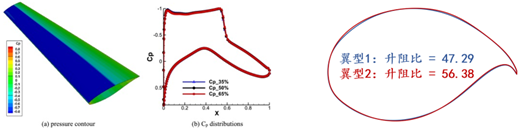
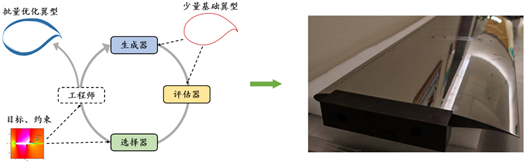
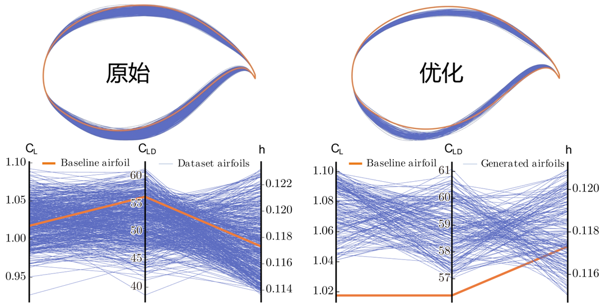

## Das Dilemma: Die datengesteuerte Optimierung hat den letzten Schritt noch nicht getan

In den letzten Jahren haben sich datengesteuerte evolutionäre Optimierungsmethoden rasant entwickelt. Ersatzmodell-unterstützte Methoden und auf generativen Modellen basierende Methoden haben die evolutionäre Optimierung bereits von der Suche mit festen Operatoren zur lernbasierten Suche verschoben. Dies bedeutet, dass Lernmodelle in mehrere Phasen der Pipeline eingetreten sind, einschließlich der Bewertung, Modellierung und sogar Generierung.

Dennoch ist diese Transformation noch unvollständig. Bestehende Methoden mögen zwar gelernt haben, auf verschiedenen Ebenen zu „bewerten“ oder zu „generieren“, aber sie haben noch nicht wirklich gelernt, wie man „optimiert“. Einerseits hängt die Generierung der nächsten Generation von Kandidatenlösungen für die Koordination oft noch von manuell entworfenen heuristischen Regeln ab. Andererseits sind das Generierungsziel und das Optimierungsziel oft unzureichend aufeinander abgestimmt. Gleichzeitig wurden die extrem begrenzten Online-Proben, die bei der Black-Box-Optimierung zur Verfügung stehen, noch nicht systematisch in lernbare und übertragbare Optimierungserfahrung transformiert.

Was heute also wirklich fehlt, sind nicht einfach mehr Modelle an sich, sondern der letzte Schritt: Optimierungsalgorithmen zu befähigen, den Prozess des Übergangs von schlechteren zu besseren Lösungen direkt aus historischen Daten zu lernen. Dies ist genau der Schritt, den EvoGO vorantreiben möchte.

## Der Durchbruch: Wie EvoGO die Optimierungs-Pipeline umschreibt

Um die oben genannten Probleme anzugehen, setzt EvoGO nicht den traditionellen Weg fort, lokale Operatoren wie Crossover und Mutation zu verbessern. Stattdessen wird versucht, die Optimierungs-Pipeline auf einer ganzheitlicheren Ebene umzuschreiben. Die Kernidee besteht darin, den Prozess „Wie generiert man die nächste Generation von Kandidatenlösungen“ aus manuell geschriebenen Regeln zu entfernen und ihn einem datengesteuerten generativen Mechanismus zum Lernen zu übergeben. Konkret organisiert EvoGO den gesamten Optimierungsprozess in drei vereinigte Phasen – **Datenvorbereitung, Modelltraining und Populationsgenerierung** – sodass die Erfahrungsorganisation, das gerichtete Lernen und die Populationsaktualisierung nicht länger fragmentiert, sondern stattdessen in einer einzigen Optimierungsschleife integriert sind.

In der Datenvorbereitungsphase filtert EvoGO zunächst hochwertige Proben aus historischen Populationen, um eine zuverlässigere Trainingsbasis zu schaffen. Wenn die Proben knapp sind, kann auch eine erlernte Augmentierung (learned augmentation) eingesetzt werden, um die Datenknappheit abzumildern. Noch wichtiger ist, dass die Proben weiter in überlegene und unterlegene Lösungen unterteilt und in paarweisen Beziehungen organisiert werden. Infolgedessen lernt das Modell nicht mehr nur eine statische Verteilung von Kandidatenlösungen, sondern vielmehr die gerichtete Beziehung des Übergangs von schlechteren zu besseren Lösungen.

In der Modelltrainingsphase übernimmt EvoGO eine paarweise Struktur, die aus einem Ersatzmodell (surrogate model), einem Vorwärtsgenerator (forward generator) und einem Pseudo-Invers-Generator besteht. Das Ersatzmodell liefert eine approximative Charakterisierung der Ziellandschaft; der Vorwärtsgenerator lernt die Abbildung von schlechteren Lösungen auf bessere; und der Pseudo-Invers-Generator hält die Trainingsstabilität durch eine Rekonstruktionskonsistenz-Bedingung aufrecht. Im Gegensatz zu allgemeinen Generierungsaufgaben besteht das Trainingsziel hier nicht nur darin, die Datenverteilung anzupassen, sondern sicherzustellen, dass sich der Generierungsprozess unter der Führung der Ziellandschaft in bessere Regionen bewegt.

In der Phase der Populationsgenerierung wirkt das trainierte generative Modell direkt auf die aktuelle Population, um parallel eine neue Generation von Kandidatenlösungen zu erzeugen. Diese Lösungen werden dann durch die reale Zielfunktion bewertet, und der Populationszustand wird entsprechend aktualisiert, bevor er in die nächste Iteration eintritt. Zu diesem Zeitpunkt ändert sich die Art und Weise, wie Populationsaktualisierungen durchgeführt werden, grundlegend. Traditionelle evolutionäre Optimierung verlässt sich hauptsächlich auf manuell spezifizierte Crossover-, Mutations- und Selektionsregeln, um den Suchraum schrittweise zu sondieren, während EvoGO diesen Prozess in einen parallelen Aktualisierungsmechanismus verwandelt, der von historischen Daten angetrieben und durch ein generatives Modell implementiert wird.

Die Parallelität von EvoGO funktioniert auf zwei Ebenen. Einerseits kann die Population in tensorisierter Form dargestellt werden, was es ermöglicht, die Generierung und Bewertung von Individuen parallel auf der GPU auszuführen. Andererseits kann EvoGO auch mehrere generative Modelle gleichzeitig auf einer einzigen GPU ausführen, wodurch eine parallele Optimierung über verschiedene Zufallssamen (random seeds) oder verschiedene Probleminstanzen hinweg ermöglicht wird. Seine parallele Fähigkeit existiert daher sowohl innerhalb von Populationen als auch über mehrere Populationen hinweg.

Unter diesem Gesichtspunkt ist der Hauptbeitrag von EvoGO nicht einfach die Einführung eines generativen Modells, sondern die Vereinheitlichung der Probenorganisation, der Zielausrichtung und der Populationsaktualisierung innerhalb eines einzigen methodischen Rahmens. Die traditionelle evolutionäre Optimierung betont die durch vorab geschriebene Regeln gesteuerte Suche, während EvoGO noch einen Schritt weiter geht und versucht, das System den Suchprozess selbst direkt aus historischen Daten lernen zu lassen.

## Validierung: Analyse der Leistung und Mechanismen

Um die Wirksamkeit dieses neuen vollständig datengesteuerten Paradigmas rigoros zu bewerten, konzentriert sich das Papier auf drei Schlüsselfragen: Ist EvoGO leistungsstark und effizient genug? Was sind die entscheidenden Designentscheidungen hinter seinem Erfolg? Welches intelligente Suchverhalten zeigt es?

### 1. Leistungsvergleich: „10-Generationen-Konvergenz“ führt bei Benchmarks

Das Papier führt eine systematische Bewertung in drei Aufgabenkategorien durch – numerische Optimierung, klassische Steuerung und hochdimensionale Robotersteuerung – und deckt 25 Benchmark-Tests mit Problemdimensionen von 10 bis 1000 ab. EvoGO wird umfassend mit der Bayes'schen Optimierung, klassischen Evolutionsstrategien, heuristischen Methoden und fortschrittlichen Ersatzmodell-unterstützten Methoden verglichen.

Insgesamt zeigt EvoGO bei den meisten Aufgaben deutliche Vorteile. Bemerkenswert ist, dass dieser Vorteil nicht auf niedrigdimensionale oder relativ reguläre Probleme beschränkt ist. Im Gegenteil, wenn die Problemdimensionalität und die Aufgabenkomplexität zunehmen, wird der Vorteil von EvoGO oft noch ausgeprägter. Unter niedrigdimensionalen und Kleinstichprobenbedingungen bleiben einige der stärksten durch Ersatzmodelle unterstützten Methoden sehr wettbewerbsfähig. Wenn die Probleme jedoch hochdimensional, komplex und von parallelen Berechnungen abhängig werden, kann sich der generative Mechanismus von EvoGO vollständiger entfalten und bei den meisten groß angelegten Aufgaben in etwa 10 Generationen konvergieren. Dies deutet darauf hin, dass der Wert von EvoGO nicht darin besteht, eine lokale Überlegenheit bei einer einzigen Art von Problem zu erreichen, sondern dass es besser für die groß angelegte Nutzung von Erfahrungswerten und die parallele Suche geeignet ist, die von der komplexen Black-Box-Optimierung verlangt werden.

Dies wird besonders in der hochdimensionalen Robotersteuerungsumgebung Hopper in Brax. Bei gleichem Funktionsauswertungsbudget und gleichem Laufzeitbudget übertrifft EvoGO traditionelle Optimierungsalgorithmen wie CMA-ES und TPE deutlich und übertrifft auch den Reinforcement-Learning-Algorithmus PPO, der eine Online-Interaktion mit der Umgebung erfordert. Noch wichtiger ist, dass EvoGO dank der parallelen Rechenleistung moderner Hardware wie GPUs in etwa 500 Sekunden ein hohes Belohnungsniveau erreichen kann. Wenn CMA-ES schließlich auf sein bestes Leistungsniveau konvergiert, ist die tatsächliche Wanduhrzeit (wall-clock time), die EvoGO benötigt, um die gleiche Leistung zu erreichen, viel kürzer – bis zu 134-mal schneller. Dieses Ergebnis zeigt, dass der Vorteil von EvoGO nicht nur in der Reduzierung der Generationsanzahl liegt, sondern in der Tatsache, dass sein Suchprozess selbst besser an parallele Rechenressourcen angepasst ist und Optimierungsaktionen, die sonst über viele Generationen verteilt wären, in einem generativen Updateprozess mit hohem Durchsatz komprimiert werden.

### 2. Ablationsstudie: Analyse der Schlüssel zum Erfolg

Um die Notwendigkeit der Kernkomponenten im „vollständig datengesteuerten“ Design von EvoGO zu überprüfen, führte das Forschungsteam systematische Ablationsstudien durch, die sich auf die paarweise generative Architektur, den Mechanismus der Ersatzmodell-Führung und das optimierungsorientierte Zieldesign konzentrierten. Fünf Varianten wurden konstruiert: eine Einzelgenerator-Version, eine Version ohne Ersatzmodell, eine Version mit gegnerischem Ziel (adversarial objective), eine MLP-Ersatzmodell-Version und eine heuristische Ersatzmodell-Version.

Die experimentellen Ergebnisse zeigen, dass die paarweise generative Architektur, der Mechanismus der Ersatzmodell-Führung und das optimierungsorientierte Zieldesign alle entscheidend für die Wirksamkeit von EvoGO. Das Entfernen des Pseudo-Invers-Generators führt zu einer merklich schlechteren Konvergenzstabilität und einer verringerten Populationsdiversität, was darauf hindeutet, dass die paarweise Struktur, die durch Vorwärtsgenerierung und inverse Einschränkungen gebildet wird, notwendig ist, um die Trainingsstabilität aufrechtzuerhalten und einen Moduskollaps (mode collapse) zu vermeiden. Das Entfernen des Ersatzmodells oder das Ersetzen des ursprünglichen Optimierungsziels durch ein allgemeines gegnerisches Ziel verursacht ebenfalls eine signifikante Leistungsverschlechterung, was zeigt, dass die Ersatzmodell-Führung und die Zielausrichtung für den Vorteil der Methode von zentraler Bedeutung sind. Das Ersetzen des Gauß-Prozesses durch ein mehrschichtiges Perzeptron (MLP) oder heuristische Regeln lässt die Methode zwar funktionsfähig, führt aber zu einem leichten Gesamtrückgang, was darauf hindeutet, dass EvoGO nicht auf eine spezifische Ersatzmodellform angewiesen ist, obwohl eine explizite Unsicherheitsmodellierung für die Leistung vorteilhafter ist. Insgesamt resultieren die Leistungssteigerungen von EvoGO nicht aus einem einzelnen Modul, sondern aus der Synergie zwischen der paarweisen generativen Architektur, dem Mechanismus der Ersatzmodell-Führung und dem optimierungsorientierten Zieldesign.

### 3. Verhaltensvisualisierung: Offenlegung eines datengesteuerten dynamischen Prozesses

Um die Suchdynamik von EvoGO intuitiver zu analysieren, präsentiert das Papier ein Visualisierungsexperiment zur zweidimensionalen Ackley-Funktion mit einer Populationsgröße von 100. Konkret werden bei verschiedenen evolutionären Generationen die Transformationsergebnisse des trainierten Vorwärtsgenerators bei Eingabelösungen aufgezeichnet – das heißt, der Abbildungsprozess von Eingabelösungen zu Ausgabelösungen wird verfolgt. In der Abbildung repräsentieren Pfeile Vektoren von Eingabe- zu Ausgabelösungen, und ihre Farben entsprechen den Vektorlängen. Der Stern markiert das globale Optimum, und gestrichelte Kästen zeigen die von generierten Lösungen abgedeckten Bereiche in verschiedenen Generationen an. Aus Gründen der Übersichtlichkeit werden die Translations- und Rotationseinstellungen der Funktionslandschaft in dieser Visualisierung weggelassen.

Die Visualisierungsergebnisse zeigen, dass das, was EvoGO lernt, keine richtungslose zufällige Störung ist, sondern ein Aktualisierungsmuster, das sich an die Suchphase anpasst. In der Frühphase sind die generierten Vektoren in der Regel länger, was darauf hindeutet, dass der Algorithmus zu einer globalen Exploration mit großer Amplitude tendiert. Im Verlauf der Evolution nehmen die Vektorlängen allmählich ab und die generierten Regionen ziehen sich weiter zusammen, was zeigt, dass sich die Suche zu einer feineren lokalen Ausbeutung (Exploitation) verlagert. Gleichzeitig sammeln sich die Vektoren insgesamt in Richtung der optimalen Region, was darauf hindeutet, dass der Vorwärtsgenerator bereits eine praktisch sinnvolle Suchrichtung aus historischen Proben extrahiert hat. Auf der Verhaltensebene stützt dieses Phänomen die zentrale Eigenschaft von EvoGO: Es lernt nicht nur die Verteilung von Kandidatenlösungen, sondern das Aktualisierungsgesetz, das vom aktuellen Zustand zu einem besseren Zustand führt.

## Anwendung: Technische Validierung an einem superkritischen Flügel eines Großraumflugzeugs

Die erfolgreiche Auslieferung der **C919** markiert für China einen entscheidenden Schritt bei der Entwicklung im Inland produzierter Großflugzeuge. Als Standardrumpfflugzeug (Narrow-Body) mit einem Gang bedient die C919 jedoch hauptsächlich Kurz- und Mittelstrecken, und Durchbrüche im Bereich der Großraumflugzeuge (Wide-Body) sind weiterhin erforderlich. Um die Entwicklungsanforderungen der nächsten Generation von inländischen Großraumflugzeugen zu erfüllen, ist das **Design superkritischer Flügel** zu einem Schlüsselthema der aerodynamischen Optimierung geworden und spielt eine wichtige Rolle bei der Reduzierung des Reisewiderstands, der Verbesserung der Treibstoffeffizienz und der Erhöhung der Flugstabilität. Daher ist die Frage, wie eine effiziente und zuverlässige Optimierung superkritischer Flügel erreicht werden kann, zu einer zentralen technischen Herausforderung im Entwicklungsprozess von Großraumflugzeugen in China geworden.

Wie im Originalartikel gezeigt, kann ein superkritischer Flügel durch die Optimierung geometrischer Merkmale wie einer längeren Sehne (Chord), einer flacheren Oberseite und einer verstärkten Hinterkantenwölbung (Trailing-Edge Camber) die transsonische Druckverteilung regulieren, die Bildung von Stoßwellen unterdrücken, den Wellenwiderstand verringern und die Auftriebseffizienz verbessern. Das optimale Design steht jedoch vor mehreren Herausforderungen. Einerseits muss das Design unter den Bedingungen hoher Reynolds-Zahlen von Großraumflugzeugen gleichzeitig strenge aerodynamische Einschränkungen wie das Gleitverhältnis (Lift-to-Drag Ratio), den Auftriebskoeffizienten und den Reiseflug-Anstellwinkel erfüllen, was extrem hohe Präzisionsanforderungen an die Formparameter stellt. Andererseits besteht eine stark nichtlineare Kopplungsbeziehung zwischen der Profilgeometrie und der aerodynamischen Leistung, die mit traditionellen Modellierungsmethoden schwer genau zu charakterisieren ist. Darüber hinaus stützt sich der bestehende Designprozess stark auf Erfahrung, wiederholte CFD-Simulationen und Windkanalexperimente, was zu hohen Rechenkosten, langen Entwicklungszyklen und Schwierigkeiten führt, sich dem globalen Optimum in einem hochdimensionalen Designraum effektiv zu nähern.

Um dieses Problem anzugehen, hat das EvoX-Team eine integrierte Design-Pipeline basierend auf EvoGO aufgebaut, bestehend aus Leistungsbewertung, Profilgenerierung (Airfoil Generation) und Kandidatenscreening. Basierend auf einer kleinen Anzahl historischer Profilproben konstruiert die Methode ein Leistungsbewertungsmodell, ein Profilgenerierungsmodell und ein Screening-Modell und verbessert das Profildesign durch iterative Evolution kontinuierlich. Ein Ersatzmodell wird verwendet, um Schlüsselkennzahlen wie das Gleitverhältnis, den Auftriebskoeffizienten und den Reiseflug-Anstellwinkel genau vorherzusagen. Gleichzeitig wird ein generativer Mechanismus eingeführt, um die traditionelle heuristische Suche zu ersetzen und eine effiziente Annäherung an das Optimum in einem hochdimensionalen Designraum zu ermöglichen. In Kombination mit einer Kandidatenscreening-Strategie kann diese Methode Kandidatenprofile, die sowohl physische Einschränkungen als auch aerodynamische Leistungsanforderungen erfüllen, schnell aus einem riesigen Suchraum identifizieren und so die Designeffizienz verbessern.

Mit nur 500 historischen Profilproben erreicht die Methode eine Vorhersagegenauigkeit von mehr als 99,5 % bei drei aerodynamischen Schlüsselindikatoren – Gleitverhältnis, Auftriebskoeffizient und Reiseflug-Anstellwinkel – und die Qualifikationsrate automatisch generierter Profile übersteigt 95 %. Diese Ergebnisse zeigen, dass vollständig datengesteuerte evolutionäre Optimierungsmethoden wie EvoGO nicht nur bei Standard-Benchmark-Tests gute Ergebnisse erzielen können, sondern auch beginnen, ihre Fähigkeit unter Beweis zu stellen, effektive Designunterstützung für reale technische Probleme zu bieten.

## Fazit und Ausblick

Worauf sich EvoGO konzentriert, ist nicht nur eine lokale Verbesserung der traditionellen evolutionären Optimierungs-Pipeline, sondern eine grundlegendere Rekonstruktion dessen, wie Optimierung selbst abläuft. Durch die Organisation der Optimierung in die drei vereinigten Phasen der Datenvorbereitung, des Modelltrainings und der Populationsgenerierung sowie durch die Einführung einer gerichteten Datenkonstruktion basierend auf der Paarung von überlegen und unterlegen, einer Ersatzmodell-gesteuerten paarweisen generativen Architektur und einem parallelen Populationsgenerierungsmechanismus demonstriert EvoGO stabile Vorteile sowohl in der Leistung als auch in der Effizienz bei Standard-Benchmark-Tests. Gleichzeitig hat es auch sein Potenzial für reale komplexe technische Probleme durch das Optimierungsdesign für superkritische Flügel von Großraumflugzeugen der nächsten Generation validiert. Auf einer höheren Ebene liegt die Bedeutung dieser Arbeit darin, zu zeigen, dass evolutionäre Optimierung nicht zwangsläufig auf manuell festgelegte heuristische Regeln beschränkt bleiben muss. Der Optimierungsprozess selbst kann zunehmend als erlernbares Gesetz aus historischer Erfahrung destilliert werden.

## Ressourcen

- [Forschungsarbeit](https://arxiv.org/abs/2508.00380)
- [GitHub](https://github.com/EMI-Group/evogo)
- [EvoX](https://github.com/EMI-Group/evox)
