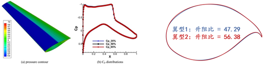
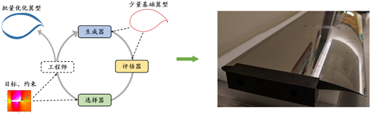
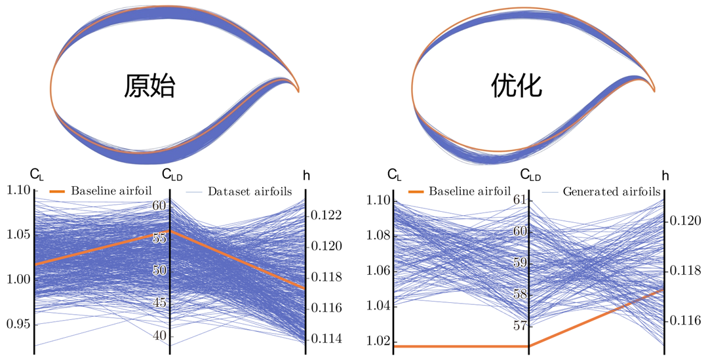

## Predicament: Data-Driven Optimization Has Still Not Taken the Final Step

In recent years, data-driven evolutionary optimization methods have developed rapidly. Surrogate-assisted methods and generative-model-based methods have already pushed evolutionary optimization from fixed-operator-driven search toward learning-driven search. This means that learning models have begun to enter multiple stages of the pipeline, including evaluation, modeling, and even generation.

Yet this transformation is still incomplete. Existing methods may have learned how to “evaluate” or “generate” at different levels, but they have not truly learned how to “optimize.” On the one hand, the production of the next generation of candidate solutions still often depends on manually designed heuristic rules for coordination. On the other hand, the generation objective and the optimization objective are often insufficiently aligned. At the same time, the extremely limited online samples available in black-box optimization have not yet been systematically transformed into learnable and transferable optimization experience.

Therefore, what is truly missing today is not more models per se, but the final step: enabling optimization algorithms to directly learn the process of moving from worse solutions to better ones from historical data. This is exactly the step that EvoGO seeks to push forward.

## Breakthrough: How EvoGO Rewrites the Optimization Pipeline

To address the issues above, EvoGO does not continue along the traditional route of improving local operators such as crossover and mutation. Instead, it attempts to rewrite the optimization pipeline at a more holistic level. Its core idea is to remove the process of “how to generate the next generation of candidate solutions” from manually written rules and hand it over to a data-driven generative mechanism to learn. Specifically, EvoGO organizes the entire optimization process into three unified stages—**data preparation, model training, and population generation**—so that experience organization, directional learning, and population updating are no longer fragmented, but instead integrated into a single optimization loop.

In the data preparation stage, EvoGO first filters high-quality samples from historical populations to build a more reliable training foundation. When samples are scarce, learned augmentation can also be used to alleviate data scarcity. More importantly, the samples are further divided into superior and inferior solutions and organized into paired relationships. As a result, what the model learns is no longer just a static distribution of candidate solutions, but rather the directional relationship of moving from inferior solutions to superior ones.

In the model training stage, EvoGO adopts a paired structure consisting of a surrogate model, a forward generator, and a pseudo-inverse generator. The surrogate model provides an approximate characterization of the objective landscape; the forward generator learns the mapping from inferior solutions to superior ones; and the pseudo-inverse generator maintains training stability through a reconstruction-consistency constraint. Unlike general generation tasks, the training objective here is not merely to fit the data distribution, but to ensure that the generation process moves toward better regions under the guidance of the objective landscape.

In the population generation stage, the trained generative model acts directly on the current population to produce a new generation of candidate solutions in parallel. These solutions are then evaluated by the real objective function, and the population state is updated accordingly before entering the next iteration. At this point, the way population updates are performed changes fundamentally. Traditional evolutionary optimization mainly relies on manually specified crossover, mutation, and selection rules to gradually probe the search space, whereas EvoGO turns this process into a parallel updating mechanism driven by historical data and implemented by a generative model.

EvoGO’s parallelism operates on two levels. On the one hand, the population can be represented in a tensorized form, allowing generation and evaluation of individuals to run in parallel on the GPU. On the other hand, EvoGO can also run multiple generative models simultaneously on a single GPU, enabling parallel optimization across different random seeds or different problem instances. Its parallel capability therefore exists both within populations and across multiple populations.

From this perspective, the key contribution of EvoGO is not simply the introduction of a generative model, but the unification of sample organization, objective alignment, and population updating within a single methodological framework. Traditional evolutionary optimization emphasizes search driven by pre-written rules, whereas EvoGO goes one step further by attempting to let the system learn the search process itself directly from historical data.

## Validation: Performance and Mechanistic Analysis

To rigorously evaluate the effectiveness of this new fully data-driven paradigm, the paper focuses on three key questions: Is EvoGO sufficiently powerful and efficient? What are the crucial design choices behind its success? What intelligent search behavior does it exhibit?

### 1. Performance Comparison: “10-Generation Convergence” Leads Across Benchmarks

The paper conducts a systematic evaluation on three categories of tasks—numerical optimization, classical control, and high-dimensional robotic control—covering 25 benchmark tests with problem dimensions ranging from 10 to 1000. EvoGO is comprehensively compared with Bayesian optimization, classical evolution strategies, heuristic methods, and advanced surrogate-assisted methods.

Overall, EvoGO shows clear advantages on most tasks. Notably, this advantage is not confined to low-dimensional or relatively regular problems. On the contrary, as problem dimensionality and task complexity increase, EvoGO’s advantage often becomes more pronounced. Under low-dimensional and small-sample conditions, some of the strongest surrogate-assisted methods remain highly competitive. But once the problems become high-dimensional, complex, and dependent on parallel computation, EvoGO’s generative mechanism is able to unfold more fully, and on most large-scale tasks it can converge in roughly 10 generations. This suggests that EvoGO’s value does not lie in achieving local superiority on a single type of problem, but in being better suited to the large-scale experience utilization and parallel search required by complex black-box optimization.

This is especially evident in the high-dimensional robotic control environment Hopper in Brax. Under the same function-evaluation budget and runtime budget, EvoGO significantly outperforms traditional optimization algorithms such as CMA-ES and TPE, and also surpasses the PPO reinforcement learning algorithm, which requires online interaction with the environment. More importantly, thanks to the parallel computing power of modern hardware such as GPUs, EvoGO can reach a high reward level in about 500 seconds. When CMA-ES finally converges to its best performance level, the actual wall-clock time required for EvoGO to reach the same performance is much shorter—up to 134× speedup. This result shows that EvoGO’s advantage is not merely in reducing the number of generations, but in the fact that its search process itself is better matched to parallel computing resources, compressing optimization actions that would otherwise be spread across many generations into a high-throughput generative update process.

### 2. Ablation Study: Dissecting the Keys to Success

To verify the necessity of the core components in EvoGO’s “fully data-driven” design, the research team conducted systematic ablations centered on the paired generative architecture, the surrogate-guidance mechanism, and the optimization-oriented objective design. Five variants were constructed: a single-generator version, a no-surrogate version, an adversarial-objective version, an MLP-surrogate version, and a heuristic-surrogate version.

The experimental results show that the paired generative architecture, the surrogate-guidance mechanism, and the optimization-oriented objective design are all crucial to EvoGO’s effectiveness. Removing the pseudo-inverse generator leads to noticeably worse convergence stability and reduced population diversity, indicating that the paired structure formed by forward generation and inverse constraints is necessary for maintaining training stability and avoiding mode collapse. Removing the surrogate model, or replacing the original optimization objective with a general adversarial objective, also causes significant performance degradation, showing that surrogate guidance and objective alignment are central to the method’s advantage. Replacing the Gaussian process with a multilayer perceptron or heuristic rules still leaves the method functional, but with a slight overall decline, indicating that EvoGO does not depend on a specific surrogate form, although explicit uncertainty modeling is more beneficial for performance. Overall, EvoGO’s performance gains do not come from any single module, but from the synergy among the paired generative architecture, the surrogate-guidance mechanism, and the optimization-oriented objective design.

### 3. Behavior Visualization: Revealing a Data-Driven Dynamic Process

To more intuitively analyze EvoGO’s search dynamics, the paper presents a visualization experiment on the two-dimensional Ackley function, with the population size set to 100. Specifically, at different evolutionary generations, the transformation results of the trained forward generator on input solutions are recorded—that is, the mapping process from input solutions to output solutions is tracked. In the figure, arrows represent vectors from input solutions to output solutions, and their colors correspond to vector lengths. The star marks the global optimum, and dashed boxes indicate the regions covered by generated solutions in different generations. For clarity, the translation and rotation settings of the function landscape are omitted in this visualization.

The visualization results show that what EvoGO learns is not directionless random perturbation, but an update pattern that adapts with the search stage. In the early stage, the generated vectors are generally longer, indicating that the algorithm tends toward large-amplitude global exploration. As evolution proceeds, vector lengths gradually decrease and the generated regions continue to contract, showing that the search shifts toward finer local exploitation. At the same time, the vectors as a whole gather toward the optimal region, indicating that the forward generator has already extracted a practically meaningful search direction from historical samples. At the behavioral level, this phenomenon supports EvoGO’s central property: it learns not merely the distribution of candidate solutions, but the update law that moves from the current state toward a better state.

## Application: Engineering Validation on a Wide-Body Airliner Supercritical Wing

The successful delivery of the **C919** marks a crucial step for China in the development of domestically produced large aircraft. However, as a single-aisle narrow-body airliner, the C919 mainly serves short- and medium-haul routes, and breakthroughs in the wide-body airliner domain are still needed. To meet the development needs of the next generation of domestic wide-body aircraft, **supercritical wing design** has become a key issue in aerodynamic optimization, playing an important role in reducing cruise drag, improving fuel efficiency, and enhancing flight stability. Therefore, how to achieve efficient and reliable supercritical wing optimization has become a core technical challenge in China’s wide-body aircraft development process.

As shown in the original article, by optimizing geometric features such as a longer chord, a flatter upper surface, and increased trailing-edge camber, a supercritical wing can regulate transonic pressure distribution, suppress shock-wave formation, reduce wave drag, and improve lift efficiency. However, its optimal design faces multiple challenges. On the one hand, under the high-Reynolds-number conditions of wide-body aircraft, the design must simultaneously satisfy strict aerodynamic constraints such as lift-to-drag ratio, lift coefficient, and cruise angle of attack, which imposes extremely high precision requirements on shape parameters. On the other hand, there is a strongly nonlinear coupling relationship between airfoil geometry and aerodynamic performance, which is difficult for traditional modeling methods to characterize accurately. In addition, the existing design process relies heavily on experience, repeated CFD simulations, and wind-tunnel experiments, leading to high computational cost, long development cycles, and difficulty in effectively approaching the global optimum in a high-dimensional design space.

To address this problem, the EvoX team built an integrated design pipeline based on EvoGO, consisting of performance evaluation, airfoil generation, and candidate screening. Based on a small number of historical airfoil samples, the method constructs a performance evaluation model, an airfoil generation model, and a screening model, and continuously improves the airfoil design through iterative evolution. A surrogate model is used to accurately predict key metrics such as lift-to-drag ratio, lift coefficient, and cruise angle of attack. At the same time, a generative mechanism is introduced to replace traditional heuristic search, enabling efficient approximation of the optimum in a high-dimensional design space. Combined with a candidate screening strategy, this method can rapidly identify candidate airfoils that satisfy both physical constraints and aerodynamic performance requirements from a vast search space, thereby improving design efficiency.

Using only 500 historical airfoil samples, the method achieves more than 99.5% prediction accuracy on three key aerodynamic indicators—lift-to-drag ratio, lift coefficient, and cruise angle of attack—and the qualification rate of automatically generated airfoils exceeds 95%. These results indicate that fully data-driven evolutionary optimization methods such as EvoGO can not only perform well on standard benchmark tests, but are also beginning to demonstrate the ability to provide effective design support for real engineering problems.

## Conclusion and Outlook

What EvoGO focuses on is not merely a local improvement to the traditional evolutionary optimization pipeline, but a more fundamental reconstruction of how optimization itself happens. By organizing optimization into the three unified stages of data preparation, model training, and population generation, and by introducing directional data construction based on superior–inferior pairing, a surrogate-guided paired generative architecture, and a parallel population generation mechanism, EvoGO demonstrates stable advantages in both performance and efficiency on standard benchmark tests. At the same time, it has also validated its potential for real complex engineering problems through next-generation wide-body airliner supercritical wing optimization design. At a higher level, the significance of this work lies in showing that evolutionary optimization does not necessarily have to remain confined to manually specified heuristic rules. The optimization process itself may be progressively distilled from historical experience as a learnable law.

## Resources

- [Research paper](https://arxiv.org/abs/2508.00380)
- [GitHub](https://github.com/EMI-Group/evogo)
- [EvoX](https://github.com/EMI-Group/evox)
