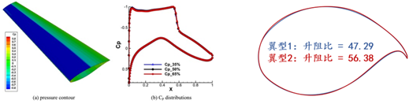
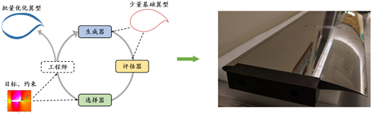
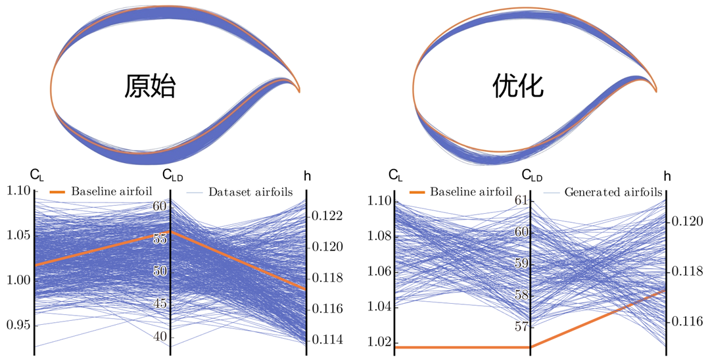

## L'Ostacolo: L'Ottimizzazione Guidata dai Dati Non Ha Ancora Compiuto il Passo Finale

Negli ultimi anni, i metodi di ottimizzazione evolutiva guidati dai dati si sono sviluppati rapidamente. I metodi assistiti da surrogati e quelli basati su modelli generativi hanno già spinto l'ottimizzazione evolutiva dalla ricerca guidata da operatori fissi verso la ricerca guidata dall'apprendimento. Ciò significa che i modelli di apprendimento hanno iniziato a entrare in molteplici fasi della pipeline, tra cui valutazione, modellazione e persino generazione.

Eppure questa trasformazione è ancora incompleta. I metodi esistenti potrebbero aver appreso come "valutare" o "generare" a diversi livelli, ma non hanno ancora appreso veramente come "ottimizzare". Da un lato, la produzione della generazione successiva di soluzioni candidate dipende ancora spesso da regole euristiche progettate manualmente per il coordinamento. Dall'altro, l'obiettivo di generazione e l'obiettivo di ottimizzazione sono spesso insufficientemente allineati. Allo stesso tempo, i campioni online estremamente limitati disponibili nell'ottimizzazione black-box non sono ancora stati trasformati sistematicamente in un'esperienza di ottimizzazione apprendibile e trasferibile.

Pertanto, ciò che manca veramente oggi non sono più modelli di per sé, ma il passo finale: consentire agli algoritmi di ottimizzazione di apprendere direttamente il processo di passaggio da soluzioni peggiori a soluzioni migliori a partire dai dati storici. Questo è esattamente il passo che EvoGO cerca di compiere.

## La Svolta: Come EvoGO Riscrive la Pipeline di Ottimizzazione

Per affrontare le problematiche sopra descritte, EvoGO non prosegue lungo il percorso tradizionale di miglioramento degli operatori locali come il crossover e la mutazione. Al contrario, tenta di riscrivere la pipeline di ottimizzazione a un livello più olistico. La sua idea centrale è rimuovere il processo di "come generare la successiva generazione di soluzioni candidate" dalle regole scritte manualmente per affidarlo a un meccanismo generativo guidato dai dati affinché lo apprenda. Nello specifico, EvoGO organizza l'intero processo di ottimizzazione in tre fasi unificate — **preparazione dei dati, addestramento del modello e generazione della popolazione** — in modo che l'organizzazione dell'esperienza, l'apprendimento direzionale e l'aggiornamento della popolazione non siano più frammentati, ma integrati in un singolo ciclo di ottimizzazione.

Nella fase di preparazione dei dati, EvoGO filtra innanzitutto campioni di alta qualità dalle popolazioni storiche per costruire una base di addestramento più affidabile. Quando i campioni sono scarsi, è possibile utilizzare anche un'augmentazione appresa per alleviare la carenza di dati. Ancora più importante, i campioni vengono ulteriormente suddivisi in soluzioni superiori e inferiori e organizzati in relazioni accoppiate. Di conseguenza, ciò che il modello apprende non è più solo una distribuzione statica di soluzioni candidate, ma piuttosto la relazione direzionale del passaggio da soluzioni inferiori a soluzioni superiori.

Nella fase di addestramento del modello, EvoGO adotta una struttura accoppiata composta da un modello surrogato, un generatore in avanti (forward generator) e un generatore pseudo-inverso (pseudo-inverse generator). Il modello surrogato fornisce una caratterizzazione approssimativa del panorama dell'obiettivo; il generatore in avanti apprende la mappatura dalle soluzioni inferiori a quelle superiori; e il generatore pseudo-inverso mantiene la stabilità dell'addestramento attraverso un vincolo di coerenza della ricostruzione. A differenza dei compiti di generazione generale, l'obiettivo di addestramento qui non è semplicemente adattare la distribuzione dei dati, ma garantire che il processo di generazione si muova verso regioni migliori sotto la guida del panorama dell'obiettivo.

Nella fase di generazione della popolazione, il modello generativo addestrato agisce direttamente sulla popolazione attuale per produrre parallelamente una nuova generazione di soluzioni candidate. Queste soluzioni vengono poi valutate dalla funzione obiettivo reale e lo stato della popolazione viene aggiornato di conseguenza prima di entrare nell'iterazione successiva. A questo punto, il modo in cui vengono eseguiti gli aggiornamenti della popolazione cambia radicalmente. L'ottimizzazione evolutiva tradizionale si affida principalmente a regole di crossover, mutazione e selezione specificate manualmente per sondare gradualmente lo spazio di ricerca, mentre EvoGO trasforma questo processo in un meccanismo di aggiornamento parallelo guidato dai dati storici e implementato da un modello generativo.

Il parallelismo di EvoGO opera su due livelli. Da un lato, la popolazione può essere rappresentata in forma tensoriale, consentendo alla generazione e alla valutazione degli individui di essere eseguite in parallelo sulla GPU. Dall'altro lato, EvoGO può anche eseguire contemporaneamente più modelli generativi su un'unica GPU, abilitando l'ottimizzazione parallela su diversi seed casuali o diverse istanze del problema. La sua capacità parallela esiste quindi sia all'interno delle popolazioni sia attraverso più popolazioni.

Da questa prospettiva, il contributo chiave di EvoGO non è semplicemente l'introduzione di un modello generativo, ma l'unificazione dell'organizzazione dei campioni, dell'allineamento degli obiettivi e dell'aggiornamento della popolazione all'interno di un singolo framework metodologico. L'ottimizzazione evolutiva tradizionale enfatizza la ricerca guidata da regole pre-scritte, mentre EvoGO fa un passo ulteriore cercando di far apprendere al sistema il processo di ricerca stesso direttamente dai dati storici.

## Validazione: Analisi delle Prestazioni e del Meccanismo

Per valutare rigorosamente l'efficacia di questo nuovo paradigma completamente guidato dai dati, il documento si concentra su tre domande chiave: EvoGO è sufficientemente potente ed efficiente? Quali sono le scelte progettuali cruciali alla base del suo successo? Quale comportamento di ricerca intelligente esibisce?

### 1. Confronto delle Prestazioni: La "Convergenza in 10 Generazioni" Primeggia nei Benchmark

Il documento conduce una valutazione sistematica su tre categorie di compiti — ottimizzazione numerica, controllo classico e controllo robotico ad alta dimensionalità — coprendo 25 test benchmark con dimensioni del problema che vanno da 10 a 1000. EvoGO viene confrontato in modo completo con l'ottimizzazione bayesiana, le strategie di evoluzione classiche, i metodi euristici e i metodi avanzati assistiti da surrogati.

Nel complesso, EvoGO mostra chiari vantaggi sulla maggior parte dei compiti. Da notare che questo vantaggio non è limitato a problemi di bassa dimensionalità o relativamente regolari. Al contrario, all'aumentare della dimensionalità del problema e della complessità del compito, il vantaggio di EvoGO diventa spesso più pronunciato. In condizioni di bassa dimensionalità e piccoli campioni, alcuni dei più forti metodi assistiti da surrogati rimangono altamente competitivi. Ma una volta che i problemi diventano ad alta dimensionalità, complessi e dipendenti dal calcolo parallelo, il meccanismo generativo di EvoGO è in grado di dispiegarsi in modo più completo e sulla maggior parte dei compiti su larga scala può convergere in circa 10 generazioni. Ciò suggerisce che il valore di EvoGO non risiede nell'ottenere una superiorità locale su un singolo tipo di problema, ma nell'essere più adatto all'utilizzo dell'esperienza su larga scala e alla ricerca parallela richiesti dalla complessa ottimizzazione black-box.

Ciò è particolarmente evidente nell'ambiente di controllo robotico ad alta dimensionalità Hopper in Brax. A parità di budget per la valutazione delle funzioni e di budget per il tempo di esecuzione, EvoGO supera significativamente gli algoritmi di ottimizzazione tradizionali come CMA-ES e TPE, e supera anche l'algoritmo di apprendimento per rinforzo PPO, che richiede l'interazione online con l'ambiente. Più importante, grazie alla potenza di calcolo parallelo di hardware moderno come le GPU, EvoGO può raggiungere un livello di ricompensa elevato in circa 500 secondi. Quando CMA-ES raggiunge infine la sua convergenza al miglior livello di prestazioni, il tempo effettivo (wall-clock time) richiesto da EvoGO per raggiungere le stesse prestazioni è molto più breve — con un'accelerazione fino a 134 volte. Questo risultato dimostra che il vantaggio di EvoGO non risiede solo nella riduzione del numero di generazioni, ma nel fatto che il suo stesso processo di ricerca è meglio adattato alle risorse di calcolo parallelo, comprimendo le azioni di ottimizzazione, che altrimenti sarebbero distribuite su molte generazioni, in un processo di aggiornamento generativo ad alto rendimento.

### 2. Studio di Ablazione: Analisi delle Chiavi del Successo

Per verificare la necessità dei componenti fondamentali nella progettazione "completamente guidata dai dati" di EvoGO, il team di ricerca ha condotto ablazioni sistematiche incentrate sull'architettura generativa accoppiata, sul meccanismo di guida del surrogato e sulla progettazione dell'obiettivo orientata all'ottimizzazione. Sono state costruite cinque varianti: una versione a generatore singolo, una versione senza surrogato, una versione con obiettivo avversario, una versione con surrogato MLP e una versione con surrogato euristico.

I risultati sperimentali mostrano che l'architettura generativa accoppiata, il meccanismo di guida del surrogato e la progettazione dell'obiettivo orientata all'ottimizzazione sono tutti cruciali per l'efficacia di EvoGO. La rimozione del generatore pseudo-inverso porta a una stabilità di convergenza notevolmente peggiore e a una ridotta diversità della popolazione, indicando che la struttura accoppiata formata dalla generazione in avanti e dai vincoli inversi è necessaria per mantenere la stabilità dell'addestramento ed evitare il collasso della modalità (mode collapse). La rimozione del modello surrogato, o la sostituzione dell'obiettivo di ottimizzazione originale con un obiettivo avversario generale, causa anche un degrado significativo delle prestazioni, dimostrando che la guida del surrogato e l'allineamento dell'obiettivo sono fondamentali per il vantaggio del metodo. Sostituendo il processo gaussiano (Gaussian process) con un percettrone multistrato (MLP) o con regole euristiche, il metodo rimane funzionante, ma con un leggero declino complessivo, indicando che EvoGO non dipende da una forma specifica di surrogato, sebbene la modellazione esplicita dell'incertezza sia più vantaggiosa per le prestazioni. Nel complesso, i guadagni in termini di prestazioni di EvoGO non derivano da un singolo modulo, ma dalla sinergia tra l'architettura generativa accoppiata, il meccanismo di guida del surrogato e la progettazione dell'obiettivo orientata all'ottimizzazione.

### 3. Visualizzazione del Comportamento: Rivelazione di un Processo Dinamico Guidato dai Dati

Per analizzare in modo più intuitivo le dinamiche di ricerca di EvoGO, il documento presenta un esperimento di visualizzazione sulla funzione bidimensionale di Ackley, con la dimensione della popolazione impostata a 100. Nello specifico, a diverse generazioni evolutive, vengono registrati i risultati della trasformazione del generatore in avanti addestrato sulle soluzioni di input, ovvero viene tracciato il processo di mappatura dalle soluzioni di input a quelle di output. Nella figura, le frecce rappresentano i vettori dalle soluzioni di input a quelle di output e i loro colori corrispondono alle lunghezze dei vettori. La stella segna l'ottimo globale e i riquadri tratteggiati indicano le regioni coperte dalle soluzioni generate nelle diverse generazioni. Per chiarezza, le impostazioni di traslazione e rotazione del panorama della funzione sono omesse in questa visualizzazione.

I risultati della visualizzazione mostrano che ciò che EvoGO apprende non è una perturbazione casuale senza direzione, ma un modello di aggiornamento che si adatta allo stadio della ricerca. Nelle fasi iniziali, i vettori generati sono generalmente più lunghi, indicando che l'algoritmo tende a un'esplorazione globale di ampia ampiezza. Procedendo con l'evoluzione, le lunghezze dei vettori diminuiscono gradualmente e le regioni generate continuano a contrarsi, mostrando che la ricerca si sposta verso uno sfruttamento locale più fine. Allo stesso tempo, i vettori nel loro insieme si raggruppano verso la regione ottimale, indicando che il generatore in avanti ha già estratto una direzione di ricerca dotata di significato pratico dai campioni storici. A livello comportamentale, questo fenomeno supporta la proprietà centrale di EvoGO: esso apprende non solo la distribuzione delle soluzioni candidate, ma la legge di aggiornamento che muove dallo stato attuale verso uno stato migliore.

## Applicazione: Validazione Ingegneristica sull'Ala Supercritica di un Aereo di Linea Wide-Body

Il successo nella consegna del **C919** segna un passo cruciale per la Cina nello sviluppo di grandi aeromobili di produzione nazionale. Tuttavia, come aereo di linea a corridoio singolo e fusoliera stretta (narrow-body), il C919 serve principalmente rotte a corto e medio raggio, e sono ancora necessari progressi nel campo degli aerei di linea wide-body. Per soddisfare le esigenze di sviluppo della prossima generazione di aerei wide-body nazionali, **la progettazione dell'ala supercritica** è diventata una questione chiave nell'ottimizzazione aerodinamica, svolgendo un ruolo importante nella riduzione della resistenza in crociera, nel miglioramento dell'efficienza del carburante e nell'aumento della stabilità di volo. Pertanto, come ottenere un'ottimizzazione efficiente e affidabile dell'ala supercritica è diventata una sfida tecnica centrale nel processo di sviluppo degli aeromobili wide-body cinesi.

Come mostrato nell'articolo originale, ottimizzando caratteristiche geometriche come una corda più lunga, una superficie superiore più piatta e una maggiore campanatura del bordo d'uscita, un'ala supercritica può regolare la distribuzione della pressione transonica, sopprimere la formazione di onde d'urto, ridurre la resistenza d'onda e migliorare l'efficienza della portanza. Tuttavia, la sua progettazione ottimale affronta molteplici sfide. Da un lato, in condizioni di elevato numero di Reynolds tipiche degli aerei wide-body, la progettazione deve soddisfare contemporaneamente rigidi vincoli aerodinamici come l'efficienza aerodinamica (rapporto portanza/resistenza), il coefficiente di portanza e l'angolo di incidenza di crociera, imponendo requisiti di precisione estremamente elevati sui parametri di forma. Dall'altro lato, esiste una relazione di accoppiamento fortemente non lineare tra la geometria del profilo alare e le prestazioni aerodinamiche, che è difficile da caratterizzare accuratamente con i metodi di modellazione tradizionali. Inoltre, l'attuale processo di progettazione fa forte affidamento sull'esperienza, su ripetute simulazioni CFD e su esperimenti in galleria del vento, portando ad alti costi computazionali, lunghi cicli di sviluppo e alla difficoltà di avvicinarsi efficacemente all'ottimo globale in uno spazio di progettazione ad alta dimensionalità.

Per affrontare questo problema, il team EvoX ha costruito una pipeline di progettazione integrata basata su EvoGO, composta da valutazione delle prestazioni, generazione dei profili alari e selezione dei candidati. Sulla base di un piccolo numero di campioni storici di profili alari, il metodo costruisce un modello di valutazione delle prestazioni, un modello di generazione dei profili alari e un modello di selezione, migliorando continuamente la progettazione del profilo alare attraverso un'evoluzione iterativa. Un modello surrogato viene utilizzato per prevedere accuratamente metriche chiave come l'efficienza aerodinamica, il coefficiente di portanza e l'angolo di incidenza di crociera. Allo stesso tempo, viene introdotto un meccanismo generativo per sostituire la tradizionale ricerca euristica, consentendo un'efficiente approssimazione dell'ottimo in uno spazio di progettazione ad alta dimensionalità. Combinato con una strategia di selezione dei candidati, questo metodo può identificare rapidamente, da un vasto spazio di ricerca, profili alari candidati che soddisfano sia i vincoli fisici sia i requisiti di prestazioni aerodinamiche, migliorando così l'efficienza della progettazione.

Utilizzando solo 500 campioni storici di profili alari, il metodo ottiene un'accuratezza di previsione superiore al 99,5% su tre indicatori aerodinamici chiave — efficienza aerodinamica, coefficiente di portanza e angolo di incidenza di crociera — e il tasso di qualificazione dei profili alari generati automaticamente supera il 95%. Questi risultati indicano che i metodi di ottimizzazione evolutiva completamente guidati dai dati, come EvoGO, non solo possono ottenere buone prestazioni nei test benchmark standard, ma stanno anche iniziando a dimostrare la capacità di fornire un supporto di progettazione efficace per problemi ingegneristici reali.

## Conclusione e Prospettive

Ciò su cui si concentra EvoGO non è semplicemente un miglioramento locale della pipeline di ottimizzazione evolutiva tradizionale, ma una ricostruzione più fondamentale del modo in cui l'ottimizzazione stessa avviene. Organizzando l'ottimizzazione nelle tre fasi unificate di preparazione dei dati, addestramento del modello e generazione della popolazione, e introducendo la costruzione direzionale dei dati basata sull'accoppiamento superiore-inferiore, un'architettura generativa accoppiata guidata dal surrogato e un meccanismo di generazione parallela della popolazione, EvoGO dimostra vantaggi stabili sia in termini di prestazioni sia di efficienza nei test benchmark standard. Allo stesso tempo, ha anche validato il suo potenziale per problemi ingegneristici reali e complessi attraverso la progettazione e l'ottimizzazione dell'ala supercritica degli aerei di linea wide-body di prossima generazione. A un livello superiore, l'importanza di questo lavoro risiede nel dimostrare che l'ottimizzazione evolutiva non deve necessariamente rimanere confinata a regole euristiche specificate manualmente. Il processo di ottimizzazione stesso può essere progressivamente distillato dall'esperienza storica come una legge apprendibile.

## Risorse

- [Articolo scientifico](https://arxiv.org/abs/2508.00380)
- [GitHub](https://github.com/EMI-Group/evogo)
- [EvoX](https://github.com/EMI-Group/evox)
