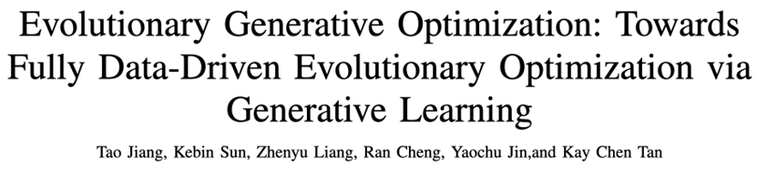

*Atualizado a 7 de novembro de 2026. Os resultados históricos mantêm a data de referência.*

A pesquisa científica e de engenharia precisa de decidir repetidamente qual experiência realizar a seguir. O EvoGO estuda uma versão computacional desta questão: podem as avaliações ensinar um gerador a melhorar as propostas? Isto liga a IA evolutiva do EvoX a uma pesquisa que aprende com os candidatos já testados.

## O Dilema: A Otimização Orientada por Dados Ainda Não Deu o Último Passo

Nos últimos anos, os métodos de otimização evolutiva baseados em dados desenvolveram-se rapidamente. Os métodos assistidos por substitutos e os métodos baseados em modelos generativos já impulsionaram a otimização evolutiva de uma pesquisa orientada por operadores fixos para uma pesquisa orientada pela aprendizagem. Isto significa que os modelos de aprendizagem começaram a entrar em várias fases do fluxo de trabalho, incluindo a avaliação, a modelação e até a geração.

No entanto, esta transformação ainda está incompleta. Os métodos existentes podem ter aprendido a "avaliar" ou a "gerar" a diferentes níveis, mas ainda não aprenderam verdadeiramente a "otimizar". Por um lado, a produção da próxima geração de soluções candidatas ainda depende frequentemente de regras heurísticas desenhadas manualmente para coordenação. Por outro lado, o objetivo da geração e o objetivo da otimização estão muitas vezes insuficientemente alinhados. Ao mesmo tempo, as amostras online extremamente limitadas disponíveis na otimização de caixa negra ainda não foram sistematicamente transformadas em experiência de otimização aprendível e transferível.

Portanto, o que verdadeiramente falta hoje não são mais modelos por si só, mas sim o passo final: permitir que os algoritmos de otimização aprendam diretamente o processo de passar de soluções piores para soluções melhores a partir de dados históricos. É exatamente este o passo que o EvoGO procura dar.

## A Inovação: Como o EvoGO Reescreve o Fluxo de Otimização

Para abordar os problemas acima referidos, o EvoGO não continua pelo caminho tradicional de melhorar os operadores locais, como o cruzamento e a mutação. Em vez disso, tenta reescrever o fluxo de otimização a um nível mais holístico. A sua ideia central é remover o processo de "como gerar a próxima geração de soluções candidatas" das regras escritas manualmente e entregá-lo a um mecanismo generativo orientado por dados para que este aprenda. Especificamente, o EvoGO organiza todo o processo de otimização em três fases unificadas — **preparação de dados, treino do modelo e geração da população** — para que a organização da experiência, a aprendizagem direcional e a atualização da população deixem de ser fragmentadas e passem a estar integradas num único ciclo de otimização.

Na fase de preparação de dados, o EvoGO primeiro filtra amostras de alta qualidade de populações históricas para construir uma base de treino mais fiável. Quando as amostras são escassas, o aumento de dados aprendido (learned augmentation) também pode ser usado para mitigar a escassez de dados. Mais importante ainda, as amostras são subdivididas em soluções superiores e inferiores e organizadas em relações emparelhadas. Como resultado, o que o modelo aprende já não é apenas uma distribuição estática de soluções candidatas, mas sim a relação direcional da passagem de soluções inferiores para soluções superiores.

Na fase de treino do modelo, o EvoGO adota uma estrutura emparelhada que consiste num modelo substituto, num gerador direto (forward generator) e num gerador pseudo-inverso. O modelo substituto fornece uma caracterização aproximada do panorama do objetivo (objective landscape); o gerador direto aprende o mapeamento das soluções inferiores para as superiores; e o gerador pseudo-inverso mantém a estabilidade do treino através de uma restrição de consistência de reconstrução. Ao contrário das tarefas gerais de geração, o objetivo do treino aqui não é meramente ajustar-se à distribuição de dados, mas garantir que o processo de geração avance em direção a regiões melhores sob a orientação do panorama do objetivo.

Na fase de geração da população, o modelo generativo treinado atua diretamente sobre a população atual para produzir uma nova geração de soluções candidatas em paralelo. Estas soluções são depois avaliadas pela função objetivo real, e o estado da população é atualizado em conformidade antes de entrar na iteração seguinte. Neste ponto, a forma como as atualizações da população são executadas muda fundamentalmente. A otimização evolutiva tradicional depende principalmente de regras de cruzamento, mutação e seleção especificadas manualmente para explorar gradualmente o espaço de pesquisa, enquanto o EvoGO transforma este processo num mecanismo de atualização paralela impulsionado por dados históricos e implementado por um modelo generativo.

O paralelismo do EvoGO opera a dois níveis. Por um lado, a população pode ser representada numa forma tensorizada, permitindo que a geração e a avaliação de indivíduos sejam executadas em paralelo na GPU. Por outro lado, o EvoGO também pode executar vários modelos generativos simultaneamente numa única GPU, permitindo a otimização paralela através de diferentes sementes aleatórias (random seeds) ou diferentes instâncias de problemas. A sua capacidade paralela, portanto, existe tanto dentro das populações quanto através de múltiplas populações.

Desta perspetiva, a principal contribuição do EvoGO não é simplesmente a introdução de um modelo generativo, mas a unificação da organização de amostras, alinhamento de objetivos e atualização de populações dentro de uma única estrutura metodológica. A otimização evolutiva tradicional enfatiza a pesquisa impulsionada por regras pré-escritas, ao passo que o EvoGO dá um passo em frente ao tentar deixar o sistema aprender o próprio processo de pesquisa diretamente a partir de dados históricos.

## Validação: Avaliação de Desempenho e Análise Mecanística

Para avaliar rigorosamente a eficácia deste novo paradigma totalmente baseado em dados, o artigo foca-se em três questões essenciais: O EvoGO é suficientemente poderoso e eficiente? Quais são as escolhas de design cruciais por trás do seu sucesso? Que comportamento de pesquisa inteligente exibe?

### 1. Comparação de Desempenho: A "Convergência em 10 Gerações" Lidera nos Benchmarks

O artigo realiza uma avaliação sistemática em três categorias de tarefas — otimização numérica, controlo clássico e controlo robótico de alta dimensão — cobrindo 25 testes de referência com dimensões de problemas que variam de 10 a 1000. O EvoGO é comparado de forma abrangente com a otimização bayesiana, estratégias de evolução clássicas, métodos heurísticos e métodos avançados assistidos por substitutos.

No geral, o EvoGO demonstra vantagens claras na maioria das tarefas. Notavelmente, esta vantagem não se restringe a problemas de baixa dimensão ou relativamente regulares. Pelo contrário, à medida que a dimensionalidade do problema e a complexidade da tarefa aumentam, a vantagem do EvoGO torna-se frequentemente mais pronunciada. Sob condições de baixa dimensão e amostras pequenas, alguns dos métodos assistidos por substitutos mais fortes permanecem altamente competitivos. Mas quando os problemas se tornam de alta dimensão, complexos e dependentes de computação paralela, o mecanismo generativo do EvoGO consegue expandir-se mais plenamente, e na maioria das tarefas de larga escala pode convergir em cerca de 10 gerações. Isto sugere que o valor do EvoGO não reside em alcançar a superioridade local num único tipo de problema, mas em estar mais bem adaptado à utilização de experiência em larga escala e à pesquisa paralela exigidas pela otimização complexa de caixa negra.

Isto é especialmente evidente no ambiente de controlo robótico de alta dimensão Hopper no Brax. Com o mesmo orçamento de avaliação de funções e orçamento de tempo de execução, o EvoGO supera significativamente os algoritmos de otimização tradicionais, como o CMA-ES e o TPE, e também supera o algoritmo de aprendizagem por reforço PPO, que requer interação online com o ambiente. Mais importante ainda, graças ao poder de computação paralela de hardware moderno, como GPUs, o EvoGO consegue atingir um nível de recompensa elevado em cerca de 500 segundos. Quando o CMA-ES finalmente converge para o seu melhor nível de desempenho, o tempo real de relógio necessário para o EvoGO atingir o mesmo desempenho é muito mais curto — um aumento de velocidade de até 134 vezes. Este resultado mostra que a vantagem do EvoGO não está apenas na redução do número de gerações, mas no facto de que o seu próprio processo de pesquisa está mais bem ajustado aos recursos de computação paralela, comprimindo ações de otimização que, de outra forma, se espalhariam por muitas gerações num processo de atualização generativa de alto rendimento.

### 2. Estudo de Ablação: Dissecando as Chaves para o Sucesso

Para verificar a necessidade dos componentes centrais no design "totalmente orientado por dados" do EvoGO, a equipa de investigação conduziu ablações sistemáticas centradas na arquitetura generativa emparelhada, no mecanismo de orientação por substitutos e no design de objetivos orientado para a otimização. Foram construídas cinco variantes: uma versão de gerador único, uma versão sem substituto, uma versão de objetivo adversarial, uma versão de substituto MLP e uma versão de substituto heurístico.

Os resultados experimentais revelam que a arquitetura generativa emparelhada, o mecanismo de orientação por substitutos e o design de objetivos orientado para a otimização são todos cruciais para a eficácia do EvoGO. A remoção do gerador pseudo-inverso leva a uma estabilidade de convergência visivelmente pior e a uma redução da diversidade da população, indicando que a estrutura emparelhada formada pela geração direta e por restrições inversas é necessária para manter a estabilidade do treino e evitar o colapso do modo (mode collapse). A remoção do modelo substituto, ou a substituição do objetivo de otimização original por um objetivo adversarial geral, também causa uma degradação significativa no desempenho, demonstrando que a orientação por substitutos e o alinhamento de objetivos são centrais para a vantagem do método. A substituição do processo Gaussiano por um perceptrão multicamadas (MLP) ou por regras heurísticas ainda deixa o método funcional, mas com um ligeiro declínio geral, indicando que o EvoGO não depende de uma forma específica de substituto, embora a modelação explícita da incerteza seja mais benéfica para o desempenho. Globalmente, os ganhos de desempenho do EvoGO não provêm de um único módulo, mas sim da sinergia entre a arquitetura generativa emparelhada, o mecanismo de orientação por substitutos e o design de objetivos orientado para a otimização.

### 3. Visualização de Comportamento: Revelando um Processo Dinâmico Orientado por Dados

Para analisar de forma mais intuitiva a dinâmica de pesquisa do EvoGO, o artigo apresenta uma experiência de visualização na função de Ackley bidimensional, com o tamanho da população definido como 100. Especificamente, em diferentes gerações evolutivas, os resultados da transformação do gerador direto treinado nas soluções de entrada são registados — isto é, o processo de mapeamento das soluções de entrada para as soluções de saída é rastreado. Na figura, as setas representam vetores desde as soluções de entrada até às soluções de saída, e as suas cores correspondem aos comprimentos dos vetores. A estrela marca o ótimo global e as caixas tracejadas indicam as regiões cobertas pelas soluções geradas em diferentes gerações. Para maior clareza, as configurações de translação e rotação do panorama da função foram omitidas nesta visualização.

Os resultados da visualização mostram que o que o EvoGO aprende não é uma perturbação aleatória sem direção, mas um padrão de atualização que se adapta à fase de pesquisa. Na fase inicial, os vetores gerados são geralmente mais longos, indicando que o algoritmo tende a uma exploração global de grande amplitude. À medida que a evolução avança, os comprimentos dos vetores diminuem gradualmente e as regiões geradas continuam a contrair-se, demonstrando que a pesquisa se desloca para uma explotação (exploitation) local mais fina. Ao mesmo tempo, os vetores como um todo reúnem-se em direção à região ótima, o que indica que o gerador direto já extraiu uma direção de pesquisa com significado prático a partir de amostras históricas. A nível comportamental, este fenómeno apoia a propriedade central do EvoGO: não aprende meramente a distribuição de soluções candidatas, mas a lei de atualização que passa do estado atual para um estado melhor.

## Dos benchmarks aos fluxos científicos

A pesquisa generativa pode ser explorada no projeto de engenharia, mas os benchmarks não demonstram precisão no projeto de perfis alares nem utilização aeronáutica. São necessários dados definidos, casos de teste independentes, verificações de restrições e validação independente por simulação ou experimentação. O artigo EvoGO citado apresenta benchmarks numéricos, de controlo e de robótica; não valida as percentagens de desempenho aerodinâmico.

## Conclusão e Perspetivas

O EvoGO fornece aos sistemas de IA evolutiva um mecanismo de proposta capaz de aprender. A ligação a AI for Science está em usar avaliações dispendiosas para orientar pesquisas futuras, juntamente com a geração paralela de candidatos. Aplicações científicas exigem restrições, avaliações e validação específicas do domínio; os benchmarks são o ponto de partida.

## Recursos

- [Artigo científico](https://arxiv.org/abs/2508.00380)
- [GitHub](https://github.com/EMI-Group/evogo)
- [EvoX](https://github.com/EMI-Group/evox)
