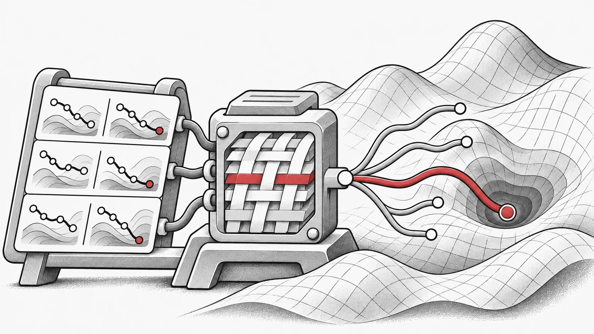
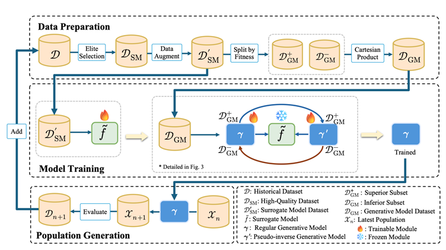
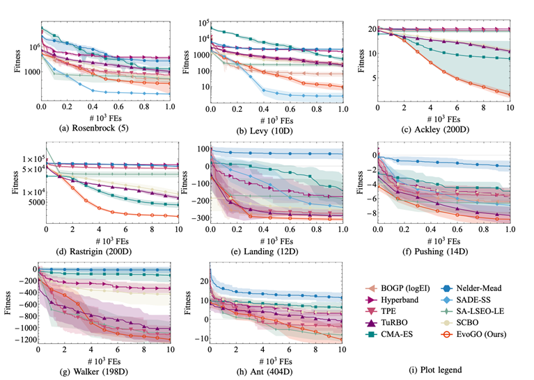
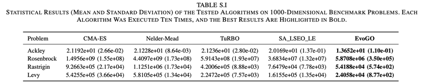
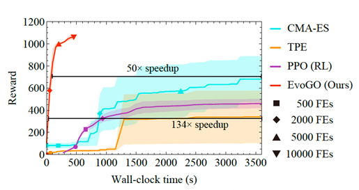
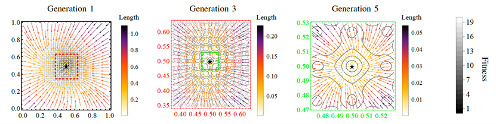

科學與工程搜尋需要反覆回答：下一次應當嘗試什麼？EvoGO 研究這個問題的計算實現——能否讓評價結果教會生成器改進候選方案？它將 EvoX 的演化式 AI 方向推進到搜尋過程自身的學習，讓已經完成的試驗參與指導下一輪探索。 [EvoGO](https://github.com/EMI-Group/evogo)

## 困境：數據驅動最佳化仍未邁出最後一步

近年來，數據驅動的演化最佳化方法發展迅速。代理輔助方法和基於生成模型的方法已經將演化最佳化從固定算子驅動搜尋推向了學習驅動搜尋。這意味著學習模型已開始進入包括評估、建模甚至生成在內的多個流水線階段。

然而，這種轉變仍不徹底。現有方法可能在不同層面上學習了如何“評估”或“生成”，但並未真正學習如何“最佳化”。一方面，下一代候選解的產生通常仍依賴人工設計的啟發式規則進行協調。另一方面，生成目標與最佳化目標往往不夠一致。同時，黑盒最佳化中極其有限的線上樣本尚未被系統地轉化為可學習、可遷移的最佳化經驗。

因此，當前真正缺失的不是更多的模型本身，而是最後一步：使最佳化演算法能夠直接從歷史數據中學習從較差解向更好解演進的過程。這正是 EvoGO 試圖推動的一步。

## 突破：EvoGO 如何重寫最佳化流水線

為了解決上述問題，EvoGO 沒有繼續沿著改進交叉和變異等局部算子的傳統路線走下去。相反，它試圖在更整體的層面上重寫最佳化流水線。其核心思想是將“如何生成下一代候選解”的過程從人工編寫的規則中剝離出來，交給數據驅動的生成機制去學習。具體而言，EvoGO 將整個最佳化過程組織為三個統一的階段——**數據準備、模型訓練和種群生成**——從而使經驗組織、方向學習和種群更新不再割裂，而是被整合到一個單一的最佳化循環中。

在數據準備階段，EvoGO 首先從歷史種群中篩選出高品質樣本，以構建更可靠的訓練基礎。當樣本稀缺時，還可以利用學習到的數據增強方法來緩解數據不足的問題。更重要的是，樣本被進一步劃分為優勢解和劣勢解，並組織成配對關係。結果，模型學習的不再僅僅是候選解的靜態分布，而是從劣質解向優質解移動的方向關係。

在模型訓練階段，EvoGO 採用由代理模型、前向生成器和偽逆向生成器組成的配對結構。代理模型提供目標地形的近似表徵；前向生成器學習從劣質解到優質解的映射；而偽逆向生成器通過重建一致性約束來保持訓練的穩定性。與一般的生成任務不同，這裡的訓練目標不僅僅是擬合數據分布，而是在目標地形的引導下，確保生成過程向更好的區域移動。

在種群生成階段，訓練好的生成模型直接作用於當前種群，並行產生新一代的候選解。這些解隨後由真實目標函數進行評估，並在進入下一次迭代之前更新種群狀態。此時，種群更新的方式發生了根本性變化。傳統的演化最佳化主要依賴人工指定的交叉、變異和選擇規則來逐步探測搜尋空間，而 EvoGO 則將這一過程轉變為由歷史數據驅動、由生成模型實現的並行更新機制。

EvoGO 的並行性體現在兩個層面。一方面，種群可以用張量化形式表示，允許個體的生成和評估在 GPU 上並行運行。另一方面，EvoGO 也可以在單個 GPU 上同時運行多個生成模型，從而實現跨不同隨機種子或不同問題實例的並行最佳化。因此，它的並行能力既存在於種群內部，也存在於多個種群之間。

從這個角度來看，EvoGO 的關鍵貢獻不僅在於引入了生成模型，更在於將樣本組織、目標對齊和種群更新統一在一個單一的方法論框架內。傳統的演化最佳化強調由預寫規則驅動的搜尋，而 EvoGO 更進一步，試圖讓系統直接從歷史數據中學習搜尋過程本身。

## 驗證：效能與機制分析

為了嚴格評估這種新的完全數據驅動範式的有效性，論文聚焦於三個關鍵問題：EvoGO 是否足夠強大和高效？其成功背後的關鍵設計選擇是什麼？它展現出怎樣的智能搜尋行為？

### 1. 效能對比：“10代收斂”領跑基準測試

論文在數值最佳化、經典控制和高維機器人控制三大類任務上進行了系統評估，涵蓋25個基準測試，問題維度從10到1000不等。EvoGO 與貝葉斯最佳化、經典演化策略、啟發式方法以及先進的代理輔助方法進行了全面比較。

總體而言，EvoGO 在絕大多數任務上都展現出了明顯的優勢。值得注意的是，這種優勢並不侷限於低維或相對規則的問題。相反，隨著問題維度和任務複雜度的增加，EvoGO 的優勢往往變得更加明顯。在低維和小樣本條件下，一些最強的代理輔助方法仍然極具競爭力。但一旦問題變成高維、複雜且依賴於並行計算，EvoGO 的生成機制就能更充分地發揮作用，在大多數大規模任務上它可以在大約10代內收斂。這表明 EvoGO 的價值並不在於在某一種題型上取得局部優勢，而在於更適合複雜黑盒最佳化所需的大規模經驗利用和並行搜尋。

這在 Brax 中的高維機器人控制環境 Hopper 中表現得尤為明顯。在相同的函數評估預算和運行時間預算下，EvoGO 顯著優於 CMA-ES 和 TPE 等傳統最佳化演算法，同時也超越了需要與環境進行線上交互的 PPO 強化學習演算法。更重要的是，得益於 GPU 等現代硬體的並行計算能力，EvoGO 可以在大約 500 秒內達到很高的獎勵水準。當 CMA-ES 最終收斂到其最佳效能水準時，EvoGO 達到相同效能所需的實際時鐘時間要短得多——最多可實現134倍的加速。這一結果表明，EvoGO 的優勢不僅在於減少了迭代代數，更在於其搜尋過程本身能更好地匹配並行計算資源，將原本分散在許多代中的最佳化動作壓縮為高吞吐量的生成更新過程。

### 2. 消融實驗：剖析成功的關鍵

為了驗證 EvoGO“完全數據驅動”設計中核心組件的必要性，研究團隊圍繞配對生成架構、代理引導機制和面向最佳化的目標設計進行了系統的消融實驗。構建了五個變體：單生成器版本、無代理版本、對抗目標版本、MLP代理版本和啟發式代理版本。

實驗結果表明，配對生成架構、代理引導機制和面向最佳化的目標設計對 EvoGO 的有效性都至關重要。移除偽逆向生成器會導致收斂穩定性明顯變差、種群多樣性降低，這表明由前向生成和逆向約束形成的配對結構對於保持訓練穩定性和避免模式崩潰是必要的。移除代理模型，或將原始最佳化目標替換為通用對抗目標，也會導致顯著的效能下降，說明代理引導和目標對齊是該方法優勢的核心。將高斯過程替換為多層感知機或啟發式規則後，方法仍能發揮作用，但整體效能略有下降，這表明 EvoGO 並不依賴特定的代理形式，儘管顯式的不確定性建模對效能更有利。總體而言，EvoGO 的效能提升並非來自任何單一模組，而是源於配對生成架構、代理引導機制和面向最佳化的目標設計之間的協同作用。

### 3. 行為視覺化：揭示數據驅動的動態過程

為了更直觀地分析 EvoGO 的搜尋動態，論文在二維 Ackley 函數上進行了視覺化實驗，種群規模設為 100。具體來說，在不同的演化代數中，記錄了訓練好的前向生成器對輸入解的變換結果——即追蹤了從輸入解到輸出解的映射過程。圖中，箭頭表示從輸入解到輸出解的向量，其顏色對應於向量長度。星號標記全域最佳解，虛線框指示不同代數中生成的解所覆蓋的區域。為了清晰起見，此視覺化中省略了函數地形的平移和旋轉設置。

視覺化結果顯示，EvoGO 學到的並不是無方向的隨機擾動，而是隨搜尋階段自適應變化的更新模式。在早期階段，生成的向量通常較長，表明演算法傾向於大幅度的全域探索。隨著演化的進行，向量長度逐漸減小，生成的區域繼續收縮，表明搜尋轉向更精細的局部利用。與此同時，向量整體上向最佳區域聚集，這表明前向生成器已經從歷史樣本中提取出了具有實際意義的搜尋方向。在行為層面上，這一現象支持了 EvoGO 的核心屬性：它學習的不僅是候選解的分布，而是從當前狀態向更好狀態移動的更新規律。

## 從基準走向科學工作流程

生成式搜尋可以作為工程設計的探索方向，但基準結果不能直接證明翼型設計精度或飛機應用效果。工程評估需要明確資料集、獨立測試樣本、約束檢查，以及獨立模擬或實驗驗證。本文連結的 EvoGO 論文報告了數值最佳化、控制與機器人基準，尚不足以支持具體的翼型設計百分比指標。

## 結論與展望

選擇一項基準任務並保存評估歷史。在相同評估預算下比較學習產生的候選方案與基準，另行記錄模型訓練時間。 [EvoGM：無需重新訓練，透過群體演化實現大模型自主合併](/zh-tw/news/evogm)

## 相關資源

- [研究論文](https://arxiv.org/abs/2508.00380)
- [GitHub](https://github.com/EMI-Group/evogo)
- [EvoX](https://github.com/EMI-Group/evox)
