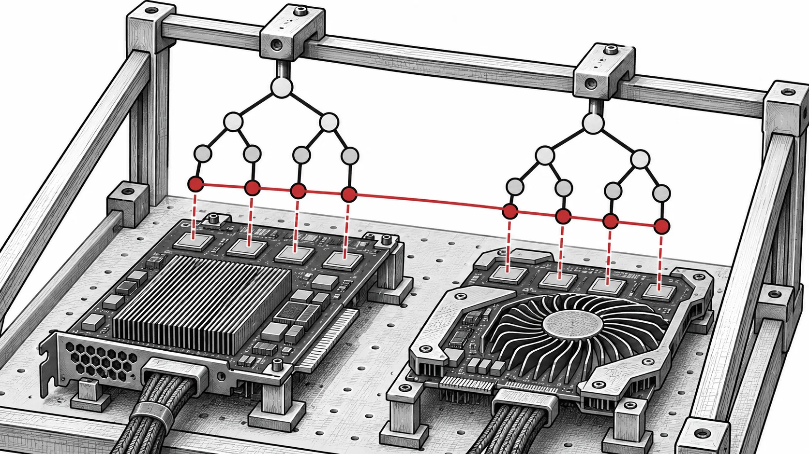

Quien dispone de una GPU AMD puede explorar la programación genética en árbol de EvoGP sin mantener otro motor de búsqueda. La [PR #12][s2], integrada el 17 de junio de 2026 UTC (18 de junio en Pekín), abre esa vía mediante ROCm/HIP. Abarca la compilación de la extensión y la conservación del significado de cada programa al ejecutarse.



*Ilustración conceptual: una representación compartida atraviesa las fronteras de los motores GPU.*

## Una base de código para CUDA y ROCm

La integración de junio usa la conversión HIP de PyTorch durante la construcción para compilar las extensiones CUDA en AMD. Las opciones se seleccionan por motor y se protege una cabecera exclusiva de CUDA. Con PyTorch ROCm no hace falta mantener otros algoritmos.

Las pilas dinámicas de los intérpretes se sustituyen por arrays locales de tamaño fijo. El contribuidor relacionó los errores AMD con alias de asignación entre wavefronts residentes. Separar las pilas importa: usar el estado temporal de otro hilo puede falsear la aptitud y perjudicar la selección.

## Traducir los kernels es solo parte del trabajo

La conversión HIP de PyTorch traduce las fuentes CUDA, pero los argumentos siguen llegando al compilador del dispositivo. Las opciones NVIDIA no pueden pasarse directamente a `hipcc`. La configuración conserva la lista CUDA y usa `-O3` para ROCm; además protege una cabecera exclusiva de CUDA. ROCm PyTorch ofrece la conversión, mientras EvoGP debe adaptar también su configuración de compilación. [Cambios de compilación][s2]

## Preparar el entorno de construcción adecuado

Las [instrucciones fuente][s3] exigen herramientas GPU, compilador C++ y PyTorch compatibles. En AMD se usan ROCm con `hipcc` y PyTorch ROCm. `--no-build-isolation` permite construir la extensión con ese entorno instalado.

Los ejemplos conservan las cadenas de dispositivo `cuda` bajo ROCm porque así funciona la interfaz PyTorch. `PYTORCH_ROCM_ARCH` selecciona una arquitectura AMD concreta. Es una opción de construcción, no una reescritura de árboles ni operadores evolutivos.

## Ejecutar la misma búsqueda en un backend verificado

El contribuidor comunica pruebas en MI250X, W7800, RX 9070 XT y PRO V710, con sistemas y versiones ROCm indicados en la PR. Utilizan 1,000 individuos, 100 generaciones y semilla fija. Son validaciones comunicadas para esas configuraciones, no garantías independientes del hardware.

```bash
python -m evogp.sr_test
```

Para regresión simbólica, comprueba primero la compilación y que la pequeña prueba termine con aptitud finita. Las comprobaciones del colaborador abarcan dispositivos wave32 y wave64 y reportan trayectorias coincidentes con semilla fija, sin una nueva promesa general de aceleración. Conserva datos, población y semilla al comparar tu hardware. La [presentación de EvoGP][related] explica la representación; la posterior [corrección del registro de población][logging] aborda otro costo por generación.

[s2]: https://github.com/EMI-Group/evogp/pull/12
[s3]: https://github.com/EMI-Group/evogp/blob/5538d75470ee0fa444ee6bbe5ea98b2eed6e99f8/README.md
[related]: /es-419/news/evogp
[logging]: /es-419/news/evogp-rocm-population-execution
