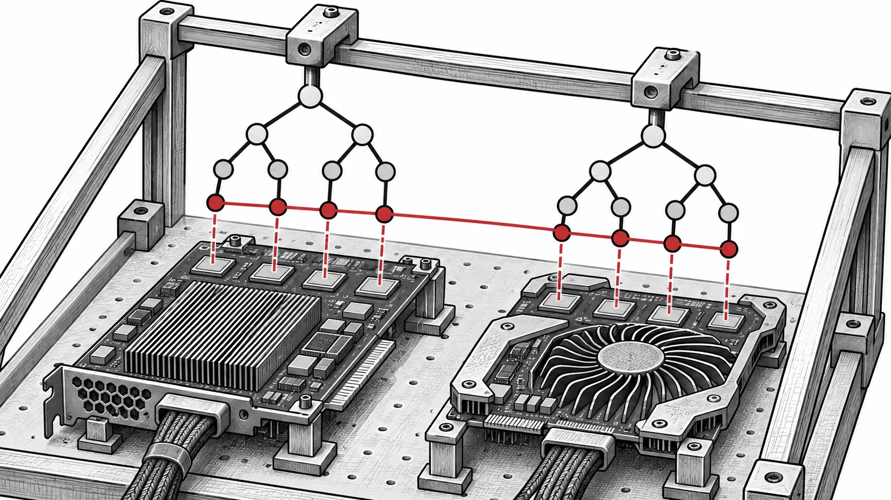

Um kernel rápido é apenas parte de uma busca utilizável. A GPU disponível precisa ser suportada e o relatório de progresso não deve dominar cada geração. A [integração de 16 de outubro de 2026][s1] substitui reduções Python de aptidão no pipeline predefinido do EvoGP. Ela segue o [suporte AMD ROCm de 17 de junho][s2], ampliando o acesso à mesma busca baseada em árvores.

*Ilustração conceptual: a mesma representação atravessa fronteiras de backends GPU.*

## Manter estatísticas em operações tensoriais

Máximo e mínimo Python sobre o tensor tornam-se `torch.max` e `torch.min`. Percorrer grandes tensores do dispositivo em Python cria trabalho na fronteira da linguagem que uma redução resolve dentro do framework numérico. Isso importa principalmente quando avaliar aptidão é barato.

Na regressão simbólica, expressões podem ser avaliadas em paralelo enquanto mostrar extremos continua caro. A correção remove esse desequilíbrio sem alterar a estatística. A PR relata grande melhora com um milhão de indivíduos, mas não oferece protocolo completo; a ação útil é medir a geração inteira, incluindo relatórios.

## Uma base de código para CUDA e ROCm

A integração de junho usa a conversão HIP do PyTorch durante a construção para compilar extensões CUDA em AMD. As opções são escolhidas por backend e um cabeçalho exclusivo de CUDA é protegido. Com PyTorch ROCm, não é necessário manter outros algoritmos.

A alocação dinâmica das pilhas dos interpretadores é substituída por arrays locais fixos. O contribuidor associou erros AMD ao aliasing de alocações entre wavefronts residentes. Pilhas separadas são importantes: usar o estado temporário de outra thread pode produzir aptidão errada e comprometer a seleção.

## Preparar o ambiente correto de construção

As [instruções de código][s3] exigem ferramentas GPU, compilador C++ e PyTorch compatíveis. Para AMD, use ROCm com `hipcc` e PyTorch ROCm. A opção `--no-build-isolation` constrói a extensão usando esse ambiente instalado.

Os exemplos mantêm as strings de dispositivo `cuda` no ROCm porque essa é a interface PyTorch. `PYTORCH_ROCM_ARCH` seleciona uma arquitetura AMD específica. Trata-se de uma escolha de construção, não de reescrever árvores ou operadores evolutivos.

## Validar uma busca pequena antes de escalar

O contribuidor relata testes em MI250X, W7800, RX 9070 XT e PRO V710, com sistemas e versões ROCm listados na PR. Foram usados 1 000 indivíduos, 100 gerações e semente fixa. São verificações reportadas para essas configurações, não garantias independentes do hardware.

Após construir, execute `python -m evogp.sr_test` e verifique aptidão finita e conclusão normal. Compare depois com e sem relatórios mantendo entradas, semente e população, separando avaliação e gestão. A [visão de pesquisa EvoGP][related] explica árvores tensorizadas; essas mudanças conectam a representação ao hardware disponível.

[s1]: https://github.com/EMI-Group/evogp/pull/14
[s2]: https://github.com/EMI-Group/evogp/pull/12
[s3]: https://github.com/EMI-Group/evogp/blob/85c9f96490185b371438768668da53de930cc3f6/README.md
[related]: /pt/news/evogp
