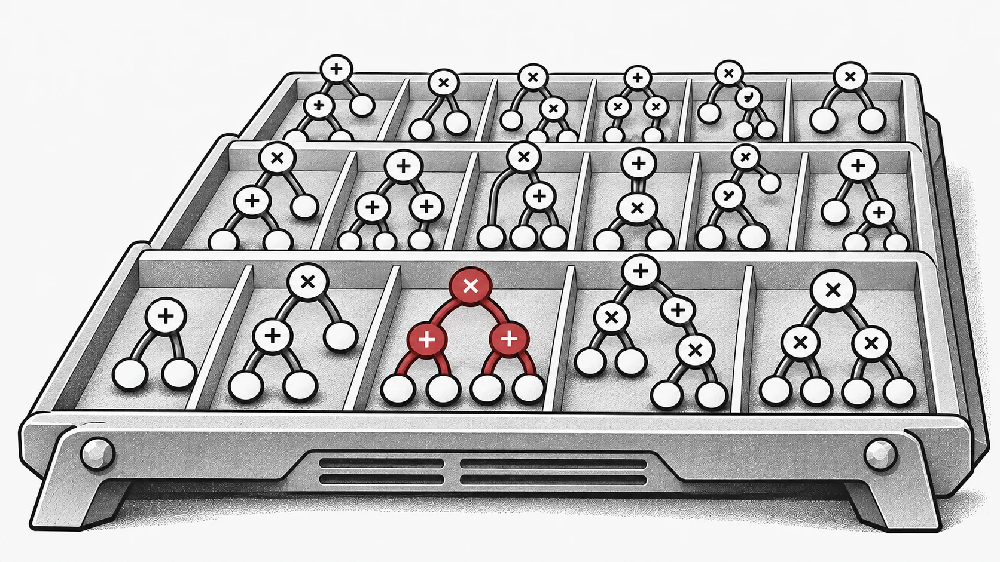
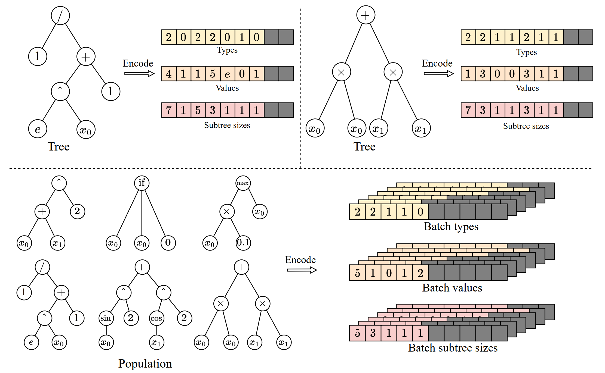
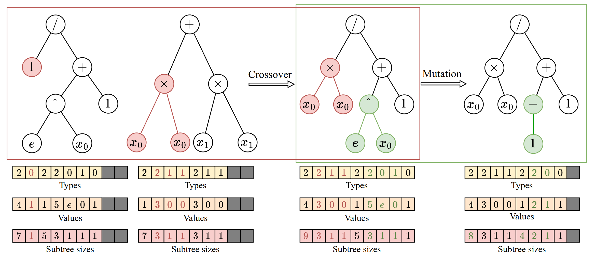
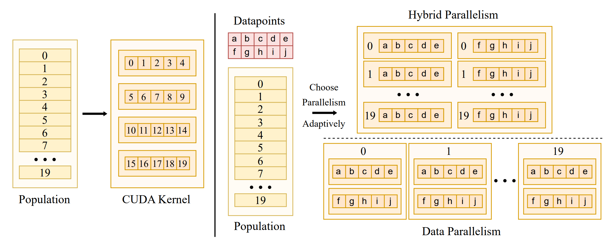
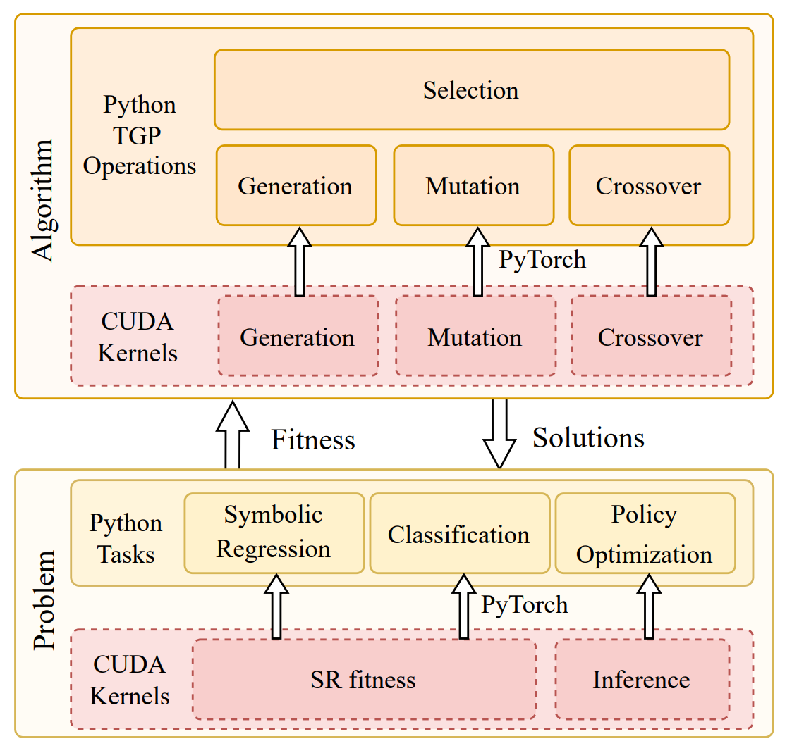
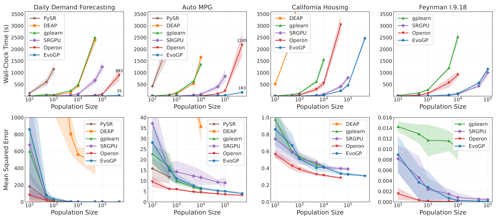
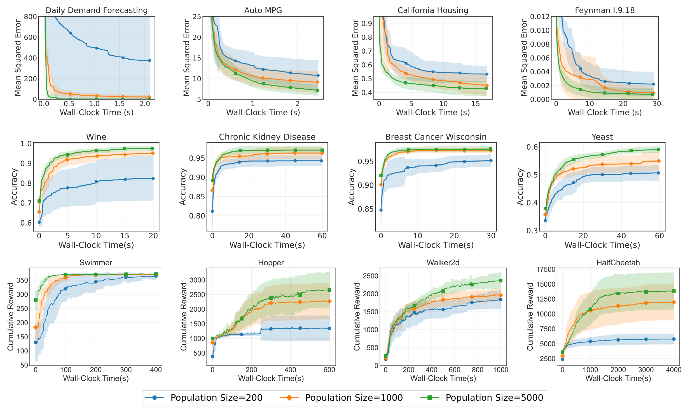

Evolutionary AI can search over executable structures as well as parameter vectors. EvoGP develops this direction within the EvoX ecosystem by making tree-based programs computationally tractable as large populations. Irregular structures and execution paths make this a representation and scheduling problem as much as an algorithmic one. [EvoGP](https://github.com/EMI-Group/evogp)

To address this challenge, **we propose the EvoGP framework, reorganizing tree representation, genetic operator logic, and parallel execution mechanisms from the ground up.** Experimental results show that **EvoGP achieves peak computational throughput exceeding 10^11 GPops/s, enabling rapid evaluation of populations of 500,000 individuals within one second—up to 304× faster than existing GPU implementations.** This milestone marks a definitive break from hardware adaptation barriers, ushering genetic programming into the era of GPU-accelerated high-performance computing.

## The GPU Adaptation Challenge in Genetic Programming
In recent years, GPUs have become a critical infrastructure for high-performance intelligent computing, thanks to their massive parallelism and high throughput. Yet genetic programming has consistently failed to fully leverage this hardware advantage. The core obstacle lies in the lack of representation and execution methods aligned with modern hardware architectures. The GPU's Single Instruction, Multiple Threads (SIMT) execution model excels at processing regular, uniform, batchable data. Genetic programming individuals, by contrast, exhibit significant structural heterogeneity—varying tree sizes, topologies, and evaluation logic. Once placed on a GPU, these structures immediately expose issues such as non-contiguous memory access, inefficient dynamic memory allocation, and severe thread divergence.

At the same time, to truly unleash GPU compute power, a system must handle both data-level parallelism within individual trees and individual-level parallelism across the population. Unifying these two modes under a single scheduling strategy, optimizing memory layout, and preventing resource contention constitute a formidable systems engineering challenge. Many past implementations, due to fundamental design flaws, exploited only data-level parallelism, leaving much of the GPU's concurrent capacity idle. **EvoGP addresses this root problem: rather than forcing genetic programming to barely run on GPUs, it provides a purpose-built underlying architecture that makes genetic programming a computation framework truly ready for the GPU era.**

## Tensorized Representation of Tree Structures
To bring genetic programming into the GPU era, the first task is to eliminate the heterogeneity barrier of individual structures. Traditional pointer-based or linked-list tree structures produce highly irregular memory layouts that completely block GPU batch execution. To this end, **EvoGP introduces an innovative tensorized representation, using a linear prefix encoding scheme to encode tree structures as contiguous arrays containing node types, node values, and subtree sizes.**

To handle trees of varying sizes, **EvoGP introduces a maximum allowed length constraint and uses NaN values for padding alignment.** Through this conversion, EvoGP successfully transforms morphologically diverse individuals in a population into fixed-shape, memory-aligned tensor matrices. This tensorization eliminates the overhead of dynamic memory allocation and irregular indexing, ensuring that the GPU can perform uniform memory access and high-throughput concurrent computation—forming the foundation for the entire framework's entry into the GPU era.

*Figure 1: Tensorized representation of tree structures. EvoGP encodes trees into a unified batch representation, enabling GPU-efficient processing of program individuals with diverse structures.*

## Unified Refactoring of Genetic Operators
After completing the tensorized representation of tree structures, EvoGP further refactors genetic operators to align with GPU architecture at the lowest level. In traditional tree representations, structural modifications such as crossover or mutation typically require repeated sequence parsing to determine subtree boundaries, incurring *O*(n) time complexity and making GPU execution highly inefficient. Thanks to the explicitly preserved subtree size arrays in the tensorized encoding, the system can now directly access subtree boundaries in *O*(1) time, completely eliminating costly structural parsing.

Building on this advantage, **EvoGP extracts the structural commonalities of various tree-based genetic operators—such as one-point crossover and subtree mutation—and unifies them into a single core computational primitive: subtree exchange.** This transforms complex structural evolution into highly regular memory slicing and tensor concatenation operations. This refactoring significantly reduces control-flow overhead during parallel execution, making the core evolutionary process of genetic programming a form of computation well suited to modern high-throughput hardware.

*Figure 2: Unified crossover/mutation operations. EvoGP unifies multiple tree-based genetic operators under a single underlying mechanism, making the core evolutionary process better suited for GPU parallel execution.*

## Adaptive Switching of Parallel Strategies
To thrive in the GPU era, an algorithm must be capable of extracting maximum hardware compute power. Data scales vary dramatically across tasks, and a single parallel strategy cannot maintain stable device utilization. To this end, **EvoGP designs and implements an adaptive parallel strategy that dynamically combines intra-individual and inter-individual parallelism based on dataset size.**

When processing small to medium-sized datasets, the system adopts a hybrid parallel mode, combining data-level and population-level parallelism within a single compute kernel—ensuring that when individual workloads are insufficient, population-level concurrency fills idle GPU cores. For large-scale datasets, a single evaluation task can saturate the hardware, and the system automatically switches to pure data-parallel mode, launching independent compute kernels for each individual's evaluation and loading tree structures into read-only constant memory—maximizing memory broadcast efficiency and significantly improving memory access throughput. This adaptive mechanism ensures the system maintains extremely high computational efficiency across diverse workloads, serving as a core guarantee of the GPU acceleration framework.

*Figure 3: Adaptive parallel mechanism. EvoGP automatically switches between different parallel modes based on task scale to maintain higher computational efficiency.*

## Unifying High Performance and Usability
The vitality of a high-performance computing framework lies not only in underlying speed, but also in ecosystem compatibility and ease of use. Many practical applications are deployed in Python-based ecosystems such as OpenAI Gym, MuJoCo, Brax, and Genesis. **While pursuing extreme GPU acceleration, EvoGP achieves seamless integration with existing development ecosystems by embedding custom high-performance CUDA compute kernels as custom operators within the PyTorch runtime.**

EvoGP can keep population tensors and compatible evaluation data on the GPU across evolutionary iterations, reducing repeated host-device transfers. Initial data loading, CPU-based objectives and exporting results may still require transfers. End-to-end acceleration therefore depends on the entire evaluation pipeline.

*Figure 4: Overall architecture. EvoGP is not an isolated acceleration module, but a complete framework that balances underlying performance with upper-layer usability.*

## Unlocking Performance at Large Population Scales
Breaking through compute bottlenecks directly expands the search boundaries of evolutionary algorithms, allowing genetic programming to truly benefit from the GPU era. In the past, ultra-large population settings were often impractical due to prohibitive computational costs. Under EvoGP's extremely high-throughput population-level parallel mechanism, processing massive numbers of individuals has become genuinely feasible in practice.

Core benchmark tests show that EvoGP's peak throughput exceeds 10^11 GPops/s, demonstrating astonishing speed under massive concurrency—completing comprehensive evaluation of populations up to 500,000 individuals in just one second. In runtime, it establishes a decisive lead over existing GPU implementations. More critically, in large-scale population tests, the algorithm exhibits excellent scalability: on symbolic regression error convergence, classification accuracy improvement, and cumulative rewards in robot control tasks, larger populations consistently yield better final performance. This proves that EvoGP releases not just computational speed—it enables larger populations to reach higher-quality solutions in shorter wall-clock time, fundamentally raising the search potential and capability ceiling of genetic programming methods.

*Figure 5: Overall performance comparison. EvoGP achieves significant performance advantages across multiple task settings while maintaining stable result quality.*

*Figure 6: Performance across different population scales. EvoGP makes larger population sizes practically usable within acceptable time and unlocks stronger search potential.*

## Conclusion

Start with a small symbolic-regression task. Keep the primitive set, tree-size limit and evaluation budget explicit before increasing the population. [Getting Started with EvoX: Your First Evolutionary Workflow](/news/evox-quickstart)

## Resources

- [Research paper](https://ieeexplore.ieee.org/document/11390710)
- [GitHub](https://github.com/EMI-Group/evogp)
- [EvoX](https://github.com/EMI-Group/evox)
