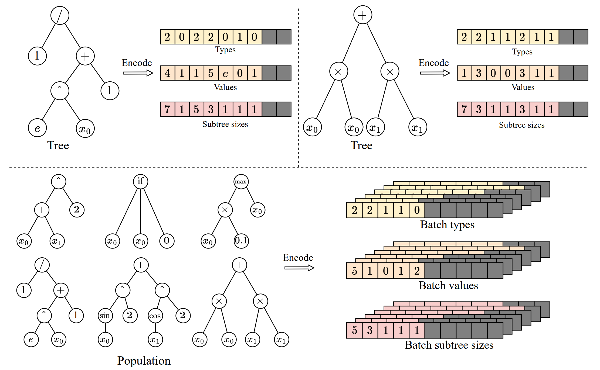
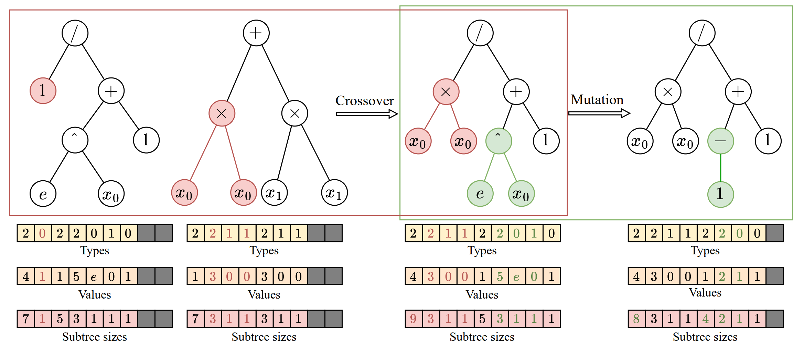
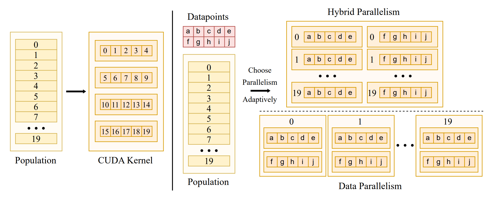
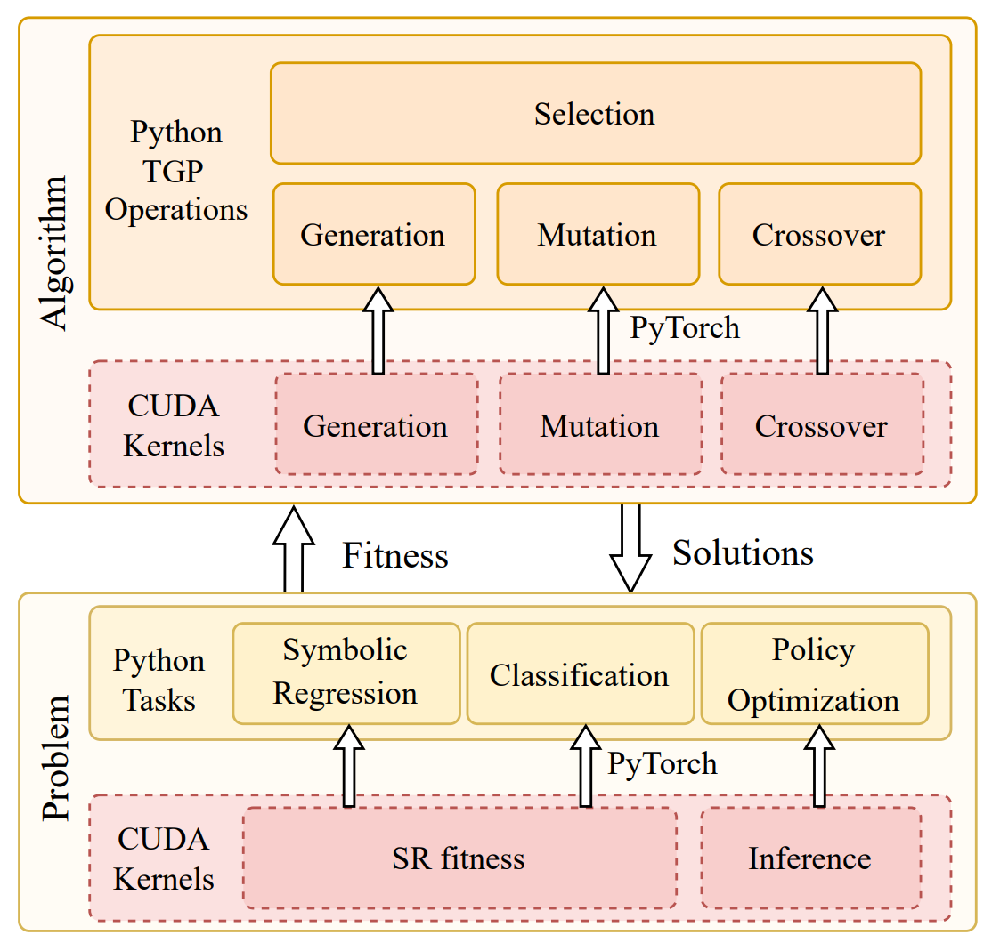
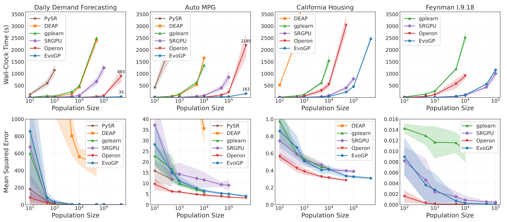
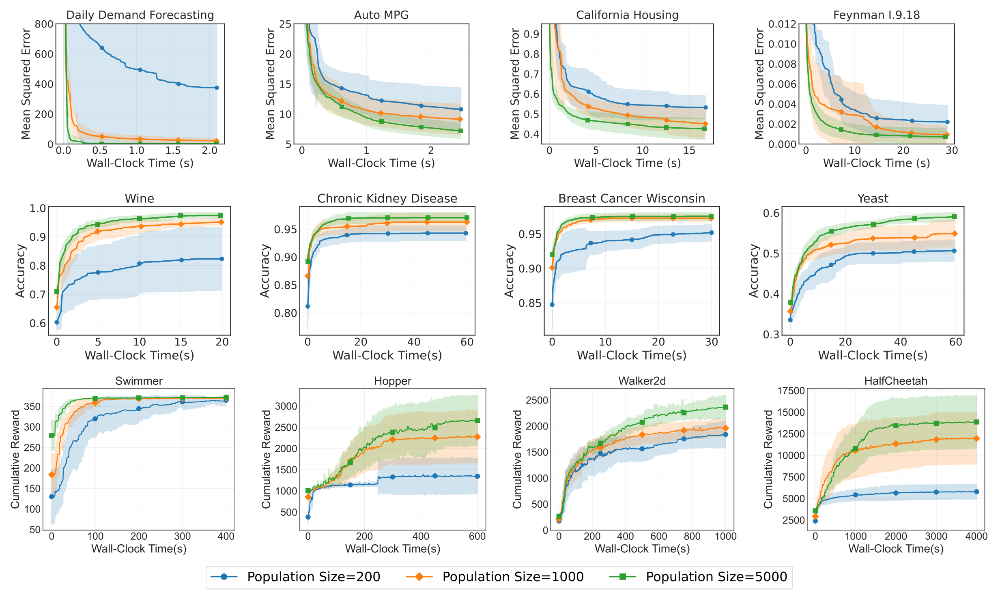

*2026年11月7日更新。過去の結果は元の記録日時に基づきます。*

進化型 AI はパラメータベクトルだけでなく、実行可能な構造も探索できます。EvoGP は EvoX エコシステムでこの方向を進め、木構造のプログラムを大きな集団として計算可能にします。不規則な構造と実行経路には、アルゴリズムとともに表現やスケジューリングの設計が必要です。

この課題に対処するため、**我々は EvoGP フレームワークを提案し、木の表現、遺伝的操作子のロジック、並列実行メカニズムを根本から再設計した。**実験結果によれば、**EvoGP はピーク計算スループット 10^11 GPops/s を超え、50 万個体規模の個体群を 1 秒以内に高速評価でき、既存 GPU 実装に対して最大 304 倍の高速化を達成する。**このマイルストーンは、遺伝的プログラミングがハードウェア適応の壁を決定的に打ち破り、GPU 加速による高性能コンピューティングの時代に突入したことを示す。

## 遺伝的プログラミングにおける GPU 適応の課題
近年、GPU は大規模な並列性と高いスループットにより、高性能インテリジェントコンピューティングの重要な基盤となっている。それにもかかわらず、遺伝的プログラミングはこのハードウェアの利点を十分に活用できていない。核心的な障壁は、現代のハードウェアアーキテクチャに適合した表現と実行方式の欠如にある。GPU の Single Instruction, Multiple Threads（SIMT）実行モデルは、規則的で均一かつバッチ処理可能なデータの処理に優れる。一方、遺伝的プログラミングの個体は、木のサイズ、トポロジ、評価ロジックが異なるなど、顕著な構造の異質性を示す。これらの構造を GPU 上に載せると、非連続なメモリアクセス、非効率な動的メモリ割り当て、深刻なスレッド分岐などの問題が直ちに露呈する。

同時に、GPU の計算能力を真に引き出すには、個体木内部のデータレベル並列と個体群レベルの個体間並列の両方を扱う必要がある。単一のスケジューリング戦略の下でこれら二つのモードを統一し、メモリレイアウトを最適化し、リソース競合を防ぐことは、極めて困難なシステム工学上の課題である。過去の多くの実装は、根本的な設計上の欠陥によりデータレベル並列のみを利用し、GPU の並行処理能力の多くが遊休状態にあった。**EvoGP が解決するのはまさにこの根本問題である。遺伝的プログラミングを GPU 上でなんとか動かすのではなく、GPU 時代に真に備えた計算フレームワークとなる専用の基盤アーキテクチャを提供する。**

## 木構造のテンソル化表現
遺伝的プログラミングを GPU 時代に導くには、まず個体構造の異質性の壁を取り除く必要がある。従来のポインタベースや連結リストによる木構造は、極めて不規則なメモリレイアウトを生み、GPU のバッチ実行を完全に阻害する。このため、**EvoGP は革新的なテンソル化表現を導入し、線形プレフィックス符号化方式により、木構造をノード型、ノード値、部分木サイズを含む連続配列として符号化する。**

サイズの異なる木に対処するため、**EvoGP は最大許容長制約を導入し、NaN 値でパディングによる整列を行う。**この変換により、EvoGP は個体群内の形態の多様な個体を、固定形状でメモリ整列されたテンソル行列に統一的に変換する。このテンソル化は動的メモリ割り当てのオーバーヘッドと不規則なインデックスを排除し、GPU が均一なメモリアクセスと高スループットの並行計算を実行できる基盤を形成する——フレームワーク全体が GPU 時代に入るための土台である。

図 1：木構造のテンソル化表現。EvoGP は木を統一されたバッチ表現に符号化し、構造の多様なプログラム個体を GPU で効率的に処理できるようにする。

## 遺伝的操作子の統一的リファクタリング
木構造のテンソル化表現を完了した後、EvoGP はさらに遺伝的操作子を最下層からリファクタリングし、GPU アーキテクチャに適合させる。従来の木表現では、交叉や突然変異などの構造変更に、部分木境界を決定するための反復的なシーケンス解析が必要となり、*O*(n) の時間計算量を招き、GPU 実行の効率を著しく低下させる。テンソル化符号化で明示的に保持された部分木サイズ配列のおかげで、システムは *O*(1) 時間で部分木境界に直接アクセスでき、コストの高い構造解析を完全に排除する。

この利点を基に、**EvoGP は一点交叉や部分木突然変異など、各種の木ベース遺伝的操作子の構造的共通性を抽出し、単一のコア計算プリミティブ「部分木交換」に統一する。**これにより、複雑な構造進化が、高度に規則的なメモリスライシングとテンソル連結操作へと変換される。このリファクタリングは並列実行時の制御フローオーバーヘッドを大幅に削減し、遺伝的プログラミングのコア進化プロセスを、現代の高スループットハードウェアに適した計算形態とする。

図 2：統一された交叉/突然変異操作。EvoGP は複数の木ベース遺伝的操作子を単一の基盤メカニズムの下に統一し、コア進化プロセスを GPU 並列実行により適したものにする。

## 並列戦略の適応的切り替え
GPU 時代に繁栄するには、アルゴリズムがハードウェアの計算能力を最大限に引き出す必要がある。タスクごとにデータ規模は劇的に異なり、単一の並列戦略では安定したデバイス利用率を維持できない。このため、**EvoGP は適応的並列戦略を設計・実装し、データセットサイズに応じて個体内並列と個体間並列を動的に組み合わせる。**

中小規模のデータセットを処理する際、システムはハイブリッド並列モードを採用し、単一の計算カーネル内でデータレベルと個体群レベルの並列を組み合わせる——個体のワークロードが不足する場合、個体群レベルの並行性が遊休 GPU コアを埋める。大規模データセットでは、単一の評価タスクがハードウェアを飽和させ、システムは自動的に純粋なデータ並列モードに切り替わり、各個体の評価に独立した計算カーネルを起動し、木構造を読み取り専用の定数メモリにロードする——メモリブロードキャスト効率を最大化し、メモリアクセスのスループットを大幅に向上させる。この適応メカニズムにより、システムは多様なワークロード全体で極めて高い計算効率を維持し、GPU 加速フレームワークの中核的保証となる。

図 3：適応的並列メカニズム。EvoGP はタスク規模に応じて異なる並列モードを自動的に切り替え、より高い計算効率を維持する。

## 高性能と使いやすさの統合
高性能コンピューティングフレームワークの生命力は、基盤の速度だけでなく、エコシステムとの互換性と使いやすさにもある。多くの実用アプリケーションは、OpenAI Gym、MuJoCo、Brax、Genesis などの Python ベースのエコシステムに展開されている。**極限の GPU 加速を追求しながら、EvoGP は PyTorch ランタイム内にカスタム高性能 CUDA 計算カーネルをカスタム演算子として埋め込むことで、既存の開発エコシステムとのシームレスな統合を実現する。**

EvoGP は進化の反復中に集団テンソルと対応する評価データを GPU に保持し、ホストとデバイス間の転送を減らせます。初期データの読み込み、CPU 上の目的関数、結果の書き出しでは転送が必要な場合があります。全体の高速化は評価パイプライン全体に依存します。

図 4：全体アーキテクチャ。EvoGP は孤立した加速モジュールではなく、基盤性能と上位層の使いやすさのバランスを取った完全なフレームワークである。

## 大規模個体群における性能の解放
計算ボトルネックの突破は、進化アルゴリズムの探索境界を直接拡大し、遺伝的プログラミングが GPU 時代の恩恵を真に受けられるようにする。過去には、超大規模個体群設定は計算コストの高さから実用的でなかった。EvoGP の極めて高いスループットの個体群レベル並列メカニズムの下では、膨大な数の個体の処理が実務上真に可能となった。

コアベンチマークテストによれば、EvoGP のピークスループットは 10^11 GPops/s を超え、大規模並行下で驚異的な速度を示す——最大 50 万個体規模の個体群の包括的評価をわずか 1 秒で完了する。実行時間において、既存 GPU 実装に対して決定的な優位を確立する。さらに重要なのは、大規模個体群テストにおいてアルゴリズムが優れたスケーラビリティを示すことである。記号回帰の誤差収束、分類精度の向上、ロボット制御タスクの累積報酬において、より大きな個体群は一貫してより優れた最終性能をもたらす。これは、EvoGP が解放するのは計算速度だけではないことを証明する——より大きな個体群がより短い壁時計時間でより高品質の解に到達でき、遺伝的プログラミング手法の探索潜在力と能力の上限を根本的に引き上げる。

図 5：全体性能比較。EvoGP は複数のタスク設定で顕著な性能優位を達成しながら、安定した結果品質を維持する。

図 6：異なる個体群規模における性能。EvoGP はより大きな個体群規模を許容可能な時間内で実用的に利用可能にし、より強力な探索潜在力を解放する。

## 結論

EvoGP は大規模な進化的探索の対象を広げます。記号式やプログラム方策を、集団として生成、実行、選択できます。その基盤上の貢献は、構造を持つ候補を GPU 計算につなぐことです。処理能力が実験規模を広げ、課題に応じた評価が有用なプログラムを決めます。

## 関連資料

- [論文](https://ieeexplore.ieee.org/document/11390710)
- [GitHub](https://github.com/EMI-Group/evogp)
- [EvoX](https://github.com/EMI-Group/evox)
