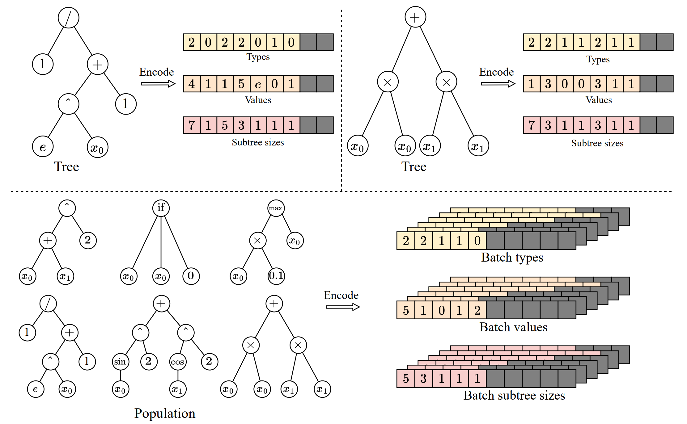
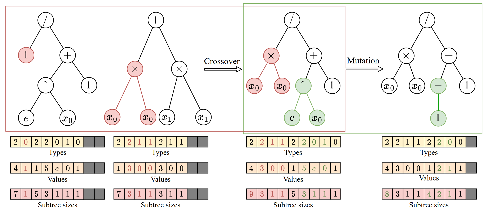
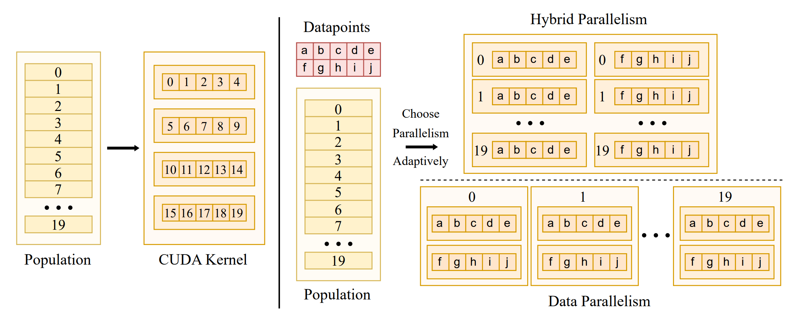
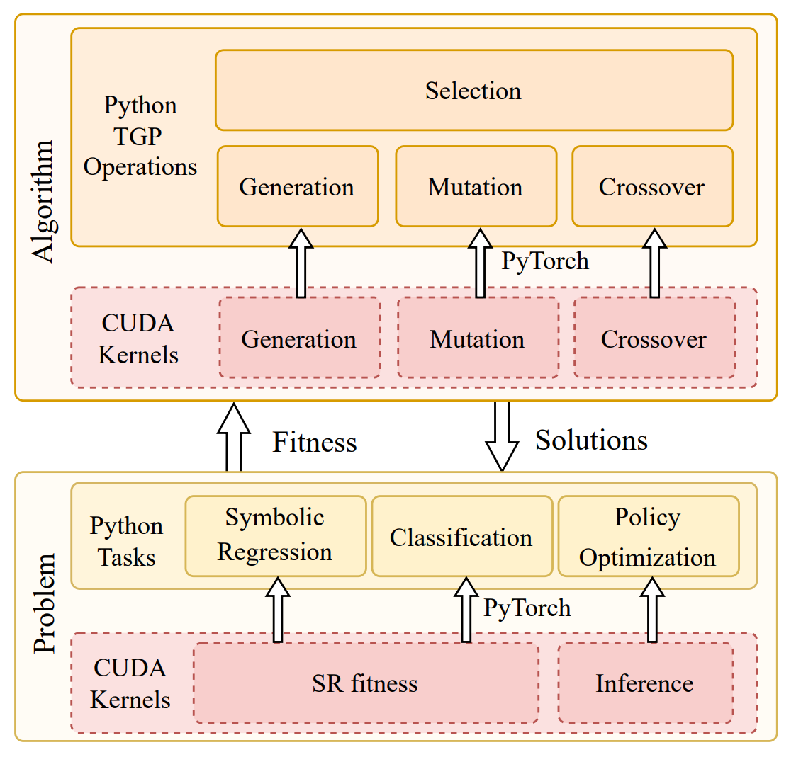
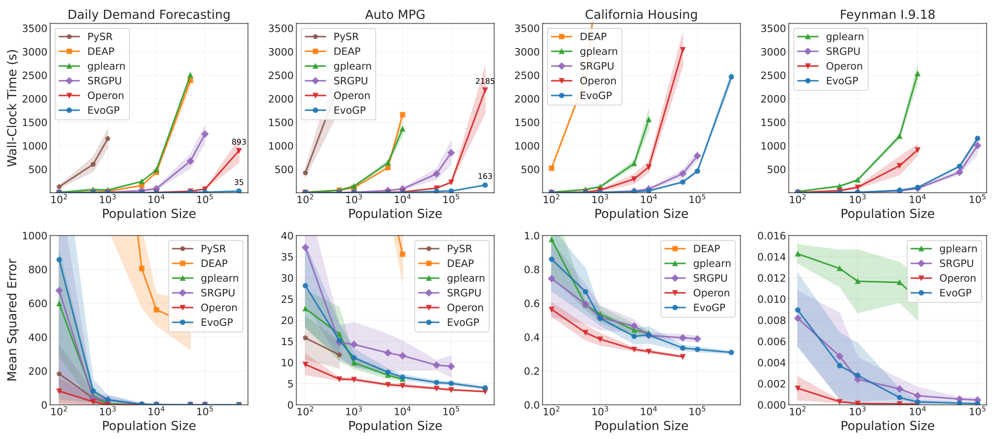
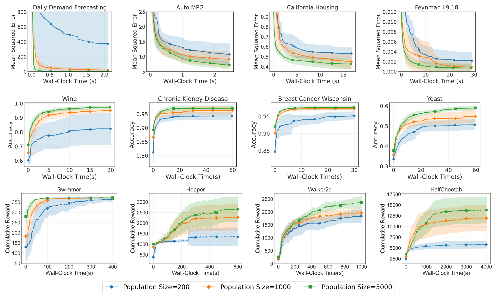

*Atualizado em 7 de novembro de 2026. Os resultados históricos mantêm a data de referência.*

A IA evolutiva pode pesquisar estruturas executáveis além de vetores de parâmetros. O EvoGP desenvolve esta direção no ecossistema EvoX, tornando viáveis grandes populações de programas em árvore. Estruturas e percursos de execução irregulares exigem soluções de representação e escalonamento, além do desenho algorítmico.

Para enfrentar esse desafio, **propomos a framework EvoGP, reorganizando desde a base a representação em árvore, a lógica dos operadores genéticos e os mecanismos de execução paralela.** Os resultados experimentais mostram que **o EvoGP atinge throughput computacional de pico superior a 10^11 GPops/s, permitindo avaliar rapidamente populações de 500.000 indivíduos em menos de um segundo — até 304× mais rápido do que as implementações GPU existentes.** Esse marco representa uma ruptura definitiva com as barreiras de adaptação ao hardware, levando a programação genética à era da computação de alto desempenho acelerada por GPU.

## O desafio da adaptação à GPU na programação genética
Nos últimos anos, as GPUs tornaram-se uma infraestrutura crítica para a computação inteligente de alto desempenho, graças ao seu paralelismo massivo e alto throughput. Contudo, a programação genética consistentemente falhou em aproveitar plenamente essa vantagem de hardware. O obstáculo central está na ausência de métodos de representação e execução alinhados às arquiteturas de hardware modernas. O modelo de execução Single Instruction, Multiple Threads (SIMT) da GPU se destaca no processamento de dados regulares, uniformes e agrupáveis em lotes. Os indivíduos de programação genética, por contraste, apresentam heterogeneidade estrutural significativa — tamanhos de árvore, topologias e lógica de avaliação variáveis. Uma vez colocados em uma GPU, essas estruturas expõem imediatamente problemas como acesso à memória não contíguo, alocação dinâmica de memória ineficiente e divergência severa de threads.

Ao mesmo tempo, para liberar de fato o poder de computação da GPU, um sistema precisa lidar tanto com o paralelismo em nível de dados dentro de cada árvore individual quanto com o paralelismo em nível de indivíduos na população. Unificar esses dois modos em uma única estratégia de escalonamento, otimizar o layout de memória e evitar contenção de recursos constitui um desafio de engenharia de sistemas considerável. Muitas implementações anteriores, devido a falhas de design fundamentais, exploraram apenas o paralelismo em nível de dados, deixando grande parte da capacidade concorrente da GPU ociosa. **O EvoGP aborda essa questão na raiz: em vez de forçar a programação genética a rodar mal nas GPUs, oferece uma arquitetura de base feita sob medida, tornando a programação genética uma framework de computação verdadeiramente preparada para a era da GPU.**

## Representação tensorizada de estruturas em árvore
Para levar a programação genética à era da GPU, a primeira tarefa é eliminar a barreira da heterogeneidade das estruturas individuais. As estruturas em árvore tradicionais baseadas em ponteiros ou listas encadeadas produzem layouts de memória altamente irregulares que bloqueiam por completo a execução em lote na GPU. Para isso, **o EvoGP introduz uma representação tensorizada inovadora, utilizando um esquema de codificação por prefixo linear para codificar estruturas em árvore como arrays contíguos que contêm tipos de nó, valores de nó e tamanhos de subárvore.**

Para lidar com árvores de tamanhos variáveis, **o EvoGP introduz uma restrição de comprimento máximo permitido e utiliza valores NaN para preenchimento e alinhamento.** Por meio dessa conversão, o EvoGP transforma com sucesso indivíduos morfologicamente diversos em uma população em matrizes tensoriais de forma fixa e alinhadas em memória. Essa tensorização elimina a sobrecarga de alocação dinâmica de memória e de indexação irregular, garantindo que a GPU possa realizar acesso uniforme à memória e computação concorrente de alto throughput — formando a base para a entrada de toda a framework na era da GPU.

Figura 1: Representação tensorizada de estruturas em árvore. O EvoGP codifica árvores em uma representação em lote unificada, permitindo que a GPU processe de forma eficiente indivíduos de programa com estruturas diversas.

## Refatoração unificada dos operadores genéticos
Após concluir a representação tensorizada das estruturas em árvore, o EvoGP refatora ainda mais os operadores genéticos para se alinharem à arquitetura GPU no nível mais baixo. Nas representações em árvore tradicionais, modificações estruturais como crossover ou mutação exigem tipicamente análise repetida de sequências para determinar limites de subárvore, com complexidade temporal *O*(n), tornando a execução na GPU altamente ineficiente. Graças aos arrays de tamanho de subárvore explicitamente preservados na codificação tensorizada, o sistema agora pode acessar diretamente os limites das subárvores em tempo *O*(1), eliminando por completo a dispendiosa análise estrutural.

Com base nessa vantagem, **o EvoGP extrai as semelhanças estruturais de vários operadores genéticos baseados em árvore — como crossover de um ponto e mutação de subárvore — e os unifica em um único primitivo computacional: troca de subárvore.** Isso transforma a evolução estrutural complexa em operações altamente regulares de fatiamento de memória e concatenação de tensores. Essa refatoração reduz significativamente a sobrecarga de fluxo de controle durante a execução paralela, tornando o processo evolutivo central da programação genética uma forma de computação bem adaptada ao hardware moderno de alto throughput.

Figura 2: Operações unificadas de crossover/mutação. O EvoGP unifica vários operadores genéticos baseados em árvore em um único mecanismo subjacente, tornando o processo evolutivo central mais adequado à execução paralela na GPU.

## Comutação adaptativa de estratégias paralelas
Para prosperar na era da GPU, um algoritmo precisa ser capaz de extrair o máximo poder de computação do hardware. As escalas de dados variam drasticamente entre tarefas, e uma única estratégia paralela não consegue manter utilização estável do dispositivo. Para isso, **o EvoGP projeta e implementa uma estratégia paralela adaptativa que combina dinamicamente paralelismo intra-indivíduo e inter-indivíduo conforme o tamanho do conjunto de dados.**

Ao processar conjuntos de dados de pequeno a médio porte, o sistema adota um modo paralelo híbrido, combinando paralelismo em nível de dados e em nível de população em um único kernel de computação — garantindo que, quando a carga de trabalho por indivíduo é insuficiente, a concorrência em nível de população preenche os núcleos GPU ociosos. Para conjuntos de dados em grande escala, uma única tarefa de avaliação pode saturar o hardware, e o sistema comuta automaticamente para modo puramente paralelo em nível de dados, lançando kernels de computação independentes para a avaliação de cada indivíduo e carregando estruturas em árvore na memória constante somente leitura — maximizando a eficiência de broadcast de memória e melhorando significativamente o throughput de acesso à memória. Esse mecanismo adaptativo garante que o sistema mantenha eficiência computacional extremamente alta em cargas de trabalho diversas, servindo de garantia central da framework de aceleração GPU.

Figura 3: Mecanismo paralelo adaptativo. O EvoGP comuta automaticamente entre diferentes modos paralelos conforme a escala da tarefa para manter maior eficiência computacional.

## Unificar alto desempenho e usabilidade
A vitalidade de uma framework de computação de alto desempenho reside não só na velocidade subjacente, mas também na compatibilidade com o ecossistema e na facilidade de uso. Muitas aplicações práticas são implantadas em ecossistemas baseados em Python, como OpenAI Gym, MuJoCo, Brax e Genesis. **Ao buscar aceleração GPU extrema, o EvoGP alcança integração transparente com os ecossistemas de desenvolvimento existentes, incorporando kernels CUDA de alto desempenho personalizados como operadores customizados no runtime PyTorch.**

O EvoGP pode manter tensores da população e dados de avaliação compatíveis na GPU entre iterações, reduzindo transferências repetidas. O carregamento inicial, objetivos executados na CPU e a exportação dos resultados podem ainda exigir transferências. A aceleração global depende de todo o processo de avaliação.

Figura 4: Arquitetura geral. O EvoGP não é um módulo de aceleração isolado, mas uma framework completa que equilibra desempenho subjacente com usabilidade na camada superior.

## Desbloquear desempenho em escalas de população elevadas
Ultrapassar os gargalos de computação expande diretamente os limites de busca dos algoritmos evolutivos, permitindo que a programação genética beneficie de fato da era da GPU. No passado, configurações de população ultra-elevadas eram frequentemente impraticáveis devido aos custos computacionais proibitivos. Com o mecanismo de paralelismo em nível de população de throughput extremamente alto do EvoGP, processar um número massivo de indivíduos tornou-se genuinamente viável na prática.

Os testes de benchmark centrais mostram que o throughput de pico do EvoGP excede 10^11 GPops/s, demonstrando velocidade surpreendente sob concorrência massiva — concluindo a avaliação abrangente de populações de até 500.000 indivíduos em apenas um segundo. Em tempo de execução, estabelece uma vantagem decisiva em relação às implementações GPU existentes. Mais criticamente, em testes de população em grande escala, o algoritmo exibe excelente escalabilidade: na convergência de erro em regressão simbólica, na melhoria de precisão em classificação e nas recompensas acumuladas em tarefas de controle robótico, populações maiores produzem consistentemente melhor desempenho final. Isso prova que o EvoGP libera não só velocidade computacional — permite que populações maiores atinjam soluções de maior qualidade em menos tempo de relógio, elevando fundamentalmente o potencial de busca e o teto de capacidade dos métodos de programação genética.

Figura 5: Comparação geral de desempenho. O EvoGP alcança vantagens de desempenho significativas em múltiplas configurações de tarefas, mantendo qualidade de resultados estável.

Figura 6: Desempenho em diferentes escalas de população. O EvoGP torna tamanhos de população maiores praticamente utilizáveis em tempo aceitável e desbloqueia maior potencial de busca.

## Conclusão

O EvoGP amplia os objetos da pesquisa evolutiva escalável: expressões simbólicas e políticas programadas podem ser geradas, executadas e selecionadas em populações. A contribuição para a infraestrutura liga estes candidatos estruturados ao cálculo GPU. A capacidade de processamento permite experimentos maiores; a avaliação da tarefa determina quais programas são úteis.

## Recursos

- [Artigo científico](https://ieeexplore.ieee.org/document/11390710)
- [GitHub](https://github.com/EMI-Group/evogp)
- [EvoX](https://github.com/EMI-Group/evox)
