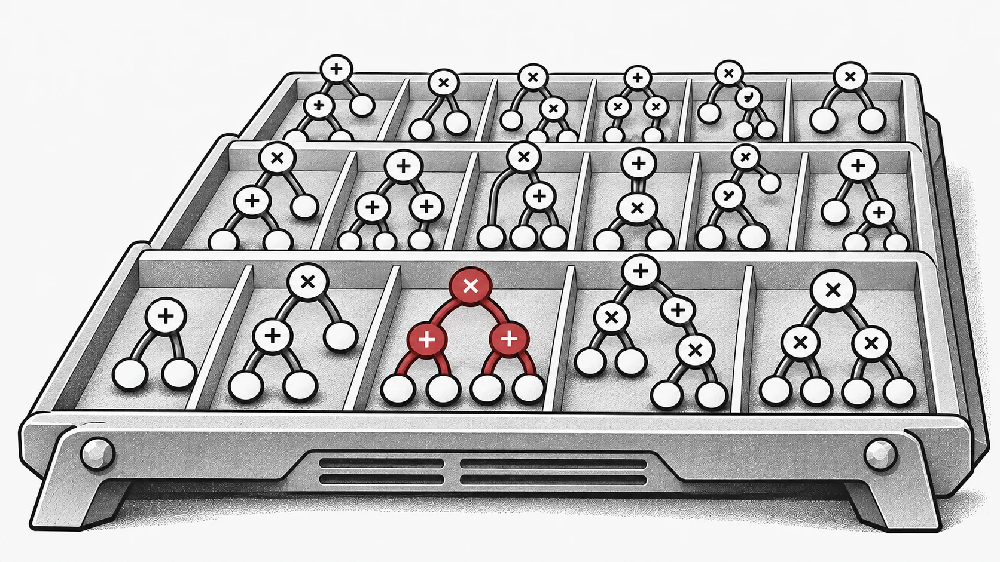
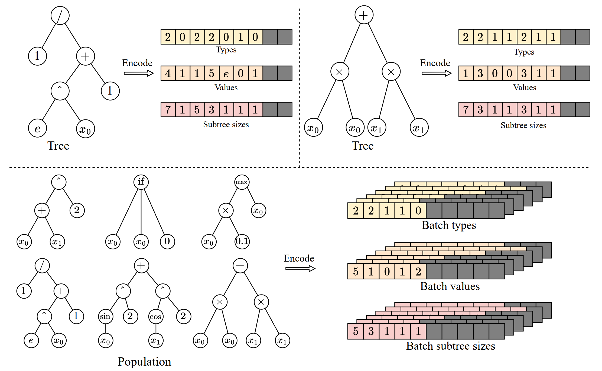
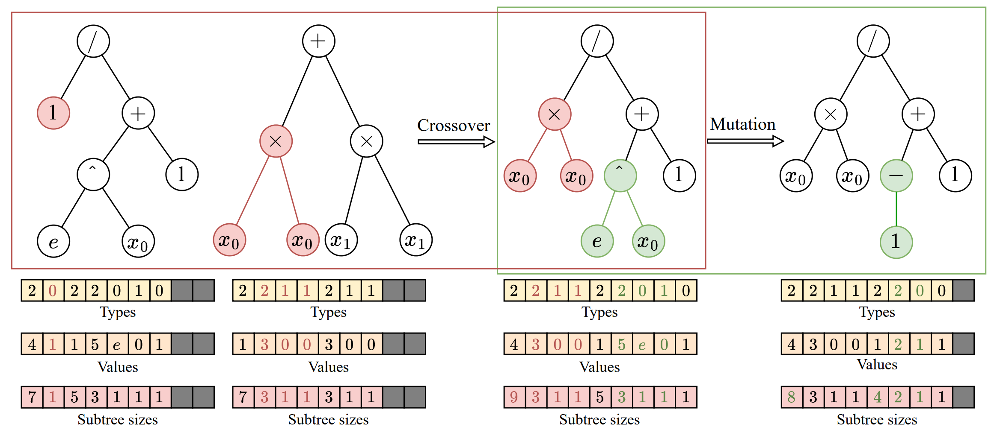
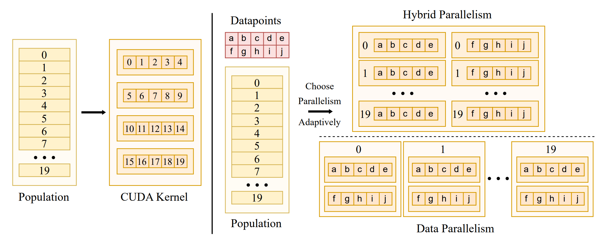
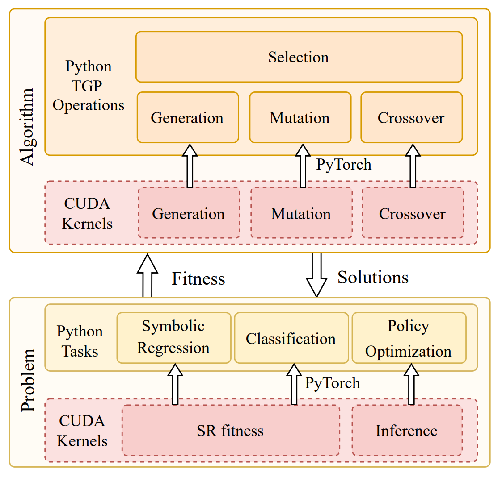
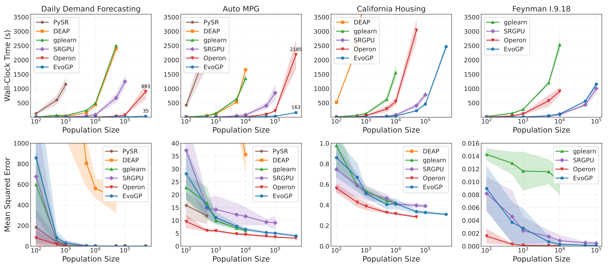
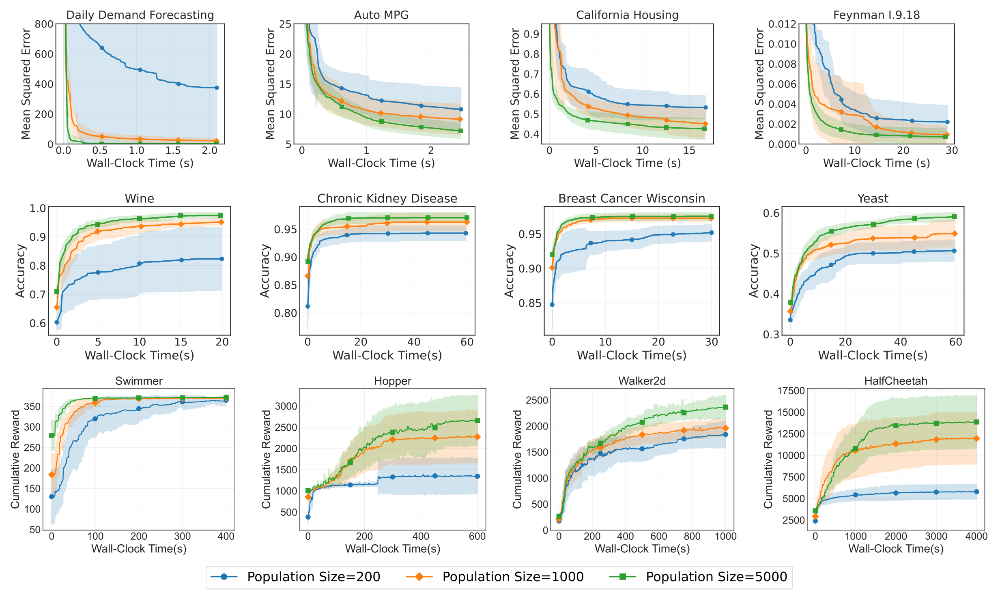

Эволюционный ИИ может искать исполняемые структуры наряду с векторами параметров. EvoGP развивает это направление в экосистеме EvoX, позволяя вычислять большие популяции древовидных программ. Нерегулярные структуры и пути выполнения требуют решений в представлении и планировании вычислений, а также в алгоритмах. [EvoGP](https://github.com/EMI-Group/evogp)

Для решения этой задачи **мы предлагаем фреймворк EvoGP, переосмысливая с нуля представление деревьев, логику генетических операторов и механизмы параллельного выполнения.** Экспериментальные результаты показывают, что **EvoGP достигает пиковой вычислительной пропускной способности свыше 10^11 GPops/s, обеспечивая быструю оценку популяций из 500 000 особей за одну секунду — до 304× быстрее существующих GPU-реализаций.** Эта веха знаменует окончательный разрыв с барьерами адаптации к аппаратному обеспечению и вводит генетическое программирование в эру высокопроизводительных вычислений с GPU-ускорением.

## Проблема адаптации генетического программирования к GPU
В последние годы GPU стали критической инфраструктурой для высокопроизводительных интеллектуальных вычислений благодаря массовому параллелизму и высокой пропускной способности. Тем не менее генетическое программирование так и не смогло в полной мере использовать это аппаратное преимущество. Основное препятствие — отсутствие методов представления и выполнения, согласованных с современными аппаратными архитектурами. Модель выполнения Single Instruction, Multiple Threads (SIMT) на GPU эффективна для обработки регулярных, однородных, пакетируемых данных. Особи генетического программирования, напротив, демонстрируют значительную структурную гетерогенность: различаются размеры деревьев, топологии и логика оценки. При размещении на GPU эти структуры сразу выявляют проблемы несмежного доступа к памяти, неэффективного динамического выделения памяти и сильной дивергенции потоков.

В то же время для полного раскрытия вычислительной мощности GPU система должна обрабатывать как параллелизм на уровне данных внутри отдельных деревьев, так и параллелизм на уровне особей в популяции. Объединение обоих режимов в единой стратегии планирования, оптимизация размещения в памяти и предотвращение конкуренции за ресурсы составляют серьёзную задачу системной инженерии. Многие прошлые реализации из-за фундаментальных недостатков проектирования использовали лишь параллелизм на уровне данных, оставляя значительную часть параллельных возможностей GPU незадействованной. **EvoGP решает эту корневую проблему: вместо того чтобы едва заставлять генетическое программирование работать на GPU, он предоставляет целевую нижележащую архитектуру, делающую генетическое программирование вычислительным фреймворком, по-настоящему готовым к эре GPU.**

## Тензорное представление древовидных структур
Чтобы вывести генетическое программирование в эру GPU, первой задачей является устранение барьера гетерогенности структур особей. Традиционные древовидные структуры на указателях или связных списках дают крайне нерегулярное размещение в памяти, полностью блокируя пакетное выполнение на GPU. С этой целью **EvoGP вводит инновационное тензорное представление, используя схему линейного префиксного кодирования для преобразования древовидных структур в непрерывные массивы с типами узлов, значениями узлов и размерами поддеревьев.**

Для обработки деревьев разного размера **EvoGP вводит ограничение максимально допустимой длины и использует значения NaN для выравнивающего заполнения.** Благодаря этому преобразованию EvoGP успешно превращает морфологически разнообразных особей популяции в тензорные матрицы фиксированной формы с выровненной памятью. Тензоризация устраняет накладные расходы динамического выделения памяти и нерегулярной индексации, обеспечивая единообразный доступ к памяти и высокопроизводительные параллельные вычисления на GPU — основу перехода всего фреймворка в эру GPU.

Рисунок 1: Тензорное представление древовидных структур. EvoGP кодирует деревья в единое пакетное представление, обеспечивая эффективную на GPU обработку программных особей с разнообразными структурами.

## Унифицированная переработка генетических операторов
После завершения тензорного представления древовидных структур EvoGP дополнительно перерабатывает генетические операторы для согласования с архитектурой GPU на самом низком уровне. В традиционных древовидных представлениях структурные изменения, такие как кроссовер или мутация, обычно требуют повторного разбора последовательностей для определения границ поддеревьев, что даёт временную сложность *O*(n) и делает выполнение на GPU крайне неэффективным. Благодаря явно сохранённым массивам размеров поддеревьев в тензорном кодировании система может напрямую обращаться к границам поддеревьев за *O*(1), полностью устраняя затратный структурный разбор.

Опираясь на это преимущество, **EvoGP выделяет структурные общие черты различных древовидных генетических операторов — таких как одноточечный кроссовер и мутация поддерева — и объединяет их в единую базовую вычислительную примитиву: обмен поддеревьями.** Это превращает сложную структурную эволюцию в высокорегулярные операции нарезки памяти и конкатенации тензоров. Такая переработка существенно снижает накладные расходы управления потоком при параллельном выполнении, делая центральный эволюционный процесс генетического программирования формой вычислений, хорошо подходящей для современного высокопроизводительного оборудования.

Рисунок 2: Унифицированные операции кроссовера/мутации. EvoGP объединяет несколько древовидных генетических операторов под единым базовым механизмом, делая центральный эволюционный процесс более пригодным для параллельного выполнения на GPU.

## Адаптивное переключение параллельных стратегий
Чтобы процветать в эру GPU, алгоритм должен извлекать максимум вычислительной мощности аппаратного обеспечения. Масштабы данных резко различаются между задачами, и единая параллельная стратегия не может поддерживать стабильную загрузку устройства. С этой целью **EvoGP проектирует и реализует адаптивную параллельную стратегию, динамически сочетающую внутриособевой и межособевой параллелизм в зависимости от размера набора данных.**

При обработке наборов данных малого и среднего размера система использует гибридный параллельный режим, объединяя параллелизм на уровне данных и популяции в одном вычислительном ядре — когда нагрузка на особь недостаточна, параллелизм на уровне популяции заполняет простаивающие ядра GPU. Для крупномасштабных наборов данных одна задача оценки может насытить аппаратное обеспечение, и система автоматически переключается в режим чистого параллелизма данных, запуская независимые вычислительные ядра для оценки каждой особи и загружая древовидные структуры в постоянную память только для чтения — максимизируя эффективность широковещательной передачи в памяти и значительно повышая пропускную способность доступа к памяти. Этот адаптивный механизм обеспечивает чрезвычайно высокую вычислительную эффективность при разнообразных нагрузках, служа ключевой гарантией фреймворка GPU-ускорения.

Рисунок 3: Адаптивный параллельный механизм. EvoGP автоматически переключается между различными параллельными режимами в зависимости от масштаба задачи для поддержания более высокой вычислительной эффективности.

## Объединение высокой производительности и удобства использования
Жизнеспособность фреймворка высокопроизводительных вычислений определяется не только базовой скоростью, но и совместимостью с экосистемой и простотой использования. Многие практические приложения развёртываются в экосистемах на базе Python, таких как OpenAI Gym, MuJoCo, Brax и Genesis. **Стремясь к экстремальному GPU-ускорению, EvoGP достигает бесшовной интеграции с существующими средами разработки, встраивая пользовательские высокопроизводительные CUDA-ядра как пользовательские операторы в среде выполнения PyTorch.**

EvoGP может сохранять тензоры популяции и совместимые данные оценки на GPU между итерациями, уменьшая повторные передачи. Начальная загрузка, целевые функции на CPU и выгрузка результатов всё ещё могут требовать передач. Итоговое ускорение зависит от всего конвейера оценки.

Рисунок 4: Общая архитектура. EvoGP — не изолированный модуль ускорения, а полноценный фреймворк, балансирующий базовую производительность и удобство верхнего уровня.

## Раскрытие производительности при крупных масштабах популяции
Преодоление вычислительных узких мест напрямую расширяет границы поиска эволюционных алгоритмов, позволяя генетическому программированию по-настоящему воспользоваться эрой GPU. Ранее сверхкрупные настройки популяции часто были непрактичны из-за запретительных вычислительных затрат. При чрезвычайно высокопроизводительном механизме популяционного параллелизма EvoGP обработка огромного числа особей стала по-настоящему осуществимой на практике.

Основные бенчмарки показывают, что пиковая пропускная способность EvoGP превышает 10^11 GPops/s, демонстрируя поразительную скорость при массовом параллелизме — завершая полную оценку популяций до 500 000 особей всего за одну секунду. По времени выполнения он устанавливает решительное преимущество над существующими GPU-реализациями. Важнее того, в крупномасштабных тестах популяции алгоритм демонстрирует отличную масштабируемость: при сходимости ошибки символьной регрессии, улучшении точности классификации и накопленных наградах в задачах управления роботами более крупные популяции стабильно дают лучший итоговый результат. Это доказывает, что EvoGP высвобождает не только вычислительную скорость — он позволяет более крупным популяциям достигать решений более высокого качества за меньшее настенное время, фундаментально повышая поисковый потенциал и потолок возможностей методов генетического программирования.

Рисунок 5: Общее сравнение производительности. EvoGP достигает значительных преимуществ в производительности в различных настройках задач при сохранении стабильного качества результатов.

Рисунок 6: Производительность при различных масштабах популяции. EvoGP делает большие размеры популяции практически применимыми за приемлемое время и раскрывает более сильный поисковый потенциал.

## Заключение

Начните с небольшой символьной регрессии. Укажите набор функций, предел размера дерева и бюджет перед увеличением популяции. [Начало работы с EvoX: первый эволюционный процесс](/ru/news/evox-quickstart)

## Ресурсы

- [Научная статья](https://ieeexplore.ieee.org/document/11390710)
- [GitHub](https://github.com/EMI-Group/evogp)
- [EvoX](https://github.com/EMI-Group/evox)
