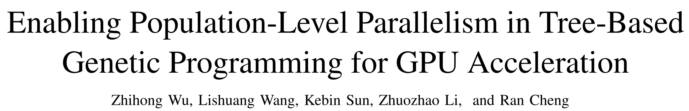
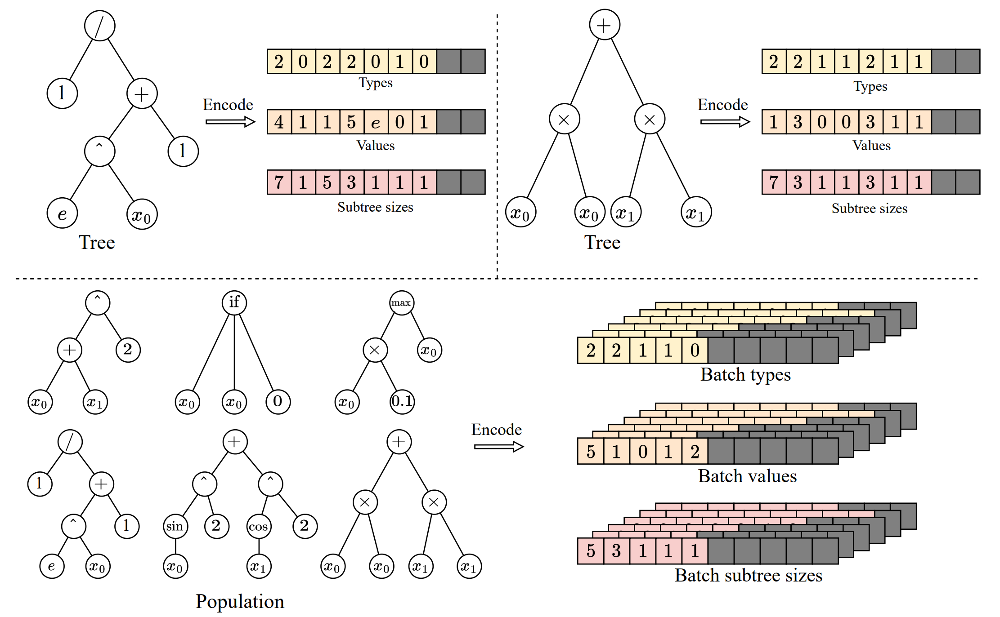
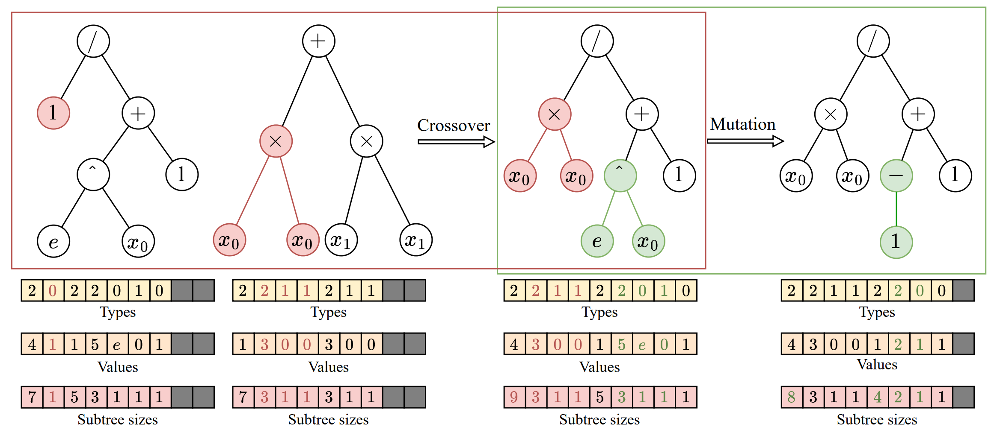
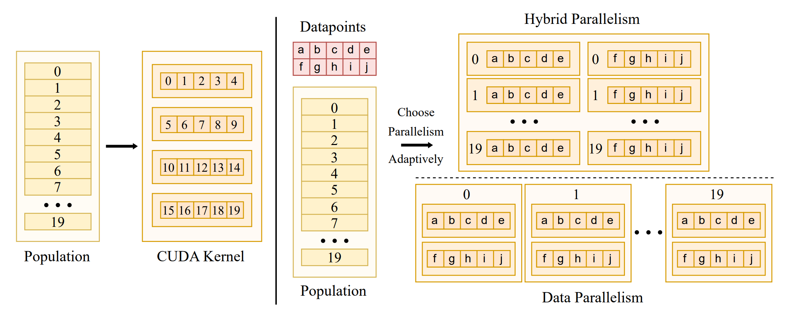
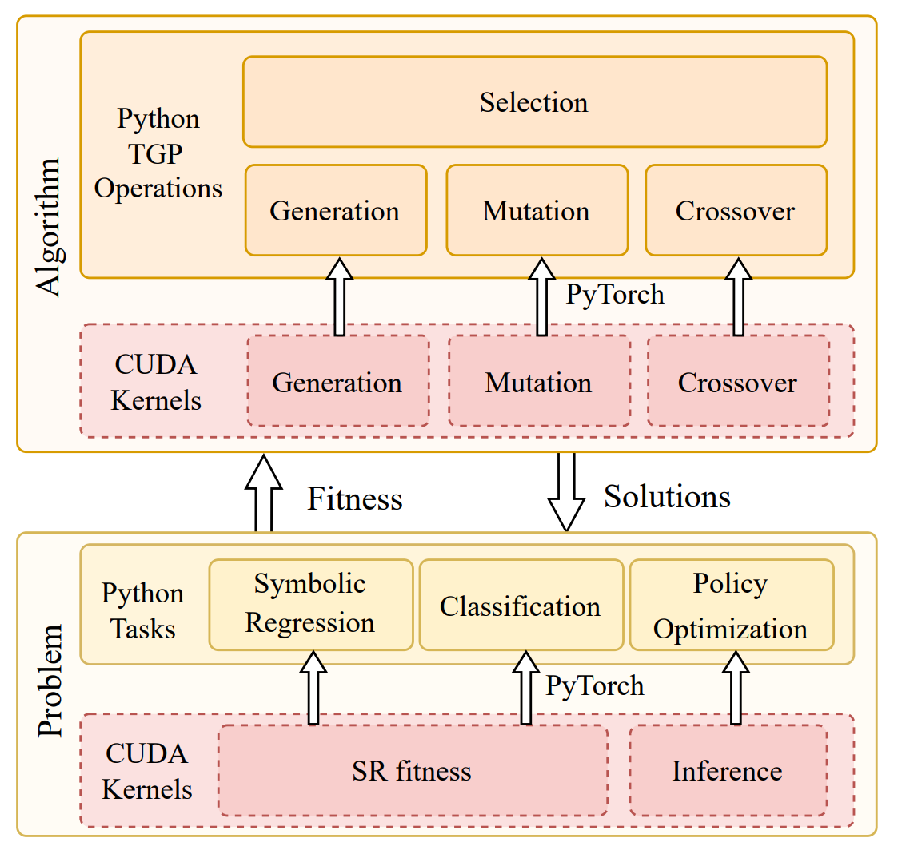
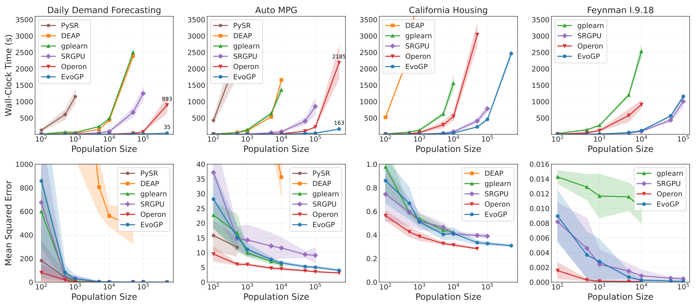
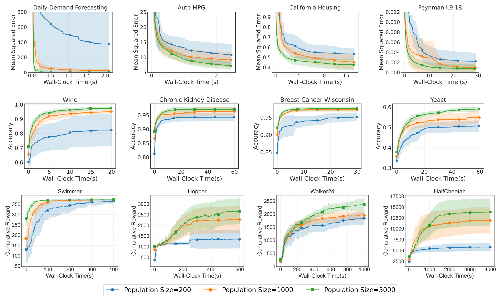

*更新于 2026 年 11 月 7 日。历史结果保留其原始记录日期。*

演化式 AI 的搜索对象既可以是参数向量，也可以是可执行结构。EvoGP 在 EvoX 生态中发展这一方向，使树形程序能够作为大规模种群参与计算。结构差异与不规则执行路径，也让它成为一个表示与调度问题，需要与算法设计一同解决。

为应对这一挑战，**我们提出了 EvoGP 框架，从底层重新组织树表示、遗传算子逻辑与并行执行机制。**实验结果表明，**EvoGP 的峰值计算吞吐量突破 10^11 GPops/s，能够在 1 秒内完成 50 万规模种群的快速评测，相比现有 GPU 实现最高可达 304 倍加速。**这一里程碑标志着遗传编程彻底打破了硬件适配壁垒，真正进入 GPU 加速的高性能计算时代。

## 遗传编程的 GPU 适配难题
近年来，GPU 凭借其海量并行性与高吞吐量，已成为高性能智能计算的关键基础设施。然而，遗传编程始终未能充分利用这一硬件优势。核心障碍在于缺乏与现代硬件架构相匹配的表示与执行方式。GPU 的单指令多线程（SIMT）执行模型最擅长处理规则、统一、可批量化的数据；而遗传编程个体则呈现出显著的结构异质性——树的大小、拓扑结构以及评估逻辑各不相同。一旦将这些结构放到 GPU 上，立刻暴露出访存不连续、动态内存分配效率低下以及严重的线程执行分歧等问题。

同时，要真正释放 GPU 算力，系统需要同时处理单个个体内部的数据级并行与种群层面的个体级并行。在单一调度策略下统一这两种模式、优化内存布局并防止资源争用，是一项极具挑战性的系统工程。许多过往实现由于底层设计缺陷，往往只利用了数据级并行，导致 GPU 的大量并发能力处于闲置状态。**EvoGP 要解决的正是这一根本问题：不是让遗传编程勉强能在 GPU 上运行，而是提供一套专门定制的底层架构，使遗传编程成为真正为 GPU 时代准备好的计算框架。**

## 树结构的张量化表示
要让遗传编程进入 GPU 时代，首要任务是消除个体结构的异质性障碍。传统基于指针或链式的树结构会产生极不规则的内存布局，完全阻碍 GPU 的批量执行。为此，**EvoGP 引入了一种创新的张量化表示方法，采用线性前缀编码方案，将树结构编码为包含节点类型、节点值和子树大小的连续数组。**

为处理大小不一的树，**EvoGP 引入最大允许长度约束，并使用 NaN 值进行填充对齐。**通过这种转换，EvoGP 成功将种群中形态各异的个体统一转化为形状固定、内存对齐的张量矩阵。这种张量化处理彻底消除了动态内存分配的开销和不规则索引，保证 GPU 能够进行统一的内存访问和高吞吐量的并发计算——构成了整个框架进入 GPU 时代的基础。

*图 1：树结构的张量化表示。EvoGP 将树编码为统一的批量表示，使 GPU 能够高效处理结构各异的程序个体。*

## 遗传算子的统一重构
在完成树结构的张量化表示之后，EvoGP 进一步在底层对遗传算子进行重构，使其与 GPU 架构对齐。在传统树表示中，交叉或变异等结构修改通常需要反复解析序列以确定子树边界，带来 *O*(n) 的时间复杂度，使 GPU 执行效率极低。得益于张量化编码中显式保留的子树大小数组，系统现在可以在 *O*(1) 时间内直接访问子树边界，彻底消除了代价高昂的结构解析。

在此基础上，**EvoGP 提取了各类基于树的遗传算子（如单点交叉和子树变异）的结构共性，并将其统一为单一核心计算原语：子树交换。**这将复杂的结构演化转化为高度规则的内存切片与张量拼接操作。这一重构显著降低了并行执行过程中的控制流开销，使遗传编程的核心演化过程成为更适合现代高吞吐硬件的计算形式。

*图 2：统一的交叉/变异操作。EvoGP 将多种基于树的遗传算子统一在单一底层机制之下，使核心演化过程更适合 GPU 并行执行。*

## 并行策略的自适应切换
要在 GPU 时代蓬勃发展，算法必须能够充分挖掘硬件算力。不同任务的数据规模差异巨大，单一并行策略无法维持稳定的设备利用率。为此，**EvoGP 设计并实现了自适应并行策略，根据数据集规模动态组合个体内部与个体之间的并行。**

在处理中小规模数据集时，系统采用混合并行模式，在单一计算内核中结合数据级与种群级并行——当个体工作负载不足时，种群级并发填补空闲的 GPU 核心。对于大规模数据集，单次评估任务即可饱和硬件，系统自动切换为纯数据并行模式，为每个个体的评估启动独立计算内核，并将树结构加载到只读常量内存中——最大化内存广播效率，显著提升访存吞吐量。这一自适应机制确保系统在各种工作负载下都能保持极高的计算效率，是 GPU 加速框架的核心保障。

*图 3：自适应并行机制。EvoGP 根据任务规模自动切换不同并行模式，以维持更高的计算效率。*

## 高性能与易用性的统一
高性能计算框架的生命力不仅在于底层速度，还在于生态兼容性与易用性。许多实际应用部署在 OpenAI Gym、MuJoCo、Brax、Genesis 等基于 Python 的生态中。**在追求极致 GPU 加速的同时，EvoGP 通过在 PyTorch 运行时中嵌入自定义高性能 CUDA 计算内核作为自定义算子，实现了与现有开发生态的无缝集成。**

EvoGP 可以在多轮演化中将种群张量和兼容的评价数据保留在 GPU 上，减少重复的主机—设备传输。初始数据加载、基于 CPU 的目标函数和结果导出仍可能需要传输，端到端加速取决于完整评价流程。

*图 4：整体架构。EvoGP 并非孤立的加速模块，而是一个在底层性能与上层易用性之间取得平衡的完整框架。*

## 在大种群规模下释放性能
突破计算瓶颈直接拓展了演化算法的搜索边界，使遗传编程真正受益于 GPU 时代。过去，超大规模种群设置往往因计算成本过高而难以实用。在 EvoGP 极高吞吐的种群级并行机制下，处理海量个体已在实践中切实可行。

核心基准测试表明，EvoGP 的峰值吞吐量突破 10^11 GPops/s，在海量并发下展现出惊人的速度——仅用 1 秒即可完成最多 50 万规模种群的全面评测。在运行时间上，它对现有 GPU 实现建立了决定性优势。更关键的是，在大规模种群测试中，算法展现出优秀的可扩展性：在符号回归误差收敛、分类精度提升以及机器人控制任务的累积奖励等方面，更大的种群始终带来更优的最终性能。这证明 EvoGP 释放的不仅是计算速度——它使更大种群能够在更短的墙钟时间内达到更高质量的解，从根本上提升了遗传编程方法的搜索潜力与能力上限。

*图 5：整体性能对比。EvoGP 在多种任务设置下均取得显著性能优势，同时保持稳定的结果质量。*

*图 6：不同种群规模下的性能。EvoGP 使更大种群规模在可接受时间内切实可用，并释放更强的搜索潜力。*

## 结论

EvoGP 扩展了可规模化演化搜索所处理的对象：符号表达式与程序化策略可以作为种群被生成、执行和选择。它的基础设施价值，在于将这些具有结构的候选对象接入 GPU 计算。吞吐量为更大规模实验提供条件，具体任务的评价则决定哪些程序真正有用。

## 相关资源

- [研究论文](https://ieeexplore.ieee.org/document/11390710)
- [GitHub](https://github.com/EMI-Group/evogp)
- [EvoX](https://github.com/EMI-Group/evox)
