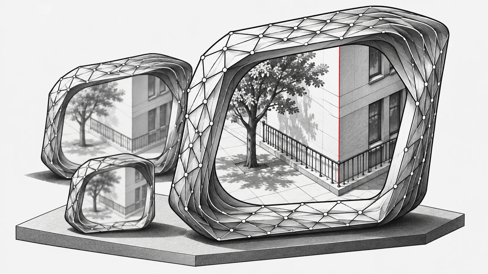

탐색에서 앞섰던 네트워크가 독립적으로 학습한 뒤에는 기대에 못 미칠 수 있습니다. 이전 평가가 다음 세대의 후보를 결정하는 진화적 탐색에서 이런 오판은 큰 비용을 치르게 합니다. 순위가 왜곡되면 더 오래 탐색해도 잘못된 방향으로 나아갈 수 있습니다. EvoNAS는 슈퍼넷 학습, 후보 평가, 정확도와 계산 비용의 절충을 연결해 이 문제를 다룹니다.

## 평가의 신뢰성이 탐색을 좌우한다

모든 후보를 따로 학습하면 계산 비용이 크게 늘어납니다. 가중치 공유는 비용을 줄이지만 후보들의 학습도 서로 연결합니다. 공유 매개변수의 혜택을 가장 많이 받는 구조가 독립 학습에서도 가장 좋은 것은 아닙니다. 선택이 다음 세대를 바꾸므로 평가의 왜곡은 전체 탐색 방향에 영향을 줍니다.

슈퍼넷은 후보 간에 매개변수를 공유합니다. 그러나 물려받은 가중치로 측정한 성능이 아키텍처의 잠재력을 정확히 나타낸다고 단정할 수는 없습니다. 2026년 3월 20일 제출된 논문은 VSS–ViT 하이브리드 슈퍼넷과 공간·주파수 영역의 표현을 정렬하는 CA-DDKD를 제안합니다. PST는 큰 구성에서 작은 구성으로 학습 범위를 확장합니다.

건물을 알아보는 능력과 경계를 정확히 찾는 능력은 다릅니다. 깊이 추정과 분할에서는 가는 난간, 벽 모서리, 전경과 배경 사이의 경계도 중요합니다. CA-DDKD는 이산 코사인 변환 제약으로 이런 기하 정보를 보존하도록 돕습니다. 특징의 위치를 다루는 공간 영역과 경계·질감의 변화를 다루는 주파수 영역이 서로 보완합니다.

따라서 학습 전략도 탐색 방법의 일부입니다. 공유 표현이 좋아져야 후보 비교의 근거도 좋아집니다. 후보 수만 늘려서는 신뢰하기 어려운 순위를 고칠 수 없습니다.

## 제약에 따라 후보 비교하기

깊이 추정에서는 지연 시간 한도를 맞추기 위해 정확도와 절충할 수 있습니다. 다목적 탐색은 해당 조건에서 비교할 후보들을 제공합니다. DMMPE는 GPU 자원 풀과 비동기 스케줄링으로 여러 모델을 평가합니다. 실제 선택에는 대상 하드웨어, 데이터셋, 측정 방식이 중요합니다.

후보들은 비교 가능한 하드웨어와 실행 조건에서 평가해야 합니다. 탐색 설정은 무엇을 유망하다고 볼지 정하고, 재학습은 선택한 구조가 학습 후 무엇을 해낼지 보여줍니다. 두 단계를 연결하는 것이 EvoNAS의 순위 문제를 살펴보는 출발점입니다.

## 실험을 시작하기 전에

과정은 ImageNet-1k 사전학습, 대상 데이터셋의 PST 미세조정, 진화적 탐색, 선택한 서브넷 재학습의 네 단계입니다. KITTI와 NYU Depth v2 깊이 추정, COCO 검출, ADE20K 분할 경로가 안내되어 있습니다. 한 데이터셋의 데이터 경로, 학습 설정, 탐색 목표, 재학습 설정을 연결해 확인하면 탐색 점수와 최종 모델의 관계를 이해할 수 있습니다.

README는 필요한 사전학습 슈퍼넷 다운로드를 여전히 준비 중으로 표시합니다. 시작 전에 가중치 제공 여부를 확인하고 Mamba SSM wheel을 문서의 Python, CUDA, PyTorch 환경에 맞춰야 합니다.

[소스 및 설치 안내](https://github.com/EMI-Group/evonas/blob/e4f6866e8092545b2b9b28f3fe0162e038e34f3c/README.md) · [논문](https://arxiv.org/abs/2603.19563v1)

[EvoX](/ko/libs)
