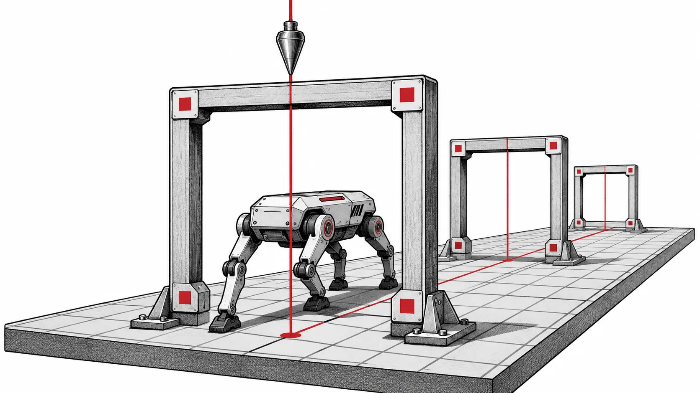

强化学习可能尚未学到任何东西就运行失败，也可能顺利结束，却用日志掩盖了实际测量对象。EvoRL 在 2026 年 11 月 8 日合入 main 的更新处理 JAX 求导和环境兼容性，并延续 10 月的设备放置与种群指标修正。[v0.2.0 源码标签][s1] 保存了这个可复查的开发快照。

*概念插画：一致的训练依赖多个彼此对齐的执行约定。*

## 对 JAX 版本敏感的梯度路径

11 月 8 日的[兼容性改动][s2] 将 EvoRL 的局部解决方案扩展到 JAX 0.12.0.1。在 JAX 0.12.0 和 0.12.0.1 中，`shard_map` 内涉及 `erf` 和 `erfc` 的导数可能无法通过 VMA 检查。受影响的 Tanh Normal 分布路径对这些版本采用另一种 Normal 对数 CDF 计算方式，其中包含尾部展开。

在连续控制训练中，这对应明确的环节：策略分布必须提供可微概率，才能更新参数。环境可能初始化成功，却在后续梯度计算时失败。修正按版本限定，其他 JAX 版本保留原路径。标签 README 为该快照推荐了经过测试的 JAX 0.11.0 与 CUDA 13 安装组合。

## 明确环境和设备假设

同一提交将依赖限制为 `playground>=0.2.0,<1`，保留 EvoRL 适配器使用的 JAX/MJX 接口。环境包升级若破坏这个接口，即使训练配置未变，底层基础也已不同。

此前 10 月的工作还通过显式复制重建捕获的数组默认值，让 JAX 即时执行遵守当前 mesh。关闭观测归一化时，ARS 使用普通评估器，避免收集该模式下不应存在的统计量。这些修正使设备放置和归一化成为可检查的执行约定，而非隐藏在初始化中的假设。[设备与 ARS 修正][s3]

## 种群不是单个策略

10 月 28 日的[指标修正][s4] 区分了集合与单策略结果。`pop_episode_returns`、`pop_episode_lengths` 等种群字段保留种群轴；单策略和中心策略结果则在适当位置使用单数名称。ERL-EDA 的单个学习器获得标量训练指标，学习器集合保持数组结构。

比较种群方法与单策略基线时，如果对已汇总字段再次求平均，或把种群向量当作标量，就可能画出看似合理却误导的曲线。复用分析脚本前，应检查日志边界的字段名称和形状。名称迁移需要保留对种群、回合与学习器维度的预期归约。

## 恢复研究前先复现小规模运行

标签源码要求 Python 3.12 或更新版本，以及 JAX/jaxlib 0.10.0 或更新版本。发行包名是 `evorl-jax`，导入名仍为 `evorl`。需要脚本和配置时，检出源码标签并按安装说明操作；README 的基础示例为 `python scripts/train.py agent=ppo env=brax/ant`。

比较学习曲线前，先用小规模运行检查梯度执行、设备放置及指标形状。默认日志包括 Aim，可选记录器需要各自的 SDK。保存环境配置、种子和评估预算。[EvoRL 介绍][related] 解释学习与演化的整体设计，这些改进则让单次实验背后的假设更容易核验。

[s1]: https://github.com/EMI-Group/evorl/blob/v0.2.0/README.md
[s2]: https://github.com/EMI-Group/evorl/commit/5c889cad465ca88e3ec0d9112b0ec55835eb68fc
[s3]: https://github.com/EMI-Group/evorl/commit/a1ca25e9b232fdb6a6160c12cfc8bd702477096b
[s4]: https://github.com/EMI-Group/evorl/commit/992a554eb164a87ef9249592711cebd319ad9ebc
[related]: /zh-cn/news/evorl
