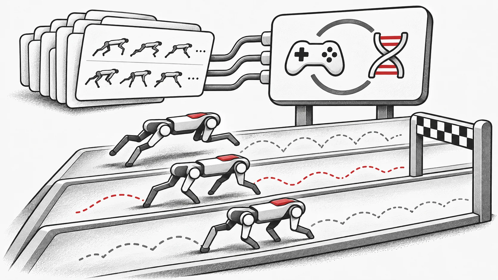

Physical AI needs ways to explore different behaviors, test them through interaction and carry useful experience into further learning. EvoRL brings that cycle into parallel simulation: individual policies learn from experience, while population-level search explores alternatives and different learning configurations. This makes the relationship between learning and evolution an experimentally accessible question.



EvoRL is an open-source research framework built around these questions. Based on JAX, it brings reinforcement learning, evolutionary computation, and environment simulation into a common training workflow for developing and evaluating both classical and hybrid methods. A sister project of EvoX, EvoRL focuses on combining evolution and reinforcement learning so that population-level search can benefit from modern GPUs. [Project introduction](https://github.com/EMI-Group/evorl)

## Why combine evolution and reinforcement learning?

Consider a robot learning to walk. Several policies may solve the same task, with different gaits, trade-offs between speed and stability, and energy requirements. Improving a policy along a single learning trajectory may leave many of these possibilities unexplored.

Reinforcement learning uses interaction data to refine policies. Evolutionary computation maintains a set of candidates, evaluating, selecting, and varying them to preserve multiple search directions. Combining the two supports a richer learning process: individuals improve through experience, while the population spreads useful results among them.

Evolutionary search can act directly on policy parameters or adjust reinforcement learning hyperparameters. These address different questions: what policies should we search for, and how can we help them learn more effectively?

This complementarity does not mean hybrid algorithms outperform reinforcement learning alone on every task. It offers more design choices to test, and EvoRL aims to reduce the engineering and computational cost of exploring them.

## Core design: a training pipeline built for GPUs

Population methods gain their appeal from diversity, but diversity also costs computation. Each additional candidate policy can require more environment interactions, evaluations, and parameter updates. When these stages run separately on CPUs and GPUs, repeated transfers and scheduling can become bottlenecks.

With compatible GPU simulation environments, EvoRL organizes environment interaction, policy computation, evolutionary operations, and learning updates into an end-to-end GPU pipeline. JAX vectorization and just-in-time compilation batch repeated computations and optimize the training step's computation graph. [Technical overview](https://evorl.readthedocs.io/latest/)

Its parallelism operates at three levels:

- **Parallel environments**: one policy interacts with multiple environment instances to collect experience in batches.
- **Parallel individuals**: multiple candidate policies in a population are evaluated simultaneously.
- **Parallel training**: multiple agents learn concurrently, supporting hybrid methods and population training.

This makes experiments that explore more policies at once easier to implement. Population size must still account for GPU memory, environment cost, and network size. [Architecture paper](https://arxiv.org/abs/2501.15129)

## Comparing four families of methods in one framework

EvoRL gives different approaches a common experimental foundation, helping researchers establish baselines before adding new search or learning mechanisms.

| Method family | Representative algorithms | Main research question |
| --- | --- | --- |
| Reinforcement learning | PPO, TD3, SAC, and others | How can interaction data improve a policy? |
| Evolutionary algorithms | OpenES, ARS, CMA-ES, and others | How can candidate evaluations guide population search? |
| Evolution-guided reinforcement learning | ERL, CEM-RL, and variants | How can evolutionary search cooperate with gradient learning? |
| Population-based AutoRL | PBT-PPO, PBT-SAC, and others | How can learning configurations adapt during training? |

Two hybrid directions deserve particular attention.

**Evolution-guided reinforcement learning** connects population search with individual learning. A population can explore different regions of policy parameter space, while reinforcement learning updates refine candidate policies. Algorithms differ in how they share experience, update individuals, and select population members; EvoRL provides implementations for investigating these choices.

**Population-based AutoRL** searches over training configurations. In PBT, for example, multiple individuals train separately. Based on periodic evaluations, they inherit training states from better-performing individuals and perturb hyperparameters to continue exploring. Hyperparameters can therefore change throughout training.

Available algorithms and variants follow the current repository implementation. [Algorithm list](https://github.com/EMI-Group/evorl#algorithms)

## Modularity: turning research ideas into experiments

Developing hybrid algorithms often involves substantial work on environment adaptation, data organization, evaluation, and component interfaces. EvoRL organizes these responsibilities through a small set of core abstractions:

- **Env** provides a common environment interaction interface.
- **Agent** defines agent behavior and related learning logic.
- **SampleBatch** organizes trajectories and sample data.
- **Workflow** defines an algorithm's training steps.
- **EC** provides evolutionary algorithms and related operators.

These modules let researchers change individual parts of an experiment. For example, they can replace a search method while retaining the environment and policy network, or compare learning behavior before and after adding evolutionary operations. [Framework and API documentation](https://evorl.readthedocs.io/latest/)

A shared implementation also makes it easier to control variables. Matching tasks, evaluation procedures, and computing budgets helps distinguish algorithmic improvements from implementation differences. The framework facilitates such comparisons, while rigorous experimental design remains the researcher's responsibility.

## What do the performance gains mean?

The EvoRL paper compares computational efficiency on Brax's Swimmer environment using a machine with two Intel Xeon Gold 6132 CPUs, 128 GiB of RAM, and one RTX 3090 GPU. In the tested configurations, OpenES achieved a maximum speedup of over 60× relative to RLlib's distributed CPU implementation; CEM-RL achieved approximately 5–9× relative to its official implementation.

These figures describe computational efficiency for particular tasks, population sizes, and baselines. They do not imply the same gains on every task, or an equivalent reduction in the samples required to reach a target reward. [Experimental setup and results](https://arxiv.org/html/2501.15129v1#S5)

For experiment planning, higher throughput can make room for more random seeds, more extensive ablations, or larger populations. This is a practical benefit of framework acceleration: more ideas can be tested within the available budget.

## From robot control to new decision-making tasks

EvoRL supports robot simulation environments such as Brax and MuJoCo Playground for continuous control, policy search, and population training. Experimental integrations with gymnax, Jumanji, and JaxMARL extend to classic control, games, combinatorial optimization, and multi-agent settings; algorithm compatibility must be checked for each configuration. Some CPU environments are also supported, so a fully GPU-based pipeline depends on the chosen environment and algorithm combination. [Environment support](https://github.com/EMI-Group/evorl#rl-environments)

Researchers in evolutionary reinforcement learning can establish baselines with existing algorithms before changing how population search and policy learning cooperate. Those interested in AutoRL can start with PBT to examine how training configurations affect learning. Developers of new optimization methods can use the common interfaces to integrate their own components incrementally.

## Running your first experiment

The current installation requirements are Python 3.12 or newer and JAX/jaxlib 0.10.0 or newer. [EvoRL](https://github.com/EMI-Group/evorl#installation)

First follow the [installation guide](https://evorl.readthedocs.io/latest/guide/installation.html) to configure JAX for your hardware. Then install EvoRL from source to obtain the training scripts and configurations used in the example:

```bash
git clone https://github.com/EMI-Group/evorl.git
cd evorl
pip install -e .
```

Start with a PPO baseline on Brax's Ant environment:

```bash
python scripts/train.py agent=ppo env=brax/ant
```

EvoRL uses Hydra to manage experiment configurations. Once the baseline works, vary random seeds, algorithm configurations, and environment settings before moving to hybrid methods or population training. See the [quickstart](https://evorl.readthedocs.io/latest/guide/quickstart.html) for full instructions.

Keep the first PPO run as a baseline: save the environment, seed, configuration and learning curve before changing one component. For a simpler introduction to population search, follow the [EvoX workflow tutorial](/news/evox-quickstart).
