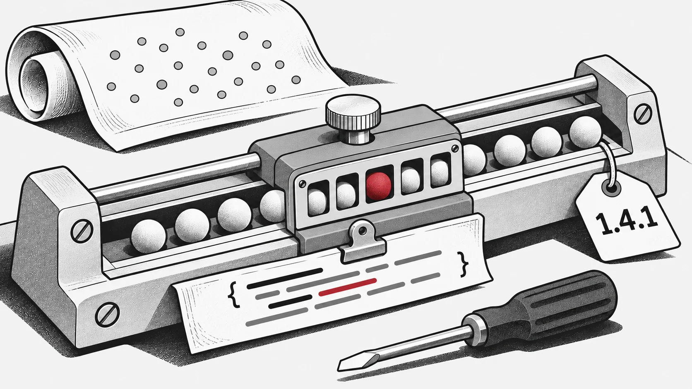

Uma pesquisa pode terminar normalmente seguindo uma regra de atualização errada. O EvoX 1.4.1, publicado em 30 de outubro de 2026, corrige esse desvio em SHADE, evolução diferencial e CMA-ES, recuperando adaptação, amostragem e execução de que os algoritmos dependem.

*Alinhar a implementação com o comportamento previsto.*

## O programa pode funcionar e pesquisar de outra forma

Em SHADE, a memória de sucessos de F e CR não se adaptava. As melhorias eram calculadas após substituir a aptidão, e a aritmética com arrays preenchidos com NaN contaminava os valores escolhidos. A correção calcula as melhorias antes da atualização e seleciona os sucessos com `torch.where`. [SHADE](https://github.com/EMI-Group/evox/commit/c92918a906eaf075cf885461acc031ee0eb223b3)

O operador partilhado de cruzamento binomial comparava amostras normais com uma probabilidade de cruzamento. Agora utiliza amostragem uniforme, coerente com essa probabilidade. Outras correções inicializam CoDE, SaDE e SHADE uniformemente dentro dos limites. Muda o que é gerado, não apenas a ausência de falhas. [DE](https://github.com/EMI-Group/evox/commit/5e68f81f8b6d6ea0638a44a337efe2183ba47716)

## Definições matemáticas e restrições de execução

As correções CMA-ES abrangem a atualização de covariância de posto um, a constante de acumulação e restrições de aliasing em `torch.cond`. Esta última reativa também um teste CMA-ES desativado. Fórmulas e condições do framework exigem verificações distintas. [CMA-ES](https://github.com/EMI-Group/evox/commit/bcde7d2a171c34722c37a3559813136f702640cb)

A versão trata ainda da inicialização e subespaços de estratégias evolutivas, seleção por torneio, transferências de dispositivo PSO e hipervolume. [v1.4.1](https://github.com/EMI-Group/evox/releases/tag/v1.4.1)

## A fiabilidade faz parte da infraestrutura

A correção SHADE acrescenta um teste de regressão: cinco passos do fluxo e verificação de que a memória de adaptação muda e mantém valores finitos. Para comparar versões, registe semente, objetivo, população e orçamento de avaliação; depois repita as referências afetadas. As [notas da versão](/pt/releases/evox-1-4-1) orientam a atualização.
