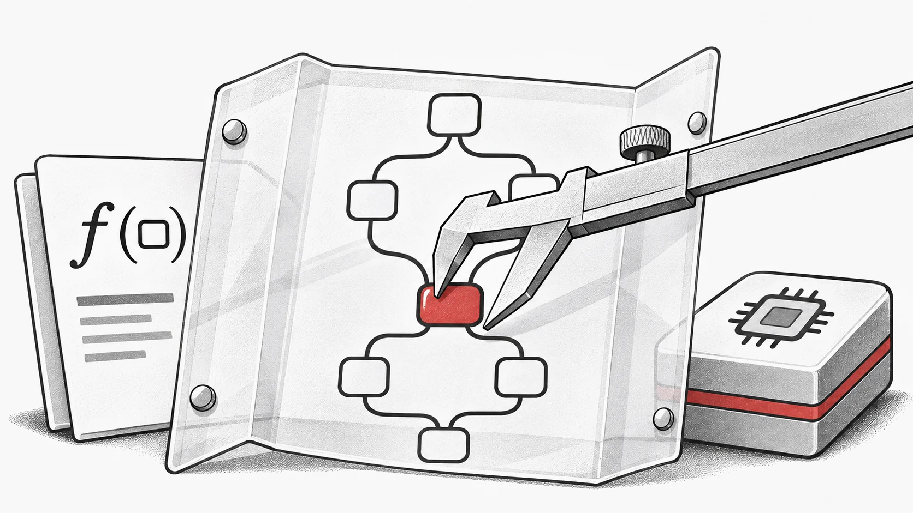

When the candidates in a search are programs, debugging only the final output leaves much of the experiment hidden. EvoX Compiler makes the program itself available for inspection: researchers can keep its graph, transform it and choose an execution backend through separate, visible stages.



*Concept illustration: program structure becomes visible between definition and execution.*

**EvoX Compiler (evoxc) v0.1.0** was released on October 29, 2026. The Python tensor-graph frontend and runtime requires Python 3.11 or newer and uses the Apache-2.0 license. [v0.1.0](https://github.com/EMI-Group/evoxc/releases/tag/v0.1.0)

## From a definition to an inspectable executable

The pipeline is `trace → lower → compile → load → run`. Tracing builds an EvoXIR graph from a definition and input specifications. Lowering prepares a backend representation; compilation creates an artifact; loading binds it to an execution device; running supplies the data. Each stage produces an inspectable object.

This separation helps locate errors: a malformed graph, an unsupported lowering operation and a device mismatch are different problems. Graphs and supported artifacts can also be persisted. External compilers handle optimization, scheduling and code generation; evoxc supplies the frontend and staging contract.

## Bring a population of programs into one graph

Transformations such as `vmap`, `grad`, `jvp` and `vjp` produce graphs that can be composed before execution. For searches over programs, [`batch_functions`](https://github.com/EMI-Group/evoxc/blob/v0.1.0/README.md#batch-transformation--one-graph-for-a-whole-population) combines candidate functions with matching input and output specifications into a population graph.

This is relevant to genetic programming, architecture search and algorithm synthesis, where candidates can be different programs rather than different parameter vectors. Combining them can reduce repeated compilation and dispatch, but the benefit depends on their structure and the backend; it is not an automatic speedup for every population.

## Choose a backend for the operations you need

NumPy is the only mandatory dependency and supplies the reference CPU interpreter. Optional adapters connect to IREE, XLA through a user-supplied PJRT plugin, and TVM through its StableHLO frontend. Backend availability does not imply equal operator or hardware coverage.

The versioned README documents Vulkan validation on Mesa lavapipe, a software device, and TVM ROCm support at compilation only. GPU inputs and device placement are explicit. Check the adapter's supported operations before moving a working CPU graph to another target.

## Start on CPU, then move the graph

Install the pinned release, run the README's CPU example, inspect the graph, and only then select a compiled backend:

```bash
pip install evoxc==0.1.0
```

The separate HuggingFace integration is installed as `evoxc-hf`, with its own distribution and upgrade cycle.

## Read the validation with its environment

With the documented extras installed, the release README reports **7,511 passed, 77 skipped and 4 expected failures**, with no failures, across the core and integration suites. Skips include hardware and dependency guards. The repository credits Genesis for its code, tests and documentation.

Use the [versioned README](https://github.com/EMI-Group/evoxc/blob/v0.1.0/README.md) for the API and support matrix, the [release record](https://github.com/EMI-Group/evoxc/releases/tag/v0.1.0) for the published artifact, and [GitHub](https://github.com/EMI-Group/evoxc) for subsequent development.

For the agentic development story behind the compiler, read [Genesis and EvoX Compiler](/news/genesis-evoxc). For your own experiment, keep one graph as a reference and inspect each transformation before comparing backend behavior.
