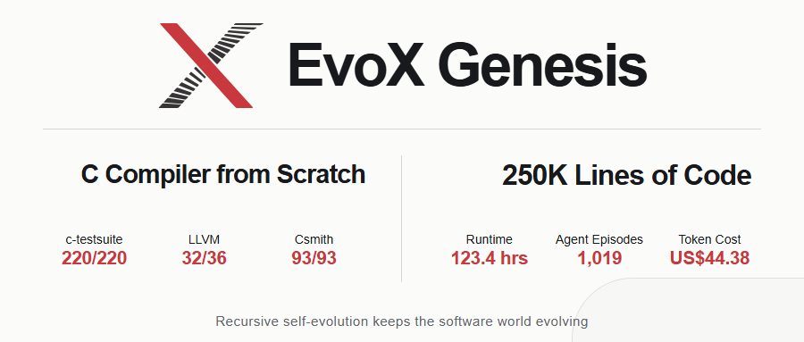
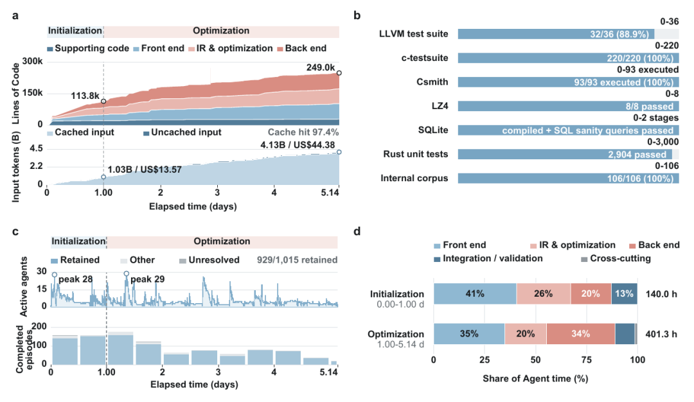
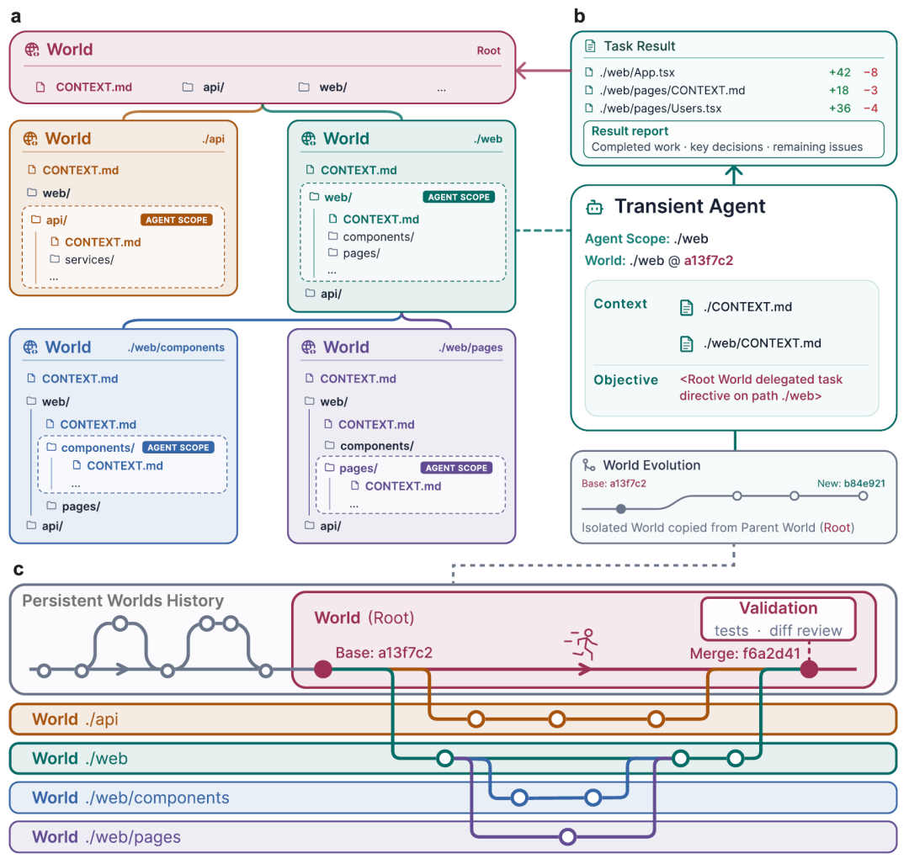
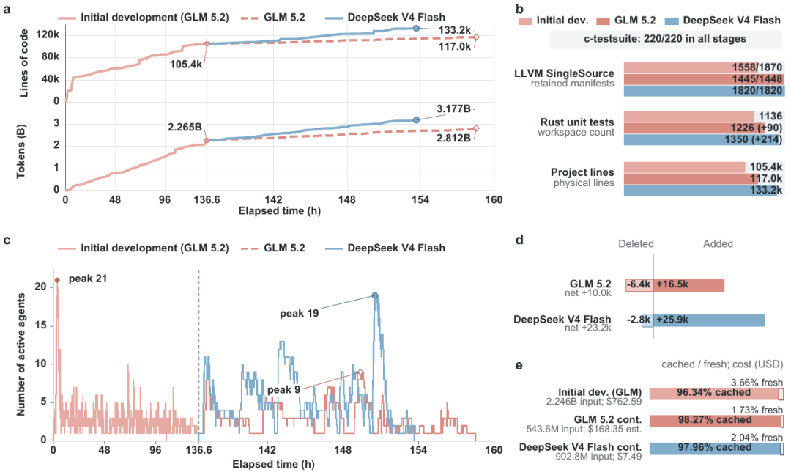
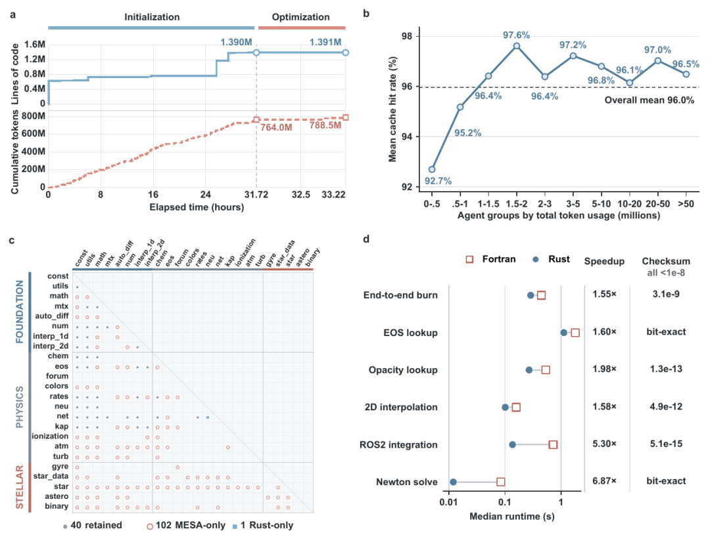
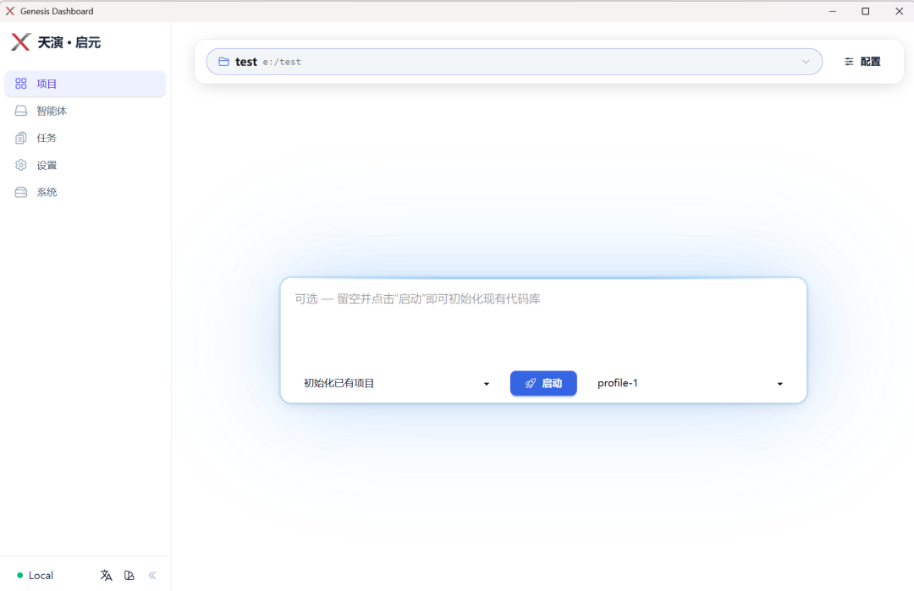

Genesis überträgt EvoXs Vision auf Agentic AI: Das sich entwickelnde Softwareprojekt bleibt als Ergebnis vieler lokaler Beiträge bestehen. Codegenerierung, Ausführung, Review und Integration bilden einen Entwicklungszyklus. Akzeptierte Implementierungen und ihre Prüfergebnisse liefern die Grundlage für anschließende Arbeit. [Genesis](https://github.com/EMI-Group/genesis)

Das EvoX-Team des Departements für Datenwissenschaft und Künstliche Intelligenz der Hong Kong Polytechnic University hat **EvoX Genesis** veröffentlicht, ein rekursives KI-System für langfristige autonome Software-Evolution.

EvoX Genesis verlässt sich nicht mehr auf einen persistenten Agenten, um langfristige Entwicklung aufrechtzuerhalten. Stattdessen lässt es die Softwarewelt selbst weiter evolvieren.

Ausgehend von einem leeren Repository hat das System über 1.019 Agenten-Episoden hinweg in 123,4 Stunden einen **C-Compiler mit 248.989 Zeilen** gebaut, bei Modell-Token-Kosten von nur **44,38 $**.

## Long-Horizon-Coding: Die Grenze verschiebt sich weiter

Die Arbeitszeit von Coding-Agenten hat sich von einzelnen kurzen Aufgaben auf Dutzende Stunden ausgedehnt.

OpenAI ließ Codex etwa 25 Stunden am Stück von einem leeren Repository aus laufen und erzeugte rund 30K Zeilen Code.

Anthropic nutzte 16 Claude-Agenten, über fast 2.000 Sessions, rund zwei Wochen und fast 20.000 $ API-Kosten, um von Grund auf einen C-Compiler mit etwa 100K Zeilen zu bauen.

Die Zeiten werden länger, die Agenten mehr, die Software komplexer.

Doch im Zentrum der Forschung steht nach wie vor der Agent:

stärkere Modelle, längere Kontexte, dauerhaftere Erinnerung, mehr Agenten.

**Das EvoX-Team hat die Frage in eine andere Richtung gedreht:**

**Warum muss der Agent persistieren?**

Was, wenn das, was wirklich persistieren muss, die Softwarewelt ist, in der er lebt?

## 123,4 Stunden, 250K Zeilen

Wir ließen EvoX Genesis mit einem Repository ohne Implementierung starten.

Es gab nur ein Ziel: einen C-Compiler bauen.

123,4 Stunden, 1.019 Agenten-Episoden, **248.989 Zeilen Code** und Modell-Token-Kosten von nur **44,38 $**.

Der finale Compiler bestand 220/220 Tests der c-testsuite, 32/36 LLVM-Testfälle und 93/93 Csmith-Tests mit zufälligen Programmen.

Kein fertiger Compiler wartete dort auf Vervollständigung — **er startete bei null.**

_Abbildung 1: Ergebnisse des C-Compiler-Experiments / Codegröße, Laufzeit, Agenten-Episoden, Kosten und Testergebnisse_

_(mit dem Modell DeepSeek V4 Flash)_

## Den Agenten am Leben halten? Nein — die Softwarewelt am Leben halten

Das Leben komplexer Software ist von Natur aus länger als eine einzelne Agenten-Session.

EvoX Genesis organisiert Software als eine rekursiv sich entfaltende Softwarewelt:

Agenten auf höherer Ebene zerlegen Ziele, und neue Agenten erledigen die Arbeit an lokalen Positionen;

sobald die Ergebnisse verifiziert sind, gehen sie in die Versionshistorie der Software ein und werden zur Realität der nächsten Entwicklungsrunde.

Dann können die Agenten verschwinden,

und neue Agenten machen weiter — ausgehend von der bereits gestalteten Softwarewelt.

Was persistiert, ist keine Konversation, kein immer weiter wachsendes Scratchpad und kein ständig onlineer „Master-Agent“.

Was persistiert, sind der Code, die Struktur, die Constraints, die Verifikationsergebnisse und die bereits geschehene Geschichte.

**Was persistiert, ist nicht der Agent, sondern die Softwarewelt.**

**Agent does not persist. Its validated consequences do.**

So hält EvoX Genesis die langfristige autonome Software-Evolution am Laufen. Für Nutzer bedeutet das auch etwas sehr Einfaches:

**Sie bauen keine Agenten — Sie beschreiben nur, was die Software werden soll.**

Agenten, Rollen oder Workflows müssen nicht vorab entworfen und ein vollständiger Aufgabenbaum nicht manuell zerlegt werden.

Die Nutzer beschreiben das Software-Entwicklungsziel nur in einem kurzen Text;

wie Aufgaben zerlegt, Agenten erzeugt, Rekursion entfaltet und Ergebnisse verifiziert werden — all das erledigt EvoX Genesis selbst.

_Abbildung 2: Das Konzept der Persistent Recursive World / Agenten entstehen, handeln und verschwinden; die Softwarewelt entfaltet sich weiter_

## Modelle sind austauschbar; die Softwarewelt geht weiter

Diese Kontinuität erfordert nicht einmal, durchgehend dasselbe Modell zu verwenden.

In einem weiteren Experiment wurde eine zunächst von GLM 5.2 aufgebaute Softwarewelt an DeepSeek V4 Flash übergeben, um sie weiterzuentwickeln.

Am Ende bestand sie 1.820/1.820 der beibehaltenen LLVM-SingleSource-Tests.

Modelle lassen sich austauschen, Agenten lassen sich austauschen — die Softwarewelt geht weiter.

_Abbildung 3: Das Modellwechsel-Experiment, GLM 5.2 → DeepSeek V4 Flash_

## Von Grund auf oder Geschichte erben

Von null zu bauen ist nur ein Ende des Lebenszyklus einer Software;

das andere Ende ist eine Softwarewelt, die seit Jahren existiert und reich an Struktur und Geschichte ist.

Wir haben EvoX Genesis auf MESA angewendet — ein langjährig entwickeltes wissenschaftliches Rechensystem für Sternentwicklung.

Das Experiment umfasste 13 Fortran-Module mit insgesamt **139.414 Zeilen**;

EvoX Genesis refaktorierte sie in entsprechende Rust-Crates, bei Modell-Token-Kosten von etwa **10,6 $**.

Eine Softwarewelt kann aus dem Nichts entstehen oder Geschichte erben und sich weiter verändern.

_Abbildung 4: MESA Fortran → Rust, 13 Module, 139.414 Zeilen Code, 10,6 $_

## Kostenvorteile verzinsen sich über die Zeit

Langfristige Softwareentwicklung bedeutet nicht, dass die Kosten linear weiterwachsen.

In EvoX Genesis akkumulieren sich verifizierter Code, Struktur und Entwicklungsgeschichte kontinuierlich und bilden das Fundament der nächsten Arbeitsrunde. Nachfolgende Agenten müssen das gesamte Projekt nicht von Grund auf neu verstehen; vieles der vorhandenen Information lässt sich direkt cachen und wiederverwenden, mit einer Cache-Trefferquote von bis zu 97,4 %.

Je länger das System läuft, desto reicher wird der wiederverwendbare Entwicklungszustand, desto weniger redundante Berechnung fällt an, und die Stückkosten der Entwicklung sinken im Laufe der Zeit sogar.

Das ist technischer Zinseszins, der sich über die Zeit ansammelt.

## EvoX Genesis ist jetzt Open Source

Das Projekt ist Open Source, mit Installationspaketen für Windows, macOS und Linux.

🌐 Webseite:

https://genesis.evox.group/

🔗 **GitHub**:

https://github.com/EMI-Group/genesis

↓ **Downloads**:

**https://github.com/EMI-Group/genesis/releases**

**▤ Paper:**

**https://arxiv.org/abs/2608.10450**

🌐 QQ-Gruppe: 297969717

**Agenten gehen; die Softwarewelt evolviert weiter**

**EvoX Genesis**

Referenzen:

OpenAI, *Run long horizon tasks with Codex* (2026).

Anthropic, *Building a C compiler with a team of parallel Claudes* (2026).

Setzen Sie bei einer akzeptierten Revision mit Build-Befehlen und Regressionstests an. Prüfen Sie den nächsten Beitrag vor der Integration gegen diese Basis. [Genesis: Agentenbeiträge in der Softwarehistorie erhalten](/de/news/genesis-development-history)
