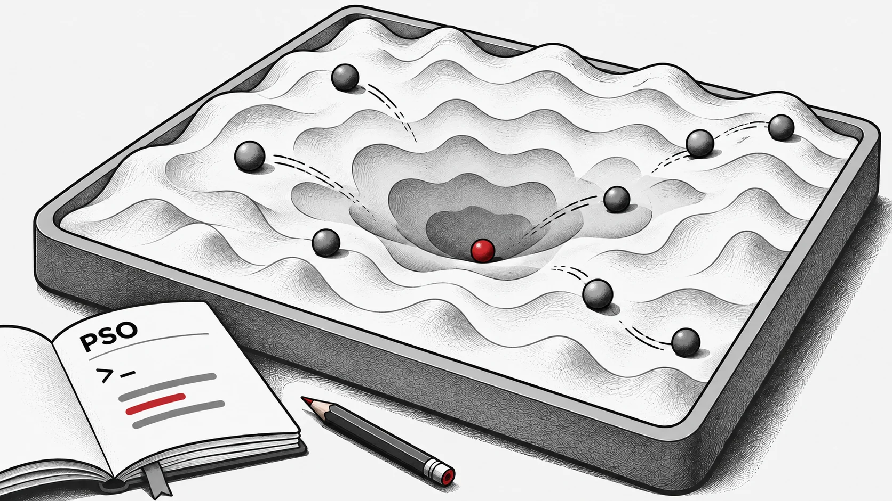
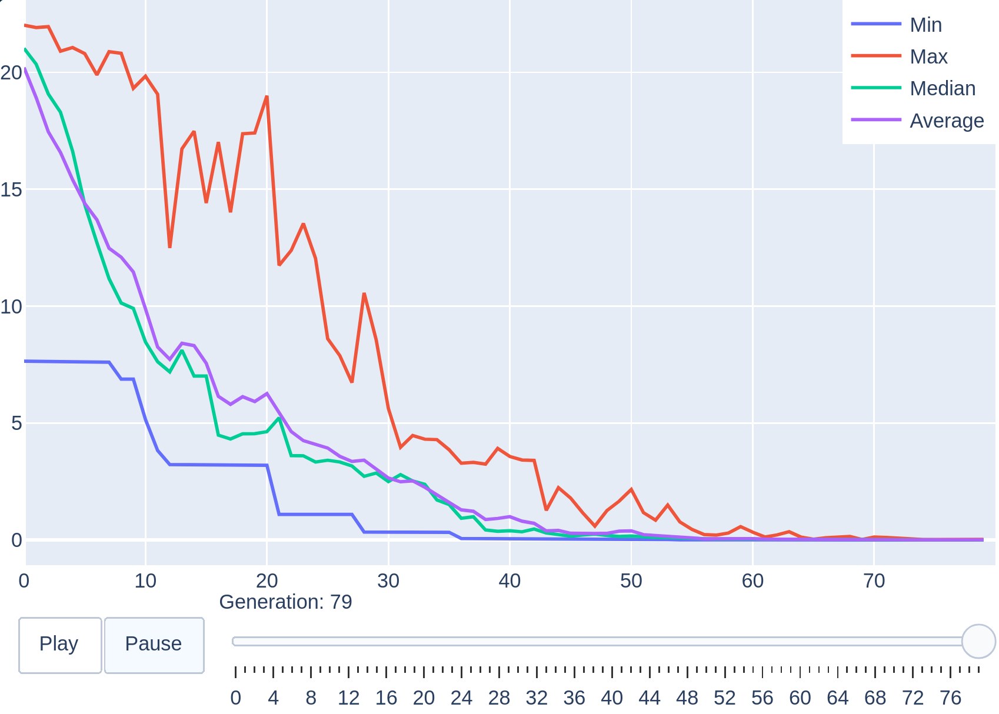
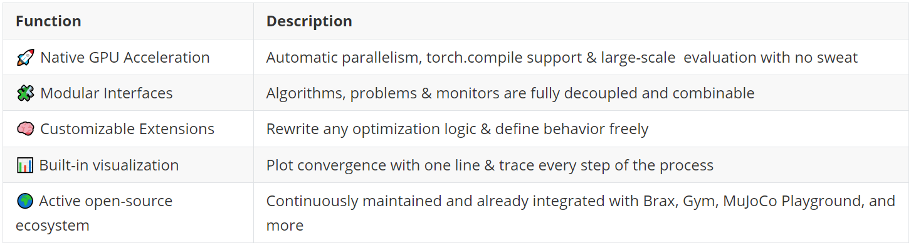

This tutorial builds a small, complete optimization experiment: use PSO to minimize the two-dimensional Ackley function, inspect the execution device and plot the search history. It targets **EvoX 1.4.1 with PyTorch**, not the experimental 2.x compiler API. The small workload teaches the workflow; it is not a GPU performance benchmark.



## Prepare an isolated environment

Use Python 3.10 or newer. Create a virtual environment, then activate it with the command for your shell.

```bash
python -m venv .venv
```

On macOS/Linux:

```bash
source .venv/bin/activate
```

On Windows PowerShell:

```powershell
.\.venv\Scripts\Activate.ps1
```

## Install the matching packages

Install PyTorch using the command selected for your operating system and hardware in the [official installer](https://pytorch.org/get-started/locally/). A CUDA wheel must match a supported driver; installing EvoX alone does not guarantee GPU availability. Then install this tutorial's pinned release:

```bash
python -m pip install "evox[vis]==1.4.1"
```

## Run a complete experiment

Save the following as a Python script. It selects CUDA when available and otherwise runs on CPU, prints that choice, and keeps algorithm state and monitoring on the selected device. A fixed seed helps repeat an experiment, although results can differ across devices and software versions.

```python
import torch
from evox.algorithms import PSO
from evox.problems.numerical import Ackley
from evox.workflows import StdWorkflow, EvalMonitor

torch.manual_seed(42)
device = torch.device("cuda" if torch.cuda.is_available() else "cpu")
torch.set_default_device(device)

algorithm = PSO(
    pop_size=50,
    lb=-32 * torch.ones(2, device=device),
    ub=32 * torch.ones(2, device=device),
    device=device,
)
problem = Ackley()
monitor = EvalMonitor(device=device, history_device=device)
workflow = StdWorkflow(algorithm, problem, monitor)

workflow.init_step()
for _ in range(100):
    workflow.step()

print("Device:", device)
print("Best fitness:", monitor.get_best_fitness().item())
```

## Understand and visualize the result

PSO maintains candidate vectors, Ackley evaluates them, StdWorkflow connects the components, and EvalMonitor records progress. Lower fitness is better; the theoretical optimum is zero at the origin. The exact final value is stochastic, so this example does not promise a fixed score.

Run the following in the same process, after the search. The optional visualization dependencies were included in the installation command. The image is an illustration from the original tutorial, not a guaranteed output of this seed.

```python
monitor.plot()
```



## Extend the experiment deliberately

Change the dimension, population size or seed one at a time. For a custom problem, return one objective value per candidate. Multiobjective optimization also needs a compatible algorithm, objective shape and monitor; changing a single parameter is insufficient.

For timing, separate compilation and warm-up from steady-state execution, synchronize CUDA around measurements and compare identical evaluation budgets. Tiny workloads may be faster on CPU. Explore compilation only after the baseline works.

## Tutorial resources and credits

The original tutorial was written by Boqing Xu, Xinmeng Yu, Bowen Zheng and Xinyao Li, and edited and published by Beichen Huang. Its overview figure is retained below.



Use the [versioned source](https://github.com/EMI-Group/evox/tree/v1.4.1) for this example and the [documentation](https://evox.readthedocs.io/en/latest/) for further tutorials. Check the documented version before copying an API from newer material.

Before extending this example, save the package versions, selected device, seed and best fitness together. Change one setting and rerun the same budget. When moving to competing objectives, the [EvoMO explanation](/news/gpu-accelerated-emo) introduces the additional selection and evaluation choices.
