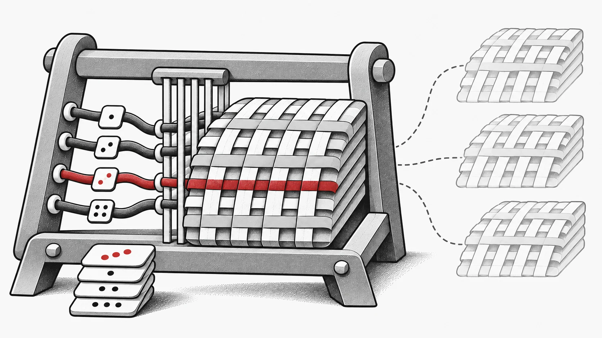

神经网络种群越大，通常就要存下越多份权重。EvoX 在 2026 年 7 月 7—8 日的更新中换了一种表示方式：VirtualES 只保存一份共享中心参数和每个候选的随机种子，在评估时重建它们之间的差异。研究者由此可以重新考虑：在参数存储耗尽显存之前，还能容纳多少搜索多样性？

*概念插画：一个共享中心，多个可重建的候选。*

## 保存候选的生成方式

若种群有 P 个候选，每个含 D 个参数，显式存储需要与 P × D 成正比的空间。中心加种子的表示约需 D + P 个元素。这里比较的是种群参数的表示；激活值、优化器状态和评估缓冲区仍计入总显存开销。[VirtualES 实现](https://github.com/EMI-Group/evox/commit/d8c0964fd71c3d6171ae83bd0c1483f742b310a6)

VirtualES 将 `(center, seeds, sigma)` 交给工作流。VirtualProblem 逐层评估网络，以融合的 Triton 操作完成基础线性计算，以及由种子生成的权重和偏置扰动。适应度再指导中心参数的下一次更新。该实现采用完整高斯扰动，替代此前的低秩 LoRA 形式。[评估实现](https://github.com/EMI-Group/evox/commit/c6bde1e47df9617cd934053c7f6c69e40068e921)

## 让每个候选获得自己的反馈

可以从包含线性层和文档支持激活函数的 `nn.Sequential` 网络开始。将损失函数设为 `reduction='none'`，让 VirtualProblem 分别汇总各候选的损失。如果只返回一个标量损失，它会被扩展到整个种群，丢失个体差异。这个小小的接口选择会直接影响搜索。

虚拟种群路径跳过分布式评估与解变换，VirtualProblem 也不支持 HPO 包装器。迁移已有实验时，应先核对这些边界。[工作流集成](https://github.com/EMI-Group/evox/commit/f4f2fd1067f184c000b7f1a94ff0ee6395c6e697)

## 衡量表示方式带来的实验空间

先使用受支持的网络，再逐步调整种群规模，在固定评估预算下记录峰值显存、评估耗时和适应度。这样可以区分参数存储的收益，以及重建噪声、处理激活值的成本。7 月的更新还包含噪声辅助函数的 [Triton 编译修复](https://github.com/EMI-Group/evox/commit/97971618740d35845740320e7db973d3a3f671ef)。

如果还不熟悉 EvoX 的实验结构，可以先看[快速入门](/zh-cn/news/evox-quickstart)。VirtualES 提出了一个值得实测的问题：当保存每个候选的完整权重不再是前提，更大的搜索种群会怎样改变你的实验？
