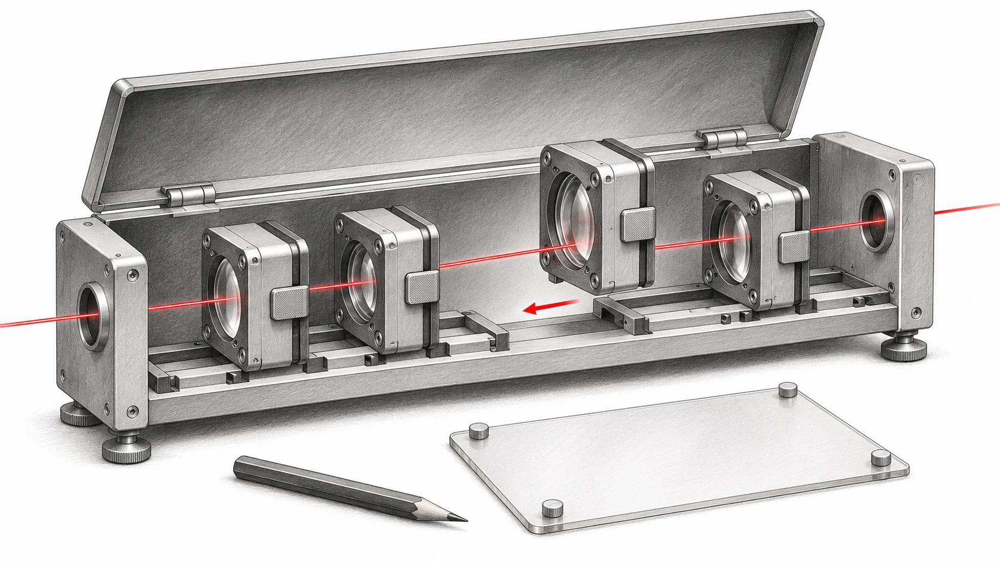

실험적 연산이 텐서 라이브러리의 범위를 벗어나더라도 주변 프로그램 전체를 바꿀 필요는 없습니다. EvoX Compiler의 2026년 11월 23~24일 기본 브랜치 업데이트는 컴파일러 전용 연산 삽입, 편집한 중간 코드 컴파일, 맞춤 백엔드 선택 경로를 추가합니다. 먼저 확장이 컴파일러 내부, 런타임 커널, 전체 백엔드 중 어디에서 실행될지 결정해야 합니다. [구현과 가이드][guide]

*개념 삽화: 주변 파이프라인을 명확히 유지하면서 한 단계를 교체합니다.*

## 맞춤 작업의 경계 선택

`custom_call`은 명시된 결과와 선택적 백엔드 설정을 담은 이름 기반 StableHLO 호출을 출력합니다. 대상의 존재와 변환 가능 여부는 외부 컴파일러가 판단합니다. `inline_stablehlo`는 원시 코드 조각을 삽입합니다. 피연산자는 `%in0`부터 번호를 매기고, 결과는 `%out0`부터 해당 번호에 대입해야 합니다. 결과 명세도 명확해야 합니다. 이름, 설정, 코드 조각은 그래프를 특수화하는 정적 값입니다. [연산 계약][ops]

이 인터페이스는 임의의 커널을 IREE나 PJRT에 등록하지 않습니다. 런타임에 실행할 Python 또는 Triton 커널에는 기존 `external_call` 등록 경로를 사용합니다. 일반 EvoX Compiler 연산으로 표현 가능한 이식성 있는 연산에는 분해 구현을 가진 block도 선택할 수 있습니다. 컴파일 선언을 런타임 구현과 혼동하지 않는 것이 중요합니다.

## 중간 프로그램을 편집하고 컴파일

예를 들어 컴파일러 개발자는 `source_text()`로 실행 객체를 확인하고 StableHLO를 편집한 뒤 입력·출력 명세와 함께 `compile_text`에 전달할 수 있습니다. 추적과 그래프 구성을 건너뛰고 일반 컴파일·로드 단계를 이용합니다. 명세는 바깥쪽 튜플을 설명하므로 실행도 튜플 입력·출력 계약을 유지해야 합니다. 외부 컴파일러가 모듈을 검증하지만 텍스트가 접수되었다고 수치적 정확성까지 보장되지는 않습니다. [파이프라인 구현][pipeline]

편집할 때마다 작은 입력 집합으로 원래 프로그램과 결과를 비교하세요. 없는 사용자 정의 대상은 백엔드를 몰래 바꾸는 대신 컴파일러의 합법화 단계에서 진단해야 합니다. NumPy 인터프리터와 네이티브 CPU 엔진은 이 확장을 명시적으로 거부합니다. 새 그래프 내 연산에는 자동 배칭·미분 규칙도 없으므로 해당 변환이 필요하면 지원되는 다른 경로를 선택해야 합니다. [기능과 한계][guide]

## 백엔드를 명시적으로 연결

백엔드 인스턴스는 파이프라인의 모든 단계에서 일관되게 유지됩니다. 등록 API는 명시적인 교체·제거를 지원하며 진입점을 통해 외부 패키지가 백엔드를 제공할 수 있습니다. 컴파일러 백엔드는 기능과 지원 dtype을 선언하고 컴파일·로드를 구현합니다. dtype 집합이 비어 있으면 모든 그래프를 거부합니다. 맞춤 IREE 컴파일러·런타임 모듈은 옵션이나 환경 변수로 지정해 기본 런타임과 혼동하지 않고 별도 빌드를 시험할 수 있습니다. [백엔드 확장 가이드][guide]

## 전송과 수치 비교를 따로 확인

같은 개발 기간에 Vulkan 전송도 변경되었습니다. 16 MiB 이하 업로드는 매핑된 일관성 버퍼를 사용하고 그보다 크면 복사 경로를 사용합니다. 읽기 반환은 실제 호스트 메모리와 호스트에 보이기만 하는 GPU 메모리를 구분합니다. 기록된 측정은 한 Intel 통합 GPU·Mesa·IREE 환경에 한정되므로 자체 하드웨어에서 전송과 실행을 따로 측정하세요. [전송 구현][transfer]

네이티브 CPU는 큰 버퍼와 입력 배열의 저장 공간을 재사용해 반복 할당 비용을 줄입니다. 리덕션 작업은 각 출력의 누적 순서를 유지하며 독립 출력을 나눕니다. 컴파일러 어댑터는 `split_reduction_threshold`와 `split_reduction_non_exact`도 제공합니다. 리덕션 정책을 바꾸면 시간과 수치 결과를 함께 확인해야 합니다. [GitHub](https://github.com/EMI-Group/evoxc/commit/beb6c45e21099cf9d3d0f6e2a0e0d00475189ac7) · [GitHub](https://github.com/EMI-Group/evoxc/commit/83a6254ae0bfdef4f9df37cdcaaead6e8ca98048) · [GitHub](https://github.com/EMI-Group/evoxc/commit/df40224b8adc988d2d2a72cd35bd0aceef5bb660) · [GitHub](https://github.com/EMI-Group/evoxc/commit/501759257b739912d8b5179ae314e05e1e2dc9ba)

네이티브 CPU의 `power` 수정은 지수 처리를 NumPy의 부동소수점 거듭제곱 경로에 맞춥니다. 동등성 도구도 정수·불리언의 정확 비교와 부동소수점의 허용 오차 비교를 구분합니다. 이 소스 수정본을 도입하기 전에 참조 출력을 보관하고 선택한 컴파일러·장치와 비교 오차를 확인하세요. 기존 준비 과정은 [v0.1.1 발표][release]에 설명되어 있으며 이번 변경은 그 과정을 맞춤화하는 방법을 확장합니다. [수치 수정][power]

[guide]: https://github.com/EMI-Group/evoxc/blob/f11167521bd913babf86e295436ea4c902cf3e11/README.md
[ops]: https://github.com/EMI-Group/evoxc/commit/879ca9a70cd390aae1a7757698d10b6e43b64908
[pipeline]: https://github.com/EMI-Group/evoxc/commit/1762ecec7d6ff56e7656ca7e2ae8d5a24149e1ef
[transfer]: https://github.com/EMI-Group/evoxc/commit/0177af388a73d1c1dcbb05b8cc3b40f7d184bdc1
[power]: https://github.com/EMI-Group/evoxc/commit/7fe54d07cc7e071ea80438eca74ad35de0bfa7d6
[release]: /ko/releases/evoxc-0-1-1
