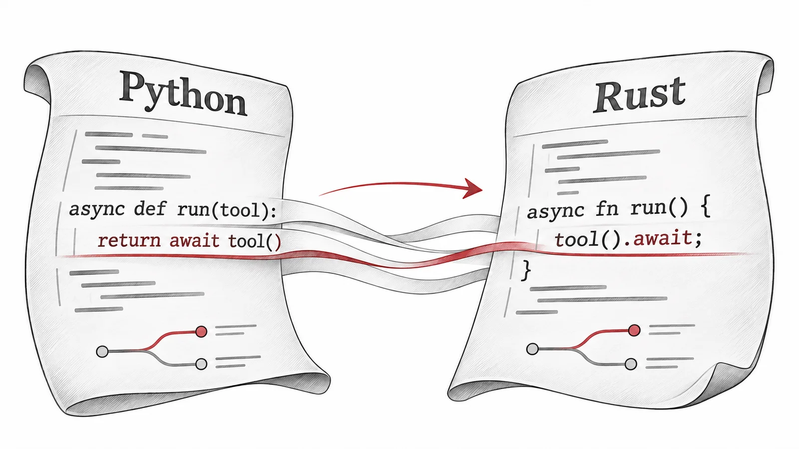

openJiuwen Agent Core is a Python SDK for building Agent applications: it connects model calls, tools, workflows and session state. In its [Evidence published on November 20, 2026][evidence], EvoX Genesis documents the SDK's conversion to Rust, producing **agent-core-rs** from Python SDK v0.1.20 as a read-only reference.

The result is a workspace of **30 Rust crates and 26 runnable examples**, developed through an initial conversion and a later task that continued from the retained code. The engineering question is what behavior survives the change of language: saved sessions must restore correctly, tools must wait for approval, and workflows must take the intended branch.

## Preserve the contract while changing the implementation

The workspace groups shared types, model and tool access, session state, orchestration and application entry points. Its runnable artifacts cover workflows, DeepAgent, team collaboration and the CLI. These layers give the 30-crate count a practical meaning: the conversion spans several parts of an Agent application, with each integration's supported scope recorded in the [coverage matrix][parity].

The [source snapshot at revision 242b5b5][repo] targets Card JSON fields, model wire formats, persisted session data, workflow references and CLI behavior. Rust types, traits, Tokio-based asynchronous execution and Serde serialization replace Python's implementation mechanisms. Shared types sit below their consumers; umbrella crates re-export APIs instead of introducing duplicate behavior.

Compatibility is scoped to an implemented subset. The [coverage matrix][parity] separates supported interfaces, partial implementations and deferred areas, including distributed execution, GPU/ML paths and some vendor or external-service integrations. Where a typed unsupported path exists, callers receive an explicit error; other gaps have no implementation. That distinction matters when choosing an application to migrate.

## A restored session and a tool that waits

The [session example][session] saves a checkpoint to temporary storage, constructs a new session with the same identity and storage root, and restores the saved state. The test crosses a storage boundary: retaining the first session object in memory would not demonstrate the same property.

Its approval scenario places a gate before a simulated tool call. An execution counter checks that the tool has not run while approval is pending. Re-invoking with the matching approval payload allows execution to proceed. A scripted model and instrumented tool make the order observable without provider credentials.

The [workflow example][workflow] adds a different integration check. Two inputs take short and long branches through the same compiled topology, passing values through node-field references. Simply connecting both mutually exclusive predecessors to one node would create a conjunction waiting for both. Forwarding components and explicit route activation let either branch reach the common end. Preserving field names alone would miss this scheduling issue.

## Two recorded tasks, with a defined cost boundary

The [task-history appendix][history] records an initial conversion from November 11–16 UTC, manually stopped with its output retained, followed by a completed evolution task on November 19 UTC. Calls attributed to DeepSeek V4 Flash total **US$150.024283** across those two tasks. The second task resumed from the first task's result revision, showing how an existing implementation could be retained and developed further across task boundaries.

Their wall times sum to **113 hours 42 minutes**, including waits and queues; the calendar interval exceeds eight days. The 3,570 registered Agent instances are cumulative, not peak concurrency. Infrastructure, human work and later documentation are outside the model-cost figure. An intervening failed task has unknown usage and is excluded.

The same appendix counts 1,434,767 Rust physical lines, including comments and blank lines, across production code, tests and examples. This describes the artifact's size; behavioral checks determine what the rewrite actually preserves.

## What the verification establishes

The [verification record][parity] reports passing formatting, Clippy, offline workspace tests, Rustdoc, seven feature groups and example builds. **24,293 is a source-level count of test functions**, not a captured test-run pass total. Five ignored entries are helpers or environment-dependent probes; the later documentation task reran selected checks only.

Scripted models, fake local servers, temporary storage and loopback sockets exercise protocol handling and runtime behavior. They allow repeatable checks without live credentials, while real-model task success remains a separate evaluation. These are project-reported results; we have not independently rerun the Rust test suite.

## Faster local operations, measured within their workload

The [benchmark report][bench] compares a Rust release build with CPython 3.11.15 on one eight-logical-CPU Linux host with warm page cache. Prompt rendering takes **0.356 µs versus 16.37 µs**, approximately **46×** faster. A two-node graph without I/O takes **7.23 µs versus 112.3 µs**, approximately **15×** faster.

Measurements use repeated batches normalized per operation; Rust batches are ten times larger. The graph's logical shape matches, while the engines differ. These ratios describe local framework overhead, excluding model/network latency, cold-cache startup and concurrency scaling. Separate Python first-graph and Rust scripted-Agent process measurements execute different workloads and do not establish a matched startup or memory ratio.

## Start with a behavior you need to preserve

For a migration assessment, the checkpoint, approval and conditional-routing examples offer concrete acceptance targets. Check the [coverage matrix][parity] against the intended integration, then use the documented `make verify` gate with the required build environment prepared. `cargo test --workspace --offline --no-fail-fast` includes development crates omitted by bare `cargo test`.

The workspace is distributed as source, with crates marked `publish = false`. Read the [full Evidence record][evidence] and [pinned implementation][repo] to inspect the artifacts. Alongside the earlier [MESA redevelopment](/news/genesis-mesa), this case shows how Genesis redevelopment can be evaluated through preserved behavior as well as the new implementation.

[evidence]: https://genesis.evox.group/evidence/agent-core-rs/
[repo]: https://github.com/EMI-Group/agent-core-rs/tree/242b5b5243aa46c6b82edd6d3764d0b70c10d571
[parity]: https://github.com/EMI-Group/agent-core-rs/blob/242b5b5243aa46c6b82edd6d3764d0b70c10d571/docs/PARITY.md
[history]: https://github.com/EMI-Group/agent-core-rs/blob/242b5b5243aa46c6b82edd6d3764d0b70c10d571/docs/REWRITE_APPENDIX.md
[session]: https://github.com/EMI-Group/agent-core-rs/blob/242b5b5243aa46c6b82edd6d3764d0b70c10d571/crates/openjiuwen-examples/examples/03_sessions_and_resume.rs
[workflow]: https://github.com/EMI-Group/agent-core-rs/blob/242b5b5243aa46c6b82edd6d3764d0b70c10d571/crates/openjiuwen-examples/examples/04_workflow_pipeline.rs
[bench]: https://github.com/EMI-Group/agent-core-rs/blob/242b5b5243aa46c6b82edd6d3764d0b70c10d571/docs/BENCHMARKS.md

