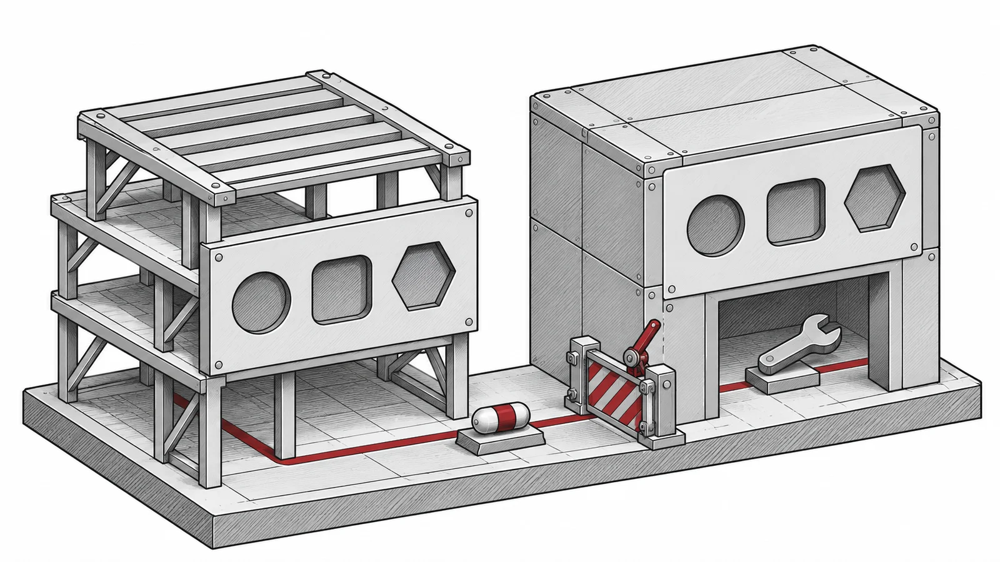

迁移 Agent SDK 的实现语言，远不止翻译函数。保存的会话要能够正确恢复，工具必须先获批准再执行，工作流也要走到预期分支。Genesis 在 [2026 年 11 月 20 日发布的新 Evidence][evidence] 中，通过 **agent-core-rs** 展示了这些具体行为：将 openJiuwen agent-core 重新开发为 Rust 实现。

EvoX Genesis 以 Python SDK v0.1.20 为只读参考，产出了包含 **30 个 Rust crate、26 个可运行示例**的工作区。记录覆盖首次转换及基于保留代码的后续开发。这个案例最有价值的部分，是把兼容性目标、可执行示例与验证记录连接起来，供读者逐项检查。

## 改变实现，保留行为契约

[提交 242b5b5 对应的源码快照][repo] 将 Card JSON 字段、模型通信格式、持久化会话数据、工作流引用和 CLI 行为作为兼容目标。Rust 类型、trait、基于 Tokio 的异步执行与 Serde 序列化承接了 Python 的实现机制。公共类型放在使用者的下层；汇总 crate 只重新导出 API，避免重复实现行为。

兼容范围限于已经实现的子集。[覆盖矩阵][parity] 区分了已支持接口、部分实现和暂缓区域，包括分布式执行、GPU/ML 路径及部分厂商或外部服务集成。有类型化 Unsupported 路径的接口会显式返回错误，其他缺口则尚无实现。选择迁移应用时，这些区别直接影响可行性。

## 会话可以恢复，工具必须等待

[会话示例][session] 先把检查点存入临时目录，再用同一身份和存储根目录创建新会话，恢复已保存状态。这个检查跨越了存储边界：只把原会话对象留在内存中，无法证明同样的行为。

审批场景则在模拟工具调用之前设置关卡，通过执行计数器确认等待审批时工具尚未运行。携带对应审批载荷重新调用后，执行才会继续。脚本化模型和带计数的工具让这个顺序无需模型服务凭据即可检查。

[工作流示例][workflow] 验证另一种集成问题。两个输入分别走同一已编译拓扑的短分支和长分支，通过节点字段引用传递数据。若简单地把两个互斥前驱都连接到同一节点，会形成等待两者完成的合取条件。示例使用转发组件和显式路由激活，让任一分支都能到达共同终点。仅保留字段名称，会漏掉这种调度差异。

## 两次任务，明确的费用口径

[任务历史附录][history] 记录了 UTC 11 月 11–16 日的首次转换：任务被手动停止，但产物保留；随后在 UTC 11 月 19 日完成一次演化任务。两次任务归于 DeepSeek V4 Flash 的模型调用费用合计 **150.024283 美元**。

任务墙钟时间合计 **113 小时 42 分钟**，包含等待与排队；从首次开始到最终完成的日历跨度超过八天。3,570 个 Agent 注册实例是累计数，并非峰值并发数。费用不含基础设施、人工及后续文档工作；中间一次失败任务的用量未知，也未计入。

同一附录统计了 1,434,767 行 Rust 物理行，包含注释、空行，以及生产代码、测试和示例。这说明产物规模；重写保留了哪些行为，仍由行为检查来回答。

## 验证记录能说明什么

[验证记录][parity] 报告格式检查、Clippy、离线工作区测试、Rustdoc、七组特性门禁及示例构建通过。**24,293 是源码中的测试函数数量**，不是一次测试运行捕获的通过总数。五个忽略项属于辅助程序或依赖环境的探测；后续文档任务仅重跑了选定检查。

脚本化模型、本地模拟服务器、临时存储和回环套接字用于检查协议处理及运行行为。这些方式支持无需真实凭据的可重复检查，而真实模型的任务成功率需要另行评估。以上是项目报告结果；我们未独立重跑 Rust 测试套件。

## 本地操作提速，要放在对应负载中理解

[基准报告][bench] 在一台八逻辑 CPU 的 Linux 主机上，以热页缓存条件比较 Rust release 构建和 CPython 3.11.15。提示词渲染分别为 **0.356 µs 与 16.37 µs**，约 **46 倍**；无 I/O 的双节点图分别为 **7.23 µs 与 112.3 µs**，约 **15 倍**。

测量通过重复批次归一到每次操作，Rust 批次规模是 Python 的十倍。图的逻辑形状相同，内部引擎不同。这些倍数描述本地框架开销，不包含模型与网络延迟、冷缓存启动或并发扩展。另列的 Python 首次图执行和 Rust 脚本化 Agent 进程测试执行不同任务，不能据此计算等价的启动或内存改善倍数。

## 从需要保留的一项行为开始

评估迁移时，检查点、审批和条件路由示例可作为具体的验收目标。先对照[覆盖矩阵][parity]检查目标集成，再在准备好构建环境后运行文档中的 `make verify`。`cargo test --workspace --offline --no-fail-fast` 会包含普通 `cargo test` 遗漏的开发 crate。

工作区以源码形式提供，各 crate 标记为 `publish = false`。可通过[完整 Evidence][evidence] 和[固定提交的实现][repo]继续检查。结合此前的 [MESA 重新开发案例](/zh-cn/news/genesis-mesa)，这个案例展示了如何通过保留的行为和新实现共同评估 Genesis 的重新开发能力。

[evidence]: https://genesis.evox.group/evidence/agent-core-rs/
[repo]: https://github.com/EMI-Group/agent-core-rs/tree/242b5b5243aa46c6b82edd6d3764d0b70c10d571
[parity]: https://github.com/EMI-Group/agent-core-rs/blob/242b5b5243aa46c6b82edd6d3764d0b70c10d571/docs/PARITY.md
[history]: https://github.com/EMI-Group/agent-core-rs/blob/242b5b5243aa46c6b82edd6d3764d0b70c10d571/docs/REWRITE_APPENDIX.md
[session]: https://github.com/EMI-Group/agent-core-rs/blob/242b5b5243aa46c6b82edd6d3764d0b70c10d571/crates/openjiuwen-examples/examples/03_sessions_and_resume.rs
[workflow]: https://github.com/EMI-Group/agent-core-rs/blob/242b5b5243aa46c6b82edd6d3764d0b70c10d571/crates/openjiuwen-examples/examples/04_workflow_pipeline.rs
[bench]: https://github.com/EMI-Group/agent-core-rs/blob/242b5b5243aa46c6b82edd6d3764d0b70c10d571/docs/BENCHMARKS.md

