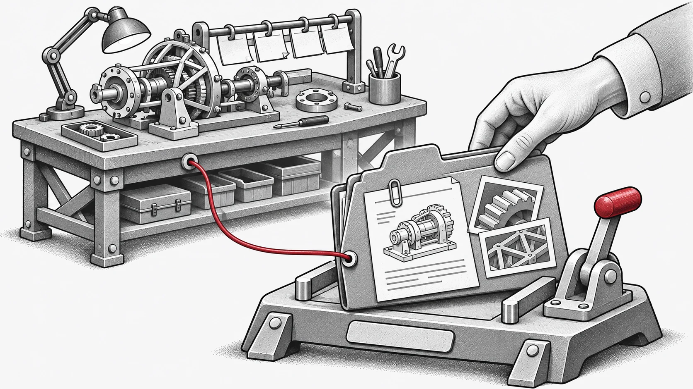

请求修复一个项目，需要明确目标、批准操作，也需要知道如何跟踪结果。2026 年 11 月 15 日合入 `main` 的 PR #172 将这些步骤串联起来，让 Genesis Assistant 从[延续一段对话][previous]走向围绕项目开展工作。

*概念插画：明确范围的请求经批准后成为后台工作。*

## 先确定工作目标

普通聊天和任务控制不再需要 Genesis 源码检出。源码参考现为可选、需审批的能力。选择目标主机上的项目可补全任务省略的路径，但不会读取项目文件或授权开发。回复期间不能切换项目；明确指定其他路径时，审批仍显示实际目标。 [已合并的工作流更新][workflows]

项目选择属于当前节点和会话，同一节点的新会话可以继承它。工具使用服务器提供的节点与会话身份，而不是让模型自行构造。如果请求明确指定其他路径，审批必须显示这个实际目标。例如，面对两个名称相近的仓库，启动前核对路径，就能避免批准错误项目上的工作。

## 从审批到跟踪任务

与 MCP 共用的十一项定义区分查询和修改。读取任务状态直接执行；启动、取消或发送需求，需要针对不可变结构化参数的审批。拒绝或超时不会执行操作。以修复测试为例，先提供失败上下文，再检查目标和拟用参数，最后批准这次具体请求。启动后应打开任务跟踪与结果审阅，而不是仅凭接受请求的消息就判断成功。[任务与审批约定][workflowguide]

成功启动的任务自动跟踪，也可用支持搜索的 Tasks 选择器关联已有任务。

## 区分回复和后台工作

补充需求会进入队列，不代表正在工作的开发者已经采用。类似地，**Stop reply** 会在当前工具批次执行完毕后停止回复并保留会话，开发任务则继续运行。卡片显示已观测状态、计数与刷新时间，不编造完成百分比；刷新失败时保留最后一次观测。这些区别帮助用户决定等待、检查结果、细化请求，还是申请取消。 取消不会撤销 Git 修改。

任务关联在 Assistant 会话结束后仍保留，但内存中的会话存储不能跨服务器重启恢复；持久化任务可以重新查找和跟踪。在包含 PR #172 的构建上尝试这一流程，对结果不确定的提交先检查任务状态再重试。[更新后的 Assistant 指南][workflowguide]

## 把正确的文件带入对话

浏览器上传支持文本、PDF、DOCX、图片和音频，每条消息最多四个文件、每个 15 MiB，上传完成后可不加文字直接发送。次级服务器路径入口支持仪表板本地节点，不会用该主机替代不支持的远程节点。

浏览器上传读取当前设备上的文件。服务器路径指向另一处位置，且只支持仪表板本地节点。切换上下文前应等待上传结束：切换会话或节点会取消待完成传输。若要查阅 Genesis 代码，可选的源码参考准备仍需审批，并应对照参考版本与实际运行版本。项目上下文和 Genesis 源码参考由此承担不同职责。[文件与源码参考][workflowguide]

[previous]: /zh-cn/news/genesis-assistant-interactive-sessions
[workflows]: https://github.com/EMI-Group/genesis/pull/172
[workflowguide]: https://github.com/EMI-Group/genesis/blob/6e10e18dd56ca3c84e2215dac647473c30563fee/docs/genesis-assistant.md
