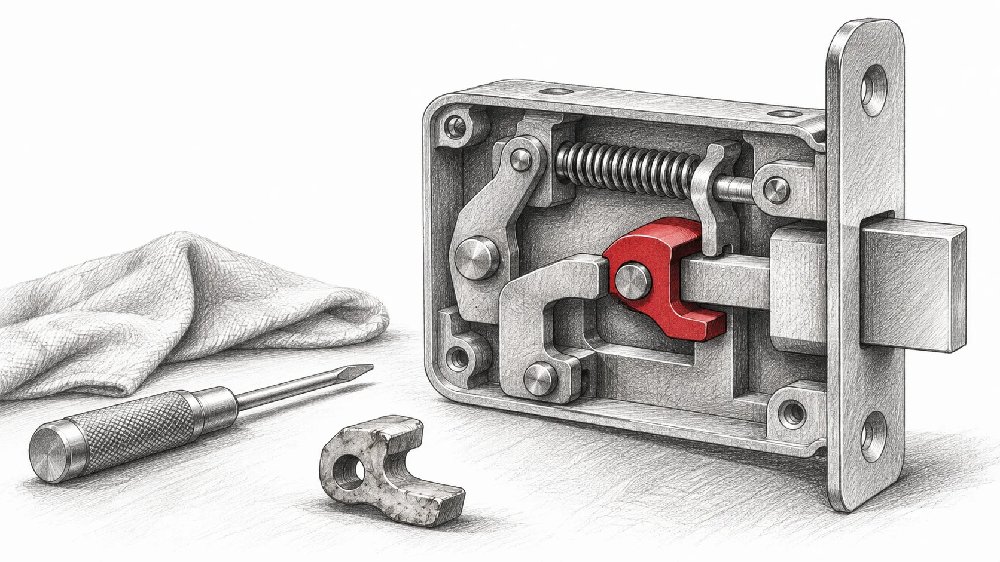

23 ноября 2026 года Genesis обновил четыре зависимости в `main`. Изменение касается общей веб-инфраструктуры доступа к рабочему пространству. Командам, собирающим Genesis из исходников, важно проверить набор зависимостей, с которым создан работающий сервис. [Обновление зависимостей][lock]

*Концептуальная иллюстрация: обслуживание компонентов общего входа.*

## Что изменилось под интерфейсом

В декларации зависимостей Genesis обновление Phoenix связано с исправлениями сбоев трекера присутствия и широковещательной доставки. Минимальная версия LiveView связана с исправлением пропуска обработчиков инициализации сессии при подключении без URL. Также описаны проверки и усиление HTTP/2 в Bandit. Это причины, зафиксированные сопровождающими Genesis; коммит не устанавливает, была ли затронута конкретная установка. [Требования][pins]

Файл фиксации версий обновляет Phoenix с 1.8.16 до 1.8.17, LiveView с 1.2.13 до 1.2.15, Bandit с 1.14.1 до 1.15.0 и jsv с 0.28.0 до 0.28.1. Объявленный минимум LiveView — 1.2.14, но зафиксированная сборка использует 1.2.15. Сопутствующее изменение Nix пересчитывает хеш зависимостей. [Версии][lock] · [Изменение Nix][nix]

## Проверьте реально развёрнутую сборку

Например, команда с собственным сервером может обновить исходники, продолжая запускать старый бинарный файл. Используйте ревизию с этими коммитами, пересоберите и разверните приложение по обычной процедуре проекта. Проверьте `mix.lock` сборки, сохраните соответствующий хеш Nix, если он используется, и проверьте доступ к панели и восстановление соединения после развёртывания. Обновление каталога исходников само по себе не заменяет работающий сервис. [Руководство по установке][install]

[lock]: https://github.com/EMI-Group/genesis/commit/99f450252b8c0f8a07ad64bb3f7491b35f9b23d0
[pins]: https://github.com/EMI-Group/genesis/commit/bfcc0115ad1cb714ec54d60265816550c1619bd3
[nix]: https://github.com/EMI-Group/genesis/commit/6a80bba389dec5d120c64a435cab88be4de275bc
[install]: https://github.com/EMI-Group/genesis/blob/43705acdfc9a4ebc885e0d457d75242286924637/README.md
