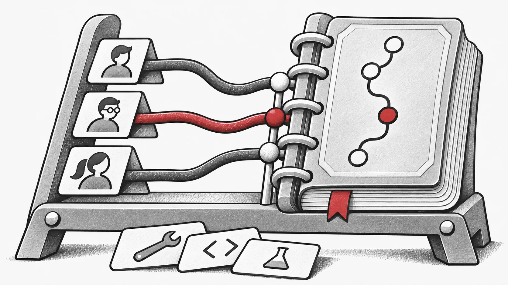

A árvore dos agentes mostra quem trabalha agora. A história do projeto deve também explicar o que fica depois. Genesis 0.13.4, publicado a 26 de setembro de 2026, desenvolve a vista de commits de 0.13.2 e as referências persistentes das tarefas de 0.13.3, ligando atividade temporária a versões inspecionáveis.

## De agentes ativos a referências persistentes

A API de histórico por tarefa resolve referências persistentes e o commit de base. A vista temporal mantém assim commits de agentes já reciclados. A API anterior consulta intervalos e referências entre repositórios; a camada da tarefa fornece o contexto para seguir um esforço específico. [v0.13.2](https://github.com/EMI-Group/genesis/releases/tag/v0.13.2) · [v0.13.3](https://github.com/EMI-Group/genesis/releases/tag/v0.13.3)

Quando um agente delega um módulo e termina, o contributo pode continuar a precisar de revisão. Git dá à alteração uma identidade duradoura e a vista da tarefa ajuda a localizá-la. O fim de uma execução não precisa de apagar a relação entre tarefa e código produzido.

## Mostrar relações entre contributos

A versão 0.13.4 organiza commits por faixas de agentes, agrupa subárvores e mostra delegação e fusão de retorno. Commits sem proprietário têm uma faixa neutra. Seleção, sincronização ao passar o cursor e acesso por teclado ajudam a inspeção; falhas parciais de leitura não apagam todo o grafo. [v0.13.4](https://github.com/EMI-Group/genesis/releases/tag/v0.13.4)

A vista assinala o truncamento no limite de 100 commits. Para alterações anteriores, use as referências de base e ponta da tarefa para examinar o intervalo Git relevante.

## Seguir uma contribuição até à integração

Parta do commit base da tarefa e siga uma faixa de agente pela delegação e integração de retorno. Consulte diferenças e testes para decidir o que conservar. Para várias bases de código, a [revisão multirrepositório](/pt/news/genesis-multi-repository) fornece o passo seguinte de integração.
