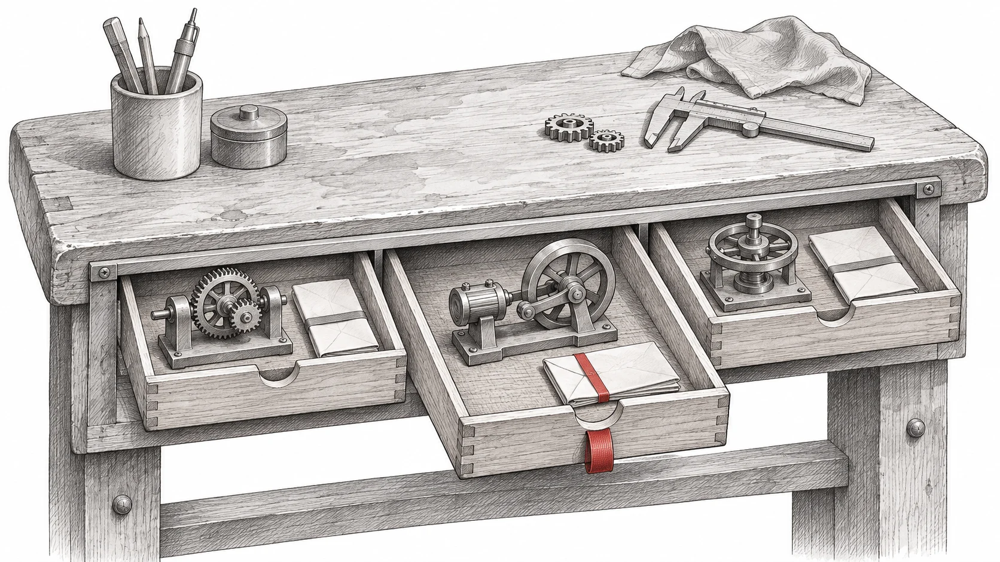

Der Wechsel zwischen Gespräch, Entwicklungsaufgabe und Git-Änderungen sollte nicht jedes Mal einen neuen Projektkontext erfordern. Genesis PR #175, am 20. November 2026 in `main` übernommen, führt eine LiveView-Workbench mit Projektnavigation, Tabs, Aufgaben- und Gesprächsverlauf, Git-Bereich und integrierten Einstellungen ein. Ergänzende Workspace- und Entwurfsänderungen tragen die Projektidentität zwischen diesen Ansichten weiter. [Übernommene Integration][pr]

*Konzeptillustration: Jedes Projekt behält seinen Arbeitskontext.*

## Das Projekt an einem Ort prüfen

Die Workbench verbindet Navigation und Arbeitsansichten. Sie können zu einem Projekt zurückkehren, Aufgaben oder Gespräche nachsehen und Git-Änderungen prüfen, ohne jede Ansicht als neuen Anfang zu behandeln. Workspace-Auswahl, Kontoeinrichtung und Aufgabenpause beziehungsweise Wiederaufnahme bleiben verfügbar. Nach einer erneuten Verbindung wird auch der Freigabekontext wiederhergestellt. Das ergänzt den [bisherigen Assistant-Aufgabenablauf][previous]; strukturierte Freigaben bestimmen weiterhin die erlaubte Aktion. [Integration][pr]

Denken Sie an den Wechsel zwischen einer Bibliothek und ihrer Anwendung. Ein Anforderungsentwurf für die Bibliothek soll dort bleiben, wenn der Anwendungstab geöffnet wird. Eine Git-Operation muss den Server und das Repository des ausgewählten Projekts treffen. Die Änderungen prüfen vor Git-Operationen die Projektzugehörigkeit und behalten bei fehlender Verbindung den gewählten Knoten bei, statt auf den Dashboard-Host auszuweichen.

## Entwurfsidentität ist mehr als ein Pfad

Das gemeinsame `DraftScope` definiert Browserentwürfe durch `{node, token}`. Ein bereits im Virtual Context Tree eingebundenes Projekt nutzt seinen Punkt `vct:///projects/<name>`; andernfalls dient der absolute Betriebssystempfad als Rückfall. Sind beide vorhanden, hat der Punkt Vorrang. Verschiedene Pfadschreibweisen desselben eingebundenen Projekts erreichen so einen Entwurf, während verschiedene VCT-Punkte über demselben Pfad getrennt bleiben. [Implementierung][scope]

Der Browserspeicherschlüssel kombiniert Knoten und Token. Eine nachfolgende Korrektur übernimmt den pfadgebundenen Entwurf, sobald der VCT-Punkt verfügbar wird, und deckt damit den Übergang von Verzeichnisauswahl zu Projektregistrierung ab. Das ist Kontinuität des Browserentwurfs, getrennt von Aufgabenpersistenz oder einer Garantie dauerhafter Gesprächswiederherstellung nach einem Serverneustart. [Entwurfsübernahme][adopt]

Bei entfernten Projekten muss der Pfad unverändert bleiben: Das Dashboard darf ihn nicht nach dem Dateisystem des Browserhosts normalisieren. Prüfen Sie vor dem Absenden eines wiederhergestellten Entwurfs Knoten, Repository und Modell, besonders nach einem Wechsel zwischen lokalen und entfernten Projekten.

## Workspaces gruppieren Projekte; Aufgaben brauchen ein Verzeichnis

VCT besitzt nun eine Gruppierungsebene unter `vct:///workspaces/<name>`. Ein Workspace hat eine geordnete Mitgliederliste und optional eine Beschreibung. Mitglieder verweisen auf Projekt-Mountpunkte oder Betriebssystempfade; Workspaces sind nicht verschachtelbar. Projects-Palette und Assistant-Auswahl können diese Gruppen anzeigen, deren Mitglieder über schreibgeschützte APIs geprüft werden können. [Bedienerschnittstelle][workspace]

Eine Gruppe hat kein eigenes Ausführungsverzeichnis. `DraftScope.path/1` liefert deshalb für eine reine Workspace-Auswahl keinen Pfad; die Aufgabenannahme weist VCT-Punkte als Aufgabenpfade zurück. Gruppieren Sie Bibliothek und Anwendung zur gemeinsamen Navigation, wählen Sie für eine Entwicklungsaufgabe aber das konkrete Mitglied aus. Ein Workspace macht nicht alle Mitglieder automatisch zu Schreibzielen.

Im Quellcheckout prüfen `mix vct.workspace list` und `mix vct.workspace show <name>` die Gruppen. Der dokumentierte Befehl `create` akzeptiert wiederholte `--member`-Argumente und optional `--data-dir`; verwenden Sie das Datenverzeichnis der gewünschten Genesis-Instanz. Fehlende Mitglieder werden gemeldet, nicht still weggelassen. Lesen Sie vor Änderungen den verlinkten Befehlsvertrag.

## Übergänge zwischen Ansichten überprüfen

Die PR berichtet Browserprüfungen für das Erstellen und Abschließen einer Aufgabe, Assistant-Tastatureingabe und Streaming sowie die Kontoeinrichtung. Sie hält außerdem einen Timeout einer projektbezogenen Assistant-Aufgabenabfrage fest. Bei langen Abläufen sind die Annahme einer Anfrage und das beobachtete Ergebnis unterschiedliche Ereignisse. [Prüfprotokoll][pr]

Probieren Sie mit einem Build dieser Änderungen zwei Projekte mit unterschiedlichen Entwürfen aus, verbinden Sie den gewählten Knoten erneut und öffnen Sie den Git-Bereich des gewünschten Projekts. Prüfen Sie, ob Entwurf und Freigabe weiterhin zum richtigen Projekt und tatsächlichen Ausführungsziel gehören. Verfolgen Sie anschließend den gespeicherten Aufgabenstatus; ein wiederhergestellter Tab beweist keinen abgeschlossenen Hintergrundauftrag.

[pr]: https://github.com/EMI-Group/genesis/pull/175
[previous]: /de/news/genesis-assistant-project-workflows
[scope]: https://github.com/EMI-Group/genesis/blob/975b9ba32be5f6772b456ea3c92bfa3b4ae22cb9/apps/evo_dash/lib/evo_dash_web/live/draft_scope.ex
[adopt]: https://github.com/EMI-Group/genesis/commit/a0f7b141ed448590030f6d36de951bbb1ca3673e
[workspace]: https://github.com/EMI-Group/genesis/blob/975b9ba32be5f6772b456ea3c92bfa3b4ae22cb9/apps/evo_git/lib/mix/tasks/vct.workspace.ex

Die Änderungen vom 25. November 2026 halten Aufgabenoptionen im Formular, öffnen explizit gewählte Projekte in der Übersicht und verlinken aktive Aufgaben mit einem aufgabenbezogenen Agenteninspektor. Ein projektbezogener Assistant-Entwurf erscheint erst nach bestätigter Projektidentität. Projekt und Ausführungsknoten bleiben beim Navigieren erhalten. [GitHub](https://github.com/EMI-Group/genesis/commit/c40b76d207345ed6b9dc1435887b3482ff3ad9a4) · [GitHub](https://github.com/EMI-Group/genesis/commit/732f127e1712424fc4501bfe59200fa4661514f4) · [GitHub](https://github.com/EMI-Group/genesis/commit/e3bba720387f921bd72dda49016cdfb4ef0fa46b) · [GitHub](https://github.com/EMI-Group/genesis/commit/4f8a233f89a1dcecb63ce3d342b437b4d4fbf8af).

PR #178 wurde am 27. November 2026 in main integriert und verfeinert die bestehende Projektauswahl: zuletzt genutzte Projekte zuerst, Ordnernavigation und weiterhin verfügbare, eingeklappte Pfadeingabe. Die Auswahl bewahrt den Entwurf und gehört zur Unterhaltung, die den Dialog geöffnet hat; ein veralteter Dialog kann keine andere Unterhaltung ändern. Unter Windows zeigt die Computerschaltfläche Laufwerkswurzeln des gewählten Knotens. Interne Projekthinweise werden im sichtbaren Verlauf ausgeblendet, bleiben aber Modellkontext; beim ersten Senden entstehen keine doppelten Verlaufseinträge mehr. Warten Sie nach einem Projektwechsel, bis History den neuen Geltungsbereich aufgelöst hat. [PR #178](https://github.com/EMI-Group/genesis/pull/178) · [History](https://github.com/EMI-Group/genesis/commit/0fc1182ea3e53baa50613f3504ff0a52798984dd).
