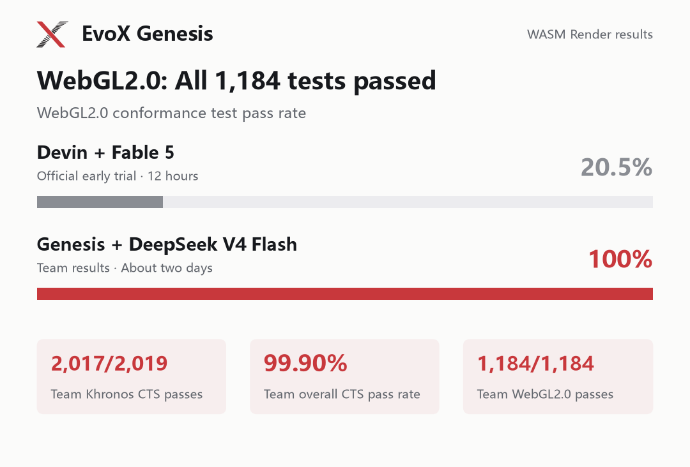

A software WebGL renderer must do more than draw a recognizable image. It must compile shaders, maintain API state, validate inputs in the right order and preserve image precision across module boundaries. The Genesis WASM Render case contains two concrete examples of those requirements being debugged and rechecked.


The [Evidence record](https://genesis.evox.group/evidence/tbench-wasm/) describes a TypeScript implementation developed with DeepSeek V4 Flash: 2,017/2,019 Khronos CTS cases passing, approximately US$36 in model-token charges, and 65.9 hours between its first and last agent commits. That interval is repository history span, not measured active-agent runtime.

## Divide the pipeline along usable interfaces

The [source architecture](https://github.com/BillHuang2001/tbench-wasm/blob/67f620392b667714ba028f320d0e24f8ed32a16a/src/CONTEXT.md) separates shader compilation and linking, rasterization, WebGL state and objects, and presentation/image decoding. A shader result still has to pass through interpolation, fragment execution, texture handling and the drawing buffer before it becomes a visible image.

The zero-runtime-dependency renderer targets execution without native GPU rendering. Browser-based conformance harnesses are still used to test it; that verification environment is distinct from the renderer's runtime dependency claim.

## A security error had to happen before a texture-binding error

One failing WebGL2 page concerned an origin-tainted image source. The [final verification record](https://github.com/BillHuang2001/tbench-wasm/blob/67f620392b667714ba028f320d0e24f8ed32a16a/tests/conformance/FINAL.md#vs-previous-record-bundle-e3565d4-2015p4f) traces it to validation order, rather than a missing worker capability.

The implementation checked texture binding before checking whether the source was origin-clean. Fix `7d8718a` moved the security check ahead of binding validation across all six relevant image-source entry points, covering both image and sub-image uploads. The affected page changed from **9 passing / 4 failing subtests to 13 / 0**.

This is an integration issue: both checks existed, but their ordering changed the observable API behavior. The targeted result was then included in a full-suite run, rather than treated as proof that unrelated behavior was unchanged.

## A high-bit-depth texture failed before it reached the renderer

A second page tested higher-precision texture input. The same record identifies an image-decoding path that reduced the source to eight bits per channel before upload. Fixes `89e4559` and `9bd7811` added a JavaScript 16-bit PNG path and corrected channel handling, including RGBA input.

The `tex-image-10bpc` page moved from **2 passing / 1 failing subtest to 3 / 0**. The relevant implementation is the [presentation-layer PNG decoder](https://github.com/BillHuang2001/tbench-wasm/blob/67f620392b667714ba028f320d0e24f8ed32a16a/src/present/png.ts). This example shows why changing shader arithmetic alone would not have addressed every precision failure: the data had already lost precision upstream.

## Verify the submitted bundle, including which renderer ran

The [August 29 final record](https://github.com/BillHuang2001/tbench-wasm/blob/67f620392b667714ba028f320d0e24f8ed32a16a/tests/conformance/FINAL.md) identifies bundle commit `c4ffbff`. It says the checked-in `renderer.js` was tested as checked out, without rebuilding it for verification.

| Evaluated suite | Passed | Failed | Timeouts / errors |
| --- | --- | --- | --- |
| WebGL1 | 833/835 | 2 | 0 / 0 |
| WebGL2 | 1,184/1,184 | 0 | 0 / 0 |
| Combined | 2,017/2,019 | 2 | 0 / 0 |

The denominator follows the manifests in that test tree. The record also states that all 2,019 graded pages reported the software renderer active, so native fallback did not supply the passing results. For those two corrected WebGL2 pages, the full run recovered both failures while preserving the previously passing pages.



*Historical result figure; the versioned final record defines the evaluated manifests and counts.*

## Investigate residual failures with a control

Two WebGL1 pages remained failing. The final record attributes the low-alpha color case to Chromium's 2D-canvas presentation/readback behavior and reports the same failure with native WebGL. For double-underscore shader identifiers, it reports that native Chrome also failed the test page.

These are the project's documented control results, not an independent reproduction. They explain the authors' classification of the residuals without turning 2,017/2,019 into an unconditional compatibility claim.

Visual comparison is a separate check. The Evidence record reports **16/38 three.js pages at a strict 0.1% pixel threshold** and **13/16 Babylon.js scenes**, both selected subsets. API conformance and pixel agreement measure different properties; the high CTS count does not erase the visual failures.

## Follow a failure from test page to final artifact

With the required test trees and harness dependencies prepared, the final record documents this WebGL2 entry point:

```bash
npx tsx tests/conformance/run.ts --renderer ./renderer.js --suite webgl2 --report tests/reports/webgl2-FINAL2.json
```

The record notes that the detailed JSON outputs are gitignored. Its checked-in report and fix identifiers are the public trail; this article has not rerun the suite.

The archive's 135,165 tracked text lines include the generated bundle, vendored material, lockfiles and documentation. US$36 covers model tokens, excluding hardware. Start with the validation-order fix and its test page when inspecting this case: it connects a specific failure, a source change and the integrated result without relying on code volume alone.
