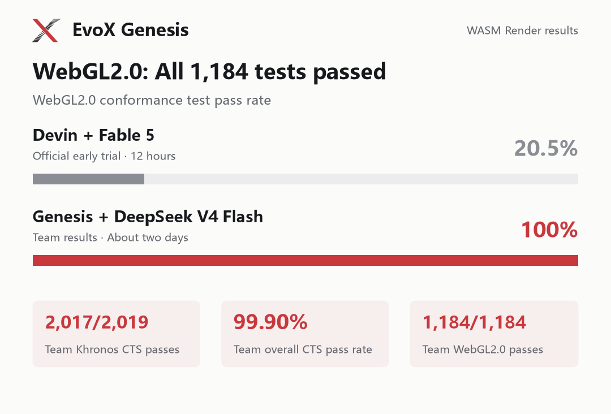

Способность последовательно выполнять длительные задачи и в итоге создавать законченный инженерный проект становится важным показателем возможностей ИИ. Terminal-Bench — один из характерных бенчмарков для ИИ-агентов, ориентированный на программирование и задачи командной строки в терминальной среде. Terminal-Bench Challenges расширяет оценку до создания полноценных программных проектов с нуля; официальная оценка затрат составляет более 1,000 долларов США на каждую задачу.

EvoX Genesis, рекурсивная система ИИ для эволюции программного обеспечения, разработанная командой EvoX, использовала DeepSeek V4 Flash для выполнения задачи WASM Render примерно за **два дня**, потратив на модель всего **36 долларов США**, и стала **первой в мире системой ИИ, представившей результат по этой задаче.** По данным тестирования команды, система прошла 2,017/2,019 тестов набора Khronos CTS (99.90%), включая все 1,184/1,184 теста на соответствие WebGL2.0.

## От локального кода к полноценной системе: в чём сложность?

WASM Render — задача по созданию графической системы в рамках Terminal-Bench Challenges: обеспечить выполнение программ WebGL без браузера, GPU и внешних библиотек среды выполнения.

По сути, это программная реализация графического конвейера: интерпретация шейдерных программ, графические вычисления и обеспечение согласованности множества интерфейсов и изменений состояния. Работающая отдельная функция ещё очень далека от слаженной работы всей системы. Задача требует от ИИ сохранять соответствие цели на протяжении нескольких циклов разработки, учитывать зависимости между модулями, исправлять ошибки по результатам тестов и в конечном итоге завершить интеграцию системы и регрессионную проверку.

Согласно опубликованным командой Terminal-Bench результатам раннего 12-часового пробного запуска, Devin — продукт Cognition для разработки программного обеспечения с помощью ИИ — в сочетании с Fable 5 прошёл 20.5% более сложных тестов на соответствие WebGL2.0. После примерно двух дней разработки Genesis довела долю успешно пройденных тестов на соответствие WebGL2.0, которые выполняла, до 100%.

*Результаты тестов на соответствие WebGL2.0 и данные тестирования Genesis в Khronos CTS.*

Открытый репозиторий результатов Genesis содержит около **130,000 строк кода**, охватывающих компилятор шейдерного языка GLSL, интерфейсы WebGL и управление состоянием, программную растеризацию и вывод изображений. Эти реализации на TypeScript собираются в рендерер на JavaScript, объединяющий обработку языка, графические вычисления и поведение интерфейсов.

В ходе разработки в итоге были пройдены 2,017 тестов Khronos CTS, а затраты на токены модели составили около 36 долларов США при доле попаданий в кеш около 98%. Последовательная разработка и интеграция столь масштабного программного инженерного проекта при низких затратах на модель также демонстрируют способность Genesis вести длительную разработку с использованием экономичных моделей с открытым исходным кодом.

## Проект продолжает развиваться, а агенты подключаются по мере необходимости

Genesis — рекурсивная система ИИ для эволюции программного обеспечения. Пользователи описывают цель разработки, а система разворачивает задачи вокруг неё, назначает локальных агентов там, где требуется работа, и сохраняет принятый код и результаты проверки в программном проекте.

Для крупных проектов интуитивный подход заключается в расширении возможностей агентов: более длинный контекст, более продолжительные сессии и более сложная заранее заданная схема взаимодействия. Genesis обеспечивает непрерывность разработки за счёт самого программного проекта. Цели и ограничения верхнего уровня направляют весь процесс, а задачи рекурсивно разворачиваются в соответствии со структурой репозитория. Агенты выполняют локальную работу и завершают свою деятельность; последующие агенты продолжают работу на основе уже сформированного проекта.

Ранее Genesis начала работу с пустого репозитория, создала компилятор C объёмом около 250,000 строк кода и продолжала разработку с переходом между моделями. Результаты тестирования WASM Render дополнительно подтверждают возможности Genesis по автономному созданию и интеграции сложных графических систем.

## Открытый исходный код и сообщество

Команда EvoX продолжит развивать рекурсивные системы ИИ для эволюции программного обеспечения, содействуя накоплению кода, результатов проверки и опыта разработки в сообществе открытого программного обеспечения. Мы приглашаем больше разработчиков участвовать в устойчивой эволюции программного обеспечения и вместе создавать открытую экосистему разработки.

🔗 Репозиторий Genesis: [https://github.com/EMI-Group/genesis](https://github.com/EMI-Group/genesis)

📄 Научная статья о Genesis: [https://arxiv.org/abs/2608.10450](https://arxiv.org/abs/2608.10450)

✅ Репозиторий результатов задачи: [https://github.com/BillHuang2001/tbench-wasm](https://github.com/BillHuang2001/tbench-wasm)

🔼 Исходный проект (EvoX): [https://github.com/EMI-Group/evox](https://github.com/EMI-Group/evox)

🌐 Группа QQ: 297969717
