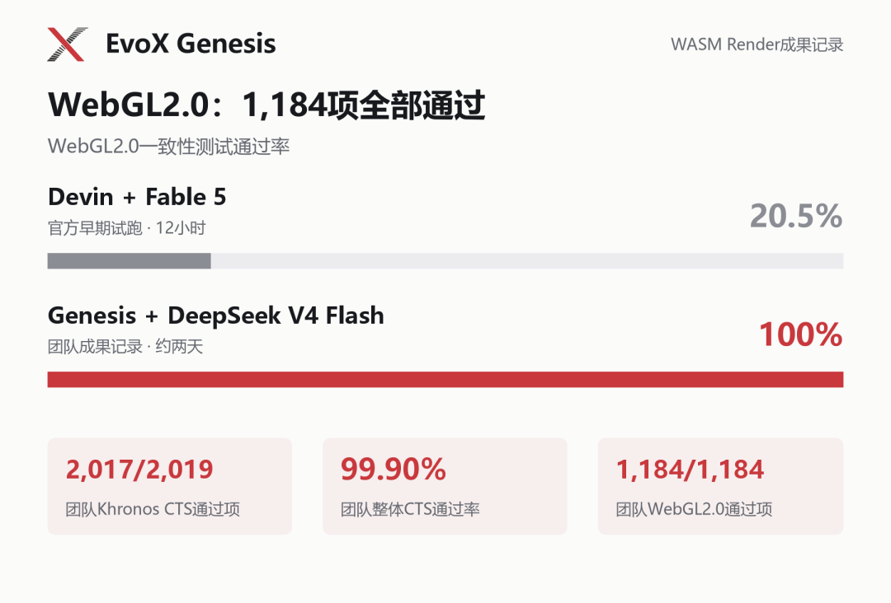

*更新于 2026 年 11 月 7 日。历史结果保留其原始记录日期。*

构建软件系统，需要让有价值的局部改动在项目增长中保持兼容。Genesis 的 WASM Render 案例以图形流水线研究这一挑战，将 EvoX 的 Agentic AI 方向推进到系统构建：着色语言处理、渲染与 API 行为，必须共同形成能够协作的整体。

Genesis 的公开记录描述了使用 DeepSeek V4 Flash 开发的 TypeScript 软件渲染器：在所评估集合中，2,017/2,019 项 Khronos CTS 通过，其中 WebGL2 为 1,184/1,184。约 36 美元仅包含模型 token 费用，不含硬件。证据档案记录首末智能体提交间隔 65.9 小时，这是仓库时间跨度，不是测量得到的智能体有效运行时长。

[Genesis Evidence](https://genesis.evox.group/evidence/tbench-wasm/)

## 从局部代码到完整系统，难关在哪里？

WASM Render是Terminal-Bench Challenges中的一项图形系统挑战：让WebGL程序在没有浏览器、GPU和外部运行库的条件下运行。

这相当于用软件实现一套图形管线：读懂着色程序、算出图形，再让大量接口与状态变化保持一致。单个局部功能可用，距离整套系统配合起来工作，还有很长的路。该任务要求AI在多轮开发中持续对齐目标、处理模块依赖，依据测试反馈修正错误，最终完成系统集成与回归验证。

早期 12 小时试验与本次运行的开发预算不同，通过率不能作为受控排名。Evidence 档案另报告：严格 0.1% 阈值下 three.js 视觉测试为 16/38，Babylon.js 为 13/16，二者均为选取的子集。因此，API 一致性覆盖率高，不等于全部视觉回归测试通过，也不等于完整图形兼容性已得到证明。

*WebGL2.0一致性测试结果与Genesis的Khronos CTS测试记录。*

档案统计的 135,165 行跟踪文本包含生成的 renderer.js、第三方代码、锁文件和文档，并非全部是渲染器源码。项目将其描述为早期自主挑战提交，但这不是主办方发布的排名。结果由项目报告，尚未独立复现。

本次开发最终通过2,017项Khronos CTS测试，模型token费用约为36美元，其中缓存命中率约98%。在较低模型成本下持续推进并集成如此大规模的软件工程，这也体现出Genesis利用经济型开源模型开展长周期开发的能力。

## 让项目持续演化，让Agent按需登场

Genesis是一套递归演化式AI系统。用户描述软件开发目标，系统围绕目标展开任务，让局部Agent在需要的位置承担工作，并将接受的代码与验证结果留在软件项目中。

面对大项目，一种直观的思路是为Agent加码：更长的上下文、更持久的会话、更复杂的预设协作。Genesis则把开发的连续性放在软件项目上——顶层目标与约束贯穿开发，任务随仓库结构递归展开。Agent处理局部工作、完成后退出，后续Agent从已经形成的项目继续。

此前，Genesis已从空仓库出发，构建出约25万行代码的C编译器，并开展了跨模型接续开发。本次WASM Render挑战的测试结果，进一步验证了Genesis在复杂图形系统开发中的自主构建与集成能力。

## 让开放系统持续演化

这一案例的开源价值，在于让系统构建过程可被检查：接口、实现和验证结果保留下来，供后续工作继续使用。它推进了 EvoX 所探索的软件持续演化方向，使不同智能体任务产生的有效变更能够积累，并以集成后系统的行为检验进展。

🔗 Genesis仓库：[https://github.com/EMI-Group/genesis](https://github.com/EMI-Group/genesis)

📄 Genesis论文：[https://arxiv.org/abs/2608.10450](https://arxiv.org/abs/2608.10450)

✅ 挑战成果仓库：[https://github.com/BillHuang2001/tbench-wasm](https://github.com/BillHuang2001/tbench-wasm)

🔼 上游项目（EvoX）：[https://github.com/EMI-Group/evox](https://github.com/EMI-Group/evox)

🌐 QQ交流群：297969717
