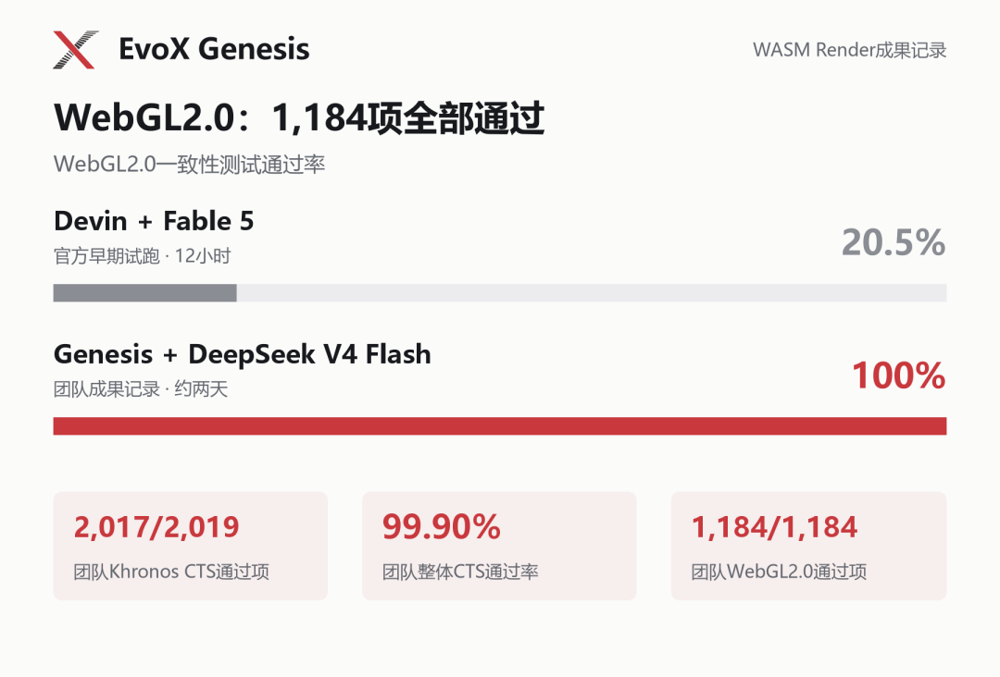

構建軟體系統，需要讓有價值的區域性改動在專案增長中保持相容。Genesis 的 WASM Render 案例以圖形流水線研究這一挑戰，將 EvoX 的 Agentic AI 方向推進到系統構建：著色語言處理、渲染與 API 行為，必須共同形成能夠協作的整體。

Genesis 的公開記錄描述了使用 DeepSeek V4 Flash 開發的 TypeScript 軟體渲染器：在所評估集合中，2,017/2,019 項 Khronos CTS 透過，其中 WebGL2 為 1,184/1,184。約 36 美元僅包含模型 token 費用，不含硬體。證據檔案記錄首末智慧體提交間隔 65.9 小時，這是倉庫時間跨度，不是測量得到的智慧體有效執行時長。

[Genesis Evidence](https://genesis.evox.group/evidence/tbench-wasm/)

## 從局部程式碼到完整系統，難關在哪裡？

WASM Render 是 Terminal-Bench Challenges 中的一項圖形系統挑戰：讓 WebGL 程式在沒有瀏覽器、GPU 和外部執行階段函式庫的條件下運作。

這相當於用軟體實作一套圖形管線：理解著色器程式、計算圖形，再讓大量介面與狀態變化保持一致。單個局部功能可用，距離整套系統協同運作，還有很長的路。該任務要求 AI 在多輪開發中持續對齊目標、處理模組相依性，依據測試回饋修正錯誤，最終完成系統整合與迴歸驗證。

早期 12 小時試驗與本次執行的開發預算不同，透過率不能作為受控排名。Evidence 檔案另報告：嚴格 0.1% 閾值下 three.js 視覺測試為 16/38，Babylon.js 為 13/16，二者均為選取的子集。因此，API 一致性覆蓋率高，不等於全部視覺迴歸測試透過，也不等於完整圖形相容性已得到證明。

*WebGL2.0 一致性測試結果與 Genesis 的 Khronos CTS 測試紀錄。*

檔案統計的 135,165 行跟蹤文字包含生成的 renderer.js、第三方程式碼、鎖檔案和文件，並非全部是渲染器原始碼。專案將其描述為早期自主挑戰提交，但這不是主辦方釋出的排名。結果由專案報告，尚未獨立復現。

本次開發最終通過 2,017 項 Khronos CTS 測試，模型 token 費用約為 36 美元，其中快取命中率約 98%。在較低模型成本下持續推進並整合如此大規模的軟體工程，這也展現出 Genesis 利用經濟型開源模型進行長週期開發的能力。

## 讓專案持續演化，讓 Agent 按需登場

Genesis 是一套遞迴演化式 AI 系統。使用者描述軟體開發目標，系統圍繞目標展開任務，讓局部 Agent 在需要的位置承擔工作，並將獲接納的程式碼與驗證結果保留在軟體專案中。

面對大型專案，一種直觀的思路是為 Agent 加碼：更長的上下文、更持久的工作階段、更複雜的預設協作。Genesis 則把開發的連續性放在軟體專案上——頂層目標與約束貫穿開發，任務隨儲存庫結構遞迴展開。Agent 處理局部工作、完成後退出，後續 Agent 從已經形成的專案繼續。

此前，Genesis 已從空儲存庫出發，建構出約 25 萬行程式碼的 C 編譯器，並進行了跨模型接續開發。本次 WASM Render 挑戰的測試結果，進一步驗證了 Genesis 在複雜圖形系統開發中的自主建構與整合能力。

## 讓開放系統持續演化

這一案例的開源價值，在於讓系統構建過程可被檢查：介面、實現和驗證結果保留下來，供後續工作繼續使用。它推進了 EvoX 所探索的軟體持續演化方向，使不同智慧體任務產生的有效變更能夠積累，並以整合後系統的行為檢驗進展。

🔗 Genesis 儲存庫：[https://github.com/EMI-Group/genesis](https://github.com/EMI-Group/genesis)

📄 Genesis 論文：[https://arxiv.org/abs/2608.10450](https://arxiv.org/abs/2608.10450)

✅ 挑戰成果儲存庫：[https://github.com/BillHuang2001/tbench-wasm](https://github.com/BillHuang2001/tbench-wasm)

🔼 上游專案（EvoX）：[https://github.com/EMI-Group/evox](https://github.com/EMI-Group/evox)

🌐 QQ 交流群組：297969717
