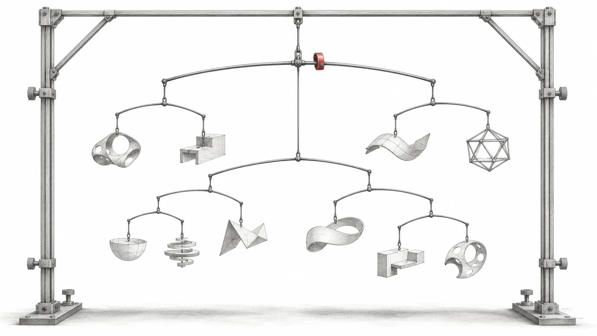

按下暂停时，一个开发任务可能还在等待多个子智能体。如果为了停下来就把这些子任务批次标为完成，保存的工作本身便发生了变化。Genesis 在 2026 年 11 月 25 日合入 main 分支的更新引入协调式整树快照：父任务保留等待位置，子任务保留身份和检查点，恢复时在同一个任务 ID 下重建这些关系。[快照设计与实现记录][design]

*概念插画：先保留每一条未完成的分支，再恢复整个结构。*

## 暂停属于任务生命周期，而非全局限流

调度器的全局暂停只阻止接纳新工作，不会让某个运行中的任务进入持久化的休止状态。任务级协议使任务经过 pausing 进入 paused，保留结果上下文，并让结束时间保持未设置。取消仍是独立操作；若暂停过程中收到取消，取消优先。交互式会话不属于该协议的处理范围。[注册表集成][registry]

例如，一个同时协调解析器和测试套件的智能体可能正在等待两个子任务。暂停必须保留这种等待，而不是生成虚假的完成结果。协调器为当前任务成员标记暂停、移除排队的模型和工具槽请求，并停驻等待子智能体批次的父任务。每个智能体在工具批次结束后的回合边界，或已停驻的等待位置停止。[冻结协调器][coordinator]

## 回收资源前，先保存工作

智能体停止前会清理后台作业、为工作树建立检查点、保留持久化的待处理工具标记，并刷新状态。检查点提交会被锚定，避免之后回收工作树时丢失。快照记录智能体处于回合边界、等待子任务，还是被中断的批次内。暂停报告自身的结果，不会替尚未完成的子任务报告成功，也不会合并其工作。[智能体冻结路径][agent]

等待时间有上限。文档中的默认值是 120 秒静止等待，加上 10 秒强制冻结宽限期。只有每个智能体都能证明自己完成了未被中断的持久化停止，才会记为 clean pause。超时或缺少证明时，任务记录 dirty pause。这个区别描述的是保存下来的执行状态，并不意味着任意外部副作用都可以撤销。

## 恢复已有协作关系

恢复使用已持久化的选项，将同一个任务重新入队。系统要求存在持久化的根记录；只有子记录不够，状态存储不可读则明确报错。恢复规划器重建身份、拓扑和执行位置。已经完成的子任务提供保存的结果，运行中的子任务以原身份和检查点重新启动，在登记之前被冻结的子任务则可从原始调用规格启动。父任务继续等待真实结果。[解冻路径][thaw]

干净冻结的批次恢复时，不需要套用中断工作所用的悬空工具修复。脏快照会执行修复并附上恢复提示，保留已知完成工作与不确定执行之间的区别。无法证明检查点有效时，恢复过程不能默默把它当作干净的子任务检查点。 重启或租约核对时，启用了持久化且存在根记录的 running 或 pausing 任务会进入 dirty paused 状态；不可恢复的任务仍按租约到期失败处理。

## 先检查一次暂停与恢复

使用包含这些提交的源码构建，并启用智能体状态持久化。暂停一个仍有活跃子任务的开发任务，等待状态记录为 paused，再恢复并核对任务身份、子任务关系和保存的工作保持一致。继续外部操作前，查看任何 dirty pause 提示。关闭持久化时，暂停会被拒绝；恢复能力受持久化检查点约束。[此前的任务工作流][related]介绍项目与审批上下文，本次变化则定义如何保留尚未完成的执行。

相关更新 · 2026-11-28: [Genesis v0.15.0：从登录到恢复，让项目工作保持连贯](/zh-cn/releases/genesis-0-15-0).

[design]: https://github.com/EMI-Group/genesis/blob/d0796aeef2372221fa3becb13692f7137ceeaffe/docs/task-pause.md
[registry]: https://github.com/EMI-Group/genesis/commit/4af29fadb58dd0096cff5eb95dfcd1e9b8dbae74
[coordinator]: https://github.com/EMI-Group/genesis/commit/e4b4ef863c5515f61e0ce56a40e3acd8c4970d11
[agent]: https://github.com/EMI-Group/genesis/commit/196261f0157a7139de7e002d20aa7d7c633334ff
[thaw]: https://github.com/EMI-Group/genesis/commit/fbaebed0671282d77fc2972f6818058e115f3616
[related]: /zh-cn/news/genesis-assistant-project-workflows
