AI や工学のシステムは、精度、資源使用、安定性など複数の目的を持ちます。EvoX の進化基盤はそれらのトレードオフを探索できる必要があります。EvoMO は高コストの集団比較と選択を GPU 向けに再構成し、大規模な多目的実験を可能にします。 [EvoMO](https://arxiv.org/html/2503.20286v1#S3)

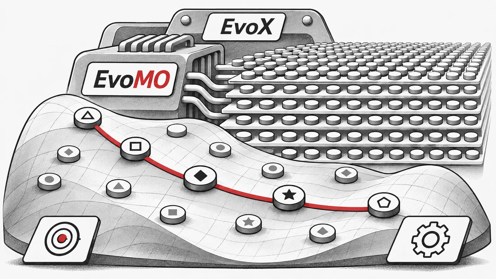

## テンソル化による進化的多目的最適化とGPUアクセラレーションの橋渡し

Zhenyu Liang, Hao Li, Naiwei Yu, Kebin Sun, and Ran Cheng, IEEEシニアメンバー

この制限に対処するため、EvoXチームはテンソル化手法を用いてGPU上でEMOアルゴリズムを並列化することを提案しました。この手法を活用し、彼らはいくつかのGPUアクセラレーション対応EMOアルゴリズムの設計と実装に成功しました。さらに、チームはBrax物理エンジン上に構築された**多目的ロボット制御のためのベンチマークスイート**である **「MoRobtrol」** を開発し、GPUアクセラレーションされたEMOアルゴリズムの性能を体系的に評価することを目指しました。

これらの研究成果に基づき、EvoXチームは高性能なGPUアクセラレーション対応EMOアルゴリズムライブラリである **EvoMO** をリリースしました。対応するソースコードはGitHubで公開されています: [https://github.com/EMI-Group/evomo](https://github.com/EMI-Group/evomo "https://github.com/EMI-Group/evomo")

## テンソル化手法

計算最適化の分野において、**テンソル**とは、スカラー、ベクトル、行列、および高階データを表現できる多次元配列データ構造を指します。**テンソル化**とは、アルゴリズム内のデータ構造と操作をテンソル形式に変換するプロセスであり、これによりアルゴリズムがGPUの並列計算能力を最大限に活用できるようになります。

EMOアルゴリズムでは、すべての主要なデータ構造をテンソル化された形式で表現できます。集団内の個体は解テンソル ***X*** で表すことができ、各行ベクトルが1つの個体に対応します。目的関数値は目的テンソル ***F*** を形成します。さらに、参照ベクトルや重みベクトルなどの補助データ構造も、それぞれテンソル R および W として表現できます。この統一されたテンソル表現により、表現レベルでの集団レベルの操作が可能となり、大規模な並列計算のための強固な基盤が築かれます。

EMOアルゴリズムの操作のテンソル化は、計算効率を向上させるために不可欠であり、基本テンソル操作と制御フローのテンソル化の2つの層に分けることができます。基本テンソル操作は、表Iに詳述されているように、EMOアルゴリズムのテンソル化実装の中核を構成します。

表I: 基本的なテンソル操作

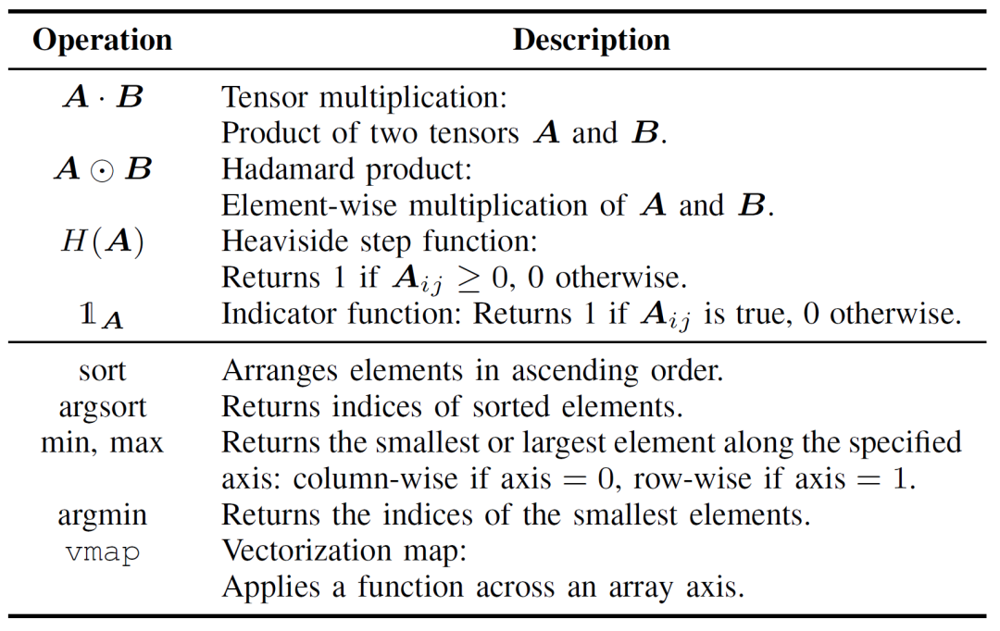

制御フローのテンソル化は、従来のループや条件分岐ロジックを、並列化可能なテンソル操作に置き換えます。例えば、for/whileループは、ブロードキャスティングメカニズムや `vmap` などの高階関数を使用してバッチ操作に変換できます。同様に、if-else条件分岐はマスキング技術に置き換えることができ、論理条件をブールテンソルとしてエンコードすることで、異なる計算パス間の柔軟な切り替えが可能になります。

従来のEMOアルゴリズムの実装と比較して、テンソル化アプローチには大きな利点があります。第一に、従来の手法が2次元の行列演算に制限されがちであるのに対し、多次元データを自然に扱えるため、より高い柔軟性を提供します。第二に、テンソル化は並列実行を通じて計算効率を大幅に向上させ、明示的なループや条件分岐に伴うオーバーヘッドを回避します。最後に、コード構造が簡素化され、より簡潔で保守性の高いプログラムになります。

例えば図1に示すように、パレート優越判定の従来の実装は、要素ごとの比較を行うために入れ子になったループに依存しています。対照的に、テンソル化されたバージョンは、ブロードキャスティングとマスキング操作を通じて同じ機能を実現し、並列評価を可能にします。これにより、コードの複雑さが軽減されるだけでなく、実行時のパフォーマンスも劇的に向上します。

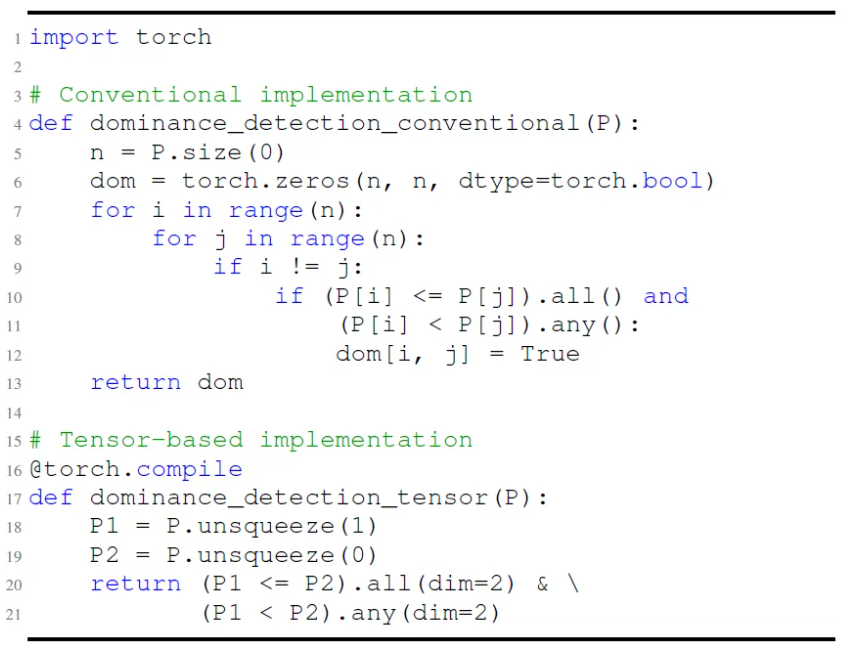

図1: パレート優越判定における従来の実装とテンソルベースの実装の比較。

より深い視点から見ると、GPUは多数の並列コアを持ち、その単一命令複数スレッド（SIMT）アーキテクチャがテンソル計算、特に行列演算に優れているため、テンソル化はGPUアクセラレーションに非常に適しています。NVIDIAのTensor Coresなどの専用ハードウェアは、テンソル演算のスループットをさらに向上させます。一般に、高い並列性を持ち、独立した計算タスクを含み、条件分岐が最小限であるアルゴリズムは、テンソル化に適しています。MOEA/Dのように順序依存性を伴うアルゴリズムの場合、その固有の構造が直接的なテンソル化への課題となります。しかし、構造的なリファクタリングと重要な計算の分離（デカップリング）を通じて、効果的な並列アクセラレーションを実現することは依然として可能です。

## アルゴリズムのテンソル化の適用例

テンソル化表現手法に基づき、EvoXチームは3つの古典的なEMOアルゴリズムのテンソル化バージョンを設計・実装しました。優越ベースのNSGA-III、分解ベースのMOEA/D、そして指標ベースのHypEです。以下のセクションでは、MOEA/Dを例として詳細に説明します。NSGA-IIIとHypEのテンソル化実装については、参照論文をご覧ください。

図2に示すように、従来のMOEA/Dは多目的問題を複数の部分問題に分解し、それぞれを独立して最適化します。このアルゴリズムは、交叉と突然変異、適応度評価、理想点の更新、近傍の更新という4つの主要なステップで構成されています。これらのステップは、単一のループ内で各個体に対して順次実行されます。この順次処理は、各個体がすべてのステップを順番に完了する必要があるため、大規模な集団を扱う際に多大な計算オーバーヘッドをもたらし、GPUアクセラレーションの潜在的な利点を制限します。特に、近傍の更新は個体間の相互作用に依存するため、並列化をさらに複雑にします。

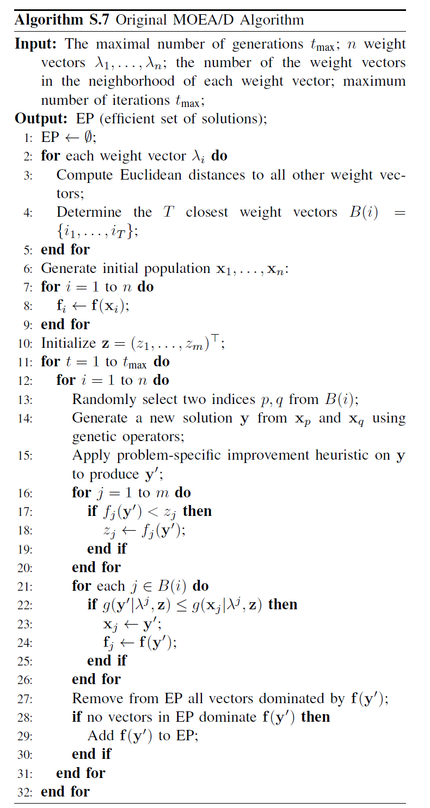

図2: MOEA/Dの擬似コード

従来のMOEA/Dにおける順序依存性の問題に対処するため、チームは環境選択の内部ループにテンソル化表現手法を導入しました。交叉と突然変異、適応度評価、理想点の更新、近傍の更新を分離することで、これらのコンポーネントを独立した操作として扱います。これにより、すべての個体の並列処理が可能になり、TensorMOEA/Dと呼ばれるテンソル化されたMOEA/Dアルゴリズムが構築されました。このアルゴリズムでは、環境選択は主に2つの段階、すなわち比較と集団の更新、およびエリート解の選択に分けられます。これら2つの段階は、主に2回の `vmap` 操作の適用を通じてテンソル化されます。詳細なプロセスを図3に示します。

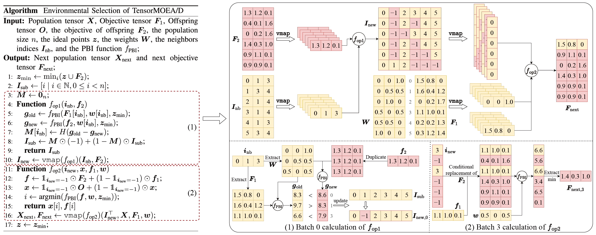

図3: TensorMOEA/Dアルゴリズムにおける環境選択の概要。 **左**: アルゴリズムの擬似コード。 **右**: モジュール(1)とモジュール(2)のテンソルデータフロー。右図の上部はモジュール(1)と(2)の全体的なテンソルデータフローを示し、下部はバッチ計算のテンソルデータフローを示しており、左側がモジュール(1)、右側がモジュール(2)です。

EMOアルゴリズムにおけるテンソル化の価値をより包括的に理解するために、3つの観点から要約できます。第一に、テンソル化は数式から効率的なコードへの直接的な変換を可能にし、アルゴリズムの設計と実装の間のギャップを縮めます。例えば、図4は、テンソル化された非劣ソートの手順が、擬似コードからPythonコードへといかに直接的に翻訳できるかを示しています。第二に、テンソル化は集団レベルの操作を単一のテンソル表現に統合することで、コード構造を大幅に簡素化します。これにより、ループや条件文への依存が減り、コードの可読性と保守性が向上します。第三に、テンソル化はアルゴリズムの再現性を高めます。その構造化された表現は、比較テストと結果の一貫した再現を容易にします。

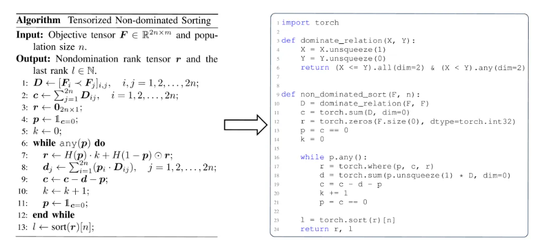

図4: テンソル化された非劣ソートの擬似コード（左）からPythonコード（右）へのシームレスな変換。

## 性能実証

GPUアクセラレーションされた多目的最適化アルゴリズムの性能を評価するために、EvoXチームは、計算の加速、数値最適化性能、および多目的ロボット制御タスクにおける有効性に焦点を当てた3つのカテゴリの実験を体系的に実施しました。

**計算アクセラレーション性能:**

**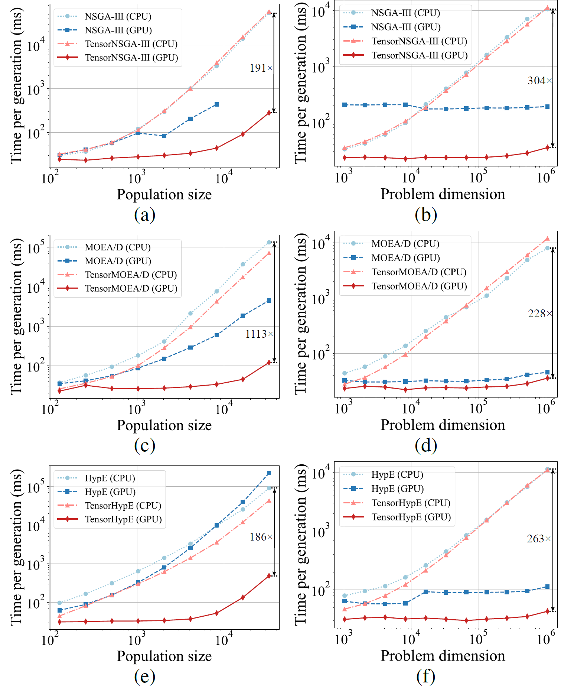**

図5: 様々な集団サイズと問題次元における、CPUおよびGPUプラットフォーム上でのNSGA-III、MOEA/D、HypEとそのテンソル化版の加速性能の比較。

実験結果は、TensorNSGA-III、TensorMOEA/D、およびTensorHypEが、非テンソル化のCPUベースの対応物と比較して、GPU上で大幅に高い実行速度を達成することを示しています。集団サイズと問題の次元が増加するにつれて、観測された最大速度向上は **1113倍** に達します。テンソル化されたアルゴリズムは、大規模な計算タスクを処理する際に優れたスケーラビリティと安定性を示しており、実行時間の増加はわずかでありながら、一貫して高いパフォーマンスを維持しています。これらの発見は、多目的最適化におけるGPUアクセラレーションに対するテンソル化の大きな利点を強調しています。

**LSMOPテストスイートでの性能:**

表II: LSMOP1〜LSMOP9における非テンソル化およびテンソル化EMOアルゴリズムのIGDと実行時間（秒）の統計結果（平均と標準偏差）。すべての実験はRTX 4090 GPU上で行われ、最良の結果は強調表示されています。

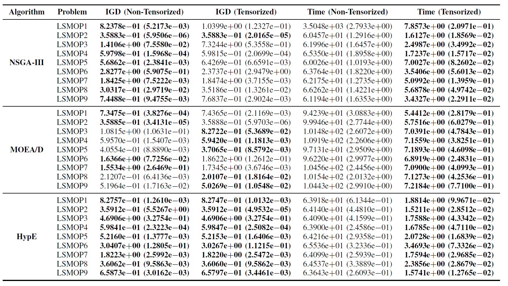

実験結果は、テンソル化表現に基づくGPUアクセラレーション対応EMOアルゴリズムが、計算効率を大幅に向上させつつ、元のアルゴリズムの最適化精度を維持し、場合によってはそれを上回ることを示しています。

**多目的ロボット制御タスク:**

GPUアクセラレーション対応EMOアルゴリズムの実用的な性能を包括的に評価するために、チームは多目的ロボット制御のためのMoRobtrolというベンチマークスイートを開発しました。このスイートに含まれるタスクは表IIIにリストされています。

表III: 提案されたMoRobtrolベンチマークテストスイートにおける多目的ロボット制御問題の概要

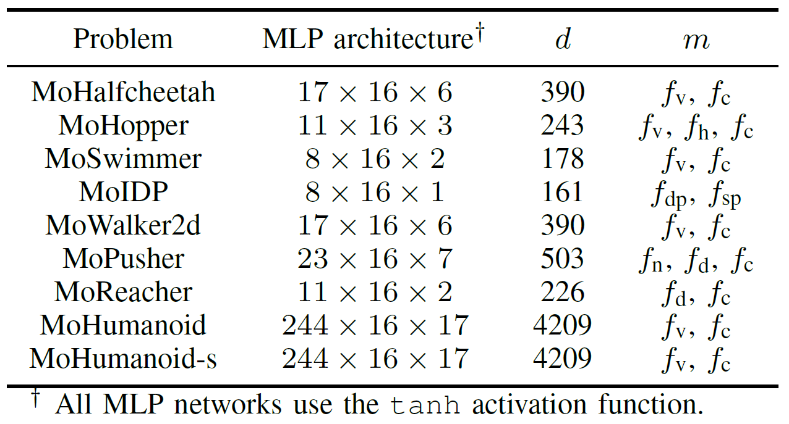

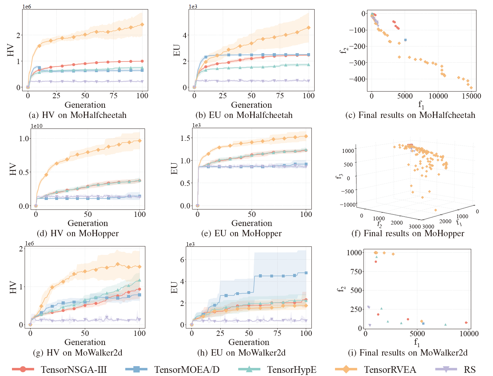

図6: 様々な問題（MoHalfcheetah (390D)、MoHopper (243D)、MoWalker2d (390D)）におけるTensorNSGA-III、TensorMOEA/D、TensorHypE、TensorRVEA、およびランダムサーチ（RS）の比較性能（HV、EU、および最終結果の可視化）。*注*: すべての指標において、値が高いほど性能が良いことを示します。

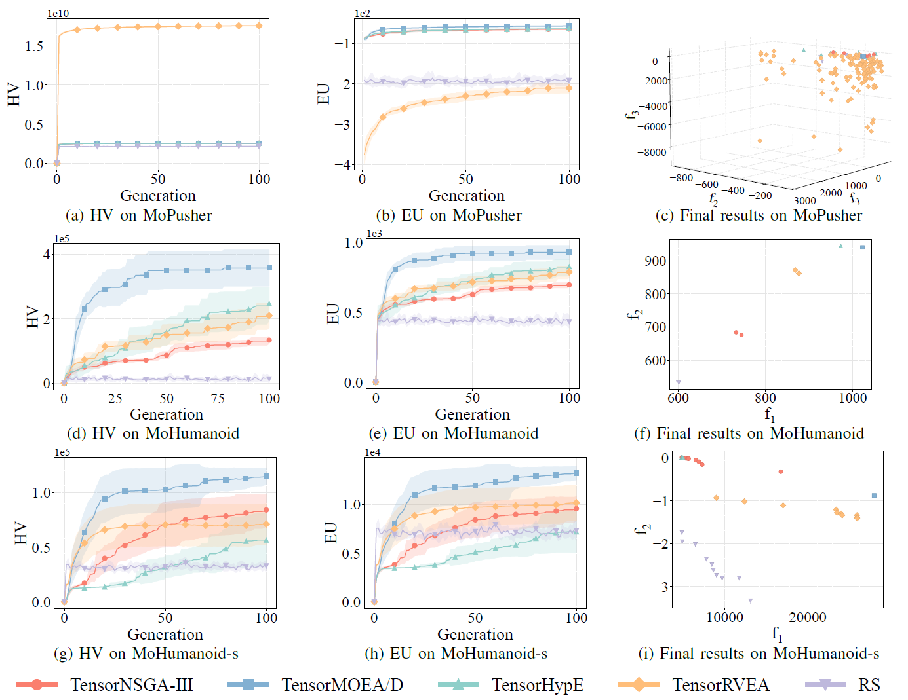

図7: 様々な問題（MoPusher (503D)、MoHumanoid (4209D)、MoHumanoid-s (4209D)）におけるTensorNSGA-III、TensorMOEA/D、TensorHypE、TensorRVEA、およびランダムサーチ（RS）の比較性能（HV、EU、および最終結果の可視化）。*注*: すべての指標において、値が高いほど性能が良いことを示します。

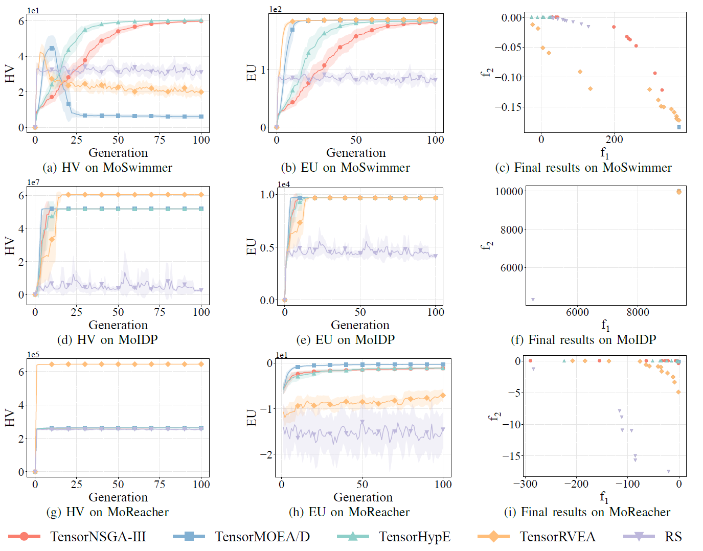

図8: 様々な問題（MoSwimmer (178D)、MoIDP (161D)、MoReacher (226D)）におけるTensorNSGA-III、TensorMOEA/D、TensorHypE、TensorRVEA、およびランダムサーチ（RS）の比較性能（HV、EU、および最終結果の可視化）。*注*: すべての指標において、値が高いほど性能が良いことを示します。

実験では、MoRobtrolベンチマーク内でTensorNSGA-III、TensorMOEA/D、TensorHypE、TensorRVEA、およびランダムサーチ（RS）の性能を比較しました。結果として、TensorRVEAが全体的に最高のパフォーマンスを達成し、最も高いHV値を獲得するとともに、複数の環境で良好な解の多様性を示しました。TensorMOEA/Dは大規模なタスクにおいて強力な適応性を示し、特に解の選好整合性において優れていました。TensorNSGA-IIIとTensorHypEは同様のパフォーマンスを示し、いくつかのタスクで競争力がありました。全体として、テンソル化された分解ベースのアルゴリズムは、大規模で複雑な問題を解決する上で優れた利点を示しました。

## 結論と今後の展望

EvoMO は目的が競合する状況で、有用な選択肢を保ち比較する能力を提供します。EvoX では多目的探索が最適化や制御シミュレーションの再利用可能な要素になります。並列計算が評価できる選択肢を増やし、分野の目的と意思決定基準が重要なトレードオフを定めます。

## 関連資料

- [論文](https://arxiv.org/abs/2503.20286)
- [GitHub](https://github.com/EMI-Group/evomo)
- [EvoX](https://github.com/EMI-Group/evox)

まず一つのタスクと評価予算を固定し、解の品質と実行時間を別々に記録します。その後、実験手順を維持して集団サイズを変えます。[EvoX ワークフローチュートリアル](/ja/news/evox-quickstart)は、その実験を組み立てる小さな出発点となります。
