AI 与工程系统往往同时面对精度、资源消耗、稳定性等多个目标。EvoX 的演化基础设施需要支持对这些权衡的探索。EvoMO 从计算层面解决这一问题：面向 GPU 重组开销较大的种群比较与选择，使更大规模的多目标实验变得可行。 [EvoMO](https://arxiv.org/html/2503.20286v1#S3)

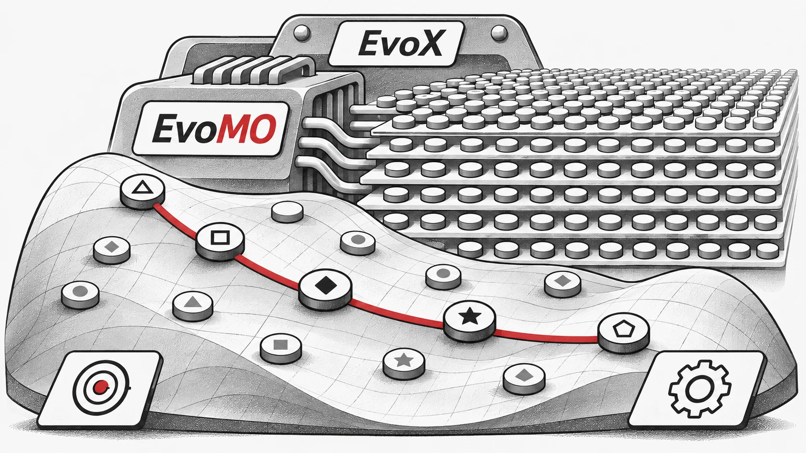

## 通过张量化连接演化多目标优化与 GPU 加速

Zhenyu Liang, Hao Li, Naiwei Yu, Kebin Sun, 和 Ran Cheng, IEEE 高级会员

为了解决这一局限性，EvoX 团队提出通过张量化方法在 GPU 上并行化 EMO 算法。利用这种方法，他们成功设计并实现了多种 GPU 加速的 EMO 算法。此外，团队还开发了 **"MoRobtrol"**，这是一个基于 Brax 物理引擎构建的**多目标机器人控制基准测试套件**，旨在系统地评估 GPU 加速 EMO 算法的性能。

基于这些研究进展，EvoX 团队发布了 **EvoMO**，这是一个高性能 GPU 加速 EMO 算法库。相应的源代码已在 GitHub 上公开：[https://github.com/EMI-Group/evomo](https://github.com/EMI-Group/evomo "https://github.com/EMI-Group/evomo")

## 张量化方法论

在计算优化领域，**张量（Tensor）**是指一种能够表示标量、向量、矩阵和高阶数据的多维数组数据结构。**张量化（Tensorization）**是将算法中的数据结构和操作转换为张量形式的过程，使算法能够充分利用 GPU 的并行计算能力。

在 EMO 算法中，所有关键数据结构都可以用张量化格式表示。种群中的个体可以由解张量 ***X*** 表示，其中每个行向量对应一个个体。目标函数值构成目标张量 ***F***。此外，参考向量和权重向量等辅助数据结构可以分别表示为张量 R 和 W。这种统一的张量表示实现了表示层面的种群级操作，为大规模并行计算奠定了坚实基础。

EMO 算法操作的张量化对于提高计算效率至关重要，可以分为两个层面：基本张量操作和控制流张量化。基本张量操作构成了 EMO 算法张量化实现的核心，详见表 I。

表 I：基本张量操作

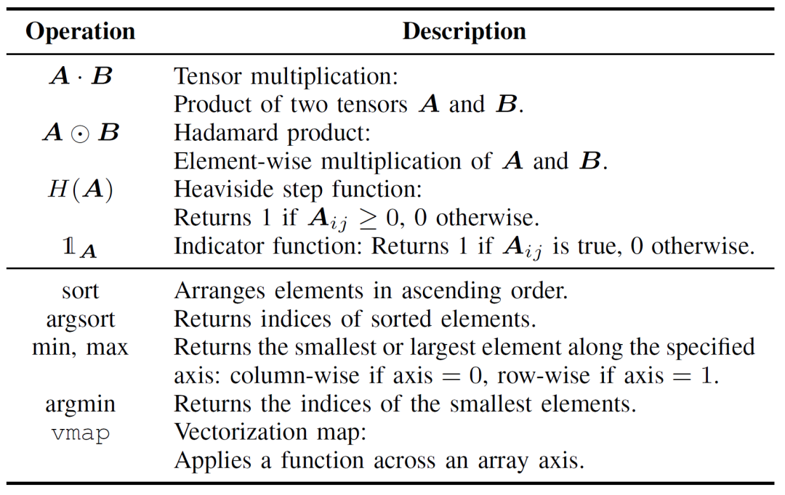

控制流张量化用可并行的张量操作取代了传统的循环和条件逻辑。例如，for/while 循环可以使用广播机制或高阶函数（如 `vmap`）转换为批处理操作。同样，if-else 条件语句可以被掩码（masking）技术取代，其中逻辑条件被编码为布尔张量，从而实现不同计算路径之间的灵活切换。

与传统的 EMO 算法实现相比，张量化方法具有显著优势。首先，它提供了更大的灵活性，能够自然地处理多维数据，而传统方法通常局限于二维矩阵运算。其次，张量化通过并行执行显著提高了计算效率，避免了显式循环和条件分支相关的开销。最后，它简化了代码结构，使程序更加简洁且易于维护。

如图 1 所示，例如，Pareto 支配检测的传统实现依赖于嵌套循环来执行逐元素比较。相比之下，张量化版本通过广播和掩码操作实现了相同的功能，从而实现了并行评估。这不仅降低了代码复杂度，还极大地提高了运行时性能。

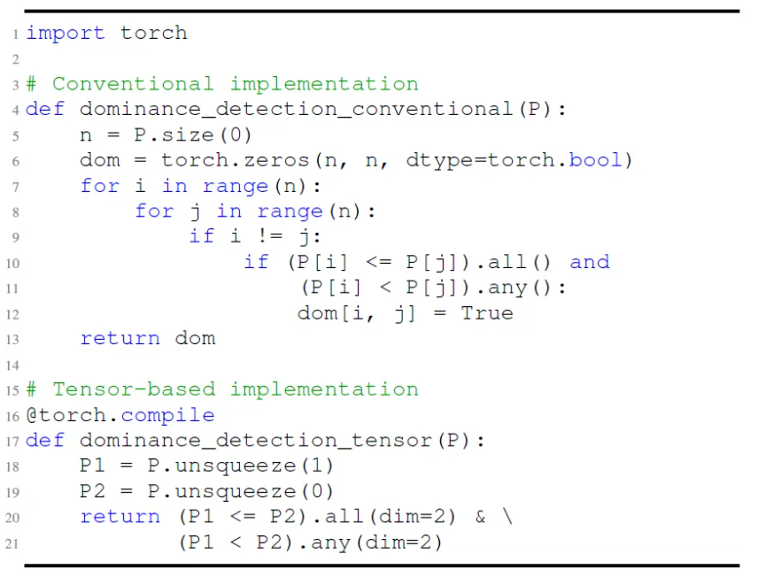

*图 1：Pareto 支配检测的传统实现与基于张量的实现对比。*

从更深层次来看，张量化非常适合 GPU 加速，因为 GPU 拥有大量的并行核心，其单指令多线程 (SIMT) 架构与张量计算天然契合，特别是在矩阵运算方面表现出色。NVIDIA 的 Tensor Cores 等专用硬件进一步提高了张量操作的吞吐量。通常，具有高并行性、包含独立计算任务且条件分支最少的算法更适合张量化。对于像 MOEA/D 这样涉及顺序依赖的算法，其固有结构对直接张量化构成了挑战。然而，通过结构重构和关键计算的解耦，仍然可以实现有效的并行加速。

## 算法张量化应用示例

基于张量化表示方法，EvoX 团队设计并实现了三种经典 EMO 算法的张量化版本：基于支配的 NSGA-III、基于分解的 MOEA/D 和基于指标的 HypE。下文以 MOEA/D 为例进行详细说明。NSGA-III 和 HypE 的张量化实现可以在相关论文中找到。

如图 2 所示，传统的 MOEA/D 将多目标问题分解为多个子问题，每个子问题独立优化。该算法包含四个核心步骤：交叉变异、适应度评估、理想点更新和邻域更新。这些步骤在单个循环中针对每个个体顺序执行。这种顺序处理在处理大规模种群时会导致巨大的计算开销，因为每个个体必须按顺序完成所有步骤，限制了 GPU 加速的潜在优势。特别是，邻域更新依赖于个体之间的交互，这进一步增加了并行化的难度。

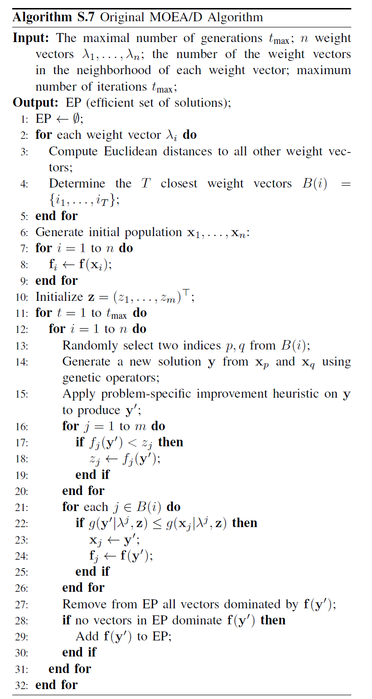

*图 2：MOEA/D 伪代码*

为了解决传统 MOEA/D 中的顺序依赖问题，团队在环境选择的内部循环中引入了张量化表示方法。通过解耦交叉变异、适应度评估、理想点更新和邻域更新，这些组件被视为独立的操作。这使得所有个体的并行处理成为可能，从而构建了张量化的 MOEA/D 算法，称为 TensorMOEA/D。在该算法中，环境选择分为两个主要阶段：比较与种群更新，以及精英解选择。这两个阶段主要通过两次应用 `vmap` 操作来实现张量化。详细过程如图 3 所示。

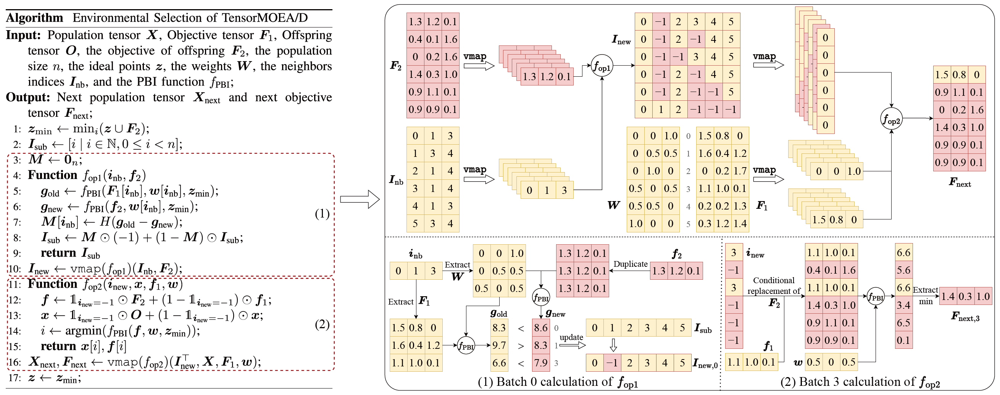

*图 3：TensorMOEA/D 算法中环境选择的概述。**左**：算法伪代码。**右**：模块 (1) 和模块 (2) 的张量数据流。右图的上半部分显示了模块 (1) 和 (2) 的整体张量数据流，而下半部分展示了批量计算张量数据流，其中模块 (1) 在左侧，模块 (2) 在右侧。*

为了更全面地理解张量化在 EMO 算法中的价值，可以从三个角度进行总结。首先，张量化实现了从数学公式到高效代码的直接转换，缩小了算法设计与实现之间的差距。例如，图 4 展示了张量化非支配排序过程如何直接从伪代码转换为 Python 代码。其次，张量化通过将种群级操作统一为单一的张量表示，显著简化了代码结构。这减少了对循环和条件语句的依赖，从而提高了代码的可读性和可维护性。第三，张量化增强了算法的可复现性。其结构化表示有助于进行对比测试和结果的一致复现。

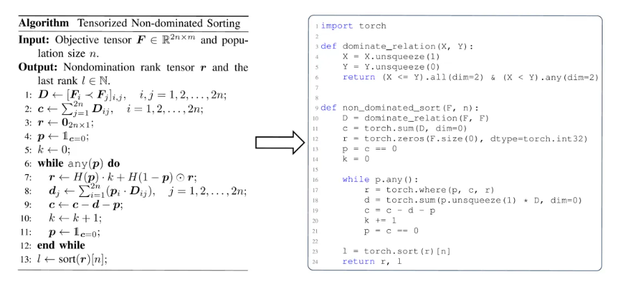

*图 4：张量化非支配排序从伪代码（左）到 Python 代码（右）的无缝转换。*

## 性能展示

为了评估 GPU 加速多目标优化算法的性能，EvoX 团队系统地进行了三类实验，重点关注计算加速、数值优化性能以及在多目标机器人控制任务中的有效性。

**计算加速性能：**

**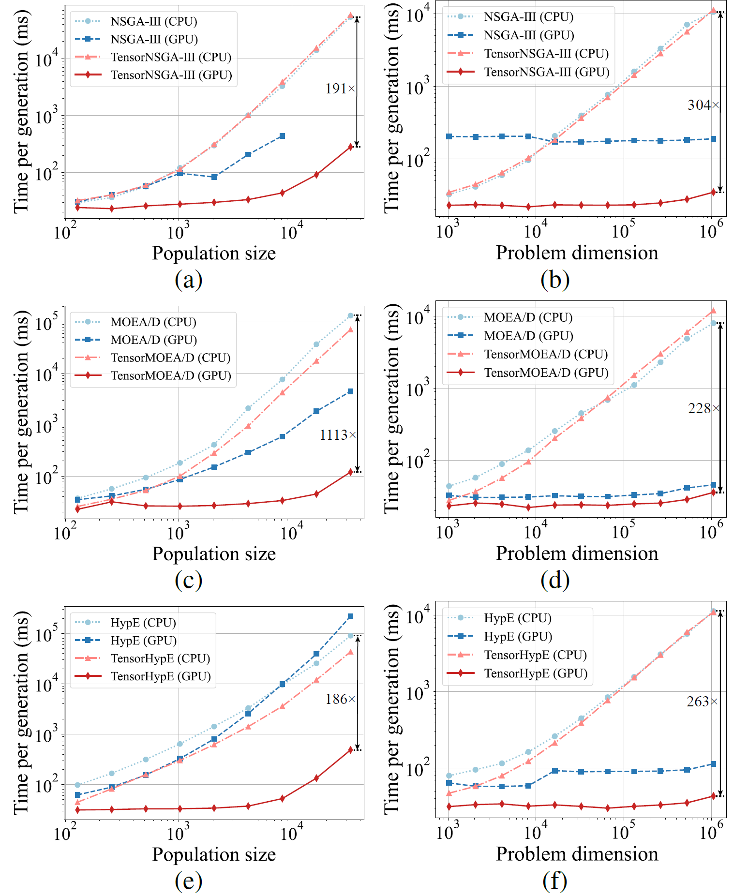**

*图 5：NSGA-III、MOEA/D 和 HypE 及其张量化版本在 CPU 和 GPU 平台上针对不同种群大小和问题维度的加速性能对比。*

实验结果表明，与非张量化的 CPU 版本相比，TensorNSGA-III、TensorMOEA/D 和 TensorHypE 在 GPU 上实现了显著更高的执行速度。随着种群大小和问题维度的增加，观察到的最大加速比高达 **1113 倍**。张量化算法在处理大规模计算任务时表现出色的可扩展性和稳定性——其运行时间仅略有增加，同时保持了一贯的高性能。这些发现凸显了张量化在多目标优化 GPU 加速方面的巨大优势。

**LSMOP 测试套件上的性能：**

表 II：非张量化和张量化 EMO 算法在 LSMOP1--LSMOP9 上的 IGD 和运行时间（秒）的统计结果（均值和标准差）。所有实验均在 RTX 4090 GPU 上进行，最佳结果已高亮显示。

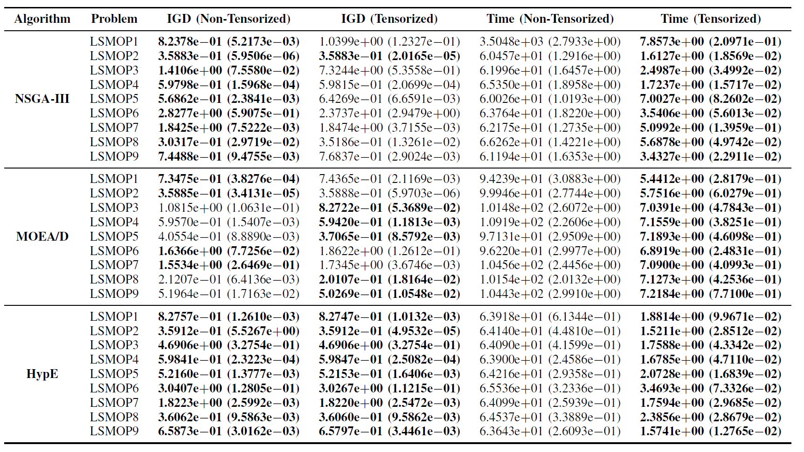

实验结果表明，基于张量化表示的 GPU 加速 EMO 算法显著提高了计算效率，同时保持了甚至在某些情况下超过了原始算法的优化精度。

**多目标机器人控制任务：**

为了全面评估 GPU 加速 EMO 算法的实际性能，团队开发了一个名为 MoRobtrol 的多目标机器人控制基准测试套件。该套件包含的任务列于表 III 中。

表 III：拟议的 MoRobtrol 基准测试套件中多目标机器人控制问题的概述

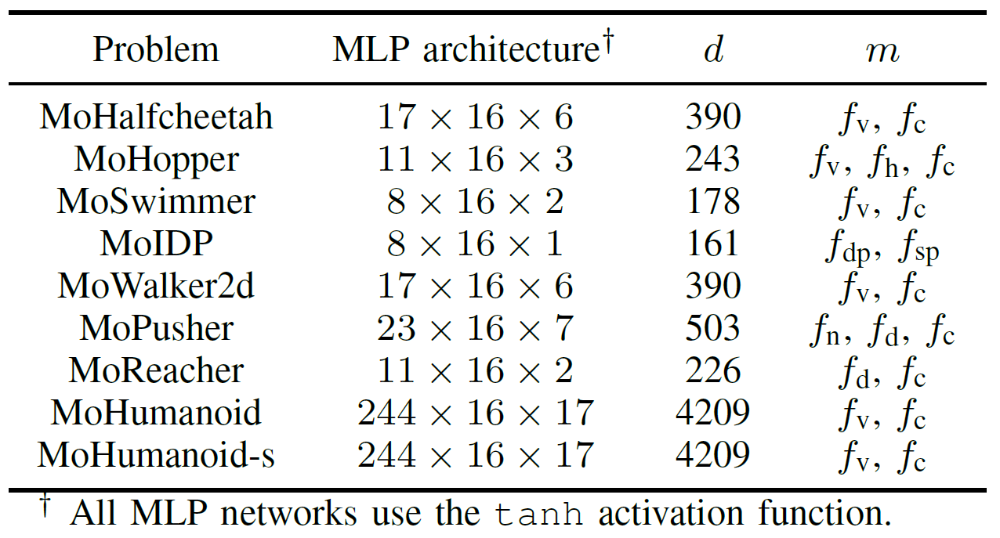

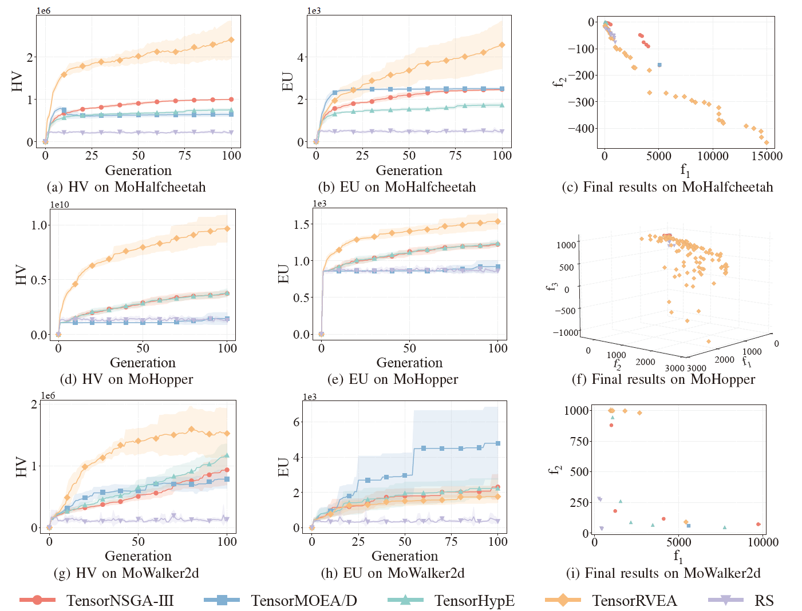

*图 6：TensorNSGA-III、TensorMOEA/D、TensorHypE、TensorRVEA 和随机搜索 (RS) 在不同问题上的性能对比（HV、EU 和最终结果可视化）：MoHalfcheetah (390D)、MoHopper (243D) 和 MoWalker2d (390D)。*注*：所有指标的值越高表示性能越好。*

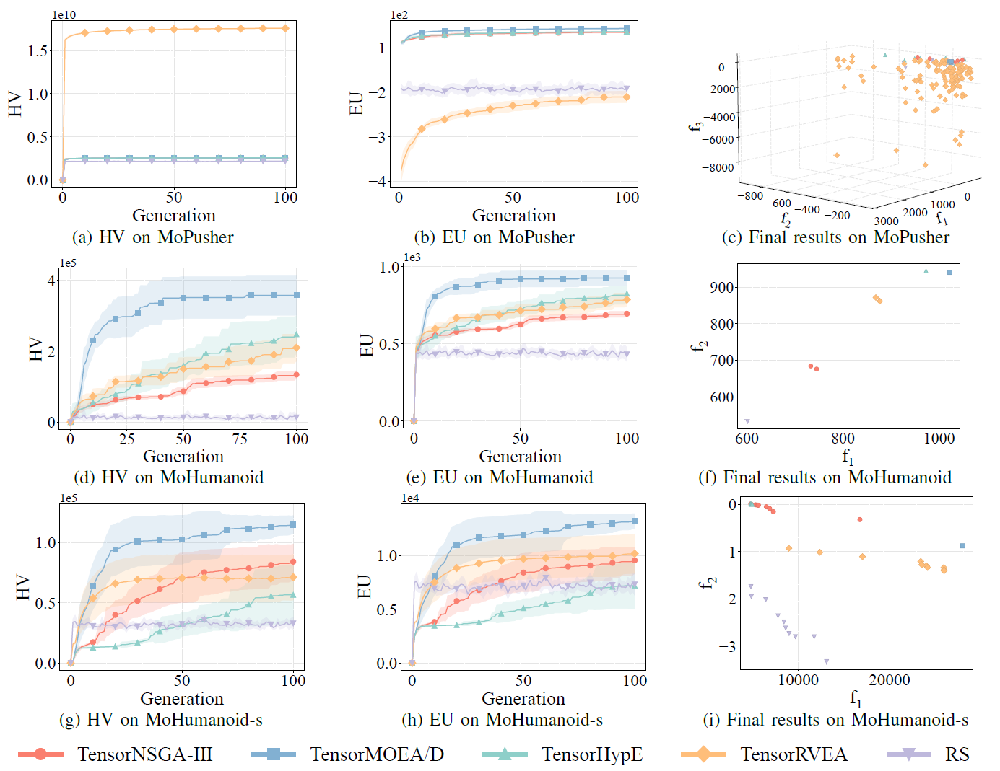

*图 7：TensorNSGA-III、TensorMOEA/D、TensorHypE、TensorRVEA 和随机搜索 (RS) 在不同问题上的性能对比（HV、EU 和最终结果可视化）：MoPusher (503D)、MoHumanoid (4209D) 和 MoHumanoid-s (4209D)。*注*：所有指标的值越高表示性能越好。*

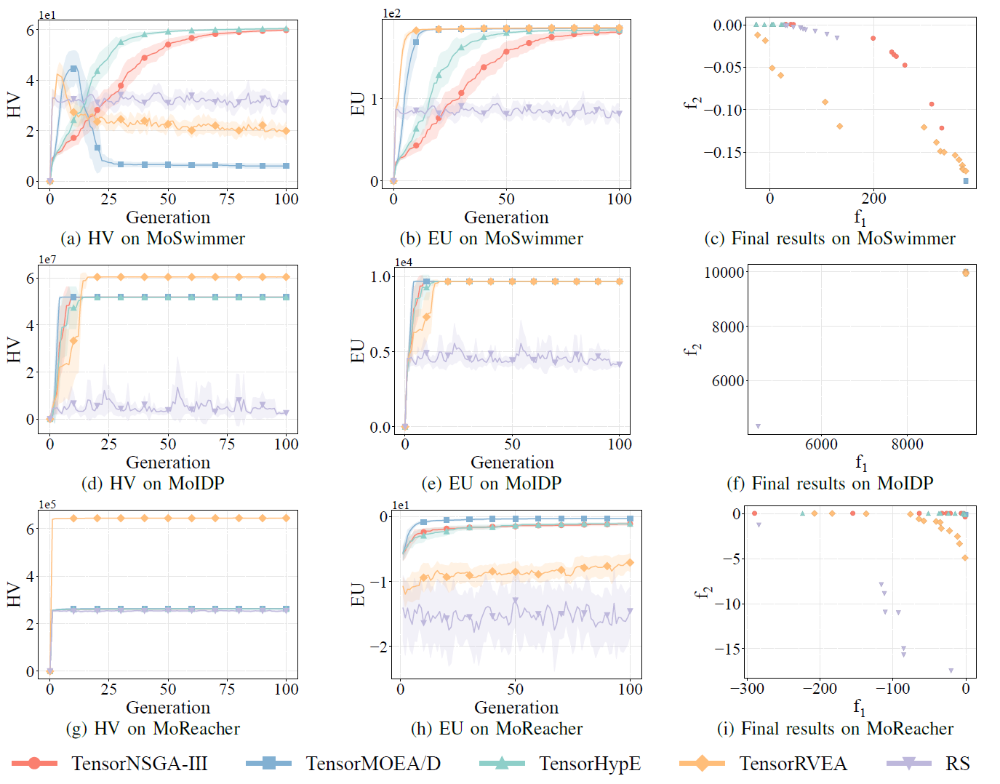

*图 8：TensorNSGA-III、TensorMOEA/D、TensorHypE、TensorRVEA 和随机搜索 (RS) 在不同问题上的性能对比（HV、EU 和最终结果可视化）：MoSwimmer (178D)、MoIDP (161D) 和 MoReacher (226D)。*注*：所有指标的值越高表示性能越好。*

实验对比了 TensorNSGA-III、TensorMOEA/D、TensorHypE、TensorRVEA 和随机搜索 (RS) 在 MoRobtrol 基准测试中的性能。结果显示，TensorRVEA 取得了最佳的整体性能，获得了最高的 HV 值，并在多个环境中展示了良好的解多样性。TensorMOEA/D 在大规模任务中表现出很强的适应性，特别是在解的偏好一致性方面表现出色。TensorNSGA-III 和 TensorHypE 表现相似，在多个任务上具有竞争力。总体而言，基于分解的张量化算法在解决大规模和复杂问题方面表现出卓越的优势。

## 结论与未来工作

EvoMO 提供了在目标相互竞争时保留、比较有价值方案的能力。在 EvoX 中，多目标搜索因此能够成为优化和仿真控制实验中的可复用组件。并行计算扩大了可评价的方案范围，领域目标与决策标准则决定哪些权衡值得关注。

## 相关资源

- [研究论文](https://arxiv.org/abs/2503.20286)
- [GitHub](https://github.com/EMI-Group/evomo)
- [EvoX](https://github.com/EMI-Group/evox)

比较算法时，可以先固定一个任务和评估预算，将解的质量与执行时间分别记录，再保持实验流程不变，调整种群规模。[EvoX 工作流教程](/zh-cn/news/evox-quickstart)提供了组织这类实验的简洁起点。
