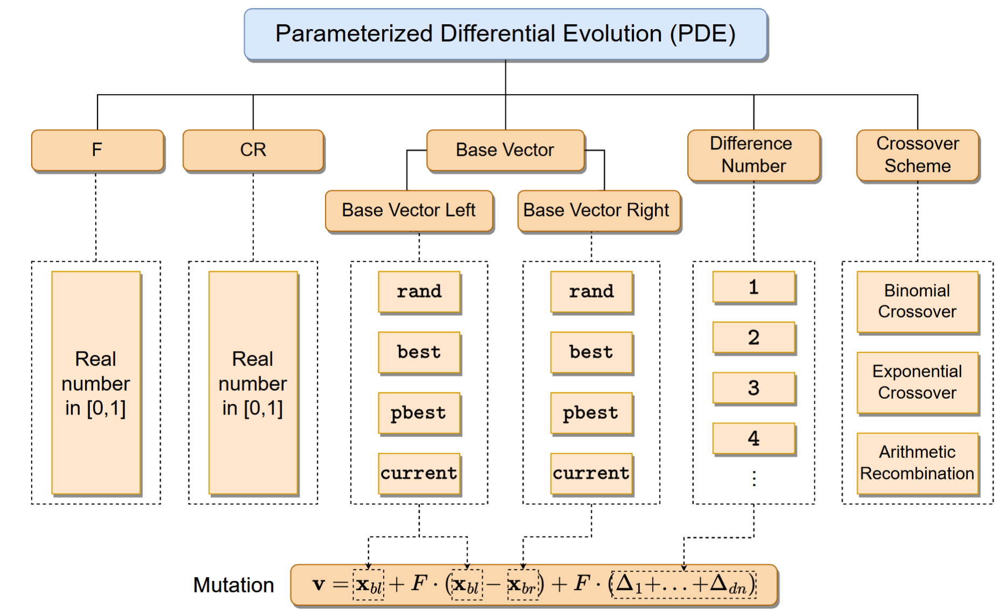
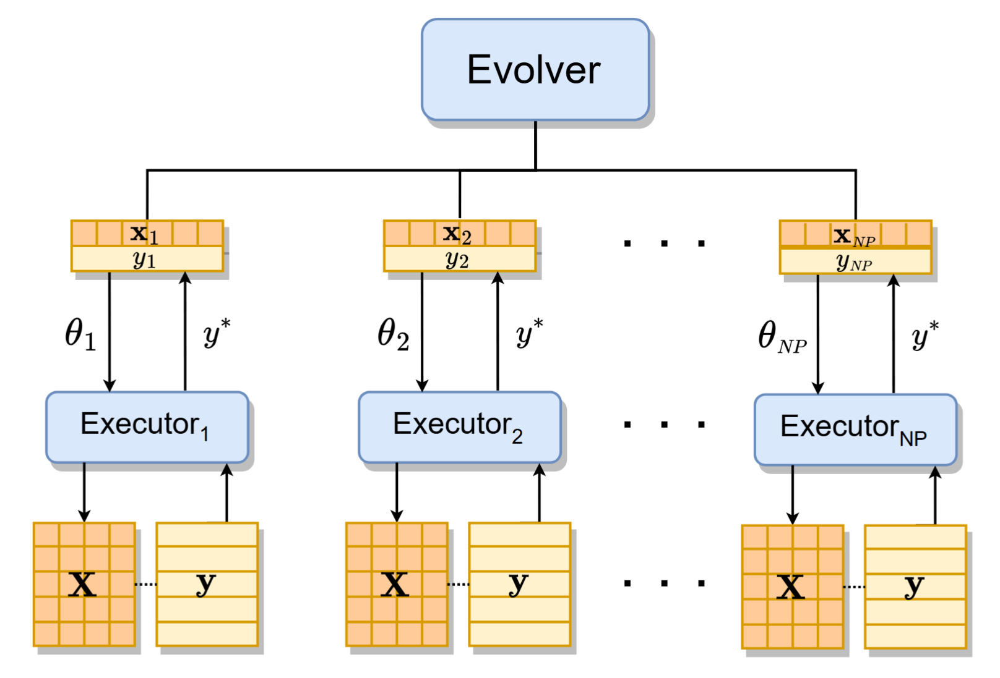
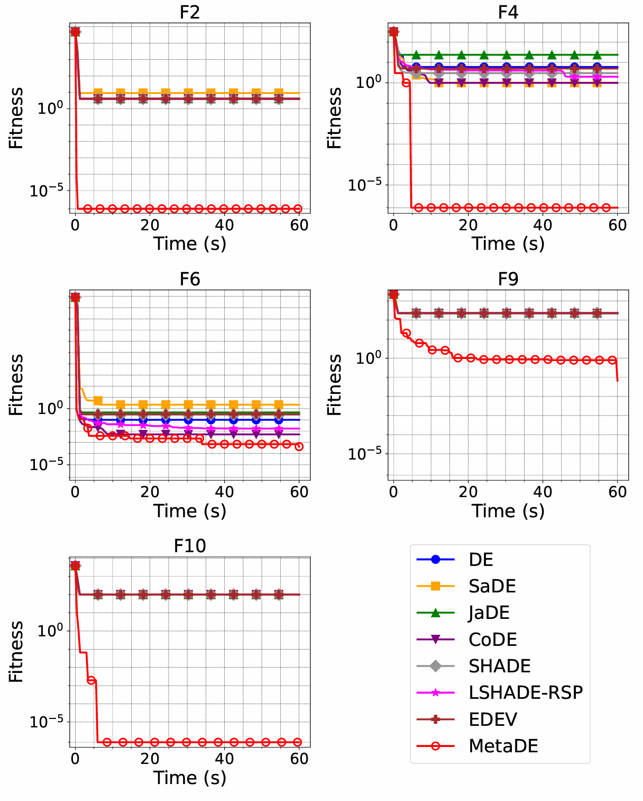
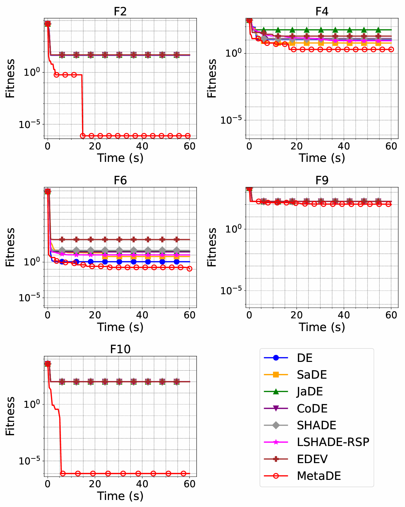
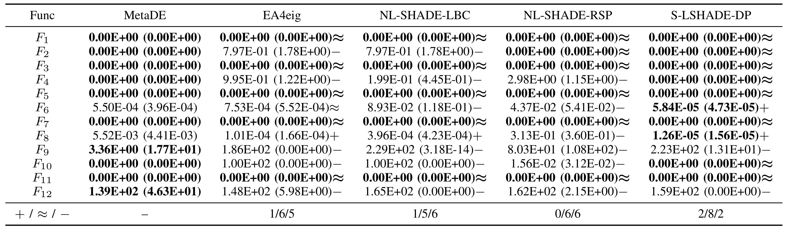
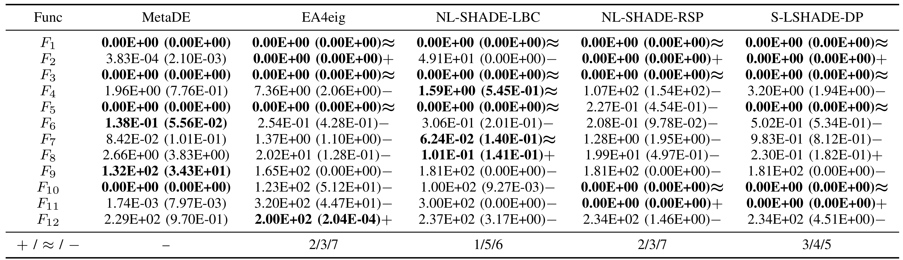
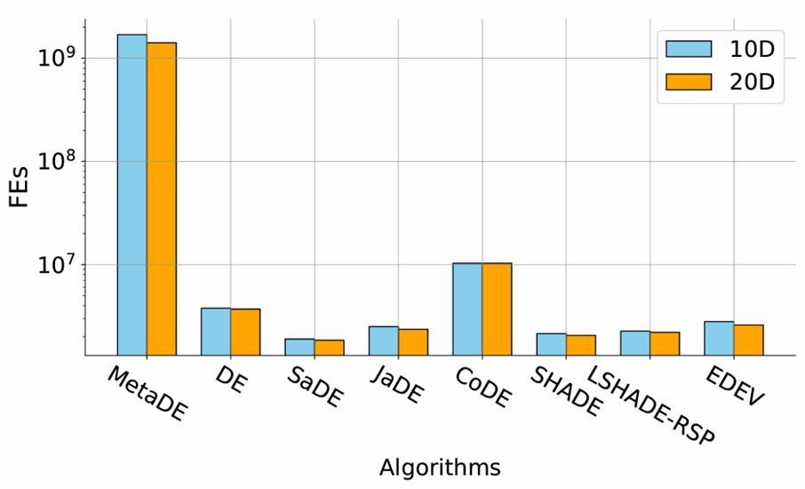
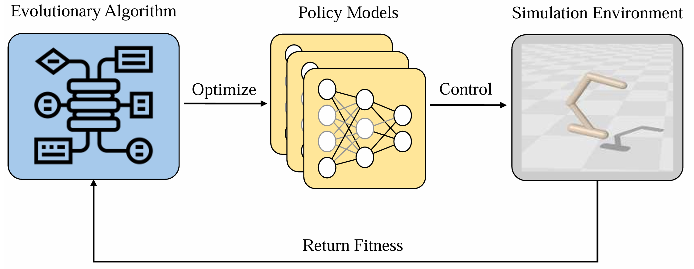
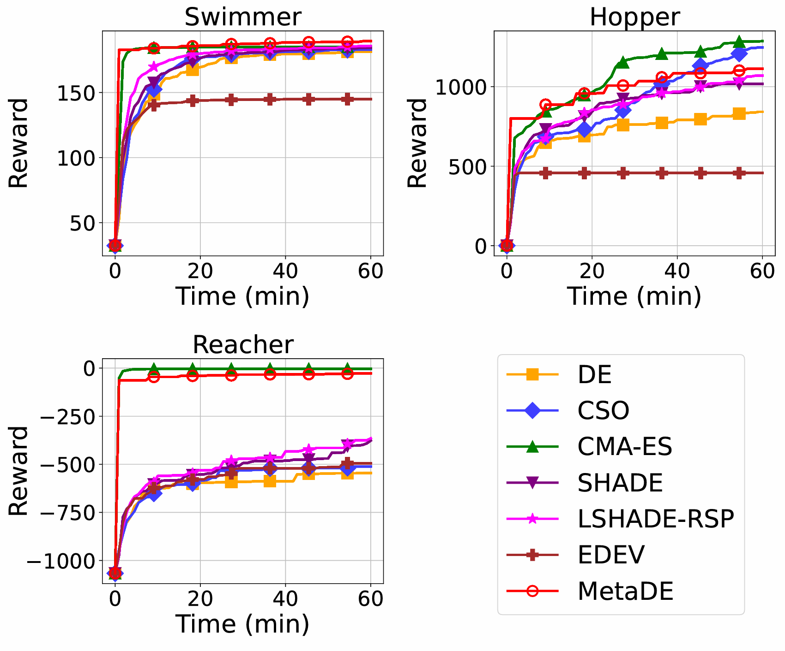

L'adattamento può riguardare il modo di cercare oltre alle soluzioni trovate. MetaDE porta questa idea in EvoX con due livelli evolutivi connessi: uno risolve il problema target, l'altro valuta quali configurazioni DE rendano efficace la ricerca. [MetaDE](https://github.com/EMI-Group/metade)

## Contesto

Nel campo del calcolo evolutivo, le prestazioni degli algoritmi sono spesso significativamente influenzate dalla scelta degli iperparametri. Determinare le impostazioni dei parametri più adatte per un problema specifico è stata una sfida di ricerca di lunga data. Differential Evolution (DE), come algoritmo evolutivo classico, è ampiamente apprezzato per la sua semplicità e la robusta capacità di ricerca globale; tuttavia, le sue prestazioni sono altamente sensibili alla selezione degli iperparametri. I metodi convenzionali si basano tipicamente sulla regolazione basata sull'esperienza o su meccanismi adattivi per migliorare le prestazioni. Tuttavia, di fronte a scenari problematici diversificati, questi approcci faticano spesso a bilanciare efficienza e ampia applicabilità.

Il concetto di "meta-evoluzione" è stato introdotto già nel secolo scorso, con l'obiettivo di utilizzare gli stessi algoritmi evolutivi per ottimizzare le configurazioni degli iperparametri di questi algoritmi. Sebbene la meta-evoluzione esista da molti anni, la sua applicazione pratica è stata limitata dalle elevate esigenze computazionali. I recenti progressi nel calcolo GPU hanno alleviato questi vincoli, fornendo un forte supporto hardware per gli algoritmi evolutivi. In particolare, l'introduzione del framework EvoX distribuito è accelerato da GPU ha notevolmente facilitato lo sviluppo di algoritmi evolutivi basati su GPU. In questo contesto, il nostro team di ricerca ha proposto un nuovo approccio meta-evolutivo che sfrutta DE per evolvere i propri iperparametri e strategie, offrendo così una nuova via per risolvere il problema di lunga data della regolazione dei parametri negli algoritmi evolutivi.

## Cos'e la meta-evoluzione?

L'idea centrale della meta-evoluzione può essere riassunta come "**usare un algoritmo evolutivo per evolvere se stesso**" (Evolving an Evolutionary Algorithm by an Evolutionary Algorithm). Questo concetto trascende i metodi tradizionali di calcolo evolutivo, non solo impiegando algoritmi evolutivi per cercare soluzioni ottimali a un problema, ma anche adattando gli iperparametri e le strategie degli algoritmi attraverso i propri processi evolutivi.

In altre parole, la meta-evoluzione introduce un paradigma di "**auto-evoluzione**", che consente agli algoritmi di ottimizzare se stessi mentre esplorano lo spazio di ricerca per le soluzioni del problema. Perfezionandosi continuamente durante il processo evolutivo, gli algoritmi diventano più adattivi e possono mantenere un'alta efficienza in vari scenari problematici.

Prendendo MetaDE come esempio, il suo design è radicato in questa filosofia. In una struttura a due livelli, il livello inferiore (l'"**esecutore**") risolve il problema di ottimizzazione dato utilizzando un DE parametrizzato. Il livello superiore (l'"**evolver**") impiega simultaneamente DE per ottimizzare le configurazioni degli iperparametri dell'esecutore. Questo framework consente a DE non solo di fungere da risolutore, ma anche di "esplorare" come regolare al meglio i propri parametri e strategie per risolvere più efficacemente problemi diversi. Tale processo è simile a un sistema che comprende e perfeziona se stesso in modo incrementale -- una trasformazione dal **"risolvere passivamente un problema" all'"auto-evolversi attivamente."** Di conseguenza, può adattarsi meglio a compiti diversificati. **Se consideriamo DE come un sistema complesso, MetaDE abilita effettivamente una modalita "ricorsiva" di auto-comprensione e auto-miglioramento all'interno di questo sistema.**

Il termine "**ricorsione**" in informatica descrive tipicamente una funzione o procedura che chiama se stessa. All'interno di MetaDE, questo concetto assume un nuovo significato: e un meccanismo di ottimizzazione **internamente ricorsivo** che impiega DE per evolvere gli iperparametri di DE. Questo schema auto-referenziale non solo incarna una potente adattivita, ma fornisce anche una nuova prospettiva sul teorema "no free lunch". Poiché non esiste un singolo insieme di parametri universalmente ottimale per tutti i problemi, consentire all'algoritmo di evolversi autonomamente e la chiave per trovare le migliori configurazioni di parametri per un dato compito.

Attraverso questo approccio meta-evolutivo ricorsivo, MetaDE raggiunge diversi benefici:

**1. Regolazione automatica dei parametri**

Il laborioso processo di regolazione manuale viene eliminato. L'algoritmo stesso impara come regolare i propri iperparametri, riducendo l'intervento umano e migliorando l'efficienza.

**2. Adattabilita migliorata**

MetaDE risponde dinamicamente alle caratteristiche e condizioni mutevoli del problema, modificando le strategie in tempo reale per migliorare le prestazioni. Questo aumenta significativamente la flessibilità dell'algoritmo.

**3. Ricerca efficiente**
Sfruttando il parallelismo intrinseco, MetaDE accelera notevolmente le ricerche nei problemi di ottimizzazione su larga scala. Fornisce soluzioni fattibili a problemi complessi ad alta dimensionalità entro tempi ragionevoli.

## Implementazione algoritmica

MetaDE impiega tecniche basate su tensori e accelerazione GPU per consentire un calcolo parallelo efficiente. Elaborando simultaneamente molti individui di una popolazione, l'efficienza computazionale complessiva e notevolmente migliorata, rendendolo particolarmente vantaggioso nell'ottimizzazione black-box mono-obiettivo e nei problemi di ottimizzazione su larga scala. Attraverso la tensorizzazione dei parametri chiave e delle strutture dati (ad es. popolazione, fitness, parametri di strategia), MetaDE non solo raggiunge una maggiore efficienza computazionale, ma migliora anche la sua capacità di affrontare sfide di ottimizzazione complesse. Rispetto al DE classico e ad altri algoritmi evolutivi (EA), MetaDE mostra prestazioni superiori nella risoluzione di problemi su larga scala. Grazie all'approccio basato su tensori, MetaDE sfrutta le risorse computazionali in modo più efficace, producendo soluzioni più rapide e risultati di ottimizzazione più precisi rispetto ai metodi tradizionali.

Architettura PDE

Il team di ricerca ha prima proposto un framework algoritmico DE parametrizzato (PDE) che supporta pienamente le modifiche di parametri e strategie. In questo framework, F e CR sono parametri continui, mentre gli altri parametri sono discreti. Le caselle tratteggiate indicano l'intervallo dei valori dei parametri ammissibili. La funzione di mutazione e derivata dai vettori base sinistro e destro, insieme al parametro che controlla il numero di vettori differenza.

Architettura MetaDE

MetaDE adotta una struttura a due livelli, composta da **un evolver** (livello superiore) e **molteplici esecutori** (livello inferiore). L'evolver e un DE (o potenzialmente un altro algoritmo evolutivo), responsabile dell'ottimizzazione dei parametri di PDE. Ogni individuo x_i nella popolazione dell'evolver corrisponde a una configurazione di parametri unica θ_i. Queste configurazioni vengono passate al PDE per istanziare diverse varianti di DE, ciascuna gestita da un esecutore che opera indipendentemente sul compito di ottimizzazione dato. Ogni esecutore restituisce il suo miglior valore di fitness y^* all'evolver, che assegna quel valore di fitness y_i all'individuo corrispondente x_i.

## Prestazioni sperimentali

Per valutare in modo completo l'efficacia di MetaDE, il team di ricerca ha eseguito esperimenti sistematici che coprono molteplici test benchmark e scenari reali. Ogni esperimento ha utilizzato un evolver (DE con strategia rand/1/bin) e degli esecutori (PDE con dimensione della popolazione di 100). I componenti sperimentali chiave includono:

### Benchmark CEC2022
 Confronto di MetaDE con varie varianti di DE in compiti di ottimizzazione mono-obiettivo.

### Confronto con i quattro migliori algoritmi CEC2022
 Valutazione di MetaDE rispetto ai quattro algoritmi con le migliori prestazioni della competizione CEC2022 con budget identici di valutazioni della funzione (FE).

### Valutazioni della funzione (FE) con tempo di esecuzione fisso
 Analisi dell'efficienza computazionale di MetaDE con accelerazione GPU.

### Compiti di controllo robotico
 Applicazione di MetaDE a compiti di controllo robotico in un ambiente della piattaforma Brax per validarne l'utilità pratica.

## Benchmark CEC2022: confronto con le principali varianti di DE

Il team ha confrontato MetaDE con diverse varianti rappresentative di DE sulla suite di benchmark CEC2022, tra cui:

* **DE standard (rand/1/bin)**
* **SaDE e JaDE (algoritmi DE adattivi)**
* **CoDE (DE con integrazione di strategie)**
* **SHADE e LSHADE-RSP (DE adattivo basato sulla cronologia dei successi)**
* **EDEV (varianti DE integrate)**

Tutti gli algoritmi sono stati implementati sulla piattaforma EvoX, utilizzando l'accelerazione GPU con una dimensione della popolazione di 100 per equita. Gli esperimenti sono stati condotti su diverse dimensionalità (10D e 20D) sotto **lo stesso vincolo di tempo computazionale (60 secondi)**.

Risultati di ottimizzazione CEC2022 a 10D

Risultati di ottimizzazione CEC2022 a 20D

MetaDE raggiunge generalmente una convergenza più rapida e stabile nella maggior parte delle funzioni di test. Il suo DE parametrizzato (PDE) accoppiato con l'ottimizzazione del livello superiore consente un adattamento dinamico a diversi spazi problematici, migliorando la robustezza complessiva e le prestazioni di ricerca.

## Confronto con i quattro migliori algoritmi CEC2022 (con FE identiche)

Per valutare ulteriormente la capacità di ottimizzazione di MetaDE, lo abbiamo confrontato con i quattro migliori algoritmi della competizione CEC2022 con **lo stesso budget di valutazioni della funzione**:

* **EA4eig**: un metodo ibrido che integra molteplici EA
* **NL-SHADE-LBC**: un DE adattivo migliorato
* **NL-SHADE-RSP-MID**: uno SHADE migliorato con stima del punto medio
* **S-LSHADE-DP**: una variante di DE che mantiene la diversita della popolazione attraverso perturbazione dinamica

Ciascuno di questi algoritmi è stato eseguito con le impostazioni ufficiali dei parametri e il codice sorgente sotto **gli stessi vincoli di FE**. Confronti statistici (test della somma dei ranghi di Wilcoxon, livello di significatività 0,05)

sono stati condotti tra MetaDE e ciascun baseline sulla suite di test CEC2022. L'ultima riga della tabella mostra le prestazioni di ciascun algoritmo rispetto a MetaDE sulle diverse funzioni di test: + (significativamente migliore), ≈ (nessuna differenza significativa) e − (significativamente peggiore).

Confronto degli algoritmi della competizione CEC2022 a 10D (stesse FE)

Confronto degli algoritmi della competizione CEC2022 a 20D (stesse FE)

MetaDE dimostra costantemente prestazioni elevate, specialmente su problemi complessi che richiedono una convergenza robusta. Grazie al suo **meccanismo auto-adattivo**, MetaDE regola efficacemente la sua strategia per diversi paesaggi di ricerca, migliorando così l'efficienza di ricerca e la capacità di ottimizzazione globale. Questi risultati indicano che MetaDE non solo supera le principali varianti di DE, ma mostra anche una forte competitività rispetto agli algoritmi di punta delle competizioni.

## Efficienza computazionale: FE entro un tempo fisso (60 secondi)

Il team di ricerca ha inoltre registrato **il numero di valutazioni della funzione (FE) completate dai diversi algoritmi nello stesso tempo di esecuzione fisso (60 secondi)**.

FE raggiunte da ciascun algoritmo in 60 secondi

Con lo stesso framework EvoX e il calcolo parallelo accelerato da GPU, MetaDE ha raggiunto in media FE di livello **10⁹**, mentre le varianti tradizionali di DE hanno raggiunto solo circa ***10^6*** FE. Questo vantaggio deriva dall'approccio parametrizzato di MetaDE, che conduce **valutazioni parallele su larga scala** degli individui, consentendo un **utilizzo più efficiente delle risorse hardware.** Di conseguenza, l'algoritmo esplora più soluzioni nella stessa finestra temporale, migliorando sia la qualità delle soluzioni che la stabilità.

## Reinforcement Learning evolutivo: compiti di controllo robotico

Nell'esperimento di controllo robotico, MetaDE cerca i parametri della politica neurale senza gradienti e senza retropropagare l'obiettivo della politica. L'apprendimento per rinforzo evolutivo comprende anche metodi basati sul gradiente e ibridi: non elimina in generale le difficoltà di PPO o SAC.

Gli esperimenti usano Swimmer, Hopper e Reacher in Brax, con politiche MLP a tre strati di circa 1.500 parametri. La ricerca interna ottimizza i pesi; quella esterna regola parametri e strategie dell'esecutore DE. Queste simulazioni non dimostrano un impiego su robot reali né un miglioramento generale della stabilità dell'addestramento.

Curve di convergenza per tre ambienti Brax

Come mostrato nella figura, MetaDE dimostra prestazioni elevate nei compiti di controllo robotico basati su Brax, raggiungendo i migliori risultati nel compito Swimmer e risultati quasi ottimali in Hopper e Reacher. Il suo principale vantaggio risiede nell'alta qualità della popolazione iniziale, che consente una rapida convergenza nelle fasi iniziali e produce soluzioni di alta qualità. Questi risultati suggeriscono che MetaDE può **ottimizzare efficientemente le policy delle reti neurali**, rendendolo **adatto ai compiti di controllo robotico con simulazioni fisiche complesse** e **offrendo un ampio potenziale per applicazioni pratiche**.

## Conclusioni e direzioni future

Conteggi tentativi di configurazione esterni e valutazioni interne. Confronti i metodi usando budget totale e tempo effettivo. [iStratDE: la diversità della popolazione come principio di ricerca parallela](/it/news/istratde)

## Risorse

- [Articolo scientifico](https://arxiv.org/abs/2502.10470)
- [GitHub](https://github.com/EMI-Group/metade)
- [EvoX](https://github.com/EMI-Group/evox)
