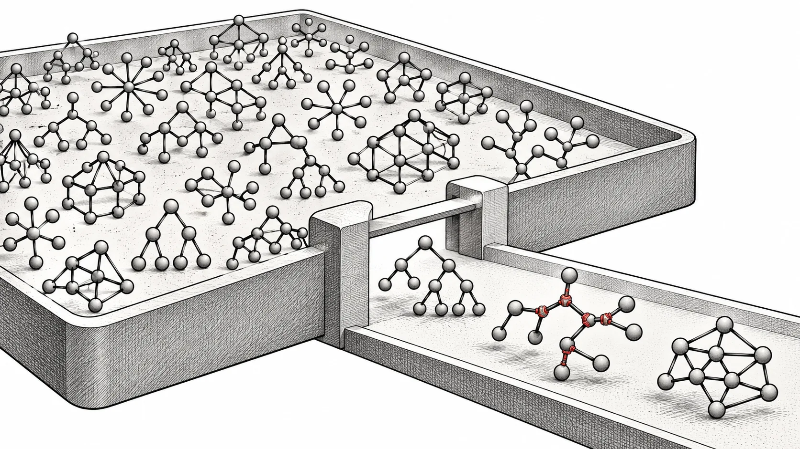

La ricerca di strutture neurali produce individui diversi. L'[integrazione dei gradienti del 3 marzo 2026][s1] in TensorNEAT permette di affinare parametri su topologie differenti. L'[aggiornamento memoria del 4 aprile][s2] riduce gli intermedi e introduce lotti di popolazione, offrendo un controllo diverso dal restringere la ricerca.

*Illustrazione concettuale: preservare la popolazione limitando il lotto di lavoro attivo.*

## Strutture diverse, una stessa operazione di gradiente

TensorNEAT rappresenta le reti NEAT con tensori di nodi e connessioni. `genome.grad` restituisce perdita scalare e gradienti dei due array. I campi strutturali, come indici e tipi di funzione, e il padding NaN ricevono gradienti nulli. I parametri numerici cambiano, la struttura codificata rimane.

La vettorizzazione JAX applica il calcolo anche a topologie diverse. L'[esempio XOR][s3] inizializza la popolazione, crea diversità con mutazioni e poi ottimizza tramite discesa del gradiente. È una base concreta per studiare insieme topologia e parametri, senza attribuire al gradiente modifiche delle connessioni discrete.

## Suddividere il lavoro, non lo spazio di ricerca

L'aggiornamento aggiunge `pop_batch_size` a NEAT e Pipeline. Il valore Pipeline prevale su quello dell'algoritmo e deve dividere la popolazione. Il precedente argomento `eval_batch_size` viene sostituito, quindi le configurazioni esistenti vanno aggiornate.

Sul singolo dispositivo, la trasformazione entra nel ciclo `jax.lax.scan`. Il pipeline trasforma e valuta un lotto alla volta invece di materializzare subito gli intermedi di adiacenza densa dell'intera popolazione. Anche la mutazione segue questo controllo. La popolazione resta uguale; cambia il lavoro simultaneo. È utile quando serve diversità ma la memoria GPU è al limite.

## Ricerche senza grandi intermedi di confronto

Il crossover sostituisce confronti annidati con hash e ricerca ordinata; anche le chiavi di connessione vengono associate agli indici dei nodi tramite ordinamento e ricerca. Si riducono array temporanei che crescono insieme a popolazione e capacità delle reti.

Il commit riporta traiettorie identiche per 15 generazioni a seme fisso con DefaultGene e OriginGene. È un risultato di regressione specifico, non una promessa per ogni dipendenza e dispositivo. Gli script di correttezza e memoria permettono di esaminare implementazione e affermazioni insieme.

## Scegliere il lotto con un esperimento riproducibile

Parta da un piccolo fitting di funzione, fissando limiti di nodi e connessioni. Registri la sequenza senza lotti, poi scelga una dimensione che divida la popolazione. Verifichi prima la correttezza, poi misuri picco di memoria, compilazione e tempo per passo separatamente. Un lotto più piccolo riduce memoria ma cambia anche il parallelismo.

Per i gradienti, usi XOR con perdita e tasso di apprendimento espliciti. Per la memoria, fissi lo [stato sorgente di aprile][s4]. TensorNEAT usa JAX; l'integrazione EvoX del README riguarda il ramo dell'epoca JAX, importante nella composizione dell'ambiente. Diventa così più chiaro quanto spazio di ricerca strutturale e parametrica rientri nel budget di memoria.

[s1]: https://github.com/EMI-Group/tensorneat/pull/37
[s2]: https://github.com/EMI-Group/tensorneat/commit/ce27fa9f794928c9416d9f12c398f58481c821ce
[s3]: https://github.com/EMI-Group/tensorneat/blob/ce27fa9f794928c9416d9f12c398f58481c821ce/examples/func_fit/xor_grad.py
[s4]: https://github.com/EMI-Group/tensorneat/tree/ce27fa9f794928c9416d9f12c398f58481c821ce
