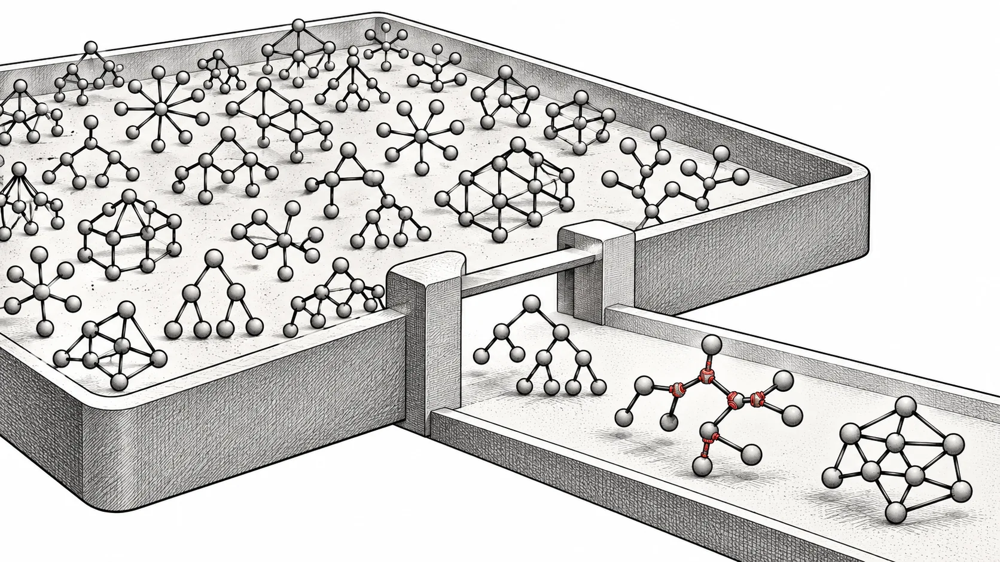

即使儲存基因組所需空間足夠，神經網路種群也可能耗盡 GPU 記憶體，因為變換和評估還會建立工作陣列。TensorNEAT 的 [2026 年 4 月 4 日更新][s2] 將變換移入順序種群批次，並減少查詢中間量，讓研究者在保留候選總數的同時控制工作集。

*概念插畫：保留整個種群，同時限制當前處理批次。*

## 分批處理工作集，保留搜尋空間

4 月更新為 NEAT 和 Pipeline 增加 `pop_batch_size`。Pipeline 中的值會覆蓋演算法設定，且種群大小必須能被批次大小整除。舊的 Pipeline 參數 `eval_batch_size` 被替換，已有配置需要相應遷移。

單裝置評估路徑把變換移入 `jax.lax.scan` 批次迴圈，不再先物化整個種群的稠密鄰接中間量，而是逐批變換並評估。變異操作也使用種群批次控制。種群總量不變，改變的是同時存在的工作集。當實驗需要保持多樣性卻觸及 GPU 記憶體上限時，這一區別很重要。

關鍵在於從哪裡開始分批。如果先變換整個種群，再拆分評估，大型鄰接中間量已經分配。將兩項操作都移入 scan 迴圈體，才能改變其生命週期。提交描述的中間量形狀從“種群 × 節點 × 節點”變成“批次 × 節點 × 節點”。這是實現層面的比較，不是總裝置記憶體公式：基因組、持久狀態和其他緩衝區仍佔用空間。[變換改動][s2]

分批是一種執行選擇，不會選出更少的存活個體，也不改變實驗請求的種群數量。相反，縮小種群會改變參與搜尋的候選，可能改變搜尋本身。排查記憶體不足時，應區分這兩個設定。一個有用的初步比較，是固定種群，只改變能整除種群的工作批次大小。

## 查詢不再需要大範圍比較中間量

更新還用雜湊匹配及排序查詢替換交叉中的巢狀比較，並透過排序與搜尋把連線鍵對映到節點索引。這些改變針對的是種群規模和網路容量同時增大時產生的大型臨時陣列。

提交報告稱，在其固定種子比較中，DefaultGene 和 OriginGene 配置的 15 代演化軌跡一致。這是特定回歸結果，並不意味著任意依賴版本或硬體都能重現所有軌跡。儲存庫保留了正確性及記憶體分析指令碼，便於結合實現檢查相關結論。

## 用可重現實驗選擇批次大小

先選小型函式擬合任務，固定節點與連線上限，記錄不分批時的損失或適應度序列，再選擇能整除種群大小的批次。先比較正確性，再分別測量峰值記憶體、編譯時間和每步耗時。更小的批次可以減少記憶體壓力，也會改變可並行的工作量。

使用[4 月原始碼快照][s4] 固定配置語義，包括已改名的批次引數。TensorNEAT 基於 JAX，其文件中的 EvoX 整合指向 JAX 時期的 EvoX 分支；測量時應記錄依賴版本。如果實驗還需要最佳化網路引數，獨立的[種群梯度文章][gradient] 解釋了該學習路徑。先確認改變批次仍保留所選執行的結果，再評估記憶體與時間的取捨。

[s2]: https://github.com/EMI-Group/tensorneat/commit/ce27fa9f794928c9416d9f12c398f58481c821ce
[s4]: https://github.com/EMI-Group/tensorneat/tree/ce27fa9f794928c9416d9f12c398f58481c821ce
[gradient]: /zh-tw/news/tensorneat-population-gradients
