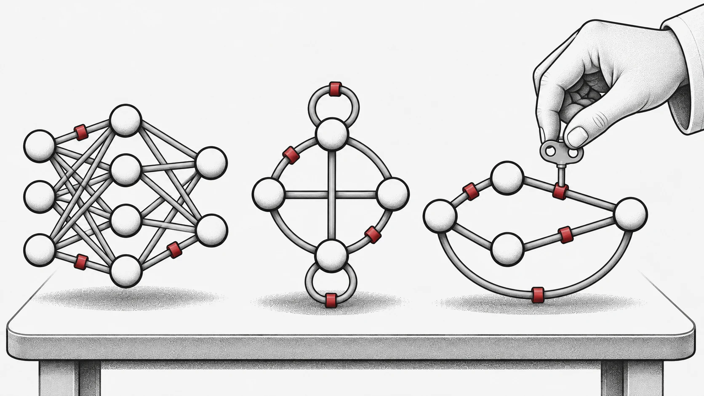

A population of neural networks can contain many different connection patterns. Fitting their parameters does not have to mean writing a separate training loop for every structure. TensorNEAT's [PR #37][s1], merged into main on March 3, 2026, adds gradients through its tensorized genomes and a JAX-vectorized path for refining the population.

*Concept illustration: tune continuous parameters without replacing each network's topology.*

## Different structures can share a gradient operation

TensorNEAT represents NEAT networks as tensorized node and connection data. Its `genome.grad` interface returns a scalar loss and gradients for both arrays. Structural fields, such as indices and function types, and NaN padding receive zero gradients. The operation refines numerical parameters while preserving the encoded structure.

JAX vectorization can apply this calculation across a population even when its networks have different topologies. The [documented XOR example][s3] initializes a population, creates structural diversity through mutation and then optimizes the resulting networks with gradient descent. This supplies a concrete experimental building block: topology search and parameter refinement can be studied together without pretending that a gradient changes discrete connections.

## Make the forward path differentiable

The implementation computes a scalar loss through the genome's transform and forward operations, then asks `jax.value_and_grad` for derivatives with respect to the node and connection arrays. A vector input takes a single forward path; a batch of inputs uses vectorized forward evaluation. This keeps the loss definition explicit: changing the objective is the caller's choice, rather than an implicit property of the network representation. [Gradient implementation][implementation]

Supporting that operation required changes below the API. The default genome's traversal uses a bounded `jax.lax.fori_loop`, and connection and aggregation operations pass validity masks instead of allowing unused NaN entries to contaminate arithmetic. Padding remains part of the representation; it is not a trainable connection. Structural mutation and numerical refinement therefore remain separate operations, even when they share the same arrays.

## An XOR example separates diversity from learning

The merged example initializes 1,000 networks for three-input XOR and applies 20 mutation rounds with distinct random keys. Only then does it run gradient descent, with learning rate 0.5 and a limit of 500 steps. The gradient phase uses `jax.jit(jax.vmap(...))` across individuals and does not perform evolutionary selection. This is a source-provided demonstration of refining varied structures, not evidence that gradient descent replaces topology search. [Complete example][s3]

Read the validity count alongside best and mean loss. A disconnected candidate can still produce nonfinite outputs; the example filters finite losses for its progress report, and the tests preserve NaN output for disconnected networks. A falling best loss alone would not tell you how much of the population is usable. Inspect the selected network's predictions after optimization as well as its aggregate score.

## Check derivatives before extending the experiment

The added tests cover finite gradients for connected default and recurrent genomes, compiled differentiation, population batching, loss reduction and a finite-difference comparison. For a custom task, begin with the versioned XOR example, then change the loss while keeping inputs and topology limits explicit. Check finite gradients and structural fields before interleaving learning with mutation. The later [bounded-memory execution update][memory] changes the working batch; it is a separate control from how parameters learn.

[s1]: https://github.com/EMI-Group/tensorneat/pull/37
[s3]: https://github.com/EMI-Group/tensorneat/blob/bec15bb5bd497dfd1b7ea765fa0b9f9a095a4709/examples/func_fit/xor_grad.py
[implementation]: https://github.com/EMI-Group/tensorneat/blob/bec15bb5bd497dfd1b7ea765fa0b9f9a095a4709/src/tensorneat/genome/base.py
[memory]: /news/tensorneat-gradient-memory
