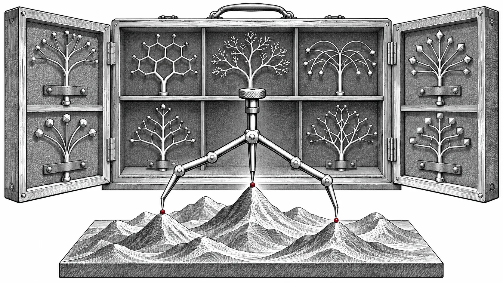

L'optimisation multiobjectif demande plus qu'un évaluateur rapide : une sélection qui conserve les compromis, des formules correctes et un état restaurable. [EvoMO v0.3.1][s1], publié le 8 octobre 2026 à l'heure de Pékin, complète la documentation de la série. Les principales capacités et corrections arrivent avec [v0.3.0 le 24 septembre][s2].

*Illustration conceptuelle : différents algorithmes explorent différents compromis utiles.*

## Davantage d'algorithmes sur une base tensorielle commune

La version 0.3.0 ajoute 48 algorithmes multiobjectifs tensorisés. Leur base commune facilite la comparaison dans un même flux d'évaluation, tout en préservant leurs règles différentes de sélection, variation et mise à jour d'état.

Pour étudier des objectifs concurrents, fixez problème, bornes, population et budget en changeant seulement d'algorithme. L'intérêt est de disposer de comportements de recherche différents. Le nombre d'algorithmes ne prouve pas qu'une méthode produira de meilleurs compromis pour une tâche donnée.

## Les corrections changent aussi les comparaisons

La version corrige mises à jour et sélection dans plusieurs méthodes. Le tri non dominé s'arrête après le front limite complet requis ; la distance de crowding traite objectifs constants, petites populations, masques et placement. PyTorch reste l'implémentation par défaut ; Triton est une option expérimentale explicite. [Modifications de sélection][s3]

ZDT1–4 et ZDT6 reçoivent des corrections d'évaluation par ligne, dont le calcul dépendant de la dimension pour ZDT6. L'hypervolume Monte Carlo est corrigé pour minimisation, référence, entrées vides et appareil d'échantillonnage. Si une étude utilisait ces chemins, gardez les anciens résultats et refaites une comparaison contrôlée sans mélanger des définitions différentes.

## Vérifier séparément contraintes et simulation

La série reprend les 86 benchmarks contraints, NSGA-II sous contraintes et `UnifiedWorkflow` introduits dans v0.2.2. Elle ajoute enregistrement différé des tampons de contraintes, restauration de checkpoints et ressources de fronts de Pareto dans les distributions. [Base contrainte][s4]

MoRobtrol reçoit Playground/MJX, objectifs spécifiques et visualisation, avec améliorations de normalisation et checkpoints. En robotique, consignez configuration du simulateur et objectifs aussi soigneusement que l'optimiseur : un meilleur front peut refléter un changement de tâche ou de mesure. [Simulation et intégration][s5]

## Mettre à jour avec une expérience de référence

Le [guide versionné][s6] installe EvoX avant EvoMO. Utilisez `pip install evox` puis `pip install evomo==0.3.1`, en enregistrant les dépendances résolues ; la source peut être fixée au tag v0.3.1. Ce correctif apporte la documentation, tandis que v0.3.0 décrit les changements fonctionnels.

Avant une grande campagne, vérifiez un objectif connu, un petit cas de sélection et la restauration d'état. Vérifiez faisabilité et qualité pour les contraintes ; gardez référence et échantillonnage identiques pour l'hypervolume. La [présentation de la recherche multiobjectif GPU][related] explique la tensorisation ; v0.3 offre une base plus large et mieux définie pour l'expérimentation.

[s1]: https://github.com/EMI-Group/evomo/releases/tag/v0.3.1
[s2]: https://github.com/EMI-Group/evomo/releases/tag/v0.3.0
[s3]: https://github.com/EMI-Group/evomo/pull/38
[s4]: https://github.com/EMI-Group/evomo/pull/34
[s5]: https://github.com/EMI-Group/evomo/pull/39
[s6]: https://github.com/EMI-Group/evomo/blob/v0.3.1/README.md
[related]: /fr/news/gpu-accelerated-emo
