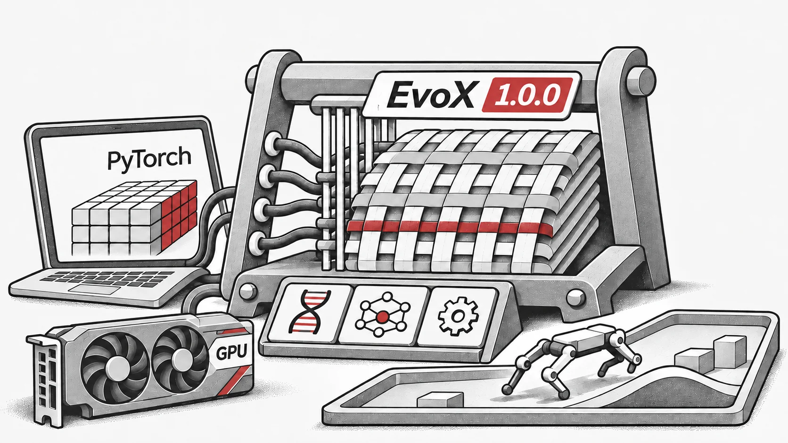

## Was ist neu in EvoX 1.0.0?
* **Volle PyTorch-Kompatibilität**: EvoX integriert sich jetzt nahtlos in das PyTorch-Ökosystem und macht es einfacher denn je, **evolutionäre Algorithmen (EAs) in Neural Architecture Search (NAS), Reinforcement Learning (RL) und Meta-Learning** anzuwenden.
* **Umfangreiche Algorithmen-Bibliothek**: Bietet **50+ evolutionäre Algorithmen**, einschließlich **GA, DE, PSO, CMA-ES, MOEAs (NSGA-II, RVEA, MOEA/D, etc.)** und modernste Meta-Evolution-Methoden.
* **Unterstützung für RL & Physik-Engines**: Kompatibel mit **Brax** und Reinforcement Learning-Umgebungen, was **Anwendungen im Bereich Evolutionary Reinforcement Learning (ERL)** ermöglicht.
* **100+ Benchmark-Probleme**: Deckt Single-Objective- und Multi-Objective-Optimierung sowie **reale technische Herausforderungen** ab.
* **Anpassbar & Skalierbar**: Unterstützt flexible Problemdefinitionen, Echtzeit-Datenstreaming und skalierbare verteilte Workflows.

## Brückenschlag zwischen Evolutionärer Berechnung und Deep Learning
EvoX 1.0.0 stellt einen **bahnbrechenden Schritt** bei der Zusammenführung von **evolutionären Algorithmen mit modernen Deep Learning Frameworks** dar. Die Integration mit PyTorch ermöglicht es Forschern und Anwendern, **gradientenbasiertes Lernen mit evolutionärer Suche zu kombinieren**, was neue Möglichkeiten in der **KI-gesteuerten Optimierung, dem automatisierten maschinellen Lernen (AutoML) und komplexen Entscheidungssystemen** eröffnet.

## Open-Source & Community-Getrieben
EvoX ist jetzt auf **GitHub** verfügbar: [https://github.com/EMI-Group/EvoX](https://github.com/EMI-Group/EvoX "https://github.com/EMI-Group/EvoX")

## Ressourcen

- [GitHub](https://github.com/EMI-Group/evox)
- [Dokumentation](https://evox.readthedocs.io/en/latest/)
