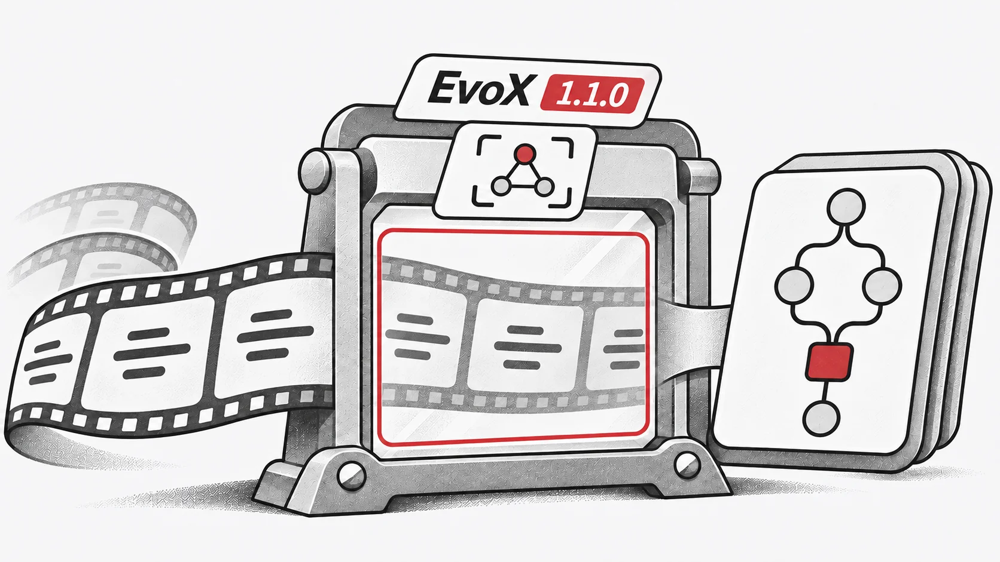

## Atualização do compilador

EvoX 1.1 substitui TorchScript por `torch.compile`. TorchDynamo captura grafos de cálculo durante a execução de Python.

## Compilação de fluxos de trabalho

As etapas do fluxo podem ser compiladas para otimizar em conjunto as operações tensoriais suportadas pelo compilador PyTorch.

## Compatibilidade

A captura depende das operações e do fluxo de controlo. Código não suportado pode interromper o grafo; nem todas as chamadas a bibliotecas Python são compiladas.

## Recursos

- [GitHub](https://github.com/EMI-Group/evox)
- [Documentação](https://evox.readthedocs.io/en/latest/)
