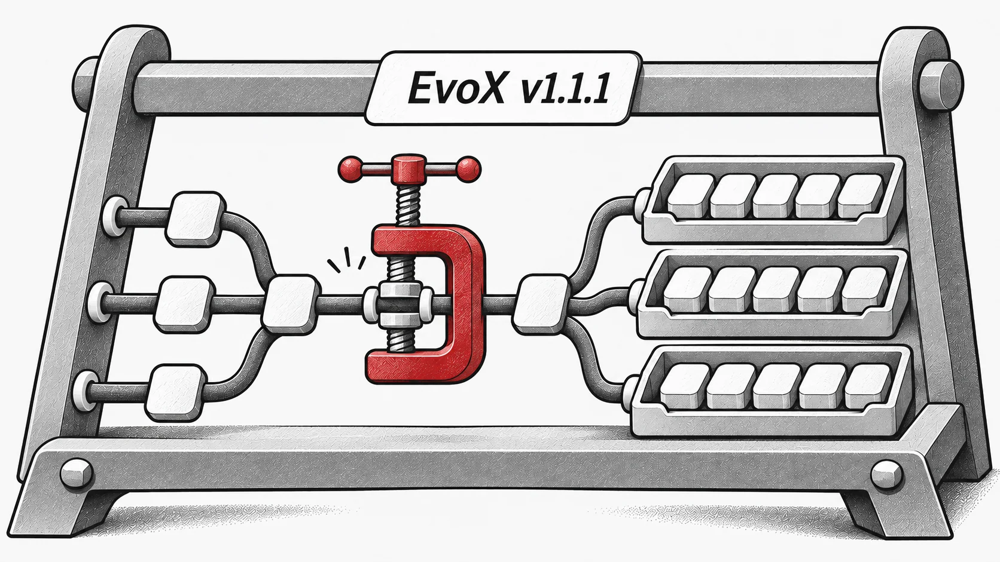

## Novedades

Esta versión menor incluye principalmente correcciones de errores y mejoras.
- Se ha corregido un problema por el cual `torch.compile` no capturaba correctamente `workflow.step`.

- Se ha corregido un problema por el cual `use_state` provocaba una ruptura del grafo.

- Se han corregido algunos usos incorrectos de los buffers del modelo.

- Se ha corregido un problema por el cual monitor.plot no funcionaba según lo previsto.

- Se ha introducido un nuevo wrapper, `evox.compile`, para solventar ciertas limitaciones de `torch.compile` y `torch.vmap`.

- Se han resuelto varios problemas relacionados con `BatchedTensor`:- Se ha corregido un error por el cual el uso de vmap en un workflow con EvalMonitor podía causar fugas de `BatchedTensor`.

- Se ha corregido un problema que impedía que HPOProblem funcionara con BraxProblem.

- Se han mejorado las implementaciones de RVEA y CSO para un mejor rendimiento y fiabilidad.

- Se ha mejorado la implementación de BraxProblem.

- Varias correcciones y mejoras menores.

## Recursos

- [GitHub](https://github.com/EMI-Group/evox)
- [Documentación](https://evox.readthedocs.io/en/latest/)
