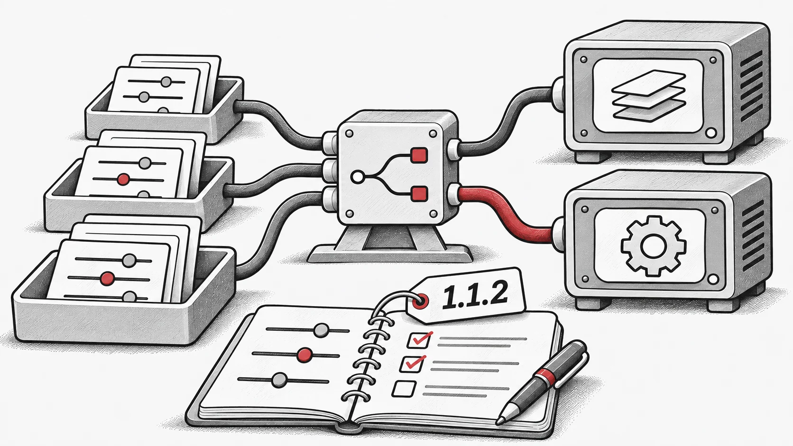

## Cambios realizados
- Se ha actualizado la documentación con notas de uso y guías para el ajuste de parámetros.

- Se han añadido nuevas funciones relacionadas con `vmap` y la optimización de hiperparámetros (HPO), además de correcciones de errores.

- Se han corregido varios problemas en la documentación.

- Se han resuelto varios errores en el código de benchmarking.

- ¡Se ha introducido soporte inicial para flujos de trabajo distribuidos!

- Registro de cambios completo: [https://github.com/EMI-Group/evox/compare/v1.1.1...v1.1.2](https://github.com/EMI-Group/evox/compare/v1.1.1...v1.1.2 "https://github.com/EMI-Group/evox/compare/v1.1.1...v1.1.2")

## Recursos

- [GitHub](https://github.com/EMI-Group/evox)
- [Documentación](https://evox.readthedocs.io/en/latest/)
