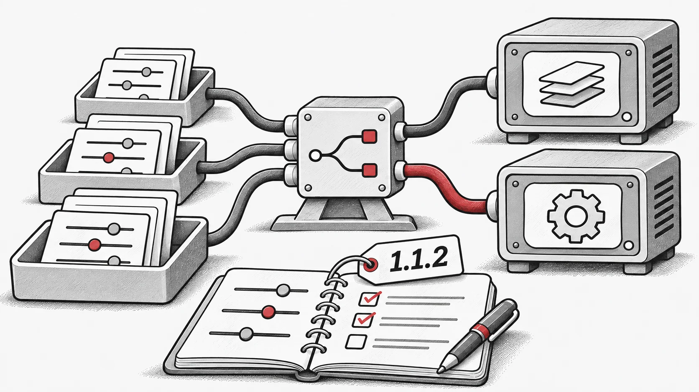

## Ce qui a changé
- Mise à jour de la documentation avec des notes d'utilisation et des conseils sur le réglage des paramètres

- Ajout de nouvelles fonctionnalités liées à `vmap` et à l'optimisation des hyperparamètres (HPO), ainsi que des corrections de bugs

- Correction de divers problèmes de documentation

- Résolution de plusieurs bugs dans le code de benchmarking

- Introduction d'une prise en charge initiale des workflows distribués !

- Journal complet des modifications : [https://github.com/EMI-Group/evox/compare/v1.1.1...v1.1.2](https://github.com/EMI-Group/evox/compare/v1.1.1...v1.1.2 "https://github.com/EMI-Group/evox/compare/v1.1.1...v1.1.2")

## Ressources

- [GitHub](https://github.com/EMI-Group/evox)
- [Documentation](https://evox.readthedocs.io/en/latest/)
